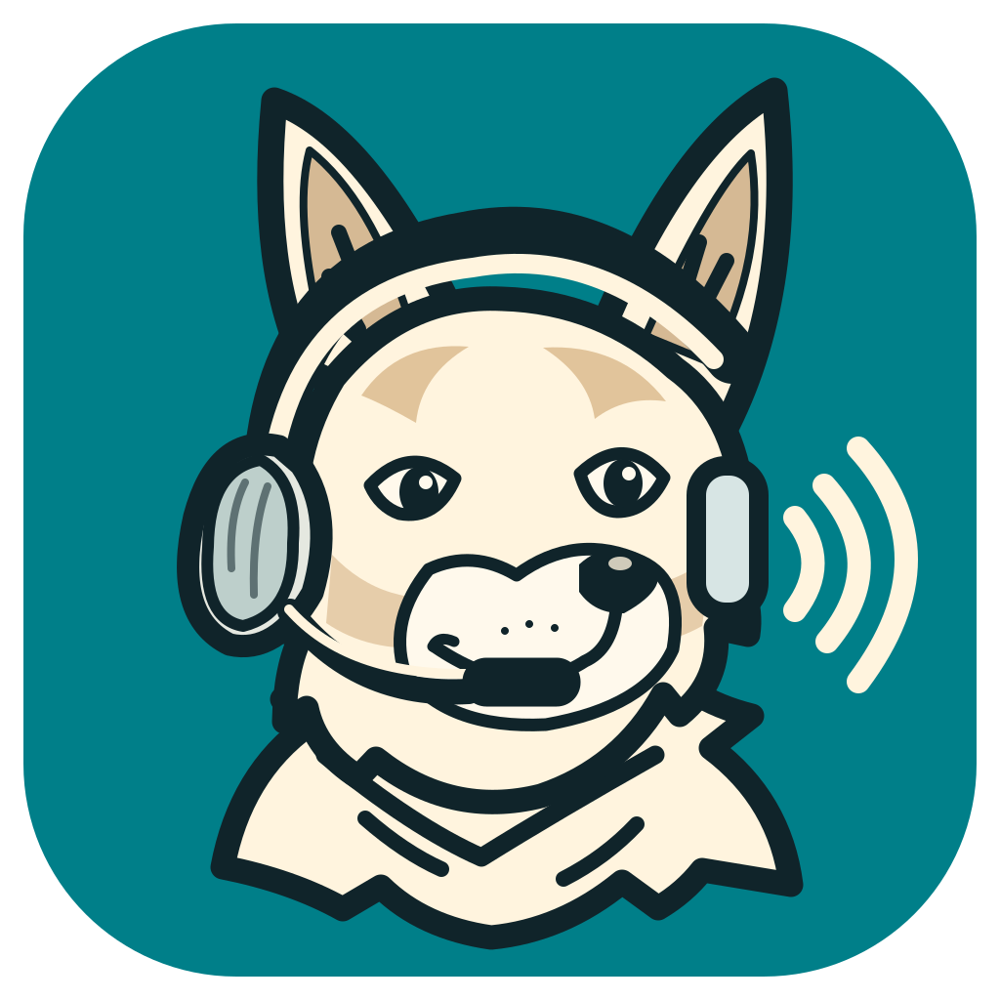

# CommSCraft



CommSCraft is a **clean-room, open-source Linux client for Skype for Business Server** (and Lync
Server 2013 and later), built from Microsoft's public Open Specifications, IETF RFCs and ITU-T
Recommendations. It follows the conventions of the [storytold Crafting Apps](https://github.com/storytold)
(WordCraft, GridCraft, DeckCraft, …): pure Rust where possible, measured parity with the target
application, a ranked work list, and nothing copied from Microsoft products.

> **Stage: M4 closed, M5 (video) next, pre-alpha.** Sign-in, presence, instant messaging (1:1 and group),
> address book search, audio and video calls, meetings and telephony (transfer, forwarding, park, delegates,
> emergency calls) exist as building blocks that pass offline tests (37 crates,
> 393 tests) and can be used through the command-line tool `commscraft-cli`. **Nothing is marked as
> verified against a real server**; there is no graphical interface yet. Read [`ROADMAP.md`](ROADMAP.md)
> for where the project stands.

CommSCraft is not affiliated with, endorsed by or sponsored by Microsoft. "Skype for Business",
"Lync" and "Microsoft" are trademarks of Microsoft Corporation; they are used here only to describe
what CommSCraft interoperates with.

## What CommSCraft is meant to do

Sign in to an on-premises Skype for Business Server (2015, 2019 or Subscription Edition) from Linux
and take part in daily work the way the Windows desktop client does:

- sign-in (NTLM, Kerberos, TLS-DSK with client certificate), registration and in-band provisioning;
- presence, contact list, address book search, photos;
- instant messaging 1:1 and in conferences;
- audio and video calls (G.711, G.722, H.264 UC) with ICE, TURN and SRTP;
- conferences (join, lobby, roles, A/V, muting), telephony features (forwarding, hold, transfer, park);
- viewing desktop and application sharing;
- Exchange integration (calendar state, out-of-office note, conversation history, voicemail).

What it will **not** do: connect to Skype for Business Online (retired by Microsoft) or Microsoft
Teams; implement codecs that need a Microsoft licence (RTAudio, RTVideo). Details:
[`docs/target-app-parity.md`](docs/target-app-parity.md).

## What works today

Status from [`docs/target-app-parity.md`](docs/target-app-parity.md) (2026-10-31): of 52 client
functions, 12 are implemented and tested offline as a whole, 18 in parts, 20 not started.

| Area | In the code (tested offline) | Not yet |
|---|---|---|
| Sign-in | Autodiscover (HTTPS only), DNS SRV, TLS 1.2/1.3, NTLM with MS-SIPAE signing, registration with GRUU, home-pool redirect, keep-alive, in-band provisioning, sign-out | Kerberos, TLS-DSK |
| Presence and contacts | own state, contacts' presence (live), contact list (read), address book search | editing the contact list, privacy/blocking, offline address book, photos |
| Instant messaging | 1:1 with typing indicator, group conversations (ad-hoc conference, invitations, delivery reports) | rich text, file transfer |
| Audio calls | G.722 and G.711, SRTP, ICE, MS-TURN relay over UDP and over TCP 443 (pseudo-TLS), DTMF, mute, hold/resume, early media, call admission control, ALSA/PipeWire devices | own music on hold |
| Meetings | join by address or meeting link, lobby, roster, audio in the A/V MCU (SRTP/SSRTP), mute yourself; as presenter: admit, roles, lock, remove, mute others or the audience | scheduling, video |
| Telephony | phone numbers with the dial plan (phone-context), calls from gateways with caller number, call back, anonymous callers, early media, call transfer (blind and with consultation), call forwarding and simultaneous ring | team/delegate calls, park, E911, voicemail |
| Video, screen sharing, Exchange | – | everything (M5–M7) |

## Building and running

Requirements: Rust (stable) and the ALSA development files (`libasound2-dev` / `alsa-lib`).

```
cargo build --release
./target/release/commscraft-cli audio-check            # local microphone/speaker check, no network
./target/release/commscraft-cli interactive --aor sip:USER@DOMAIN --user NTLM_USER --domain NTLM_DOMAIN --authorized
```

`commscraft-cli` connects to a server only with `--authorized`: it is meant for runs on systems you
are allowed to test. In `interactive` mode the commands are `/contacts`, `/status`, `/chat`,
`/group`, `/invite`, `/join`, `/search`, `/call`, `/answer`, `/hangup`, `/dtmf`, `/mute`, `/to`,
`/end`, `/quit`; `commscraft-cli` without arguments prints the full usage.

## How the work is documented

| File | Content |
|---|---|
| [`ROADMAP.md`](ROADMAP.md) | Stage, headline numbers, progress log |
| [`docs/roadmap.md`](docs/roadmap.md) | Milestones, current focus, alpha gate |
| [`docs/gaps.md`](docs/gaps.md) | Ranked list of everything missing or unresolved |
| [`docs/interop-tests.md`](docs/interop-tests.md) | Test cases only the owner runs against a real server, each with a default |
| [`docs/security.md`](docs/security.md) | Security by design: threat model and the rules every crate follows |
| [`docs/target-app-parity.md`](docs/target-app-parity.md) | The target client and the 52 functions with their evidence status |
| [`docs/architecture.md`](docs/architecture.md) | Layers and crates |
| [`docs/protocol/`](docs/protocol/) | The protocol analysis: evidence per protocol, function matrix, conflicts/gaps/open points, source registers |
| [`docs/decisions.md`](docs/decisions.md) | Decisions the owner has to take, and decisions already taken |
| [`AGENTS.md`](AGENTS.md) | Rules for contributors and AI agents (clean room, evidence, security) |

## Clean room and sources

- Protocol behaviour comes from Microsoft Open Specifications ([MS-SIPAE], [MS-SIPREGE], [MS-PRES],
  [MS-ICE2], [MS-SDPEXT], …), IETF RFCs and Internet-Drafts, and ITU-T Recommendations. Every
  requirement is cited by document, edition, section and page.
- Specification PDFs are **not** stored in this repository; only our own descriptions with citations.
- No code, assets, icons or text are taken from Microsoft products. Third-party open-source
  implementations are read only to confirm behaviour and are cited as secondary evidence; their code
  is not copied.
- Interoperability tests against real servers are run only by the project owner on authorized
  systems ([`docs/interop-tests.md`](docs/interop-tests.md)); their results are not published.
  All work in this repository is verified offline.

## License

CommSCraft is dual-licensed under [MIT](LICENSE-MIT) or [Apache-2.0](LICENSE-APACHE), at your option.
Copyright (c) 2026 the CommSCraft contributors.
