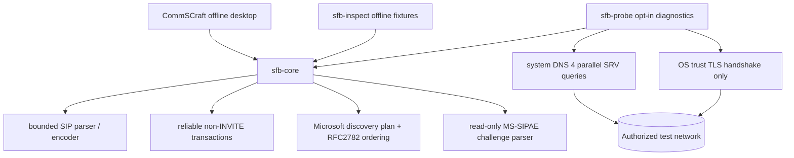
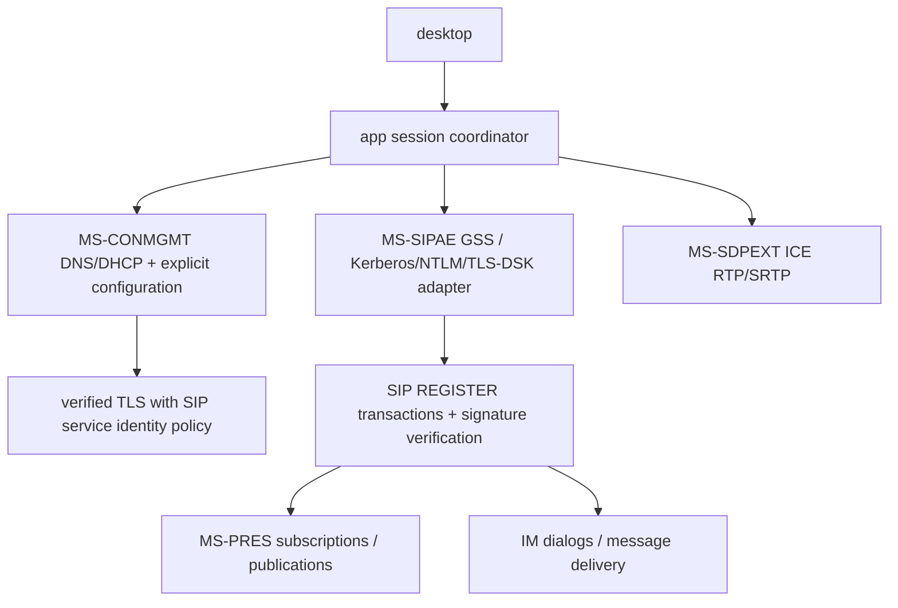

# Architecture (v0.3)

**Trust boundary:** The desktop UI remains offline. Only the separate CLI
`sfb-probe`, invoked with explicit `--dns` or `--tls-probe` flags, performs any
network I/O. No component performs authenticated SIP registration, presence
publication, IM delivery, calls, conferencing, or any media capture.

## Separation of concerns

- `sfb-core`: pure Rust, no network or cryptography dependencies. Discovery
  plan, RFC 2782 random-order resolver logic via injected RNG, parser and
  transactions are deterministically testable.
- `sfb-probe`: Hickory for system-configured DNS-SRV (parallel requests),
  `native-tls` for a TLS handshake with chain/hostname checking, OS socket
  resolver for TCP connection attempts. It does not send SIP bytes.
- `sfb-inspect`: privacy-preserving inspection of local sample SIP packets.
- `commscraft`: **CommSCraft** native application (offline prototype) with sample contacts and read-only diagnostics.

## Future production data flow (not implemented)

## Registration safety invariants

- The UI must never show an authenticated/registered status until a verified
  Microsoft authentication security association and REGISTER response are
  established; the existing demo simulator is explicitly separate.
- 401/407 from MS-SIPAE ends the original non-INVITE transaction. Any token
  exchange uses newly correlated SIP transactions, replay protection and
  correctly verified server identity; no hand-written NTLM cryptography.
- Untrusted DNS SRV data must never disable TLS or redirect credentials to a
  non-authorized identity. The current probe restricts DNS subtree and has no
  credential support. Microsoft registration/certificate rules may require
  additional bindings before interoperability is safe.

## v0.4 offline REGISTER layer

`registration.rs` produces an offline REGISTER plan with an externally provisioned identity, owns one reliable non-INVITE transaction, and classifies 1xx/401/407/423/200/other-final and timeouts. It never creates a security association or performs sign-in. A matching Contact `+sip.instance` and Microsoft `gruu` value lead only to `UnverifiedAcceptance`; signed server authentication under MS-SIPAE is a separate, missing requirement. `sfb-inspect --register-demo` exercises a synthetic scenario without network access. See `registration-protocol.md`.

### v0.5 incoming authentication verification (offline only)

`challenge.rs` (401/407 scheme offers) -> `security.rs::SecurityAssociation::begin`
(establishing) -> parse `Authentication-Info` -> build §3.2.5.2 signed buffer ->
`ServerMicVerifier` (HMAC-SHA256 with separately supplied TLS-DSK **server** key,
or a future audited GSS provider) -> replay window -> SA established.

This model is intentionally disconnected from `registration.rs`: no valid
TLS-DSK handshake / GSS credentials are available, and so no live REGISTER
`200 OK` is promoted to signed-in status. Any real integration also needs
transaction matching, service identity binding and reconnect/timeouts.

## New offline protocol modules in 0.6.0

`presence.rs` observes baseline SIP PIDF SUBSCRIBE/NOTIFY state only;
`im.rs` models post-INVITE dialog signaling and conservative plain-text MESSAGE;
`sdp.rs` inspects RFC 8866 session media descriptions without activating them.
There is no live transport or authenticated message adapter connecting these
components. Full Windows client parity remains blocked on MS-SIPAE handshake,
server interoperability, media engines, MCU and sharing protocol implementations.
See `docs/windows-parity.md` for the acceptance matrix and release rule.
