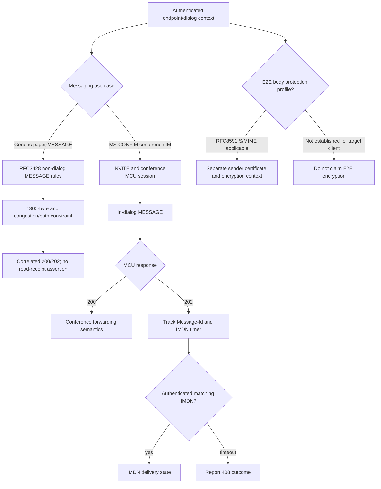

# Direct and conference IM: RFC3428 / RFC8591 and MS-CONFIM source reconciliation

**Date:** 2026-10-22. **Research-only.** Original normative primary RFCs: [RFC 3428, December 2002](https://www.rfc-editor.org/rfc/rfc3428), §§2–11; [RFC 8591, April 2019](https://www.rfc-editor.org/rfc/rfc8591), §§3–12, which explicitly updates RFCs 3261/3428/4975. Microsoft primary source: owner-supplied original **MS-CONFIM v20250520, rev 11.0**, and its extracted text. Secondary user-supplied `assessments/messaging-and-conference-im.md` was reviewed as a *research hypothesis*, not treated as normative.

## Critical applicability finding

**MS-SIPAPP is not a generic one-to-one messaging specification.** Its original supplied PDF is titled *Session Initiation Protocol (SIP) Application Protocol*, and its technical body addresses telephony application features including parked calls. The source list for direct IM must instead start with RFC3428, generic RFC3261 dialogs, the targeted Skype for Business SIP profile (MS-SIPRE/MS-SIP etc.) and the concrete presence/conversation extensions. Do not infer point-to-point session establishment from MS-CONFIM's **conference** MCU INVITE/MESSAGE dialog.

## Clause-level primary evidence

| ID | Verified source | Requirement or consequence | Scope limitation |
|---|---|---|---|
| DIM-01 | RFC3428 §§3–4 | MESSAGE carries MIME body and **does not create a SIP dialog**. Can be sent inside an already established dialog. | Conference's initial INVITE is a separate MS-CONFIM requirement, not a property of generic MESSAGE. |
| DIM-02 | RFC3428 §§4,7 | UAC/UAS **MUST support text/plain**; MESSAGE request and a 2xx response do not insert a Contact header under original specification. | Historical Microsoft examples must be reconciled; cannot blindly copy a conflicting example. |
| DIM-03 | RFC3428 §§3–4,7 | A 200 acknowledges delivery to the destination application, while 202 means accepted by an intermediary for possible forwarding. Neither proves that a human read content. | MS-CONFIM MCU's 200/202 + IMDN semantics are a different, more specific profile. |
| DIM-04 | RFC3428 §8 | Out-of-dialog MESSAGE without verified all-hop congestion-controlled support has a **1300-byte total request** safety limit; concurrency throttling and path assumptions apply. | Not merely 1300 bytes of typed text. Caller next-hop TLS does not establish end-to-end congestion behavior. |
| DIM-05 | RFC3428 §11; RFC8591 §§3–7, 12 | SIP transport security and Microsoft SA MIC are **not synonyms for body end-to-end encryption**. RFC8591 revises S/MIME guidance for confidentiality, sender validation and cryptographic structures. | RFC8591 is dated 2019; do not assert every older SfB Windows client implements those algorithms without a product profile. |
| DIM-06 | MS-CONFIM §§2.2.5, 3.1–3.3 | Conferencing can establish an IM media/dialog via INVITE/SDP `m=message`, `port 5060`, `sip`, `null`; actual MESSAGE is routed in the established SIP dialog. | The SDP port value is not automatic authorization for a standalone plaintext IM transport. |
| DIM-07 | MS-CONFIM §§2.2.2, 3.3.1.5.1 | Conference MESSAGE 202 triggers `Message-Id` correlation with IMDN (application/ms-imdn+xml); client timer 10 seconds (previous report). | Must scope IDs to a conference dialog; no assumption IMDN from another context is authoritative. |
| DIM-08 | MS-CONFIM §§3.3.1.5.2, 3.3.2.5.1 | MCU may use `Ms-Sender` to convey original person as `From` holds conference URI; distinguish verified conference origin from display text claims. | Not a general peer-to-peer sender rule. |
| DIM-09 | RFC8591 §§4,7–9,12 | S/MIME content protection has its own certificates/identities and ordering; MSRP protection and chunking are covered separately. | Presence in an updated RFC does not prove any SfB server deployed MSRP for the MS-CONFIM conference profile. |

## Original-document discrepancy register

The supplied secondary assessment identified these apparent mistakes in **MS-CONFIM rev 11.0**. Each remains a *source discrepancy requiring normative/errata resolution*, not permission to relax protocol validation:

- **§3.4.1.5.2:** the text discusses an incoming INFO but calls for a response to an incoming MESSAGE. This requires disambiguation with RFC3261 method matching and RFC2976.
- **§4.2.1:** example MESSAGE 200 includes Contact although RFC3428 §7 forbids a 2xx MESSAGE response from inserting it.
- **§4.3.1:** a deleteUser example appears to reference a different person in success than the original target. Trust transaction and target identifiers, not narrative participant names.
- **§4.3.2:** an example display-text XML start-tag is malformed. Protocol parsers must not disable XML well-formedness enforcement to accept printed illustrative material.

The original Microsoft PDF text is available locally, but **these discrepancy entries need page-image verification and errata review before declaring typographic errors confirmed**, especially because extracted text can differ from rendered figures. Exact source pages and author corrections still open.

## Decision-layer and failure diagram

**This is NOT the missing Skype for Business one-to-one IM wire transcript.** That requires separate original evidence for conversation invitation, peer-dialog use, format/capability negotiation, message/INFO activity, hold/leave and endpoint routing, with exact Windows Full Client product applicability.

## Open next research

1. Check PDF page images and published errata for MS-CONFIM inconsistencies, then log confirmed editorial defects vs legitimate Microsoft exceptions.
2. Analyze RFC3428 fully for MESSAGE Contact and 1300-byte exceptions, then reconcile Microsoft-on-wire variants.
3. Inspect actual legacy Windows client one-to-one INVITE/SDP/MESSAGE/INFO flows in normative Microsoft technical sections and distinguish out-of-dialog pager use; do not generalize the conference profile.
4. Inspect RFC8591 applicability and Microsoft client crypto support rather than asserting universal S/MIME capabilities.
5. Complete MS-CONFIM IMDN XSD, SIP transaction retry and session-timer state; assign individual numbered acceptance/rejection conditions per normative clause.

**Status:** Direct RFC original and locally available conference-specification section review completed at the documented scope; direct peer Windows-client IM profile **still open**. Full corpus/feature analysis **NOT COMPLETE**. No protocol implementation, live-server testing, merges or releases.
