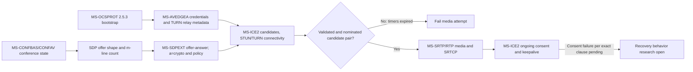

# Media and conference cross-spec normative ledger — full Microsoft May 2025 PDFs

**Research date 2026-10-22; evidence: directly inspected full owner-provided Microsoft PDF text, not only assessment reports.** Five original PDF files in `catalog.zip`: `MS-CONFAV`, `MS-ICE2`, `MS-SDPEXT`, `MS-SRTP`, `MS-AVEDGEA`, each bearing revision **v20250520 / release 2025-05-20**. Microsoft Open Specifications official landing: https://learn.microsoft.com/en-us/openspecs/office_protocols/ . This document is a **partial section-by-section analysis**, not feature-complete proof or implementation authorization.

## Original section-qualified evidence matrix

| ID | Original PDF section/page | Normative fact extracted | Role and downstream implications |
|---|---|---|---|
| AV25-01 | MS-CONFAV §3.1.5.2.1, p27 | If MCU conference notification does **not** mark `multi-view-capable=true`, client **SHOULD NOT** offer more SDP instances for a media type than represented in conference state. Extra instances can be rejected via SDP `port=0` under RFC 3264 §8.2. | Client offer is constrained by conference notifications; do not infer all possible video m-lines from local hardware. |
| AV25-02 | MS-CONFAV §3.1.5.2.1, p27 | If `multi-view-capable=true`, multiple `m=video` SDP sections may correspond to one conference video instance. Other media types retain limits. Client **SHOULD** construct per MS-SDPEXT §§3.1.5.34–35 and MS-SIPRE §3.15.4.1. | Conditional exception, not general multi-stream permission; use conference notification state to choose SDP shape. |
| AV25-03 | MS-ICE2 §3.1.6.2, p30 | After STUN binding request/response received, connectivity-check timer **MUST** reset to 5 seconds; on expiry controlling agent chooses best validated candidate pair; if none validated **MUST fail call** and **MUST NOT** issue more connectivity checks. Controlled agent stops checks at expiry. | Connectivity phase is separate from SIP transaction and SDP negotiation completion. |
| AV25-04 | MS-ICE2 §3.1.6.3, pp30–31 | ICE keepalives use STUN binding requests; after media path established if media/keepalive idle for configured interval, RTP-component keepalive timer **MUST** fire and STUN keepalive **MUST** be sent. RTCP-component keepalives **SHOULD NOT** be sent. | No invented universal fixed keepalive interval from this excerpt; configured timer value is distinct from consent freshness. |
| AV25-05 | MS-ICE2 §3.1.6.4, p31 | If USE-CANDIDATE checks timer expires before nominations finish, call **MUST fail**. | Nomination completion is an independent gate. |
| AV25-06 | MS-ICE2 §3.1.6.5, p31 | Consent freshness timer **SHOULD** reset to 30 seconds after path established; consent requests **SHOULD** occur every 5 seconds, use valid RFC 5389 STUN binding requests, with fresh transaction ID **MUST** each time. | Path consent is a post-connect ongoing property, not once-only ICE validation. Remaining expiry/failure handling in clause needs further extraction. |
| AV25-07 | MS-SDPEXT §3.1.5.1, pp19–20 | `a=crypto` format per RFC 4568 with **single whitespace**, no HTAB; crypto-suite **MUST** be `AES_CM_128_HMAC_SHA1_80`; decimal crypto tag unique across `a=crypto` and `a=cryptoscale`; one key-params element per line; inline key method required; no session-param. | Microsoft's extension to allow the attribute even with `RTP/AVP` SDP offer is not generic RFC 4568 behavior; optional SRTP negotiation requires a distinct profile check. |
| AV25-08 | MS-SDPEXT §3.1.5.1, p20 | Key lifetime written in sent SDP **MUST** be `2^31`; received advertised lifetime ignored and treated as `2^31`. MKI **SHOULD** be used, if used length **MUST** be 1 byte. | Strict offer/answer security parser differences and format constraints. This does **not** authorize using deprecated algorithms outside historical interoperability scope. |
| AV25-09 | MS-SRTP §3.1.5.1.2, p12 | Incoming RTP implements RFC 3711 §3.3 with crypto context from MS-SRTP §3.1.3.1 and SSRC; replay checklist **MUST** contain 64 entries. | Replay protection is specific to RTP crypto context, separate from MS-SIPAE 256-window SIP MIC. |
| AV25-10 | MS-SRTP §3.1.5.2.1–2, p13 | SRTCP packets **MUST** be encrypted and authenticated; incoming packets **MUST** be encrypted regardless of e-bit; SRTCP index shared across all media streams; replay checklist **MUST** be 64. | SRTCP independent format and shared-index constraints; do not conflate RTP SSRC and SRTCP shared counter. |
| AV25-11 | MS-SRTP §5.1, p15 | Send/receive directions in one SRTP session do not use same master key; SDP key exchange assumed over secure transport (e.g., TLS); RTP initial sequence must avoid values near 65535 due to rollover risks. | Security and historical operational caveat; independent TLS identity verification still required. |
| AV25-12 | MS-AVEDGEA §3.1.5.4, pp22–23 | When request contains duration, server token lifetime **MUST** be min(requested duration, configured default); otherwise configured default. Base64 username/password returned for each credentialsRequest; response `credentialsRequestID` **MUST** equal request identifier. | **Server** generation rules, client verification of correlation is inferred rather than a claimed explicit client MUST. |
| AV25-13 | MS-AVEDGEA §3.1.5.4, p23 | When request specifies location, server returns matching location's TURN relay info; otherwise both intranet/Internet. `route=directip` requires direct IP field, absent or `loadbalanced` requires hostName, which **SHOULD** resolve to actual relay. | Client edge selection depends on returned route and network identity; must not invent TURN destination. |
| AV25-14 | MS-AVEDGEA §§3.1.5.5–6, p23 | `reasonPhrase` values map to SIP outcomes: `OK` → 200; `Request Malformed` → 400; `Forbidden` → 403, etc. Successful output echoes from/to/requestID. | Do not treat all credential failures as SIP auth 401 or route them through SIPAE NTLM SA challenges. |

## Combined conditional state/dependency diagram

**Diagram classification:** directly normative nodes for SDP shaping, ICE timeout/nomination, packet security; ordering across independent mechanisms is a *cross-spec reconstruction*, not a normative sequential wire transcript. Distinguish joining conference using C3P from peer/multimedia INVITE, and all of these from actual ICE/RTP traffic.

## Precise protocol-layer separation

1. **Signaling authentication:** MS-SIPAE SIP HMAC/GSS MIC and registration security association; **its replay window is not 64**.
2. **Media security negotiation:** SDP `a=crypto`, possibly SSRTP and negotiation constraints, MS-SDPEXT rules; SDP over secure signaling must be evaluated for policy requirements.
3. **Connectivity and ongoing peer consent:** MS-ICE2 STUN binding and nomination, TURN/relay credentials from MS-AVEDGEA; timer expiry may independently fail an otherwise accepted SIP call.
4. **Media packet cryptography:** MS-SRTP §§3.1.5 and RFC 3711; replay tracking per context and SRTCP shared index.
5. **Conference topology:** MS-CONFAV notification state controls SDP instances and thus what is actually offered, with conditional multi-view capability.

## Issues requiring document closure

- MED-01: MS-SDPEXT §§3.1.5.2, 3.1.5.8, 3.1.5.34–35; MS-SSRTP and MS-SIPRE §3.15.4.1 byte-accurate media negotiation, codec/crypto capabilities and SDP attribute ordering.
- MED-02: MS-ICE2 §3.1.4.8.* full nomination, controlled/controlling roles, consent failure, restart and ICE1 compatibility; RFC 5245 vs modern RFC 8445 update status.
- MED-03: MS-CONFAV server §§3.2.5 and C3P XML state changes (MS-CONFBAS, MS-CONFPRO, MS-XMLMC), MCU addUser roles and dial-out errors.
- MED-04: MS-AVEDGEA full client §3.2 and temporary TURN credential consumption, renewal and security; avoid treating relays as unconditional in every topology.
- MED-05: Entire codec matrices, optional encryption policy, legacy version negotiation and end-to-end security threat model not yet validated.
- MED-06: Document-by-document checks of all 112 accompanying assessment reports, original 151 PDFs and cross-reference closure not yet performed.

**Status: substantial directly validated 2025 media security and signaling sections, globally NOT COMPLETE.** Documentation-only; no live-server tests, protocol code, merges or releases.
