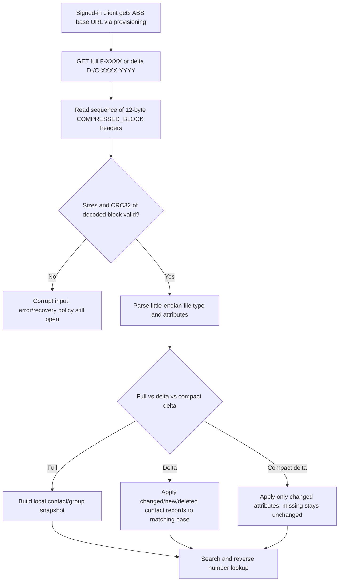

# MS-ABS 10.1 (2025-08-19): offline address-book file, delta semantics and normalization — original-source analysis

**Research date 2026-10-22; not complete protocol coverage.** Primary original **[MS-ABS] Address Book File Structure, revision 10.1, v20250819**, owner's original PDF/text in `catalog.zip`. Directly inspected **§§1.2–1.5, 2.1.1–2.1.2, 2.2.1–2.2.16, 5.1–5.3 and section 7 product notes** plus original figure on PDF page **20/79**. Supporting *overview* **[MS-OCSPROT] revision 9.0, v20250520, §2.5.7 pp34–35**. Official original URLs are in `catalog/inventory.json` under IDs MS-ABS and MS-OCSPROT. Source categories: **P** direct primary clause; **S** cross-spec synthesis; **U** unresolved. All technical actions refer to an eventual parser design **after** the analysis gate; no code or network tests now.

## 1. Distribution and discovery versus local file semantics

**P (MS-ABS §1.3; MS-OCSPROT §2.5.7):** The address-book server produces daily full and delta snapshots, stores them as compressed files and clients download them using **HTTP GET** using a **base URL obtained from in-band provisioning after sign-in**. The Windows-client overview says full book download and later delta download; after local processing the data supports **offline search** and **reverse number lookup**. **MS-ABS specifies file structure, not SIP authentication/roster subscriptions or a complete HTTP service discovery standard.** HTTPS endpoint / authentication / transport certificate requirements need to be established by the surrounding provisioning and service documents, not inferred from file layout alone.

| ID | Exact original clause | First-party requirement |
|---|---|---|
| ABS-01 | MS-ABS §1.3 | Filenames: `F-XXXX.lsabs` full, `D-XXXX-YYYY.lsabs` conventional delta, `C-XXXX-YYYY.lsabs` **compact delta**; `.dabs` variants are device-specific minimal book and omit group entries. Client must distinguish these formats; do not treat them as one binary parser. |
| ABS-02 | §1.3 | `XXXX`/`YYYY` are four-digit hexadecimal **zero-based day count after 2001-01-01 00:00:00 UTC**, `XXXX < YYYY` for deltas. Local calendar formatting is not a valid substitute. |
| ABS-03 | §1.3.4 | ABF numeric records are **little-endian** despite big-endian-style diagrams. (Checked in rendered original PDF p20.) |
| ABS-04 | §§1.3.2, 2.2.1–2 | File is concatenation of `COMPRESSED_BLOCK` records. Each has **12-byte header**: CRC32 (4), CompressedSize (4), DecompressedSize (4); compressed data follows with length = CompressedSize. `CompressedSize <= 0x10000`; `DecompressedSize >= CompressedSize`; if equal, data is not compressed, no decompression step. |
| ABS-05 | §5.1 | CRC32 over **decompressed** content: standard table implementation starting 0xFFFFFFFF, final XOR 0xFFFFFFFF. This is **data corruption detection**, not an authentication or cryptographic trust guarantee. |
| ABS-06 | §§5.2–5.3 | LZ77-family **file** compression uses token groups of up to 32, group 32-bit bitmap, 0=literal and 1=back-reference of >=3 bytes. Runs encode backward offset / length with biases. Not interchangeable with **MS-SIPCOMP LZ77-8K per-connection streaming compression**. |
| ABS-07 | §§2.2.3–4 | Full and delta/compact delta have **different 16-byte FileType GUID values**. Header includes creation-day reference and attribute cardinality; delta includes `BaseCreationDate` and `CreationDate`. Use original file signatures, not only filename suffix, to classify. |
| ABS-08 | §§2.2.5, 1.3.1 | Phone normalization rules stored as UTF-8, NUL terminated when nonempty; pairs of regex/replacement CRLF lines, applied **in order, first matching wins**. Built-in `E164` rule discards formatting punctuation and yields `tel:+` plus matched digits (<=15). |
| ABS-09 | §§2.1.1, 2.2.7 | Attribute descriptors include numeric `Id`, type/client/norm flags and NUL-terminated UTF-8 AD attribute name. `ABF_ATTRIBUTE_FLAGS_REQUIRED`, `INCLUDE`, `EXCLUDE`, `EMAIL`, `GROUPTYPE`, `DEVICE`, etc. **Server publication filtering** is distinct from client field mapping; review §7 notes for edition. |
| ABS-10 | §§2.2.10–11 | Contact `Id` is a **16-byte AD objectGUID**, **not SIP URI or EPID**. Contact sentinel has all-zero GUID, `NumberOfAttributes=0`, `Length=0x12` and is not counted. Attribute identifiers are **1 byte when maximum attribute ID <256**, else **2 bytes**; binary values have explicit 2-byte length, others are NUL-terminated UTF-8. |
| ABS-11 | §§2.2.12–14 | Full trailer has 16-bit `Hash` and 32-bit contact count; delta trailer adds 16-bit `BaseFileHash` and 32-bit deleted count; terminal `ABF_TRAILER_LENGTH` is 32-bit and allows backward trailer location. **Two-byte book hash must not be treated as cryptographic integrity/authentication**, regardless of original's 'cryptographic hash function' wording. |
| ABS-12 | §§2.2.15–16, §7 product notes | Compact deltas use `ABF_CONTACTS_CHANGES` / `ABF_CONTACT_CHANGES`; **only changed attributes included**, `missing = unchanged`, `present but empty = attribute deletion`. Deleted object marker and sentinel details remain as §2.2.16. Compact delta **not available to Office Communications Server 2007 / Office Communicator 2007 without specified later hotfix generations**; avoid treating as universal old-client format. |
| ABS-13 | §2.2.4, §1.3 | A delta's `BaseCreationDate` and `CreationDate` correspond to its filename's two hexadecimal day values; `BaseFileHash` identifies target base. **S:** match expected base and verify file metadata before applying delta rather than blindly patching the first local book. Exact rollback/transaction policy not mandated by cited section. |

## 2. Delta processing architecture (cross-clause synthesis)

**Diagram evidence:** original steps (GET, compressed records, different file types, delta change semantics, locally usable results) are directly supported. Local atomicity, corruption retry/backoff, file signing and cache persistence are **U** and are **not inferred as mandatory**.

## 3. Files are not roster subscriptions

| Identity / object | Source and type | Why not interchangeable |
|---|---|---|
| AD address book contact | MS-ABS §2.2.10: objectGUID + typed attributes | Can include not-yet-added directory users/groups; **not** user's contact-list membership |
| Live presence publisher | MS-PRES §2.2.2.4, category publishing and subscriber/container resolution | Rights and streaming updates depend on explicit SIP category subscriptions |
| Endpoint instance | MS-SIPRE §§3.2–3.4: EPID, SIP.INSTANCE, GRUU | Per-endpoint/dialog routing; **not** AD objectGUID |
| Distribution-list expansion | MS-DLX §3.1.4.1 SOAP groupMailAddress → Users/NestedGroups | Directory membership expansion; **not** local file delta or presence category update |

## 4. Edition/standards conflicts and missing proof

- **ABS-G1:** Obtain exact client provisioning fields and HTTP download headers/status/range/cache behavior and full credential/HTTPS trust rules from MS-SIPREGE/other MS docs.
- **ABS-G2:** Analyze file-hash function selection and expected base/delta chaining, safe update failure, time-bound paths, format corruption and transactionality. A 16-bit file hash is not a strong security primitive.
- **ABS-G3:** Finish MS-ABS §5.3 variable-length run encoding and canonical golden vectors from original appendix without implementation; verify original diagrams and product-specific endian assumptions.
- **ABS-G4:** Resolve 2025 MS-ABS product behavior notes for **classic Skype for Business Windows Full Client** vs historical Communicator, phone-specific `.dabs`, and compact delta compatibility.
- **ABS-G5:** Normative references MS-ABS §1.2 specifically includes **E.164**, **Microsoft regex syntax**, **RFC2119**; RFC3261/other references are **architectural neighbors**, not automatically normative dependencies of MS-ABS.
- **ABS-G6:** Check MS-PRES roster/category schema, MS-DLX SOAP, privacy and remote directory search to close search/add/subscription flow.
- **ABS-G7:** Don't silently generalize example normalization to all users or assume unrestricted directory enumeration by unauthenticated callers.

**Research state:** MS-ABS selected original clauses verified; whole Windows client, server download authentication, security and all normative references still **NOT COMPLETE**. No protocol code, live-server tests, merge or release.
