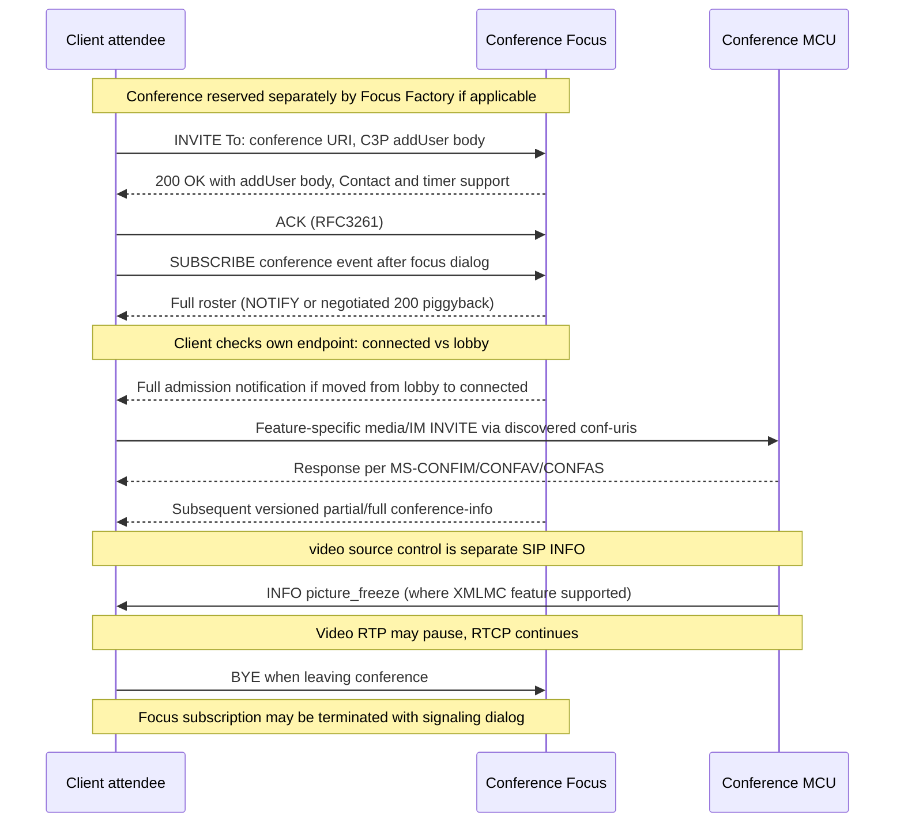

# Conference focus signaling, lobby privacy, full/partial roster notifications and XML media freeze

**Research 2026-10-22; research phase still OPEN.** Direct owner-supplied original Microsoft PDF texts: **[MS-CONFBAS] rev15.0 v20250520** §§2.2.1.2, 2.2.1.5, 3.1.4.1–2, 3.2.4–3.2.5, 3.3.4, 3.4.2–3.4.6, 3.5; **[MS-XMLMC] rev10.0 v20250520** §§2.1–2.2.1, 3.1.2–3.1.5.2, 3.2.1.1–3.2.5. These are **two different protocols**: C3P conference focus and SIP INFO media control, not a single conference join transaction. Normative primary standard cross-checked against original [RFC 4575 (Aug 2006)](https://www.rfc-editor.org/rfc/rfc4575) §§3.2–3.7,4.3–4.6,5.2 and [RFC 4353](https://www.rfc-editor.org/rfc/rfc4353) §§2,3–4; MS-CONFBAS additionally references RFC3261, RFC3265, RFC4028, RFC4579, RFC2976. See [separate MS-CONFPRO Focus Factory provisioning](ms-confpro13-focus-factory-c3p-provisioning-version-key-2026-10-22.md).

## A. MS-CONFBAS 15: role-specific SIP wire and state ledger

| ID | Original section | Normative content | Role, condition |
|---|---|---|---|
| FOCUS-01 | §3.1.4.1 | Focus bootstraps MCU for each requested MCU-Type; conference **MUST activate even when individual MCUs fail to bootstrap**. It may retry failed MCU or use internal resource management. **Conference active does not imply every requested media capability is operational.** | Focus |
| FOCUS-02 | §3.1.4.1.1 | Per-MCU `MCU-Conference-URI` is generated by implementation-dependent mechanism, but **MUST route INVITE to MCU** and let MCU identify its conference. | Focus, not UAC deriving a URI string |
| FOCUS-03 | §§2.2.1.2, 3.2.4.1.1 | Client INVITE `To` **MUST** be conference URI, valid Contact **MUST** be supplied, INVITE body **MUST** be valid **C3P addUser** or `endorseUser`; client addUser body **MUST** conform §2.2.3.3. | Participating Windows UAC |
| FOCUS-04 | §3.2.4.1 | Participant sends INVITE to establish focus dialog; can re-INVITE using same body; sends CANCEL while INVITE pending and BYE to leave after establishment. UPDATE performs session refresh per RFC4028. None of these inherently creates the media MCU SIP dialog. | Participating client |
| FOCUS-05 | §3.2.4.1.1; §3.2.4.2 | If joining on behalf of another, `p-session-on-behalf-of` SIP header **MUST** be present and related body `session-on-behalf-of` **SHOULD** match. Focus **MUST validate** matching header/body, otherwise **SHOULD** respond 403. | Delegated identity trust boundary |
| FOCUS-06 | §3.2.4.1.2 | Anonymous conference-join authentication is governed separately by MS-SIPAE §3.2.4.3, even though post-join conference-control semantics are shared. | Capability and authorization guard |
| FOCUS-07 | §§3.2.4.2,3.2.5.2.1 | Focus unauthorized addUser → **403**; accepted user normally **200 OK** with valid `addUser` response body. For timer-capable original INVITE, successful response **SHOULD** use Session-Expires with `refresher=uac` and **MUST** return Supported/Require `timer` if Session-Expires used per source. | Focus, conditional timer negotiation |
| FOCUS-08 | §3.2.5.2.4 | Extension error map: **400 malformed headers/body**, **403 conference-policy authorization denied**, **404 conference not found**, **603 conference meeting-size exceeded**. These errors differ from `C3P response code=failure` in Focus Factory provisioning SERVICE. | Focus |
| FOCUS-09 | §§3.2.5.2.2–3 | Focus **SHOULD** allow multiple endpoints belonging to same conference user; if allowed, **MUST** list each connected endpoint inside that user roster and manage independently; one endpoint BYE **MUST NOT** disconnect the others. Participant connected event **MUST** notify conference watchers. | Focus, multi-endpoint |
| FOCUS-10 | §3.3.4.2 | `endorseUser` is **not** a regular join: Focus unauthorized endorsement → **401 Unauthorized** (distinct from join's 403); success focus responds 200 and terminates special dialog; client **SHOULD NOT** send BYE for endorse-dialog. Early CANCEL **MUST** cancel pending endorsement. | Focus / endorsing endpoint |
| FOCUS-11 | §3.1.4.2 | Conference deactivation removes Focus instance state and may be triggered by organizer deletion, presenter/focus command or inactivity. Trigger mechanism itself is **outside this document**, and organizer deletion differs from one participant leaving. | Focus |

## B. Conference subscription and lobby isolation

| ID | Section and source | Proof |
|---|---|---|
| ROST-01 | MS-CONFBAS §§3.4.3.1,3.4.4.2 | Before **conference SUBSCRIBE** the client **MUST already have established focus signaling dialog**. Focus **SHOULD reject** subscriptions with no signaling dialog. This is a Microsoft extension to RFC4575 and does not mean MS-PRES contact SUBSCRIBE needs a conference INVITE. |
| ROST-02 | MS-CONFBAS §§3.4.2.1,3.4.5.1.1,3.4.6.1 | Client can start **32-second wait for first full conference notification**; on first full notification **MUST terminate** timer; if timer fires with no notification client **SHOULD fail** conference subscription and notify user. Timer is distinct from RFC6665 Timer N and MS-CONFPRO per-request 32-second timer. |
| ROST-03 | MS-CONFBAS §§3.4.4.1,3.4.5.1.1 | Conference participant **MUST** read its own Focus endpoint `state`. In lobby it receives **limited data**, no other participants, live conference state or MCU availability. `lobby-capable=true` allows waiting; if false/absent client **SHOULD immediately terminate** focus and subscription dialogs. |
| ROST-04 | MS-CONFBAS §§3.4.4.2,3.4.5.2.1 | When lobby attendee admitted Focus **MUST notify `state=connected`** and send a **full notification**. Focus **MUST immediately** provide full doc on new subscription; with negotiated `ms-piggyback-first-notify`, SHOULD return full doc in SUBSCRIBE 200. |
| ROST-05 | MS-CONFBAS §3.4.5.2.1 | Full conference document MUST include `conf-uris` of provisioned MCU URIs; conference-view SHOULD include Focus and later MCU entity-view; `users` SHOULD list participants including MCU-only connections. Client **SHOULD** extract `conf-uris` to construct MCU routing table. |
| ROST-06 | MS-CONFBAS §3.4.4.2 | Focus roster MUST NOT expose sensitive **conference key, internal web URL or external web URL**; client MUST use `getConference` control command to get them in **encrypted form**. This is a concrete server/client trust boundary separate from TLS-only transport. |
| ROST-07 | MS-CONFBAS §§3.4.4.2–3.4.4.2.1 | Focus can aggregate conference-info from multiple MCU event publishers. Its roster aggregation **MUST** provide compatible external behavior and preserve user/endpoint structure; implementation choice remains server-side. |
| ROST-08 | MS-CONFBAS §3.4.4.2 | When focus signaling dialog ends Focus **SHOULD** terminate corresponding conference subscription dialog; independent dialog objects with coupled lifetime. |
| ROST-09 | RFC4575 §4.6 | On first `conference-info state=full`, subscriber records version and snapshot. Repeated/lower version documents are discarded; `state=deleted` replaces state/indicates conference ended. New partial with version gap >1 **MUST** provoke SUBSCRIBE refresh requesting full state; consecutive partials are applied recursively with keyed element updates. |
| ROST-10 | RFC4575 §5.2 | Root `conference-info` has mandatory version (32-bit monotonic within subscription). RFC permits same version in a partial and subsequent full snapshot **if no state change occurred**, so do not impose globally strict uniqueness across all full notifications. |
| ROST-11 | RFC4575 §§3.2–3.3,3.6 | Default conference event package subscription is one hour under RFC4575 and notifier changes are generally partial except full response to subscription. **Microsoft** may impose own Expires and BENOTIFY/piggyback behavior; source edition profile must be resolved before asserting default exact timeout. |

**Critical difference:** presence categories in MS-PRES can carry repeat NOTIFY version; this is **not** evidence that RFC4575 **conference-info** accepts an identical repeat partial update. These are distinct event models with different version semantics. Also MS-CONFBAS still cites obsolete RFC3265; RFC6665/7621 historic-client compatibility remains OPEN.

## C. MS-XMLMC 10: video-source pause is separate from media negotiation

| ID | Original | Direct rule |
|---|---|---|
| VID-01 | MS-XMLMC §2.1–2.2.1 | XML media control extension is carried **inside SIP INFO payload**, RFC2976; `picture_freeze` extends `to_encoder` choice alongside `picture_fast_update`. It is **not** C3P addConference or an SDP attribute. |
| VID-02 | §§3.1.5.1,3.1.5.2 | Originating video source supporting extension **SHOULD** stop RTP video when well-formed freeze received; if it stops RTP it **MUST continue RTCP**. It **MUST NOT** return an error in response to well-formed freeze merely because current OVS state makes it irrelevant. |
| VID-03 | §3.1.5.1 | Extension stateless: OVS **SHOULD NOT** persist per-freeze state; an implementation supporting freeze **MUST also support picture_fast_update** to resume the video stream. Video may already be suspended and no action is required. |
| VID-04 | §§3.2.1.1,3.2.2–3.2.4 | Central Video Processor **SHOULD NOT** include optional `stream_id` in freeze/fast_update messages under the specified centralized multi-stream assumptions. Protocol defines no new timers or required server-trigger conditions. |
| VID-05 | §3.1.5.2 | No additional error conditions beyond referenced XML media control draft parsing error rules, and **no synchronization is expected with SDP offer/answer**. Thus `picture_freeze` **does not terminate or renegotiate** the SDP media direction; RTP mute is distinct from SIP dialog and ICE connection state. |

### Conditional conference sequence and four independent lifetimes

**Synthesis caveats:** This composes independently defined join, admission, MCU and optional XMLMC use cases; exact order of roster and MCU SIP messages can vary, some transports/hops omitted, and an INFO freeze is an independent optional event, not caused universally by admission. Microsoft §§3.4.5.2.1 and 3.4.4.2 apply per publisher/subscriber rights; a lobby attendee must not receive the full other-user or MCU roster before admission despite generic focus full-notify rules.

## D. Negative-state matrix

| Event | Source result and boundary |
|---|---|
| Invalid addUser body | MS-CONFBAS focus **400**; not automatic SIP 401 challenge |
| Conference join rejected by policy | **403**, role-specific; endorsement failure may be **401** |
| Conference URI unknown | **404** at Focus |
| Conference too large | **603**, not a generic 503 media congestion response |
| Lobby waiting, lobby-capable false/absent | Client SHOULD end focus+subscription dialogs |
| First full conference notification absent after 32 seconds | Client SHOULD fail subscription and report; separate from standard RFC event Timer N |
| Partial conference version jumps | RFC4575 subscription refresh requests full document, not blind delta application |
| Individual MCU bootstrap fails | Conference stays active; media service availability must be represented separately |
| One of two endpoint dialogues ends | Other endpoint connection MUST be unaffected |
| Picture freeze arrives after video already paused | OVS no-op; well-formed freeze MUST NOT elicit application error |
| `getConference` private conference key | Only through authorized, encryption-aware control, never naked roster |

## E. Cross-spec research blockers

1. **Complete C3P INFO grammar and control operations** [MS-CONFBAS] §§2.2.2.12, 3.5, 3.6–3.14, XSD §§6–7; precise role/delegation/lobby admission commands and `RequestId`/body constraints.
2. **MS-CONFBAS C3P roster** full/partial, `endpoint` state attribute namespace, lock/broadcast capabilities, `ms-piggyback-first-notify` compatibility with MS-SIP v20170601 and RFC3265→6665.
3. **RFC4575 status/update chain**, RFC4353 (informational architecture), RFC4028 refresh, RFC4579 isfocus and Microsoft client product notes; not all Windows client releases support same view.
4. **Conference authorization/privacy:** anonymous MS-SIPAE conference join, `p-session-on-behalf-of` verification, roster leak boundaries and web URL/key encryption, focus/MCU trust.
5. **MCU failure/per-session distinction:** MS-CONFAV, MS-CONFIM, MS-CONFAS and MS-SDPEXT / MS-ICE2 / MS-SRTP media teardown, partial MCU bootstrap and participant vs media stream capabilities.
6. **XMLMC draft dependency:** source references `IETFDRAFT-XMLSMC-12` and older RFC2976 INFO; version/replacements and whether historical SfB Windows Full Client negotiates this control are OPEN; no claim that current web conferencing uses this scheme.

**Research gate remains CLOSED for implementation.** Source sections verified with original PDF text and RFC Editor; entire Microsoft corpus and related RFCs, UI behaviors and security conformance NOT COMPLETE. No new protocol code, genuine server tests, merge or release.
