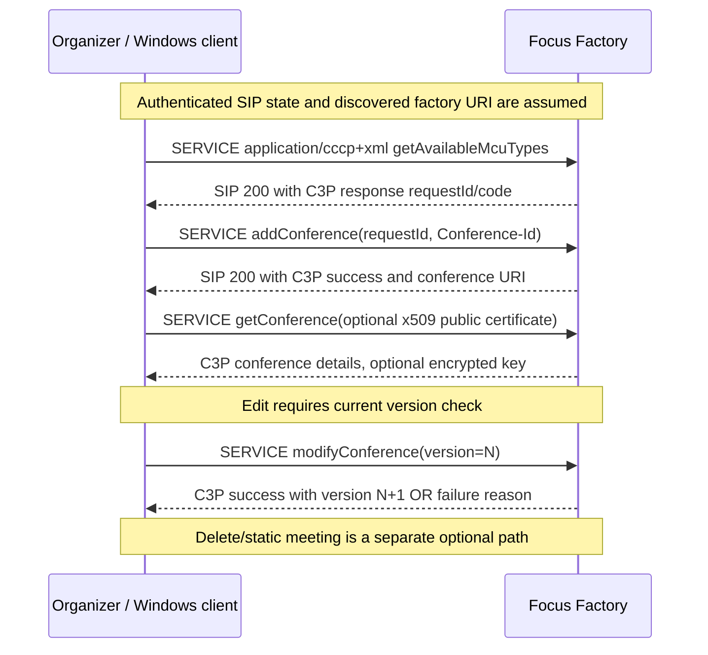

# C3P conference provisioning: Focus Factory, SERVICE XML, optimistic versioning, cryptographic return channel

**Research tranche 2026-10-22.** **Primary Microsoft source:** owner-provided original PDF **[MS-CONFPRO] v20250520, revision 13.0, release 2025-05-20**. Sections directly inspected: **§§2.1–2.2.3, 3.1.1–3.1.6, 3.1.7.1, 3.1.7.3, 3.2.5.1–3.2.5.5**, printed pages approximately 10–39/63. Cross-references to **[MS-CONFBAS] v20250520 rev15.0 §§2.2.2–2.2.3**, **[MS-SIPAE] v20250520 rev11.0** (delegation) and **RFC 3261**, **RFC 3852**. Original official PDF URL recorded in owner supplied `catalog/inventory.json`; [Microsoft Office Open Specifications](https://learn.microsoft.com/en-us/openspecs/office_protocols/). Requirement labels specify **client versus server**. Directly checked source text is not evidence the entire RFC dependency graph or all product notes are closed.

## 1. Message contract and security boundary

| Proof ID | Clause | Verifiable rule |
|---|---|---|
| CFP-01 | §2.1–§2.2 | Conference planning uses **SIP SERVICE requests/responses over TCP or TLS**, not a new protocol transport. Request and response bodies **MUST** be well-formed **UTF-8 XML** with **Content-Type: application/cccp+xml**, and conform to [MS-CONFBAS] §§6.2–6.3 XML schemas. |
| CFP-02 | §2.2 | **Client** `From` is organizer's SIP URI or delegate's SIP URI; `To` and Request-URI **MUST** be **Focus Factory URI**; SERVICE request **MUST NOT** contain `Require`; request body **MUST** exist. Delegated From **SHOULD** include `p-session-on-behalf-of` equal to organizer URI, with authorization defined by **MS-SIPAE**. |
| CFP-03 | §2.2.2 | C3P request `request` root must use namespace `urn:ietf:params:xml:ns:cccp` unless extension schema; `requestId` **nonnegative, unique among that sender's requests**, `from` = organizer URI, `to` = enclosing SIP To URI. A root has **exactly one** request-type child. Source labels optional `C3PVersion` and says if present **MUST equal 1**; this is **not** license to invent other versions. |
| CFP-04 | §2.2.3 | C3P response `response` root must echo `requestId`, reverse request `from`/`to`, expose `code = success|failure` and exactly one type-identifying child. SIP 200 **alone** is not sufficient to conclude semantic conference operation success; parse C3P `code`. |
| CFP-05 | §§3.1.1–3.1.2, 3.1.7.1 | Client conceptual **Outstanding Request Queue (ORQ)** stores request IDs; **Request Timer SHOULD be 32 seconds** per request. Send request and store its request ID; on timeout with no matching SIP response **SHOULD** remove ID and report timeout. This is not the RFC4028 dialog timer or MS-CONFBAS conference-notify 32-second timer. |
| CFP-06 | §§3.1.5.1–3.1.5.2 | A 200 SIP response **MUST** carry body, non-200 response body may be absent. Client **SHOULD** parse well-formed XML, validate schema, locate `requestId` in ORQ, remove it, validate response type, and then consume `code`. Failed validation aborts and reports error to upper layer; a stale/unmatched `requestId` must not silently complete a different pending command. |
| CFP-07 | §3.2.5.1 | **Focus Factory** validates XML well-formedness, root and request type. On these failures it responds **400 SIP with no body**; these are distinct from application `response code=failure` with reason. |
| CFP-08 | §3.1.3 | **Client** must know **organizer SIP URI** and **Focus Factory URI** before sending provisioning commands; conference SIP URI and Focus Factory URI are distinct roles. |

## 2. Organizer lifecycle and optimistic version state

| ID | Clause | Proven state transition |
|---|---|---|
| CFP-09 | §3.1.4.1 | New conference: create organizer-unique `Conference-Id`, send `addConference`, wait for response. **Static** meeting: first `getConferences static=true`; if existing use `getConference`, otherwise `addConference static=true`. |
| CFP-10 | §3.1.4.2 | Before `modifyConference`, **MUST** retrieve current conference details/version; if higher-layer version differs **stop, return current details, request higher-layer reissue**. On match send `modifyConference` containing current version. No blind last-write-wins update. |
| CFP-11 | §§3.2.5.2–3 | **Focus Factory** checks admission authorization, delegate/invitee authorizations, allowed MCU types, quotas, storage sizes and unique conference ID. On add success insert entry at **version=1**; on modify success verify matching version and **increment by one**. Errors carry `response code=failure` and **reason**, not universally 4xx SIP. |
| CFP-12 | §3.1.4.3; §3.2.5.4 | Delete via `deleteConference`; a static meeting needs matching `static=true`; **server** checks existence, if active causes focus deactivation, removes conference entry, emits success or failure `reason`. **Deleting reservation** is distinct from a participant's BYE/leave dialog. |
| CFP-13 | §§3.1.4.4–3.1.4.8 | Distinct commands: `getConferences` list, `getConference` details, `getEncryptionKey`, `getAvailableMcuTypes`, optionally product-supported `getConferencingCapabilities`. **Client** must retrieve available MCU types before requesting them explicitly. |
| CFP-14 | §2.2.3.1–3 | Structured failure `reason` cases include `anonymousUsersNotAllowed`, `conferenceExistsAlready`, `entitySettingsTooLarge`, `federatedUsersNotAllowed`, `invalidAdmissionPolicy`, `invalidEncryptionKeyUsed`, `conferenceDoesNotExist` and `staticFlagDoesntMatch`, depending on operation. Do not misinterpret as SIP status codes. |

## 3. Sensitive conference-key retrieval

| ID | Primary | Verified trust rule |
|---|---|---|
| CFP-15 | §3.1.4.5 | For organizer requesting sensitive conference-key on `getConference`, client **MUST** create base64-encoded self-signed certificate per RFC3852/CMS profile, place it under `encryption-key/x509-certificate`, send request. **Explicit exception:** when key not needed, omit certificate and skip those steps. |
| CFP-16 | §§3.1.7.3, 3.2.5.5, 3.1.5.6 | Locally generated self-signed certificate carries **only public key**, while **private key remains protected locally**. Server uses supplied public key to encrypt conference-key when one exists; client decrypts response with matching private key. This is **application-layer confidential key return**, not replacement for secure signaling and peer authentication. |
| CFP-17 | §3.2.5.2 | If conference-key `issuing-server` differs from servicing Focus Factory, **server verifies requested issuing server** before forwarding; if key supplied, decrypts using local Focus Factory private key. Server authorization/route roles are not Windows client MUSTs. |

## Conditional client/server sequence (synthesis, not universal chronology)

SIP responses, request transaction errors, and possible authorization failures depend on MS-SIPAE and RFC3261. The trace is **illustrative path assembled from independently specified commands** and is not asserted to be mandatory for every join. A participant may join an already provisioned meeting without creating one.

## Research blockers and compatibility risks

1. **Full XML**: Complete [MS-CONFBAS] §§6.2–6.3 WSDL/XSD, exact MS-CONFPRO operation-specific child types, schema extension namespace and optional attributes, strict on-wire serialization and parser error handling remain to be reviewed.
2. **Cryptographic format**: RFC3852 legacy CMS, certificate encoding, current chain validation and conference-key encryption algorithms/authorization require independent original clause check. A client-created self-signed certificate does **not** authenticate remote service.
3. **Delegation**: `p-session-on-behalf-of` is only meaningful under verified MS-SIPAE authorization; no acceptance of arbitrary delegation claims.
4. **State & concurrency**: stale C3P request ID, out-of-order responses, version conflicts, Focus Factory failover, multi-organizer, static meeting lifecycle, quota and retention across deployments.
5. **Document editions**: review product note <35> etc to decide capability API coverage for precise classic Windows client versions; do not assume every capability probe exists for 2007/2010/2015 variants.
6. **Cross-service**: conference reservation/provisioning does not create an active focus SIP signaling dialog or guarantee MCU and media availability (see accompanying MS-CONFBAS analysis).

**Evidence classification:** directly checked sections P, example cross-sequence S, above blockers U. **Whole client/protocol/RFC analysis NOT COMPLETE. No implementation code, real-server tests, merge or release.**
