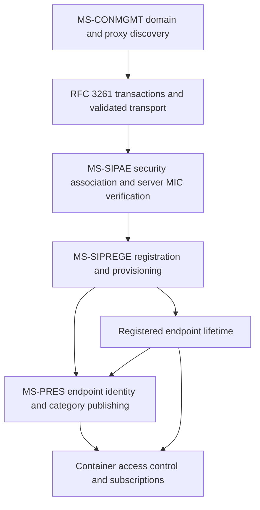

# Cross-specification research: discovery, presence, identity and lifetime
Date: 2026-10-22. Research-only. No protocol source changes and no real-server tests.

## Sources and revision boundary
- [MS-CONMGMT §3.1.5](https://learn.microsoft.com/en-us/openspecs/office_protocols/ms-conmgmt/40d79c10-2275-4e52-bb4b-67c703d092c3), HTML last updated 2021-08-17.
- [MS-PRES §1.3 overview](https://learn.microsoft.com/en-us/openspecs/office_protocols/ms-pres/5968aa41-cd2f-4f36-b2e1-f9e35e7126fb), HTML 2020-10-15.
- [MS-PRES §2.2 message syntax](https://learn.microsoft.com/en-us/openspecs/office_protocols/ms-pres/a7d01968-158c-4ae5-a79b-c2a6da577163), HTML 2019-02-15.
- [MS-PRES categories document](https://learn.microsoft.com/en-us/openspecs/office_protocols/ms-pres/751c5acf-3ee0-4cad-901a-c9787b196073), HTML 2020-10-15.
- [MS-PRES §3.8.5.2.1](https://learn.microsoft.com/en-us/openspecs/office_protocols/ms-pres/74c58295-3320-4b76-9dc0-8c9c047736a0), HTML 2019-02-14.
- [RFC 3261](https://www.rfc-editor.org/rfc/rfc3261), June 2002; [RFC 3263](https://www.rfc-editor.org/rfc/rfc3263), June 2002; [RFC 6665](https://www.rfc-editor.org/rfc/rfc6665), July 2012.

NOTE: these dated HTML clauses are NOT automatically equivalent to the published most recent Microsoft PDF revisions. Exact full-PDF change tracking remains an open requirement.

## Discovery — MS-CONMGMT §3.1.5, directly extracted
After deriving the SIP domain in §3.1.4, the client MUST query **in parallel** these SRV names (the associated TLS/TCP transports are given by the source):
- _sipinternaltls._tcp.<domain> (TLS)
- _sipinternal._tcp.<domain> (TCP)
- _sip._tls.<domain> (TLS)
- _sip._tcp.<domain> (TCP)

It SHOULD append fallback entries if absent, including sipinternal.<domain>:443 (TLS), sipinternal.<domain> (TCP), sip.<domain>:443 (TLS), sip.<domain> (TCP), sipexternal.<domain>:443 (TLS), sipexternal.<domain> (TCP). The client SHOULD attempt resulting entries in sequence, perform a fresh DNS A lookup before connecting to each, and attempt returned addresses sequentially. DNS A or all-address TCP failures warrant trying the next entry; **other failure classes must terminate discovery**, as does exhausting all entries.

This is **Microsoft-specific discovery**, not a claim that generic RFC 3263 mandates these names. The existence of TCP candidates does NOT grant permission for a silent downgrade from an applicable TLS-only policy; reconcile transport policy and MS-CONMGMT TLS sections before deriving implementation rules.

## Presence — MS-PRES overview, message syntax, category schema
- Enhanced presence is a **category + container + subscriber** model, not merely the standard PIDF status document. Users publish categories and control subscriber visibility through container membership.
- The Microsoft profile uses XML message bodies within SIP **SERVICE** and **SUBSCRIBE** requests. Directly enumerated bodies in §2.2 include categories, publish, self-subscribe, category-subscribe, containers, subscriber lists, state/device/services, contactCard, calendarData, workingHours, dndState and delegates.
- The category document can carry instance, publishTime, container, version, expireType, endpointId and expires. **Lifetime semantics**: static (until deletion), endpoint (while publishing endpoint is registered), user (while at least one user endpoint is registered), time (until specified expiration). This couples presence lifetime to **registration state**, an explicit cross-spec dependency.
- For expireType=endpoint, endpointId identifies the publisher's endpoint and derives from the +sip.instance UUID in the Contact header under **MS-SIPRE §2.2.5**. This directly connects presence identity to registration contact identity.
- §3.8.5.2.1 describes category aggregation for device/machineState into services and specifically forbids adding members to container 2 because doing so can compromise publisher privacy. Treat this as an access-control requirement, not cosmetic UI metadata.
- Subscription types are not interchangeable: persistent subscription can last until corresponding client registration expires, while a polling SUBSCRIBE (Expires=0 and no To tag) requests a one-time snapshot. Determine exact MS-PRES state changes and RFC 6665 applicability before drawing normative message trace.

## Inter-spec lifecycle — evidence-based synthesis
1. **Discovery:** MS-CONMGMT §3.1.5 determines candidate transport endpoints and failure conditions. RFC 3263 governs generic SIP target-location concepts; do not confuse the two discovery profiles.
2. **Transaction/security:** RFC 3261 handles SIP transaction matching, transport error and method processing; MS-SIPAE §3.2.5.2 specifies separate verification and SA state for protected server messages.
3. **Registration/provisioning:** MS-SIPREGE defines the client registration and in-band provisioning framework, but its complete current revision wire and timing clauses remain unverified here.
4. **Presence:** MS-PRES lifetime and endpoint identity depend on registered endpoint/contact identities. MS-PRES publication privacy also requires container-specific access enforcement.
5. **Recovery inference:** when the endpoint loses registration, endpoint-lifetime categories and persistent subscriptions need state re-evaluation under MS-PRES; precise server/client actions must be extracted, not guessed.

## Architectural diagram — dependency, NOT complete chronological wire trace

## Conflict/uncertainty ledger
- P01: Published Microsoft PDF revision and earlier section HTML might differ: still needs revision-by-revision delta.
- P02: RFC 3263 service resolution vs MS-CONMGMT SRV naming and fallback order: roles and applicability to deployment type not fully resolved.
- P03: Conditional TCP discovery candidates vs TLS-required security profile: do not infer automatic plaintext downgrade.
- P04: MS-PRES endpointId and +sip.instance depend on MS-SIPRE exact syntax; match across XML and SIP after verifying both specifications.
- P05: MS-PRES publication categories and RFC 6665 subscription semantics need a combined full state machine; neither document alone proves the exact Windows client sequence.
- P06: No complete media, conference, contacts, delegated access or sign-out/recovery clause coverage yet.

## Research status
Direct original HTML clauses analyzed in four MS-CONMGMT/MS-PRES locations; relationships labeled inference where applicable. The complete RFC/MS reference closure, latest revision PDFs, byte-exact messages and full Windows Full Client coverage remain unfinished. Owner alone performs real-server testing. This file is not authorization to implement new protocol code.
