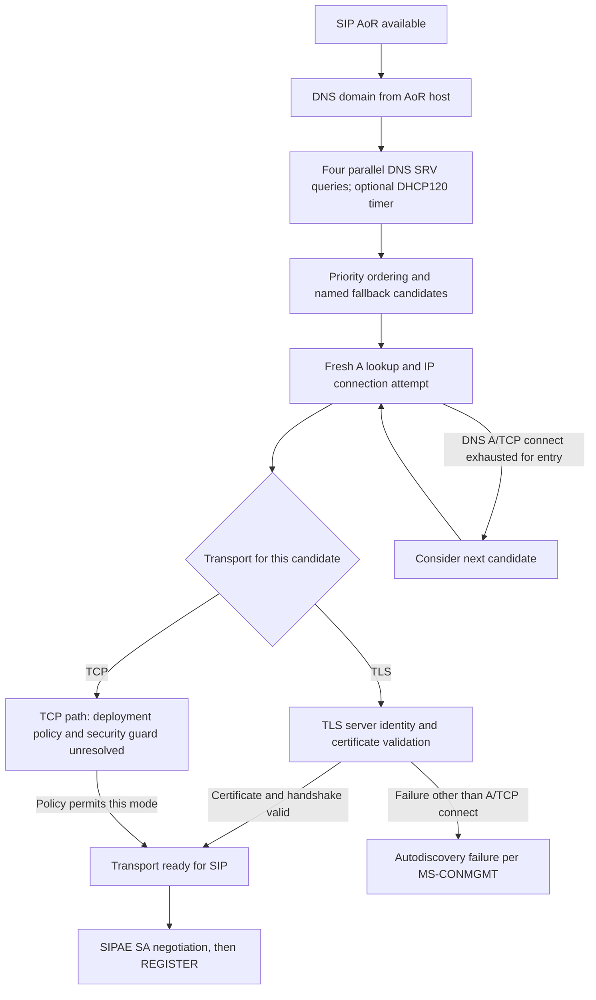

# Client startup: Microsoft outbound-proxy discovery, TLS host identity and RFC edition conflict

**Original-primary research date 2026-10-23; analysis is partial, not implementation-ready.** Source **[MS-CONMGMT] Connection Management Protocol, revision 10.0, v20250520, release 2025-05-20**, original archived 27-page PDF, SHA-256 `95fee40b4d20e4eece095acf090e3a65abdae711c03200e99cd28afc0f29ce38`, examined **§§1.3, 1.5–1.7, 3.1.1–3.1.7, 3.2, 3.3, 3.4–3.5**, visually rendered PDF pp14–16. Cross-check: **[MS-OCSPROT] rev9.0 v20250520 §2.5.1–§2.5.3**; primary IETF **[RFC3263](https://www.rfc-editor.org/rfc/rfc3263)** (2002) §§4.1–4.3 and 7, **[RFC2782](https://www.rfc-editor.org/rfc/rfc2782)** (2000), **[RFC2131](https://www.rfc-editor.org/rfc/rfc2131)** (DHCP), **[RFC3361](https://www.rfc-editor.org/rfc/rfc3361)** (SIP DHCP option), **[RFC5246](https://www.rfc-editor.org/rfc/rfc5246)** (2008 TLS 1.2), **[RFC5922](https://www.rfc-editor.org/rfc/rfc5922)** (2010 SIP domain identities), **[RFC8446](https://www.rfc-editor.org/rfc/rfc8446)** (2018 TLS 1.3, obsoletes RFC5246), **[RFC9525](https://www.rfc-editor.org/rfc/rfc9525)** (2023 replaces RFC6125 general TLS service identity). Some RFCs are *comparative editions*, not automatically listed normative dependencies of MS-CONMGMT. Official Microsoft file URL and metadata are in `catalog/inventory.json`.

Evidence: **P** = direct Microsoft clause; **R** = RFC primary; **S** = reasoned synthesis; **U** = unresolved; **H** = guarded historical/product condition. Every normative requirement identifies its actor. The existence of a discovery transport entry **does not authorize a security downgrade** without independent Microsoft Windows deployment policy, an open gate.

## A. Autodiscovery and concrete order of operations

| ID | Source | Verifiable rule, actor and condition |
|---|---|---|
| DISC-TLS-01 | MS-CONMGMT §3.1.4 | Client **MUST** derive discovery DNS domain from **host part of SIP address-of-record**, acquired from user or local store; not from currently connected HTTP/AD domain or arbitrary email MX. |
| DISC-TLS-02 | §3.1.5 | Client **MUST** issue four **parallel** SRV queries: `_sipinternaltls._tcp.<domain>` TLS, `_sipinternal._tcp.<domain>` TCP, `_sip._tls.<domain>` TLS, `_sip._tcp.<domain>` TCP. It **MUST** sort each answer by **SRV priority**. |
| DISC-TLS-03 | §3.1.2/§3.1.5 | DHCP discovery optional via implementation policy, **SHOULD** send DHCP INFORM for **option 120** (RFC3361) with **vendor-class option 60 "MS-UC-Client"**; MUST maintain **DHCP discovery timer** recommended **5 s** *if DHCP discovery supported*. Failing to enable DHCP does not mean all Windows clients must wait 5 s. |
| DISC-TLS-04 | §3.1.5 | On DHCPACK client MUST cancel discovery timer; ignores returned IP addresses not relevant to host list and uses **5061 TLS** and **5060 TCP** as default since DHCP results lack port. |
| DISC-TLS-05 | §3.1.5 | Candidate groups in **fixed order**: internal TLS SRV, TLS DHCP, internal TCP SRV, TCP DHCP, external/general TLS SRV, TCP SRV. Query completion races can affect available groups; include records from queries conditionally as specified. |
| DISC-TLS-06 | §3.1.5 | Client **SHOULD** ignore TLS SRV records with server hostname outside discovered domain/subdomain; spec example refuses `server1.fakecontoso.com`, permits `server1.contoso.com`. This is **DNS response filter**, **not substitute for certificate verification**. |
| DISC-TLS-07 | §3.1.5 | Client **MUST** connect to TLS-tagged SRV via **TLS**, TCP-tagged SRV via **TCP**. It **SHOULD** append (if absent) `sipinternal.<domain>:443` TLS, `sipinternal.<domain>` TCP, `sip.<domain>:443` TLS, `sip.<domain>` TCP, `sipexternal.<domain>:443` TLS and `sipexternal.<domain>` TCP. These names are **fallback candidates**; their availability/trust cannot be assumed. |
| DISC-TLS-08 | §3.1.5 | Client **SHOULD** sequentially try candidate entries, fresh DNS A lookup before current entry, then resolved IPs. On DNS A failure or TCP connection failure to *all* IPs of current entry it SHOULD try next entry. For **all other errors** or exhausted final list it **MUST treat discovery as failed**. |
| DISC-TLS-09 | §3.2 | Client **MUST** authenticate outbound proxy certificate using TLS key exchange/identity procedure cited as **RFC5246 §7**. A TCP connection or negotiated ciphersuite by itself is not identity verification. |
| DISC-TLS-10 | §3.3 | **Server-side** obligation: outbound proxy's presented certificate **MUST** have `subject name` equal to its **FQDN** as referenced to old **RFC2459 §4.1.2.6**. The document **does not explicitly specify a modern SAN validation algorithm** for each Windows build. Do not turn this one server requirement into an invented certificate acceptance exception on the client. |
| DISC-TLS-11 | MS-OCSPROT §2.5.1–§2.5.3 | After discovery and transport success, example uses `REGISTER` and may authenticate using 401/407 MS-SIPAE, then provision/bootstrap; overview does **not** mean all DNS/transport successes imply authenticated registration or ready presence. |

### Client discovery state and abort boundary

**Qualification:** This graph separates **Microsoft normative discovery error behavior** from the unresolved **client security policy of offering TCP without TLS**. In particular, a failed certificate check is **not** evidence that a client should silently downgrade to unencrypted TCP; original §3.1.5 groups *other failures* into discovery failure. The diagram is a cross-protocol synthesis, not a packet-capture of every variant.

## B. Cross-edition RFC certificate/TLS identity conflict register

| ID | Current standard/historical clause | Applicability question |
|---|---|---|
| CERT-ED01 | RFC3263 §§4.1–4.3 describes SIP DNS transport selection with NAPTR/SRV and fallback rules; MS-CONMGMT §3.1.5 gives **specific 4 SRV query set**, DHCP 120 and fixed fallback hostnames. | Must follow Microsoft’s narrowed algorithm for target Windows client profile where applicable, not silently replace with generic NAPTR-first RFC3263. |
| CERT-ED02 | RFC5922 §7.1–7.2 **updates RFC3261** for SIP domain certificate identities: uses cert SAN URI `sip:` without userinfo and DNS domain identities; CN fallback only if SAN absent. | MS-CONMGMT §3.3 instead says **subject name FQDN** and cites older RFC2459. **Potential host-FQDN vs SIP-domain identity profile difference**, needs concrete deployment/cert-role and client version proof; do not call either text incorrect. |
| CERT-ED03 | RFC9525 §6 disallows CommonName identity fallback for general TLS verification (obsoletes RFC6125). | As later generic TLS service identity text, not proof this Microsoft 2025 historical spec adopts the modern rule. Do not disable validated SAN or trust chain for legacy compatibility. |
| CERT-ED04 | RFC8446 TLS 1.3 obsoletes RFC5246 as TLS standard, but TLS 1.3 has changed handshake/key schedule, no legacy master-secret/EAP PRF representation. | A TLS transport supporting TLS1.3 is **not evidence** that MS-SIPAE TLS-DSK's RFC5246-based **inner token handshake** supports TLS1.3. See companion [SA audit](ms-sipae11-ntlmk-tlsdsk-security-association-states-2026-10-23.md). |
| CERT-ED05 | DNS hostname filtering MS-CONMGMT §3.1.5 is SHOULD, certificate validation §3.2 MUST. | DNS SRV answer membership, DNSSEC or DHCP provenance cannot replace authenticated certificate/domain identity. Whether TLS identity must equal SRV target, realm, SIP AoR or a more specific certificate EKU needs original MS product policy and RFC5922 comparison. |
| CERT-ED06 | MS-CONMGMT server reference uses **RFC2459** while modern PKIX certificate profile is RFC5280. | Historical reference is real; verify trust chain, EKU, key usage, SAN/CN, revocation, expiry and proxy credential policies. No speculation of accepting invalid or self-signed server certificate. |

## C. Open requirements to be linked to registration and authentication

- **SEC-DISC-G01:** Evaluate MS-CONMGMT §6 product behavior notes `<3>` and client editions where DHCP120 is enabled/disabled; verify fallback policy for unencrypted TCP with exact Windows Full Client target profile.
- **SEC-DISC-G02:** Audit RFC2782 weighted SRV selection against §3.1.5's 'sort by priority' plus actual implementation rules; resolve record order for equal-priority hosts (not specified here, don't invent).
- **SEC-DISC-G03:** Map each TLS server cert's trust requirements from RFC5246/5280/5922 to proxy SAN FQDN and SIP domain checks and Microsoft product settings, including chain, revocation, wildcard, redirects.
- **SEC-DISC-G04:** Separate DNS discovery, transport TLS, inner TLS-DSK exchange, SIP message MIC, SA validity, REGISTRATION refresh, web-ticket and certificate provisioning. None alone proves entire client's authenticated/usable state.
- **SEC-DISC-G05:** Discovery TLS error differentiation must not trigger plaintext fallback merely because other TCP SRV records were discovered; exact historical Windows client behavior remains unknown.
- **SEC-DISC-G06:** Compare outbound proxy discovery in MS-OCDISCWS / HTTPS autodiscover and Web Ticket metadata, external Edge, domain federation, split-DNS; do not assume same DNS SRV path for all topology variants.

**Status: directly documented parts of MS-CONMGMT and RFCs, not all TLS/security lifecycle fully analyzed. Research-only. No protocol code, real-server tests, merge or release.**
