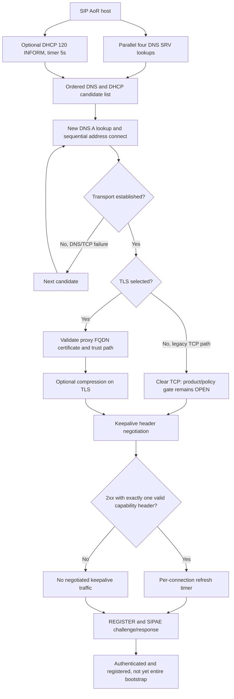

# Client start and discovery: MS-OCSPROT 9.0 / MS-CONMGMT 10.0 original-source ledger

**Date:** 2026-10-22. **Research only.** Original PDFs/text from owner's supplied `catalog.zip`: **MS-OCSPROT 9.0, release 2025-05-20 §§2.5.1–2.5.2, pp27–30**, **MS-CONMGMT 10.0, release 2025-05-20 §§1.2–1.7, 2.1–2.2.1, 3.1.1–3.1.6, 3.2, 3.3, 3.4.2–3.4.5.3, pp8–18**. [Official MS-CONMGMT](https://learn.microsoft.com/en-us/openspecs/office_protocols/ms-conmgmt/), [official MS-OCSPROT](https://learn.microsoft.com/en-us/openspecs/office_protocols/ms-ocsprot/). This analyzes the named original sections, not the entire normative graph, contemporary security posture or guaranteed Windows client implementation.

## Layered sequence: overview vs precise discovery mechanism

**MS-OCSPROT §2.5.1**: SIP-domain lookup → DNS SRV selection of outbound FQDN/port → TCP → optional TLS including certificate verification → optional SIP compression when encrypted and enabled by policy; result **connected, ready to sign in**, not authenticated or registered. **§2.5.2**: client sends REGISTER asking GRUU, presence resource-list/extended XML, keepalive capabilities; server challenges with SIP 401/407 for NTLM/Kerberos; client re-REGISTER with authentication; successful server reply can supply GRUU and server authentication proof. The overview is a use-case, so interpret exact wire details from MS-CONMGMT, MS-SIPAE, MS-SIPREGE, MS-SIPCOMP, MS-SIPRE and RFC3261, not from the overview figure alone.

## Clause-level discovery requirements

| ID | Original section | Normative finding | Caveat |
|---|---|---|---|
| DISC-01 | MS-CONMGMT §3.1.4 | **MUST** derive discovery domain from host portion of user's SIP AoR (input or offline source). | Not device hostname or email domain unless identical to SIP AoR. |
| DISC-02 | §3.1.5 | **MUST** initiate four DNS SRV queries in parallel: `_sipinternaltls._tcp.<domain>` TLS, `_sipinternal._tcp.<domain>` TCP, `_sip._tls.<domain>` TLS and `_sip._tcp.<domain>` TCP. | Historical Microsoft profile, not generic RFC3263-alone routing. |
| DISC-03 | §3.1.5 | For each SRV query **MUST** sort records by SRV priority. | Exact RFC2782 weighting and tie-breaking remains a separate normative verification task. |
| DISC-04 | §3.1.2, §3.1.5 | SIP DHCP discovery **SHOULD** use DHCP INFORM / Option 120 and **SHOULD** send vendor Option 60 `MS-UC-Client`; DHCP INFORM **MUST** target broadcast 255.255.255.255 and may target DHCP server per interface. Discovery timer recommended **5 seconds**, **MUST** cancel after qualifying DHCPACK; on timeout complete without results. | RFC2131, RFC2132, RFC3361 are explicit normative references. |
| DISC-05 | §3.1.5 | DHCP results lacking ports **MUST** use TLS port 5061 or TCP port 5060. Returned IP addresses from DHCP **SHOULD** be ignored. | Separate from fallback hostname entries using 443. |
| DISC-06 | §3.1.5 | Group candidate order: internal TLS SRV, DHCP TLS, internal TCP SRV, DHCP TCP, external TLS SRV, external TCP SRV. | Query completion races allow documented early-result variants; not a universal wait-for-every-response rule. |
| DISC-07 | §3.1.5 | Additional fallback entries (when not present) include `sipinternal.<domain>:443` TLS, `sipinternal.<domain>` TCP, `sip.<domain>:443` TLS, `sip.<domain>` TCP, `sipexternal.<domain>:443` TLS and `sipexternal.<domain>` TCP. | Need profile-specific behavior and product notes before planning transport fallback security. |
| DISC-08 | §3.1.5 | **SHOULD** ignore TLS SRV answers with unrelated hostname suffix (e.g. fakecontoso.com is not contoso.com); **MUST** use TLS for TLS SRV and TCP for TCP SRV records. | Suffix filter is not a replacement for full certificate identity verification. |
| DISC-09 | §3.1.5 | **SHOULD** try ordered candidates, fresh DNS A lookup, then returned addresses sequentially; after DNS A or TCP-connect failures **SHOULD** attempt next entry; other failures or exhaustion **MUST** fail discovery. | Does not authorize bypassing TLS certificate failure by downgrade to plaintext. |
| TLS-01 | MS-CONMGMT §§1.5, 3.2, 3.3 | Client needs trusted CA root; client **MUST** authenticate outbound proxy using TLS certificate under cited RFC5246; server's certificate subject **MUST** identify proxy FQDN. | 2025 original cites RFC2459 and TLS 1.2 RFC5246; modern name/SAN, revocation and TLS policy require explicit newer RFC and deployment reconciliation. |
| KA-01 | MS-CONMGMT §3.4 | Keep-alive is **per TCP connection and hop-by-hop**, not automatically for every endpoint or through every proxy. Client **MUST** initiate negotiation, proxy **MUST NOT** initiate. |
| KA-02 | §3.4.5.1 | Client **MUST** send `Ms-Keep-Alive` request with `UAC` and `hop-hop=yes`; `end-end` and `tcp` capabilities unsupported and SHOULD NOT be advertised. Negotiation begins immediately after transport/compression establishment. |
| KA-03 | §§3.4.5.2–3 | SIP failure >=400 → negotiation failure; **MUST NOT** send keepalive traffic. A 2xx missing `Ms-Keep-Alive` or duplicate `Ms-Keep-Alive` headers in 2xx must be treated as failed negotiation; no keepalive. |
| KA-04 | §3.4.5.2 | On accepted negotiation server MUST return `Ms-Keep-Alive` with role `UAS`, supported `hop-hop`, and negotiated `ms-keep-alive-timeout` seconds. |
| KA-05 | §3.4.2 | Server timeout/expiry timer includes at least a transaction-timeout grace period and resets on traffic. Client **MUST** maintain refresh timer, SHOULD set at **2/3** of server-negotiated timeout; sending data resets refresh timer to timeout. | These are not SIP registration or RFC4028 session timers. |

## Dependency diagram (one conditional discovery path, not a single universal wire trace)

Graph marks user/application policy unknown, compression negotiated only if enabled, and server registration state separate from transport. The diagram draws a plausible *composition of primary clauses*, not a full canonical packet sequence. No assumption that TLS is optional under current best practices just because historical Microsoft source permits plaintext TCP.

## Explicit blockers and remaining investigations

- Need full original **MS-SIPCOMP 10.0** transport/compression negotiation and failure paths, especially where TLS is absent, including whether unsupported compression aborts connection.
- Need exact §3.4.5.3–3.4.6 keepalive payload and timer expiry processing and its interaction with proxy failure/REGISTER binding.
- Need **RFC2782** SRV weights/priority selection, RFC3361 DHCP Option120 wire formats, RFC3263 official SIP server-discovery compatibility, RFC6125/9525 modern cert identity and RFC5246/8446 edition/profile constraints.
- Need actual product-specific policies around TLS downgrade, server name/SAN checks, certificate revocation/trust, client authentication and deployment, not assumed from protocol overview.
- Need bootstrap §2.5.3 contacts/provisioning/full services and independent SA / REGISTER / dialog state; previous research partially addresses these but full proof gap persists.
- Need reconcile 2025 `MS-OCSPROT` steps to 2025 `MS-CONMGMT` normative state/timer details, Microsoft product annotations, and all 151 PDF + RFC reference closure.

**NOT COMPLETE. No new protocol implementation, live-server tests, merge, release or premature implementation roadmap.**
