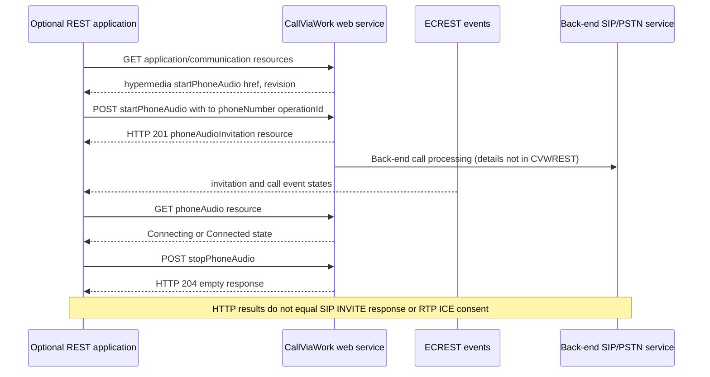

# MS-CVWREST 7.0 — Call Via Work REST, hypermedia navigation and scope boundary

**Original Microsoft PDF clause review 2026-10-23; conditional web-client capability, NOT proof classic native Windows Full Client uses this API.** [MS-CVWREST] *Unified Communications Call Via Work Protocol*, revision **7.0**, published **2025-05-20** (v20250520), 46-page original PDF SHA-256 **aa47469c3c968e914b64acc901815ff1eba0b0399ddf71eab23cfea2eb6899a2** verified locally; official protocols [catalog](https://learn.microsoft.com/en-us/openspecs/office_protocols/ms-offprotlp/939e9850-c48d-464d-860e-78f8b281e7bd); Microsoft original PDF `https://msopenspecs.microsoft.com/files/MS-CVWREST/%5BMS-CVWREST%5D.pdf` (this exact path not web fetched). Original PDF **pages 9 and 15** rendered; reviewed §§2.1–2.2.6.10,3.1.1–3.1.2,3.1.5.4–3.1.5.9, resources/HTTP errors. Direct Microsoft dependencies **[MS-OCSMP]**, **[MS-ECREST]**, **[MS-OCAUTHWS]**, **[MS-OCDISCWS]**; historical IETF [RFC2616](https://www.rfc-editor.org/rfc/rfc2616) HTTP, [RFC2818](https://www.rfc-editor.org/rfc/rfc2818) HTTPS, [RFC3966](https://www.rfc-editor.org/rfc/rfc3966) TEL URIs. Microsoft [2015 Skype SDK Call Via Work resource](https://learn.microsoft.com/en-us/skype-sdk/ucwa/startphoneaudio_ref) independently establishes **web API** capability. **P** source normative, **S** cross-source inference, **U** target Windows build unspecified.

## Source-specific HTTP contract and state transitions

| ID | Clause | Role and exact relevant behavior |
|---|---|---|
| CVW-01 | §2.1 | REST messages over **HTTP or HTTPS**, default 80/443 SHOULD but other ports possible. Text messages **MUST UTF-8**, **MUST NOT contain UTF-8 BOM**. Historic HTTP permission is **not** a security recommendation to send secrets in plaintext. |
| CVW-02 | §3.1.1.1 | REST navigation is **hypermedia `href` links**: `application`→`communication`→`startPhoneAudio/conversations`; `conversation`→`phoneAudio`; active `phoneAudio`→`stopPhoneAudio`. Event-origin conversations can be discovered via **[MS-ECREST] event channel**, not by guessing URL strings. |
| CVW-03 | §§2.2.2,3.1.1.2 | Resource link with nondefault **revision** SHOULD be used with header **`X-MS-RequiresMinResourceVersion`**. If tested revision not advertised, application SHOULD NOT fabricate that version in header but instead disable relevant functionality / require compatible app. |
| CVW-04 | §§2.2.4.3–5 | `CallState` values **Disconnected, Connecting, Connected, Transferring, Disconnecting**. `ConversationState` separately **Disconnected, Incoming, Connecting, Connected, InLobby, Conferencing, Conferenced, Disconnecting**. Neither status equals SIP REGISTER validity or ICE RTP media verified. |
| CVW-05 | §2.2.4.8 | `InvitationState`: **Connecting, Alerting, Forwarded, TeamRing, Connected, Cancelled, Declined, Failed**. Invitation and call resource have distinct lifecycles. |
| CVW-06 | §§2.2.6.3–7 | `conversation` has `threadId,subject,activeModalities,state,participantCount,conference policy` while `phoneAudioInvitation` inherits `operationId,from,to,phoneNumber,availableModalities,state`; `phoneAudio` inherits `CallResource.state`. Do not flatten into one client logged-in Boolean. |
| CVW-07 | §2.2.6.9 | `StartPhoneAudioInput` has optional `phoneNumber` (user's desktop/mobile), `to` destination, `operationId` application correlation, `subject`, `importance`, `threadId`. `operationId` is **not SIP Call-ID**, user authorization or an ICE pair. |
| CVW-08 | §§3.1.5.4–7 | HTTP **GET** conversations, conversation, phoneAudioInvitation and phoneAudio resources supports **application/json or application/xml**; **200 success**, **404 not available**, **410 gone with no forwarding address**. Neither 404 nor 410 automatically implies SIP deregistration. |
| CVW-09 | §3.1.5.8 | `POST startPhoneAudio` should carry JSON/XML StartPhoneAudioInput, returns **HTTP 201** with **phoneAudioInvitation** resource; **201 is invitation resource created, not remote party answered or RTP flow active**. 404/410 stale URI/error branches documented. |
| CVW-10 | §3.1.5.9 | `POST stopPhoneAudio` allows **empty request body**, returns HTTP **204** and empty response; 404/410 also possible. **HTTP 204 is not an on-wire SIP BYE** and does not prove media resource cleanup complete. |
| CVW-11 | §§3.1.1–3.1.2 | No protocol-specific timer in REST extension's server details; lower-level [MS-ECREST]/[MS-OCSMP] event/session deadlines, client HTTP timeouts and SIP/ICE life remain separate. |
| CVW-12 | §§1.3,2.1,3.1.1; [MS-OCSPROT] §§2.1–2.5 | **Applicability gate:** source documents *a web-controlled call-via-work capability*. It does **not assert** the **classic native Windows desktop SIP Full Client** uses REST endpoints for its telephony call state. Retain as **adjacent optional service/API** pending actual 2015 build evidence. |
| CVW-13 | [MS-OCAUTHWS], [MS-ECREST] refs | Auth/session/participant privilege, event subscription resource authorization and anti-replay need exact lower-level source. A returned HREF, phone number or `operationId` is **not itself an authentication bearer**. |

## Cross-plane application control (S, not native client packet capture)

## Unresolved specification dependencies

- **CVW-U1:** [MS-OCSMP]/[MS-ECREST] web app auth, event lifetime, WSDL/REST schema type rules, pagination and version negotiation not fully audited here; full 46-page trace open.
- **CVW-U2:** Exact client Web Ticket/HTTPS secure authentication and origin validation must be derived from [MS-OCAUTHWS]; never infer credentials from web resource HREF.
- **CVW-U3:** Historical [RFC2616]/[RFC2818] reference editions do not warrant obsolete TLS usage. Product-specific 2015 desktop native SIP versus Skype UCWA REST applicability remains **unproven**.
- **CVW-U4:** 410 resource expiry is web server resource lifecycle, not a guaranteed SIP user deregistration; reconnect/effective SIP media operation must be sourced separately.

**Global research incomplete, code gate closed. No actual server traffic, interoperability test, merge or release.**
