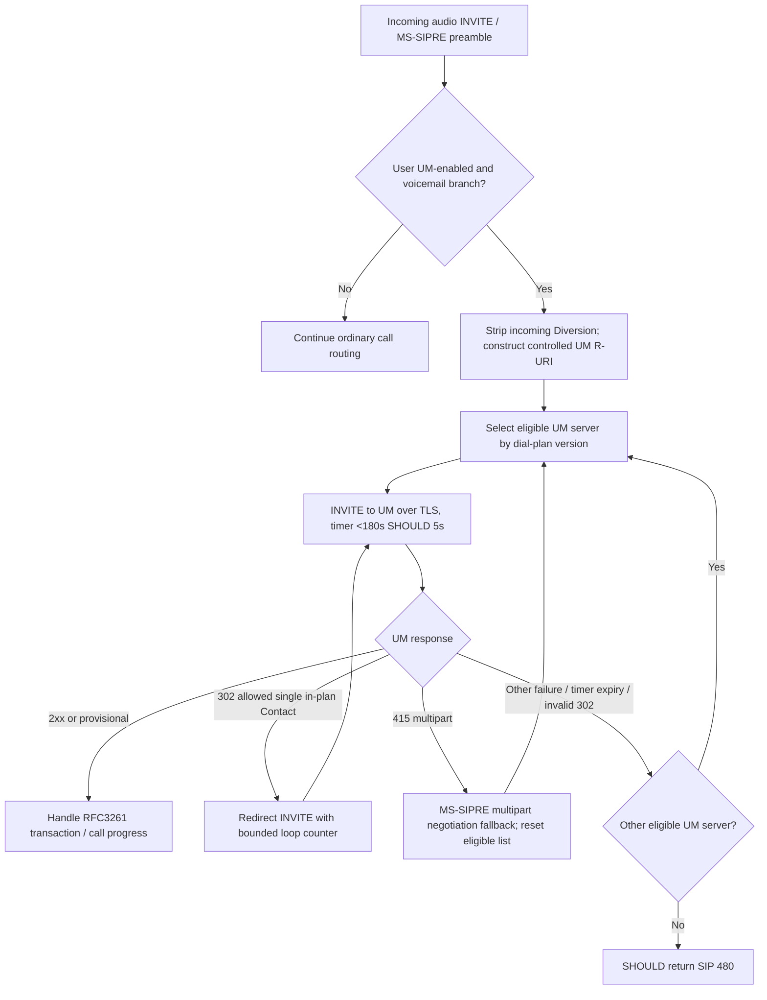

# Exchange UM voicemail routing, provisional SDP and RTP DTMF — exact state/role boundaries

**Original-only research date:** 2026-10-23. Not exhaustive and not an implementation specification. Primary Microsoft source editions (owner's `catalog.zip`, official files and SHA256 from `catalog/inventory.json`):
- **[MS-EUMR] rev9.0 v20250520, May 20 2025**, PDF SHA256 `483eea91ca631981393ff96e512620051377b1463962b93b1d5f42cbc1157ed3`, original **§§1.3–1.7,2.2.1–2.2.6,3.1.1–3.1.6,3.2.1–3.2.6** (PDF pp9–20, p16 rendered); [Microsoft original](https://officeprotocoldocs-f5hpbjgea6b8gneq.b02.azurefd.net/files/MS-EUMR/%5BMS-EUMR%5D.pdf).
- **[MS-EUMSDP] rev9.0 v20250520**, SHA256 `d9c8c1b658fb25530fdd4032b7a97a45fe199feb12ef9950ef0d50a07c18c3d6`, original **§§1.3–1.5,2.1–2.2,3.1.1–3.1.5** (PDF pp7–10, p10 rendered).
- **[MS-DTMF] rev15.0 v20250520**, SHA256 `53ea6180bb1b4dad11966a4d0d5d134cab75fd432472070505d91f09633ea405`, original **§§1.3–1.7,2.1–2.2.1,3.1–3.3** (PDF pp6–12, p11 rendered).
- Supporting Microsoft **[MS-SIPRE] rev13 §§2.2.3,3.8.5,3.9.5.5**, **[MS-SDPEXT] rev16 §§3.1.5.3,3.1.5.5,3.1.5.12,3.1.5.18–33**, **[MS-AVEDGEA] rev12**, **[MS-ICE2] rev19**, **[MS-TURN] rev21**, **[MS-QoE] rev12**.
- IETF originals [RFC3261](https://www.rfc-editor.org/rfc/rfc3261) SIP, [RFC3264](https://www.rfc-editor.org/rfc/rfc3264) SDP offer/answer, [RFC4566](https://www.rfc-editor.org/rfc/rfc4566) SDP, [RFC4733](https://www.rfc-editor.org/rfc/rfc4733) telephone event RTP (December 2006) §§2.2–2.5, [RFC2976](https://www.rfc-editor.org/rfc/rfc2976) legacy INFO (superseded by [RFC6086](https://www.rfc-editor.org/rfc/rfc6086)), [RFC3892](https://www.rfc-editor.org/rfc/rfc3892) Referred-By. Archived `IETFDRAFT-DIISIP-08` Diversion must still be mapped to exact draft publisher/edition. Microsoft EUMR explicitly cites **RFC2327** historical SDP for its notification dialog while EUMSDP cites **RFC4566**.

Tags: **P** directly read original normative clause, role-scoped; **R** RFC verified; **S** derived composite; **U** unspecified client/runtime.

## I. UM incoming voicemail route and bounded server retry

| ID | Original clause and role | Normative meaning |
|---|---|---|
| UM-01 | MS-EUMR §§1.3–1.6,3.1, SIP proxy | UM voicemail only when target **is UM-enabled** and client/server deploy appropriate SIP voicemail; not evidence that every Windows install has Exchange UM/voicemail. Proxy owns **dial-plan→UM-server** and **user→dial-plan** configuration. |
| UM-02 | §2.2.2, proxy | To route deposit INVITE into UM, Request-URI **user = dial plan name**, host **UM server FQDN**, port **5061**, URI parameter `transport=tls`, `maddr=UM server FQDN`. Original uses these exact URI parameters, not arbitrary SIP URI inherited from caller. |
| UM-03 | §§3.1.5,2.2.1 | Proxy **MUST strip any original Diversion header**; if Request-URI user+host differs from From user+host, add new Diversion with Request-URI's SIP URI stripped of URI parameters and headers. Preserve this **proxy role**; ordinary Windows caller UAC is not directed to fabricate Diversion. |
| UM-04 | §§3.1.1,3.1.5 | When A/V Edge present proxy **MUST** add `Ms-Mras-Address: <SIP-URI>` with Edge GRUU, to let UM obtain its own media relay tokens; UM then uses MS-AVEDGEA/MS-TURN for **outside** callers. Edge credential is not client SIPAE SA or Voicemail access code. |
| UM-05 | §3.1.5 | Proxy **MUST** order UM servers for user dial plan; if mixed versions, restrict to **highest version**, and prefer frontend/array when available per source SHOULD. Proxy **MUST start timer** on routing selected UM server, not run an unbounded random retry. |
| UM-06 | §3.1.2 | **UM routing timer <180 seconds MUST**; **5 seconds recommended**. This is a **proxy wait** for UM INVITE route, not an RTP DTMF digit duration or client 10-second conference IMDN timer. |
| UM-07 | §3.1.5.3, proxy | On selected UM's **302**, proxy **MUST** follow Contact **only** if exactly one Contact, identifies UM server within user's dial plan, and fewer than/equal to **four previous 302 redirects** for that UM server. Otherwise try next eligible UM server. Caller should **not** receive this 302 transparently in this profile. |
| UM-08 | §§3.1.5.4–7 | Proxy **SHOULD** send SIP **101 Progress** to caller each time INVITE routed to a **new** UM server; failure response/UM timer timeout **MUST retry next eligible server**, restarting timer. Once all tried **SHOULD fail caller with SIP 480**. |
| UM-09 | §3.1.5.5, proxy | UM **415** to INVITE with multipart MIME → proxy **MUST reset UM order** and invoke MS-SIPRE §3.9.5.5; any new INVITE then reruns UM route rules. Ordinary 415 response cannot be interpreted solely as unsupported DTMF. |
| UM-10 | §3.1.5.1–2, UM server | UM can obtain AV Edge **long-term relay credentials** via MS-AVEDGEA when external caller, and **can publish QoE** after audio call if monitoring server provisioned. Both are independent from UM SIP INVITE answer and user's voicemail mailbox entry. |

### Server-selected voicemail routing (S)

**Source qualification:** 100–299 responses are handled per RFC3261; diagram groups them for display, **not** assertion a 1xx is a final accepted call. The optional 101 Progress is Microsoft-specific. No universal retransmission order when 302 races with timer is established by cited clauses.

## II. UM notifications as a *separate* server-to-server SIP dialog

| ID | Original clause | Source role and state |
|---|---|---|
| UMN-01 | MS-EUMR §2.2.3,§3.2.1–3 | **SIP proxy** for UM-enabled user establishes/reuses **dedicated INVITE dialog with UM notification server**, then sends **INFO** body `application/ms-rtc-usernotification+xml`; ordinary caller or callee desktop **does not directly send these server notifications** according to source. |
| UMN-02 | §§2.2.4–2.2.5 | Notification-dialog SDP **`m=application 9 SIP *`**, `a=sendonly` proxy/INVITE and `a=recvonly` UM/200; `a=accept-types:application/ms-rtc-usernotification+xml`, server answer adds `ms-rtc-accept-eventtemplates:RtcDefault`. This is **not audio/media RTP** and has port 9 as SDP placeholder. |
| UMN-03 | §2.2.4.1–2, proxy | Notification dialog uses defined **special From SIP identity** `sip:A410AA79-D874-4e56-9B46-709BDD0EB850`, target Request-URI at UM FQDN with `transport=tls`, empty user part, `opaque=app:rtcevent`. Avoid confusing user notification dialog with user voicemail audio dialog. |
| UMN-04 | §§2.2.3.1–3, XML | Notification includes required **User SIP URI**, UTC **Time**, fixed `Template=RtcDefault`, `Event type=missed|answered|forbidden` and required original SIP **CallId + From**; conditional `Target`, `TargetClass`, `AnsweredBy`, `MissedReason`. `CallId` is original call's ID, not server notification INVITE's ID. |
| UMN-05 | §§3.2.2–3.2.6 | **Mutual TLS server-to-server** required; **reuse UM notification INVITE dialog**, reset **10 minute idle timer** on each INFO; after timer expires dialog **SHOULD terminate**, later event creates new dialog. Do not confuse 10m inactivity with UM INVITE **5-second suggested** routing timeout. |
| UMN-06 | §§3.2.4.1–3.2.4.1.1 | Missed event when caller hangs up before answer/voicemail or all destinations negative (unless `Ms-Sensitivity: private-no-diversion`); `MissedReason=CallerReleased|Declined` per cause. INFO `Event type=missed`. |
| UMN-07 | §§3.2.4.2–3.2.4.2.1 | `answered` event for call accepted by another target (not registered endpoint or simultaneous ring); special source treats SIP **200,303,605** as triggering answers; `Target/TargetClass` mandatory and `AnsweredBy` set from response PAI when present. Do not interpret 605 as generic SIP answer for normal peer. |
| UMN-08 | §§3.2.4.3–3.2.4.3.1 | `forbidden` event for external target's SIP **403**, not an automatic report on SIPAE account-password 403. Proxy may suppress notification for team/delegate destination; XML `TargetClass` distinguishes primary/secondary. |
| UMN-09 | RFC2976/6086 vs MS-EUMR §2.2.3 | Notification INFO is legacy RFC2976 named usage, **not** the same as conference typing INFO (MS-CONFIM) or conference-control C3P INFO (MS-CONFBAS). RFC6086 obsolescence preserves legacy use with negotiated controls; do not inject Info-Package header blindly. |

## III. Exchange UM SDP narrows media renegotiation

| ID | Original clause | Evidence |
|---|---|---|
| UMSDP-01 | MS-EUMSDP §§1.3–1.5,3.1.5 | **Only `m=audio` accepted**. Video and application-sharing `m=` lines rejected. Media and offer/answer inherit MS-SDPEXT 16.0 unless overridden here. Not a universal SfB Full Client media restriction outside UM. |
| UMSDP-02 | §3.1.5 | SDP `o=` session-version **MUST be numeric** but receiving server **SHOULD ignore its value**; server **SHOULD increment** in subsequent offers. This is a UM-specific override and not generic RFC3264 acceptance semantics. |
| UMSDP-03 | §3.1.5 | For SDP answer in provisional **18x**, the final response's SDP on **same fork** treated identical; any differences on final answer **ignored**. In generic MS-SDPEXT, same-fork final can have specified changes; **source-dependent behavioral divergence**, critical for early secure audio. |
| UMSDP-04 | §3.1.5 | `a=x-bypassid`, `a=x-bypass`, `a=x-mediasettings`, `a=rtcp-rsize`, `a=rtcp-fb`, `a=x-ssrc-range`, `a=x-source-streamid`, `a=x-source` **ignored**. `ms-bypass` support from PSTN SIP level does not imply UM audio SDP bypass supported. |
| UMSDP-05 | §§1.4,3.1.1–3.1.5 | Original dependency matrix: **MS-SDPEXT**, MS-ICE/ICE2, MS-TURN, MS-RTP, MS-DTMF, MS-SRTP, MS-QoE, MS-SIPRE. **UM only audio** still depends on ICE/SRTP/DTMF but not arbitrary video/sharing settings. |

## IV. DTMF event payload, negotiated codec and integrity

| ID | Original clause | Normative transport-level meaning |
|---|---|---|
| DTMF-01 | MS-DTMF §§1.3–1.5,2.1 | Extension to **RFC4733** for **out-of-band telephone-event** carried in **RTP**; does **not** define mixed-in-band tone generation. Requires established RTP session and **SDP negotiated dynamic payload type**, via MS-SDPEXT §§3.1.5.3/.5. |
| DTMF-02 | §§2.2–2.2.1,3.3 | Support events **0–15** and additional Microsoft **event 16**, described as reserved under RFC4733; example `a=rtpmap:101 telephone-event/8000`, `a=fmtp:101 0-16`. **101 is only an example dynamic payload number**, not a fixed RTP PT. |
| DTMF-03 | §3.2, receiver | **MUST NOT** use MS-RTPRADEX redundant RTP payload blocks and **MUST NOT** use multiple DTMF events per RTP block. |
| DTMF-04 | §3.3, sender | Sender **MUST NOT** generate redundant blocks or pack multiple DTMF payloads per RTP packet; **MUST NOT** send duration zero or duration above RFC4733 §2.3.5 max. |
| DTMF-05 | RFC4733 §§2.2–2.5 | Telephone event RTP packets use event code, end flag, volume, duration and **RTP timestamp at event onset**, with subsequent updates increasing duration, same audio sequence/timestamp base. RTP duplicate handling and reliable end signaling need RFC4733 rather than inventing a SIP INFO DTMF packet. |
| DTMF-06 | MS-DTMF §1.7 | Protocol defines **no independent authentication/security scheme**: protection depends on RTP/SRTP agreed media security. Successful SIP REGISTER or DTMF RTP header alone does not certify trusted end-to-end tone receipt. |
| DTMF-07 | MS-EUMSDP §1.4 and MS-DTMF §1.4 | UM IVR/voicemail can use RTP DTMF; independent **media codec/telephone-event negotiation** must be set before sending. This is distinct from phone-context used to route *call initiation*. |

## V. Cross-protocol negative cases and open gates

**First-party concern UM-ED01 (same-fork SDP precedence):** MS-SDPEXT v20250520 §3.1.5.12.3 allows some provisional→final adjustments; MS-EUMSDP v20250520 §3.1.5 says **all differences ignored for same fork**. These are not universally contradictory if MS-EUMSDP intentionally overrides for UM-only audio; model *peer role and media type* and don't apply the UM override to P2P / PSTN gateway / conference.

**UM-ED02 (three different timers):** proxy UM INVITE routing **SHOULD 5s, MUST <180s**, UM event-notification dialog inactivity **10 minutes**, conference IMDN sender **10 seconds**, ICE consent **30 seconds**. None is SIPAE 8h SA lifetime or ordinary RFC4028 session refresh interval. No universal recovery clock.

**UM-ED03 (legacy SIP INFO):** UM notification INFO is a proxy→UM server notification on **separate SDP application INVITE dialog**, not a desktop user MESSAGE/INFO feature. Full desktop UI missed call display arises from separate server services outside examined packet sequence.

**UM-ED04 (UM deployment optional):** Exchange UM must exist and user be enabled; legacy UM support on current/retired server versions not assumed. MS-EUMR 2025 document is not proof present-day hosted Exchange supports same transport.

**UM-ED05 (real errors):** 302 loop bounded by max four prior redirects, 415 MIME restart and other response fallback to eligible server. Routing proxy alone controls UM server selection. Need race analysis for 302 vs 5s timer and final caller SIP transaction, plus 180s bound override and all exact product notes.

**UM-ED06 (DTMF source):** RFC4733 update/supersession exact status for events 16, long events/segment wrap and redundancy, MS-RTPRADEX effect, SRTP authentication and ICE media path expiration; negotiated SDP `telephone-event` support is not sufficient without security session. Do not assume phone keypad digit always travels as ordinary SIP INFO or audio tone.

**UM-ED07 (credentials):** EUMR can provide UM server A/V Edge GRUU, then UM obtains TURN credentials via AVEDGEA. This server trust path is not license to copy desktop user credentials to voice mail. PKI and TLS proxy/UM MTLS require full normative host identity proof.

**UM-ED08 (full voicemail lifecycle):** Deposit call, check/play voicemail, Play-On-Phone, diversion/fork, transfer, privacy and user notifications have additional MS-SIPRE, MS-OCEXUM, MS-EUMSDP, MS-OCAUTHWS and product notes. The evaluated sections do not establish all full-client UI behavior.

**State:** partial original-source normative proof only, not a final cross-protocol implementation plan; **NO** protocol code, live-server contacts or interoperability testing, merge or release.