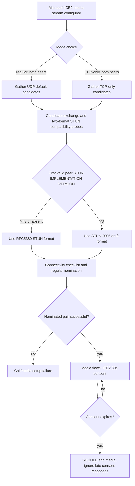

# Original MS-ICE 11.0 vs MS-ICE2 19.0: non-equivalent profiles, IETF drafts and recovery limits

**2026-10-22; original Microsoft PDFs directly cross-compared, research only.** Editions **MS-ICE rev11.0 / v20250520** (SHA256 `6461f7957d2bf9bf696995968df804ad15a674af375e1171a0662ab6986657d8`), and **MS-ICE2 rev19.0 / v20250520** (SHA256 `41a7ad81272bf83cd36bb8a88116fa446802d502732aa403c268acf1eeec4631`), both Microsoft 20 May 2025. Original texts directly inspected §§1.2,1.5–1.7,2.1–2.2.2,3.1.2,3.1.4–3.1.6; product notes and complete examples still unverified. Official source URLs and hashes are stored in owner `catalog/inventory.json`. First-party archived IETF texts: [ICE-06](https://datatracker.ietf.org/doc/html/draft-ietf-mmusic-ice-06) (Oct 19 2005), [ICE TCP-00](https://datatracker.ietf.org/doc/html/draft-ietf-mmusic-ice-tcp-00) (Feb 27 2006), [ICE-19](https://datatracker.ietf.org/doc/html/draft-ietf-mmusic-ice-19) (Oct 29 2007), [ICE TCP-07](https://datatracker.ietf.org/doc/html/draft-ietf-mmusic-ice-tcp-07) (July 14 2008). RFC5245, RFC6544 and RFC8445 are successors, **not implied exact historical profiles**.

## 1. Client compatibility is two **different** Microsoft specifications

| ID | MS-ICE 11.0 primary clauses | MS-ICE2 19.0 primary clauses | Consequence |
|---|---|---|---|
| ICE-C01 | §1.2 cites **`IETFDRAFT-ICENAT-06`** and **`IETFDRAFT-TCPCICE-00`** (exact IDs original: `draft-ietf-mmusic-ice-06` and `draft-ietf-mmusic-ice-tcp-00`). | §1.2 cites **`IETFDRAFT-ICENAT-19`** and **`IETFDRAFT-ICETCP-07`** (exact IDs `draft-ietf-mmusic-ice-19`, `draft-ietf-mmusic-ice-tcp-07`). | These define **different checklist/nomination/role and TCP procedures**, not mere document name variants. All four original drafts are found in IETF Datatracker. |
| ICE-C02 | §§1.7, 2.1 **IPv4-only**, explicitly does not support IPv6. | §§1.7,2.1 transport **IPv4/IPv6**, subject to product behavior note `<1>`. | IPv6 feature must be variant/peer/deployment-guarded. |
| ICE-C03 | §1.6 requires **exactly two components per candidate** (RTP and RTCP). | §1.6 also exactly two components, despite conditional UDP RTP/RTCP mux under RFC5761; also multiplexes components over TCP. | Do **not** map RTP/RTCP mux to one-component standard ICE state without checking Microsoft's component-ID rules. |
| ICE-C04 | §1.6 TCP cannot work without TURN server; two components multiplexed to same TCP address. | §1.6 modes **regular** or **TCP-only**; regular-mode TCP requires TURN, **both agents must use same mode**, TCP-only differs. | Application-sharing/TCP-only cannot be inferred supported in old ICE profile. |
| ICE-C05 | §3.1.2 candidate gathering timer **SHOULD default 10s**. | §3.1.2 gathering timer **MUST default 10s**. | Same numeric setting with **different normative force**. |
| ICE-C06 | §§3.1.2,3.1.6.2 connectivity timer max 10s and on peer check+response **MUST reset to 3s**. | §§3.1.2,3.1.6.2 max 10s but reset on peer check+response **MUST be 5s**. | Timer profile must not be shared between ICE and ICE2. |
| ICE-C07 | §3.1.4.8.2.6 uses candidate states **valid/invalid**, caller chooses best; no separate regular USE-CANDIDATE nomination per ICE2 state machine. | §3.1.4.8.2.6 candidate states **Succeeded/Failed**, controlling agent Valid List then **Regular Nomination**; nomination timer §3.1.2/3.1.6.4 max 10s SHOULD. | Different peer roles and termination checks; no generic 'ICE_OK' shortcut. |
| ICE-C08 | §2.2.2 STUN peer message format follows **`IETFDRAFT-STUN-02`**; additionally references TCP framing. | §§2.2.2,3.1.5.2 supports **draft STUN-02 and RFC5389 format**, with optional dual-probes before version detection and `IMPLEMENTATION-VERSION` gating. | Inferred wire parsers must distinguish 2005 STUN draft's 128-bit ID/cookie behavior from RFC5389 fixed-cookie and 96-bit ID. |
| ICE-C09 | §3.1.5.1 TURN messages follow **MS-TURN**. | §3.1.5.1 TURN messages use MS-TURN §3.2.5 and **can also support RFC5766** with product note <15>. | Relay-version choice is **independent** from ICE peer STUN version; cannot deduce modern TURN from `ICE2` name. |
| ICE-C10 | §1.6 RTP/RTCP ICE keepalives for used RTP component and RTCP packets maintain RTCP binding. | §1.6 checks-phase keepalive also for *both* RTP and RTCP on validated and relayed candidate pairs; for selected media pair RTP ICE keepalives and RTCP traffic as separate rules. | Timing/transport-only; not SIP Ms-Keep-Alive or RFC4028 session refresh. |
| ICE-C11 | §3.1.2 ICE keepalive default **MUST <=19s**. | §3.1.2 same <=19s, plus §3.1.6.5 **30s consent freshness**, 5s recommended check intervals. | Consent-specific state is explicit in ICE2; **not proven** for old MS-ICE at these sections. |
| ICE-C12 | §1.6 and §3.1.4 stream transport change requires media stream to stop then reconnect candidate procedure. | §1.6 **explicitly 'does not support ICE restarts'** but §3.1.4 likewise orders stop and restart stream connectivity procedure when media/candidate address changes. | Distinguish **an ICE protocol restart within existing ICE negotiation (unsupported)** from **application stopping media and initiating a fresh connectivity-establishment procedure**. Claim of transparent RFC8445 restart is NOT supported. |
| ICE-C13 | §1.6 both endpoints need RTP and RTCP nonconsecutive ports. | §1.6 same; UDP mux supported if RFC5761 negotiated. | Port arithmetic cannot assume RTP port+1 for RTCP; mux only if negotiated. |
| ICE-C14 | §3.1.4.8.2.6 failure when no valid check pair on timer; caller chooses best. | §3.1.4.8.2.6 no valid controlled nomination result → **MUST fail**; early nomination failure ends call. | Response path for peer capability mismatch is not identical. |
| ICE-C15 | §2.1 message send max **1500 bytes**; receive <=1500. | §2.1 same max; applies to messages per this ICE profile and not arbitrary SRTP MTU or TURN data packet. | Wire buffer/reassembly policy still requires lower-level transport study. |

### 2. The MS-ICE2 dual-STUN format decision (§3.1.5.2) — role/edition-specific

The following rule is **directly specified in MS-ICE2 19.0**, not modern generic RFC8445 negotiation:

1. During checks, when sending `IETFDRAFT-STUN-02` formatted Binding Request, implementation **SHOULD** also send RFC5389-formatted check until it has received a valid peer STUN message.
2. From **first valid** peer STUN read proprietary `IMPLEMENTATION-VERSION`: `>=0x00000003` means **RFC5389** format supported, below `0x03` means **only historical draft** format.
3. **Missing** IMPLEMENTATION-VERSION implies **RFC5389 only**, not 'assume old draft'.
4. **All subsequent** checks MUST use determined peer-supported format.

This is a **STUN peer format** version gate, different from the **MS-TURN relay `MS-Version>=3` HMAC SHA256** gate. Similar numeric thresholds do **not** permit sharing a single version state.

**Mermaid caveat:** version decision can occur asynchronously to candidate exchange; simplified display does not claim that both peers must emit both formats or that a missing version always occurs. Mode/candidate states are per-stream, and TURN Allocation/relay credential state is independent; no universal mandatory TURN route.

## 3. High-risk misinterpretation register

- **MIS-ICE01:** MS-ICE vs MS-ICE2 are separate Microsoft Open Specs, both 2025 editions, not proof of linear upgrades in a particular Windows client. Need SDP capability/body profiles from MS-SDPEXT, MS-CONFAV and product notes.
- **MIS-ICE02:** MS-ICE2 says no ICE restarts. Previous media state ledger used the phrase 'stream restart'; this means initiating a new stream procedure, not proof of **RFC8445 ICE restart support**.
- **MIS-ICE03:** MS-ICE2 Lite peer is treated as **non-ICE**, by §1.6, despite modern IETF ICE-Lite role processing. Applying RFC8445 ICE-Lite machinery would contradict the cited Microsoft behavior.
- **MIS-ICE04:** MS-ICE2 does **not** work with aggressive-nomination peer by §1.6; standard generic ICE support cannot be presumed enough. Regular nomination required.
- **MIS-ICE05:** Neither 19s ICE NAT keepalive nor 30s consent timer is the MS-CONMGMT hop-by-hop SIP Keep-Alive or MS-SIPREGE contact registration expiry.
- **MIS-ICE06:** 2025 Microsoft ICE2 documents RFC5389 alongside 2005 draft; successor RFC8489, modern RFC8839 a=ice-options token or RFC8656 TURN **must not be substituted silently**.
- **MIS-ICE07:** A successful SIP INVITE 200 OK or even MS-CONFBAS focus join does not imply ICE nominated, consent valid, SRTP crypto established or MCU stream ready.

## 4. Remaining normative original-source dependencies and product gates

| Reference | Status after this tranche | Outstanding |
|---|---|---|
| `IETFDRAFT-ICENAT-06` | FOUND: https://datatracker.ietf.org/doc/html/draft-ietf-mmusic-ice-06 | Full candidate priority, transaction and error state section audit |
| `IETFDRAFT-TCPCICE-00` | FOUND: https://datatracker.ietf.org/doc/html/draft-ietf-mmusic-ice-tcp-00 | Exact TCP candidate syntax, media demux, reuse/close handling |
| `IETFDRAFT-ICENAT-19` | FOUND: https://datatracker.ietf.org/doc/html/draft-ietf-mmusic-ice-19 | Full regular nomination, checklist freezing, role conflicts, retransmission |
| `IETFDRAFT-ICETCP-07` | FOUND: https://datatracker.ietf.org/doc/html/draft-ietf-mmusic-ice-tcp-07 | Exact full/TCP-only candidate procedures and interactions |
| `IETFDRAFT-STUN-02` | FOUND: https://datatracker.ietf.org/doc/html/draft-ietf-behave-rfc3489bis-02 | Exact MIC and fingerprint bytes under dual compatibility branch |
| MS-TURN 21.0 | PDF held and selected sections audited | Microsoft TURN legacy-vs-RFC5766 relay selection and full error mapping |
| MS-SDPEXT / MS-CONFAV | PDFs held, partially read | Source profiles selecting **which ICE variant** on actual Windows Full Client and multiparty/media modality |
| RFC6544, RFC8445, RFC8489 | Current successor RFC originals available | Precise normative differences, not blanket replacement |

**CLOSE-OUT STATUS:** Four previously untraced historical ICE draft URLs are located; critical ICE/ICE2 differences directly demonstrated, but overall RFC/Microsoft client reconstruction and security/media errors are still **NOT COMPLETE**. No implementation code or plan, real-server interop tests, main merge, release.
