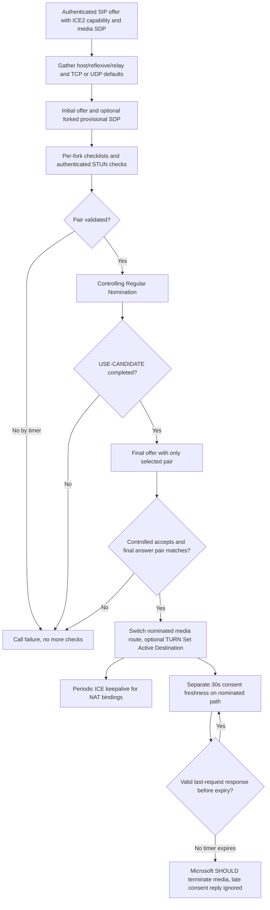

# MS-ICE2 19.0 and MS-ICE 11.0: candidate selection, final offer, consent and historical RFC profile

**Research audit: 2026-10-23. Status PARTIAL/BLOCKED; no protocol implementation or live tests.** Owner-supplied Microsoft original **[MS-ICE2] Interactive Connectivity Establishment (ICE) Extensions 2.0, rev19.0 v20250520, 2025-05-20**, SHA-256 `41a7ad81272bf83cd36bb8a88116fa446802d502732aa403c268acf1eeec4631`, [official PDF](https://officeprotocoldocs-f5hpbjgea6b8gneq.b02.azurefd.net/files/MS-ICE2/%5BMS-ICE2%5D.pdf); cross-source **[MS-ICE] ICE Extensions, rev11.0 v20250520** SHA256 `6461f7957d2bf9bf696995968df804ad15a674af375e1171a0662ab6986657d8`, [official PDF](https://officeprotocoldocs-f5hpbjgea6b8gneq.b02.azurefd.net/files/MS-ICE/%5BMS-ICE%5D.pdf). Sections directly inspected: MS-ICE2 **§§3.1.4.1–3.1.4.8.3, 3.1.5.2.2,3.1.5.3.1–3.1.5.3.3,3.1.6.2–3.1.6.5**; MS-ICE §§3.1.4.8,3.1.5,3.1.6 (structural predecessor cross-check). PDF images checked MS-ICE2 pp27,31. Original IETF [RFC5389](https://www.rfc-editor.org/rfc/rfc5389) (2008 STUN; obsoleted by [RFC8489](https://www.rfc-editor.org/rfc/rfc8489)), [RFC5245](https://www.rfc-editor.org/rfc/rfc5245) (2010 ICE; obsoleted by [RFC8445](https://www.rfc-editor.org/rfc/rfc8445), 2018), [RFC7675](https://www.rfc-editor.org/rfc/rfc7675) (2015 consent freshness), [RFC5761](https://www.rfc-editor.org/rfc/rfc5761) (2010 RTP/RTCP mux), and historic **IETFDRAFT-ICENAT-19 / IETFDRAFT-ICETCP-07 / IETFDRAFT-STUN-02** cited *by this Microsoft document*. **A modern RFC's superseding status does not retroactively rewrite the Microsoft profile.**

Evidence grades: **P** directly checked Microsoft original with actor, **R** normative RFC edition, **S** cross-document inference, **U** unverified deployment/client version. All normative conditions below are **conditional on ICE2 selection**, not mandatory to all Windows desktop modes. Every media component is separate from SIP registration and SDP offer transaction.

## 1. Initial offer and candidates: explicit bounds, not generic ICE defaults

| ID | Exact MS-ICE2 clause | Normative and actor-specific finding |
|---|---|---|
| ICE2-01 | §3.1.4.1 | Calling endpoint **MUST gather local candidates** before first offer; **regular mode default MUST be UDP** and no UDP candidate means **call MUST fail**. **TCP-only mode default MUST be TCP**, with **no UDP candidates gathered or sent**, and no allocated TCP candidate also **fails call**. |
| ICE2-02 | §3.1.4.2 | Callee performs equivalent gathering, chooses mode-appropriate default; **starts checks after receiving caller candidates and gathering its own**. Callee SHOULD send candidates in provisional SDP for latency where applicable, and final answer's candidate/default set **MUST match provisional answer**. |
| ICE2-03 | §3.1.4.3 | For SIP forked **multiple provisional answers**, ICE processing **MUST be independent per provisional branch**. Implementations **SHOULD NOT** process more than **20 provisional answers** and **MUST ignore** replies exceeding their supported resource limit. This is an implementation SHOULD bound, **not** a claim server cannot fork more. |
| ICE2-04 | §3.1.4.4 | Final initial-answer received: caller **MUST start checks** unless already begun after provisional; if begun then **continue existing checklist**. Do not begin a completely new set and discard validated results without a source trigger. |
| ICE2-05 | §3.1.4.8.1.1 | Supported candidate types: UDP host/server-reflexive/relayed; TCP **active/passive host**, active server-reflexive, active/passive relayed. Implementation **MUST NOT gather other types/behaviors** in this profile. This is not RFC8445's universal candidate inventory. |
| ICE2-06 | §3.1.4.8.1.1–.3 | **UDP** RTP/RTCP components MUST have same IP but different ports; **TCP** components MUST multiplex on same IP/port. TCP simultaneous-open **unsupported**. Null, broadcast, multicast, link-local candidates **MUST NOT** be gathered; selected ports **MUST be outside 0–1023**. If both IPv4 and IPv6 same-type candidates available, IPv4 **SHOULD** be higher priority (product note <10>). |
| ICE2-07 | §§3.1.4.8.1.4,3.1.4.8.2.1–2 | Candidate foundations/priorities and ordered checklist defer to cited **IETFDRAFT-ICENAT-19** and **IETFDRAFT-ICETCP-07**, but require local/remote **same transport and IP family**; **TCP vs UDP MUST NOT be paired**. **At most 80 candidate pairs** may be generated. Two media components form each pair (including TCP multiplex). |
| ICE2-08 | §3.1.4.8.2.3–4 | Checklist pair states follow old ICE draft §5.7.4. Binding checks **MUST include USERNAME, MESSAGE-INTEGRITY and FINGERPRINT** and Microsoft's **CANDIDATE-IDENTIFIER** set to local foundation or base foundation for peer-derived local candidate. |
| ICE2-09 | §3.1.4.8.2.4 | ICE check HMAC requires short-term credential mechanism, username format from draft ICE19 §7.1.1, with **explicit Microsoft instruction to use the older STUN message format from §2.2.2 for MESSAGE-INTEGRITY computation**. Do not use later RFC8489 message authentication serialization blindly for initial connectivity checks. |
| ICE2-10 | §3.1.5.2.2 | Incoming connectivity STUN: missing/bad USERNAME and missing FINGERPRINT **discard**; missing MESSAGE-INTEGRITY **401 error**; present but invalid MESSAGE-INTEGRITY **431 error**. Error requests echo USERNAME. These are **STUN errors** and not SIPAE 401 or SIPRE 430. |
| ICE2-11 | §3.1.5.3.1 | Incoming binding response before peer candidates known **MUST discard**; on failed pair discard; missing FINGERPRINT, HMAC mismatch, missing XOR-MAPPED-ADDRESS, null/multicast/broadcast XOR address **MUST discard**. Missing USERNAME **SHOULD discard**. |
| ICE2-12 | §3.1.5.3.3 | For valid STUN binding error response, **401,430,431,432,500 SHOULD prompt retry** on transport address; other errors **MUST set component pair Failed**. STUN 430 is not SIP **430 Flow Failed** under MS-SIPRE §3.7. |

## 2. Nomination/final SDP: selected pair is not yet identical to an accepted media session

| ID | Original clause | Requirement |
|---|---|---|
| ICE2-13 | §3.1.4.8.2.6 | ICE checks end on timer or all pairs Succeeded/Failed. On **controlling endpoint** with empty Valid List **MUST fail call**; highest priority validated pair **MUST undergo Regular Nomination** (draft ICE19 §8.1.1.1); nomination failure **MUST fail call**. |
| ICE2-14 | §§3.1.6.2,3.1.6.4 | After STUN binding request and response, connectivity checks timer **MUST reset to 5 s**. When timer expires **MUST NOT send more connectivity checks**. If USE-CANDIDATE nomination timer expires while incomplete **MUST fail call**. No unlimited retry after expiry. |
| ICE2-15 | §3.1.4.5 | **Controlling agent MUST send final offer**, containing **only nominated local+remote candidate**, **even if same pair was default in initial SDP**. A single initial offer/answer is not enough to declare all ICE2 state final. |
| ICE2-16 | §3.1.4.6 | Controlled agent MUST verify nominated remote candidate known, and local candidate known or recovered via corresponding triggered-check queue; otherwise **call fails**. With verified pair MUST switch media, send final answer containing **only chosen local+remote**; if selected local TURN relay, **SHOULD send Set Active Destination** under MS-TURN. |
| ICE2-17 | §3.1.4.7 | Controlling agent **MUST compare final answer selected pair with sent final offer**; mismatch **MUST fail call**. On match MUST switch media to final pair, SHOULD release unselected local candidates, and SHOULD Set Active Destination for chosen TURN candidate. |
| ICE2-18 | §3.1.4.8.3 | **Regular mode** can send tentative media on **default pair** after initial candidate exchange, **but delivery is not assured**. During checks SHOULD switch when both component pairs succeeded; after final offer/answer **MUST use selected pair**. **TCP-only mode MUST wait until checks complete if reliable data delivery required.** |
| ICE2-19 | §3.1.6.3 | ICE **keepalive** for selected media RTP component uses STUN binding request after configured idle timer, **even if other peer doesn't implement ICE**; **RTCP keepalives SHOULD NOT** be sent because RTCP flow suffices. This mechanism preserves NAT/relay bindings and is *distinct* from verified consent. |

## 3. Consent freshness: primary Microsoft semantics versus RFC7675

| ID | Section | Normative and versioned effect |
|---|---|---|
| ICE2-20 | §3.1.6.5; original PDF p31 | Once path established **consent timer SHOULD be 30 s**, consent request interval **SHOULD be 5 s**. Consent request **MUST be valid STUN Binding** and **MUST use RFC5389 format**, **SHOULD NOT carry CANDIDATE-IDENTIFIER**; **new transaction ID MUST be generated every request**. Distinct from legacy connectivity-check MESSAGE-INTEGRITY serialization. |
| ICE2-21 | §3.1.6.5 | Receive consent request on nominated path: validate username/HMAC per §3.1.5.2.2, **SHOULD NOT send STUN error for consent**, **MUST silently discard when MESSAGE-INTEGRITY invalid**, and MUST reply with valid RFC5389 STUN Binding response when valid. |
| ICE2-22 | §3.1.6.5 | **Only response whose Transaction ID matches the *last sent* consent request** is used for resetting consent: validate **FINGERPRINT + MESSAGE-INTEGRITY** and **MUST reset 30-s timer**. After timer expiry **endpoint SHOULD terminate media session**; **all late responses MUST ignore**. |
| ICE2-23 | [RFC7675](https://www.rfc-editor.org/rfc/rfc7675) §5.1 | RFC defines strict consent expiration: **MUST cease sending application data on 5-tuple** after 30s without valid response, checks SHOULD have jitter **4–6 seconds** around 5s, minimum interval 4s, allow matching responses from still-outstanding request transactions and support consent even over TCP. Microsoft ICE2 states last sent response matching and SHOULD terminate media on expiry, but excerpt does **not** expressly forbid earlier/older valid responses being processed for any other reason. **Do not automatically apply RFC7675 MUST/jitter to the 2025 ICE2-specific code path without establishing actual negotiated profile**; likewise never turn Microsoft SHOULD into MUST merely because modern RFC exists. |
| ICE2-24 | RFC7675 §5.1 vs MS-ICE2 §§3.1.6.3/.5 | RFC distinguishes consent Binding Request/**Response** from ordinary NAT keepalive Binding Indication. Microsoft ICE2 §3.1.6.3 explicitly calls its keepalive a **STUN Binding Request**, not an RFC7675 indication. Keepalive/consent need distinct purpose, timer and validation policy, even if packet method overlaps. |

### Conditional ICE2 media lifecycle (S — not universal observed client flow)

## 4. Source applicability and research gaps (blocking)

- **ICE-ED01:** MS-ICE **11.0**, MS-ICE2 **19.0**, historical ICE draft19 and modern RFC5245→RFC8445 form **different wire/candidate models**. MS-ICE §3.1.6 has no dedicated Consent Freshness Timer subsection whereas MS-ICE2 does. This is *not* proof all legacy ICE traffic lacks consent under other optional specs.
- **ICE-ED02:** Microsoft ICE2 explicitly requires some checks' HMAC over old STUN format and consent on **RFC5389** format. Reusing one universal STUN byte parser/HMAC input without source condition would be unsafe. Need exact §2.2.2 STUN encoding and RFC5389/8489 transition.
- **ICE-ED03:** STUN errors **430/431** cannot be mapped to SIP 430 dialog route recovery, TURN Allocate error or SIPAE credentials. Different authentication credentials and state machines.
- **ICE-ED04:** ICE2 20 provisional answer SHOULD limit and 80 candidate pair MUST limit; interplay with forked 18x→200 SDP key changes MS-SDPEXT §3.1.5.12.3 must be per fork without transferring validated pair across peers.
- **ICE-ED05:** **Connectivity check 5-s reset**, **nomination timer**, **NAT keepalive timer**, **5-s consent period**, and **30-s consent expiry** are distinct from RFC4028 media dialog and TURN Allocate retransmission 650ms. No global media `connected` Boolean.
- **ICE-ED06:** TCP-only candidate RTP+RTCP shares same IP/port; SDP `rtcp-mux` §3.1.5.38 under older draft19 needs exact profile/RTCP component validation. Do not declare ordinary UDP RTP/RTCP mux always supported.
- **ICE-ED07:** After ICE consent loss, original excerpt says **SHOULD terminate media**, not a documented SIP BYE or REGISTER deregistration. App/media peer recovery, restarting ICE, TURN allocation lifecycle and QoE loss report timing remain U.
- **ICE-ED08:** RFC7675's stricter **MUST cease transmission** on 5-tuple is important for current security best practice, but user asks historical client **documentary reconstruction**, not retroactive standard adoption; record this difference for future policy/compatibility resolution.
- **ICE-ED09:** Media success still requires negotiated **SRTP/SSRTP transform integrity** and user/conference authorization. Proven [SHA1/SHA256 normative conflict](ms-srtp14-sdpext16-ssrtp11-sha1-sha256-original-normative-conflict-2026-10-23.md) remains BLOCKED even with successful ICE.
- **ICE-ED10:** Need source-aligned SDP `a=candidate` format, STUN error authentication nonce/role, RFC ICE priority and tie-break, TCP active/passive interplay, server behavior notes and client software version with original IETF draft19/07 full text and RFC errata.

**Status incomplete; no implementation, live-server traffic/interoperability testing, merge to main or release.**
