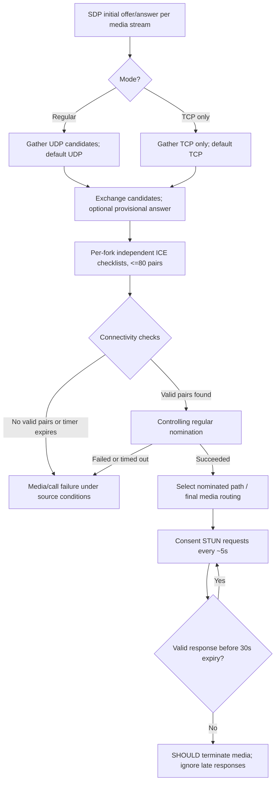

# Original MS-ICE2 19.0 media connectivity, nomination, fork and consent — RFC profile reconciliation

**Audit date:** 2026-10-22. **Status: PARTIAL original-text proof, entire client remains UNVERIFIED.**
Microsoft primary source: user-supplied original `catalog/MS-ICE2.pdf` and matching `.txt`, **[MS-ICE2] Interactive Connectivity Establishment (ICE) Extensions 2.0, revision 19.0, v20250520, release May 20, 2025**, inspected §§2.2.2–2.2.3, 3.1–3.1.6.5, original PDF pp19–31. Current authoritative official version index: https://learn.microsoft.com/en-us/openspecs/office_protocols/ms-ice2/8cd2fe91-1aa6-49e1-b482-f92b5c40b7e2 (published version 19.0, May 20, 2025). Original standards from RFC Editor: [RFC 8445](https://www.rfc-editor.org/rfc/rfc8445) (July 2018, obsoletes RFC5245, updated RFC8863), [RFC 8839](https://www.rfc-editor.org/rfc/rfc8839) (January 2021, SDP usage, obsoletes RFC5245 and RFC6336), [RFC 7675](https://www.rfc-editor.org/rfc/rfc7675) (October 2015, consent freshness), [RFC 8489](https://www.rfc-editor.org/rfc/rfc8489) (February 2020, obsoletes RFC5389).

**Evidence tags:** P = directly read Microsoft's precise normative wording, R = directly checked RFC Editor normative text, S = cross-protocol reasoning, U = unproven deployment or binary behavior. Capitalized MUST/SHOULD apply to their original clauses, not generic Windows code planning.

## 1. Media establishment and per-stream state (P)

| ID | Original Microsoft clause | Normative evidence / scoped behavior |
|---|---|---|
| ICE2-01 | §3.1 | Supports *regular mode* or *TCP-only mode*, signaled by higher-layer; regular is default. Each media stream **MUST** undergo connectivity establishment independently. |
| ICE2-02 | §3.1.4 | If a stream transport address or a candidate changes, the specific media stream **MUST** stop and restart its connectivity procedure. If peer does not support ICE, post-initial offer/answer default transport addresses **MUST NOT** change. This prevents inventing universal transparent migration without a new negotiated procedure. |
| ICE2-03 | §3.1.4.1–2 | Caller/callee **MUST** gather and signal candidates via established signaling channel; regular mode default candidate **MUST** be UDP (no UDP => fail call); TCP-only mode default **MUST** be TCP, with no UDP candidates (no TCP => fail). |
| ICE2-04 | §3.1.4.2–4 | Callee starts checks after gathering; optionally sends provisional answer to reduce latency, but provisional and its subsequent final answer from same endpoint **MUST** contain same candidate set/default candidate. Caller can start on provisional answer and **MUST** continue checks when final answer arrives. |
| ICE2-05 | §3.1.4.3 | Forked INVITE may produce several provisional answers. ICE checks are **independent per provisional answer**. Implementations **SHOULD NOT** process more than 20 provisional answers; can cap lower under resource constraints; extras beyond supported limit **MUST** be ignored. This is **Microsoft ICE fork resource limit**, not RFC3261 limit for SIP 2xx. |
| ICE2-06 | §3.1.4.8.2.1–3 | Forms RTP+RTCP component pairs by corresponding components; **MUST NOT** form more than **80 candidate pairs**; priority/sort/state reference legacy `IETFDRAFT-ICENAT-19`. Need exact outdated draft availability and algorithm comparison. |
| ICE2-07 | §3.1.4.8.2.4 | Binding connectivity check requests **MUST** contain USERNAME and MESSAGE-INTEGRITY using STUN short-term credential; **MUST** have fingerprint, **MUST** have proprietary CANDIDATE-IDENTIFIER set to specified local candidate foundation (or peer-derived base foundation). Source distinguishes older STUN draft message layout for MIC from RFC5389. |
| ICE2-08 | §3.1.4.8.2.6 | At checks end, if controlling party Valid List empty, call **MUST fail**. Controlling party starts **Regular Nomination** with highest-priority valid pair; nomination success => final media pair; failed nomination => **MUST fail**. |
| ICE2-09 | §3.1.4.8.3 | Before final exchange, media **MUST** use default pair if sent at all; when components succeed, **SHOULD** switch to first succeeded pair; after final exchange **MUST** use selected best pair. TCP-only applications needing reliable delivery **MUST wait** until checks complete. No assumption RTP is safely flowing because SIP 200 was seen. |
| ICE2-10 | §3.1.5.3.1 | Binding response before remote candidates, with failed component, missing fingerprint, bad MESSAGE-INTEGRITY, missing XOR-MAPPED-ADDRESS or invalid mapped IP **MUST** be discarded (USERNAME absent **SHOULD** be discarded). |
| ICE2-11 | §3.1.5.3.3 | Error response 401,430,431,432,500 => checks for address **SHOULD** be retried; other errors => candidate pair **MUST** become Failed. **STUN 430 is not SIP 430 Flow Failed** in MS-SIPRE §3.7. |
| ICE2-12 | §3.1.6.1–2 | Gathering timer expiration => exchange gathered candidates. Checks-phase timer **MUST reset to 5 seconds** after peer request+response; expiration ends checks; if no validated candidate controlling call **MUST fail**; no further checks after expiry. |
| ICE2-13 | §§3.1.2,3.1.6.4 | Gather timer default **10 s**; connectivity-check maximum **10 s**; ICE keepalive default **≤19 s**; controlling USE-CANDIDATE nomination timer maximum **SHOULD** be 10 s, and on expiry with incomplete nomination call **MUST** fail. |
| ICE2-14 | §3.1.6.3 | Keepalive over used RTP component is STUN **binding request** according to special §2.2.3 profile; on timer expiry while no media/keepalive traffic **MUST** send; RTCP keepalives **SHOULD NOT** be separately sent because RTCP refreshes NAT bindings. This differs from SIP hop-hop `Ms-Keep-Alive` in MS-CONMGMT. |
| ICE2-15 | §3.1.6.5 | After successful path, consent timer **SHOULD** reset to **30s**; consent checks **SHOULD** recur every **5s** on nominated path. Requests **MUST** follow RFC5389 format with fresh transaction ID each time and SHOULD NOT carry CANDIDATE-IDENTIFIER. |
| ICE2-16 | §3.1.6.5 | Invalid consent MESSAGE-INTEGRITY => **discard**, **SHOULD NOT** reply with error; valid check => mandatory STUN binding response. Validate matching transaction ID of **last** sent request, FINGERPRINT and MESSAGE-INTEGRITY before resetting 30s timer. |
| ICE2-17 | §3.1.6.5 | When consent expires endpoint **SHOULD terminate media session**; any consent response arriving **after timer expires MUST be ignored**. Distinguish missing consent from SIP dialogue state and SRTP key expiry. |

### Conditional ICE phase state model

**S qualification:** A successful SDP media negotiation and independent ICE channel connectivity are separate state variables. Branch-specific ICE checks need not finish when SIP INVITE receives 200. The diagram omits partial/provisional answer races, TURN allocations, RTCP multiplexing, ICE-lite behavior and unsupported profile branches; no claim of canonical one-path packet order.

## 2. Three different STUN profiles in this *one* Microsoft specification

| Variant | Source | Purpose | Processing distinction |
|---|---|---|---|
| Peer connectivity check | MS-ICE2 §§3.1.4.8.2.4, 3.1.5.2–3 | Candidate pairing and validation | Legacy draft-specific encoding permitted/used plus RFC5389 parallel check; USERNAME, short-term MIC, fingerprint and CANDIDATE-IDENTIFIER mandatory under cited variant. |
| ICE NAT/TURN keepalive | §2.2.3, §3.1.6.3 | Maintain NAT bindings/TURN allocations | Binding request has restricted attribute set; TCP framing per RFC4571; **not identical to consent challenge**. |
| Consent freshness | §3.1.6.5 | Demonstrate remote willingness on nominated 5-tuple | **RFC5389** layout, fresh transaction IDs, no CANDIDATE-IDENTIFIER recommended, 30s deadline, ignore expired responses. |

**Security:** STUN short-term credentials/MESSAGE-INTEGRITY prove check-source possession of ICE password under relevant scheme, not user SIPAE login, media key exchange, or permission to stream to any third party. Valid response must correspond to expected transaction and transport address; source validation exceptions/rules remain an exact-byte investigation.

## 3. IETF version and terminology conflict register (R)

| Entry | First-party RFC reference | Why Microsoft profile cannot be silently updated |
|---|---|---|
| RFC-V01 | RFC8445 §21, RFC8839 §§1,11 | Modern ICE removes aggressive nomination, revises state and pacing, and separates SDP procedure to RFC8839. Microsoft MS-ICE2 still references `IETFDRAFT-ICENAT-19` for detailed peer and checklist processing and states. Compare each step instead of assuming all RFC8445 MUSTs applied to classic Windows product. |
| RFC-V02 | RFC8839 §§4.2.1.5, 4.3 | Modern SDP use requires `a=ice-options:ice2`. Microsoft specification's *document name* “ICE Extensions 2.0” is **not** evidence that it sends the IETF `ice2` option token. Need directly inspect MS-SDPEXT and product SDP examples before claiming this wire support. |
| RFC-V03 | RFC8489 abstract/§1 | RFC8489 obsoletes RFC5389. Microsoft expressly references RFC5389 and an older draft, sometimes differently for check vs consent packets. Do not substitute new integrity/encoding behavior without a negotiated edition. |
| RFC-V04 | RFC7675 §§4–5 | Consent expiry **30s** is consistent with Microsoft's own §3.1.6.5, but protocol behavior still has exact initial/revocation/retransmission differences that need independent verification. |
| RFC-V05 | RFC8839 §7 | Current RFC ICE over SIP treats forked SDP answers as independent ICE sessions; aligns conceptually with Microsoft §3.1.4.3 but specific 20-provisional limit is Microsoft-only and not a generic SIP response limit. |

## 4. Cross-spec security and resilience gates

- **ICE-G01:** Obtain original historical `IETFDRAFT-ICENAT-19`, `IETFDRAFT-STUN-02` and `IETFDRAFT-ICETCP-07` (or explicitly mark inaccessible). Exact candidate priority, additional attribute encoding, fingerprint and MIC layout and UUID/transaction semantics need clause-level closure.
- **ICE-G02:** Analyze provided [MS-ICE] distinct document and [MS-TURN] plus RFC5766/8656. Distinguish versions, UDP/TCP relay credentials, allocations, TURN refresh, alternate-server failures and nominated route under proxy move.
- **ICE-G03:** Wire matrix for provisional/forked answer, 20-provisional limit, 80-pair bound, 5s resetting connectivity timer, 10s max, 30s consent; model race with RFC3261 2xx/ACK and MS-SIPRE dialog/EPID without conflating states.
- **ICE-G04:** Early-media rule from MS-SDPEXT §3.1.5.12 and MS-CONFAV may allow conditional media before final SIP 200; do not send speech or unverified media on arbitrary candidate before ICE checks/consent.
- **ICE-G05:** Determine how ICE consent expiration propagates to SIP dialog, conference MCU state, SRTP key, UI and re-INVITE. MS-ICE2 states SHOULD terminate media, **not** automatically MUST deregister user.
- **ICE-G06:** Determine whether TCP-only application-sharing profile, RTCP multiplexing and MS-ICE2 consent apply to exactly the target Windows product version; source has product notes <7>,<14>,<17>,<18> needing separate checks.

**No code, no network tests and no implementation roadmap. Partial primary source study only; complete protocol research NOT COMPLETE.**
