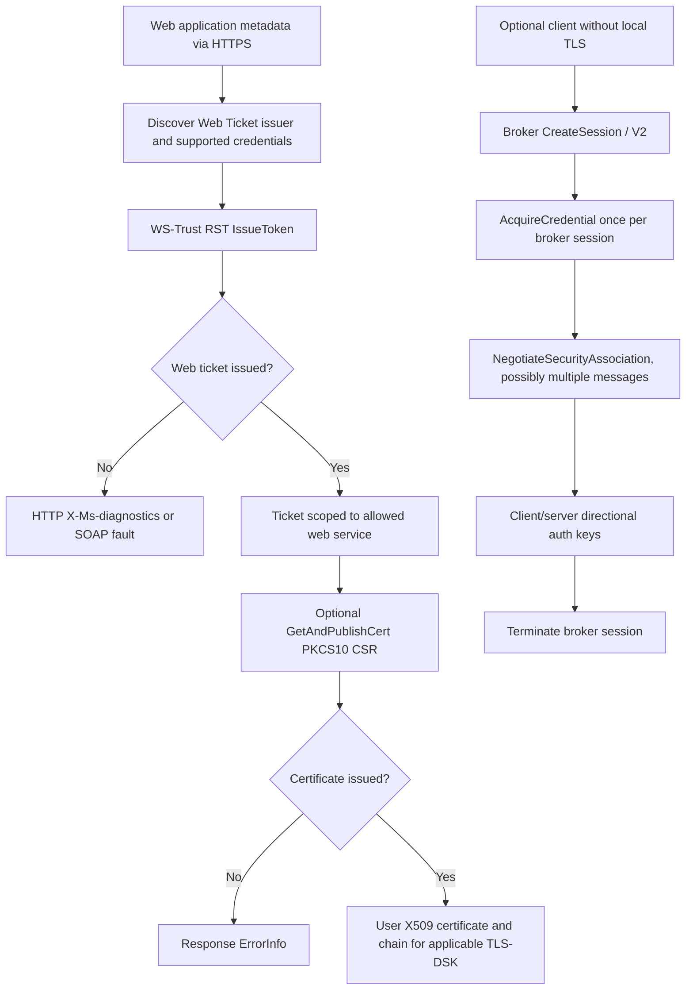

# Web Ticket, Certificate Provisioning and optional TLS-DSK broker: distinct trust and edition requirements

**Research, 2026-10-23, incomplete.** Original [MS-OCAUTHWS] rev11.0, v20250520, May 20 2025; 92-page Microsoft original PDF, SHA-256 a57de2759abca016437d728020fcefae4f687512274f3f8eaa9f91aaff6a17a3. Direct original chapters §§1.3.1–1.3.3, 1.4–1.5, 3.1.4.1, 3.2.4.1, 3.3.4.1–3.3.4.7; PDF pp13,14,20 rendered. Supporting MS-SIPAE rev11 §§3.2.5.1 and 4.4; original RFC 2986 (PKCS10), RFC 2315/5652 (PKCS7/CMS), RFC5280 X509, RFC5246 (TLS1.2) and RFC8446 (TLS1.3). Clauses below are role/edition scoped: P=direct original, S=synthesis, U=unresolved.

## A. Normative message and trust map

| ID | Original clause | Source-qualified requirement or behavior |
|---|---|---|
| WEB-01 | §1.3.1 | Web Ticket Service is a security token service issuing Web tickets for specified web applications; presentation in HTTP body or header depends on consumer application. **Not** an NTLM/Kerberos/TLS-DSK SIP REGISTER security association. |
| WEB-02 | §1.3.1.1 | A web-service client discovers WS-MetadataExchange metadata of the target service and Web Ticket Service, receives authentication-binding information, performs WS-Trust RST/RSTR, and presents issued ticket to a web application. Metadata-supported schemes include Integrated Windows, OCS-signed client certificate or historical Live ID, each conditional on binding. |
| WEB-03 | §1.4 | Web Ticket and certificate provisioning uses SOAP **over HTTPS**, WS-Trust 1.3; neither equivalent to SIP REGISTER nor to SIP SERVICE. HTTPS hostname validation and token audience trust are independent of SIP domain/realm and MIC. |
| WEB-04 | §1.3.2 | Certificate Provisioning Service issues user-authenticated **X.509 v3** certificate for later client authentication, e.g. SIP TLS-DSK. This public certificate is not a private-key transfer. |
| WEB-05 | §1.5 | Server requires CA for **PKCS#10 CSR**; client must process PKCS#7 certificate chain and X.509 v3; client obtains Web Ticket Service URL via web-service metadata or documented alternative. |
| WEB-06 | §3.1.4.1 | WSDL GetAndPublishCert operation receives PKCS#10 CSR, issues and stores X.509 certificate for later verification. On error response server **MUST** use GetAndPublishCertResponse/ErrorInfo and **SHOULD NOT** use SOAP fault. |
| WEB-07 | §3.2.4.1 | Web Ticket WSDL IssueToken operation uses WS-Trust RST/Issue and RSTRC/IssueFinal. Authentication errors can be HTTP X-Ms-diagnostics or SOAP faults, depending on credential type. |
| WEB-08 | §3.2.4.1 | For Integrated Windows error mapping, source describes HTTP **403** with errorId **28000** when user authenticated but not SIP-enabled; **500** / **28001** for internal error. This is *HTTP Web Ticket* failure, not SIP UAC auth 403. |
| WEB-09 | §1.3.3 | Authentication Broker Service implements TLS as a web service for **a client without local TLS support** wishing to use TLS-DSK. **No proof classic Windows Full Client normally uses this broker.** |
| WEB-10 | §§3.3.4.1–3.3.4.4 | Broker has separate CreateAuthBrokerSession, TerminateAuthBrokerSession, AuthBrokerAcquireCredential and AuthBrokerNegotiateSecurityAssociation WSDL operations. Last returns response tokens to SIP challenges and, when complete, client/server authentication keys. |
| WEB-11 | §3.3.4.5 | CreateAuthBrokerSessionV2 creates a broker TLS-DSK session and explicitly **supports TLS 1.2**. |
| WEB-12 | §3.3.4.6 | AuthBrokerAcquireCredentialV2 binds particular SIPInstance to session, **only once per session**, supports TLS1.2. |
| WEB-13 | §3.3.4.7 | AuthBrokerNegotiateSecurityAssociationV2 returns SIP challenge GSSAPI response and **client/server authentication keys**; may be called **multiple times per session**; supports TLS1.2. |
| WEB-14 | §1.3.1.1,§3.2.4.1 | Web metadata determines STS issuer and audience, not arbitrary SIP realm; token issuance and user registration are distinct success states. |
| WEB-15 | §§1.5,3.1.4.1 | S: PKCS10 CSR/public certificate and later TLS-DSK client certificate can be reconciled, but user's private key must not be assumed exportable or sent to an unverified broker endpoint. Source does **not** mandate export of private key in examined clauses. |

## B. Conditional authentication subsystems

**Synthesis caveat:** paths are optional and might not be executed in sequence by the classic Windows desktop client. Broker web-service trust and session keys have their own separate trust boundary. Having a Web Ticket is not evidence of SIP REGISTER, Presence, or A/V Media authorization.

## C. Unresolved original clause and edition gates

1. Full WSDL/XSD serialization and all ErrorInfo/diagnostic status codes; WS-Security signatures, token audience and time window/revocation; meta-issuer redirects.
2. Exact applicability of Authentication Broker on classic Skype for Business Windows Full Client versus thin/mobile devices; do **not** assume server Web-service support implies desktop invocation.
3. V2 broker supports **TLS 1.2**, which does not assert TLS 1.3 token/key-schedule compatibility. Microsoft SIPAE §3.2.5.1 inner TLS-DSK PRF and modern RFC8446 cannot be automatically equated.
4. Broker obtains and returns **authentication key material**: SOAP HTTPS trust, authorization, key memory lifecycle and user secrets require separate evidence. Do not send credentials or certificate private key based on unvalidated STS URI.
5. Cross-spec linkage to Lync Autodiscover MS-OCDISCWS, SAML/WS-Trust metadata updates and certificate renewal; explicit client product notes still open.

**Evidence gate remains OPEN; no protocol implementation, server traffic/interoperability tests, merge or release.**
