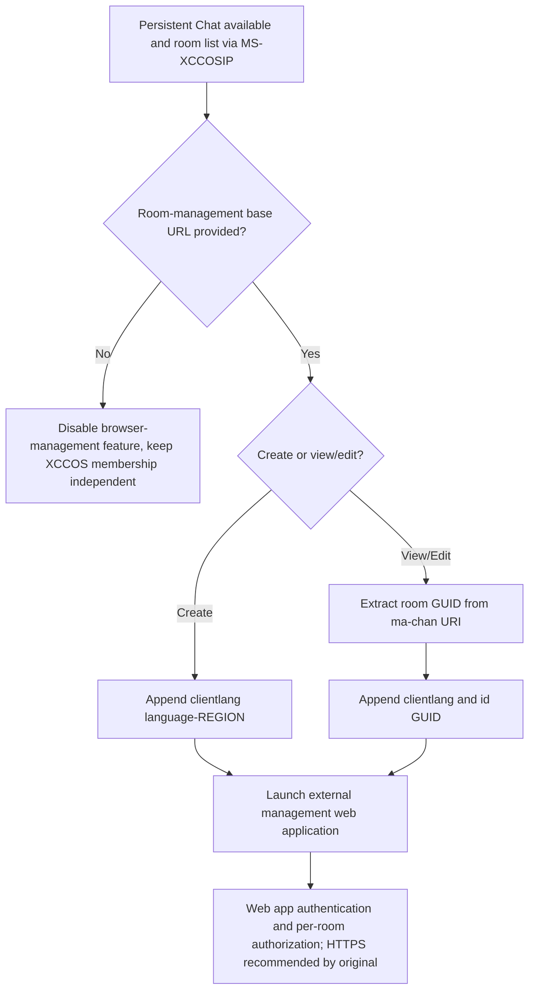

# MS-OCGCWEB rev2 — persistent chat room-management browser bridge, missing OCSPROT graph edge resolved

**First-party source audit 2026-10-23.** **[MS-OCGCWEB] Persistent Chat Web Protocol** revision **2.0** released **2016-09-14** (v20160914). Original **14-page** Microsoft PDF SHA-256 **c8dfca11fa0921ffbd0e0aa8e211a16bd6bcb7985b78b46259fd395cddda301a**, verified vs local original. Official overview [MS-OCSPROT] rev9 §1.2 (direct bibliography had omitted edge in old extracted graph), **[MS-XCCOSIP]** 2024 rev7 as companion source, **[MS-SIPREGE]** provisioning; [RFC3986](https://www.rfc-editor.org/rfc/rfc3986) URI syntax and [RFC2119](https://www.rfc-editor.org/rfc/rfc2119). §§1.3–1.5,2.1–2.2.2,3.1.1–3.1.7,5.1 evaluated, original PDF **page 7** rendered. **P** first-party normative, **S** cross-spec inference, **U** deployment applicability.

| ID | Source clause | Verifiable requirement |
|---|---|---|
| OCG-01 | §2.1 | **No new network transport introduced**: native protocol client launches an **external browser-based room management web application** via URL. This is **not** SIP INFO/XCCOS command protocol, nor evidence of an internal embedded browser implementation. |
| OCG-02 | §3.1.1 | Client gets **base URL from persistent-chat configuration**. If base URL cannot be obtained client **MUST disable room management functionality**. SIP authentication and chatroom membership might remain valid independently. |
| OCG-03 | §§2.2.1,3.1.5 | **Create room** link = configured base URL + **`clientlang`** language-region code (lowercase ISO639 language, uppercase ISO3166 region). No room `id` parameter needed to *create* a room. |
| OCG-04 | §§2.2.2,3.1.5 | **View/edit existing room** = base URL + `clientlang` and **`id` GUID**. GUID must be extracted from room URI known from XCCOSIP search/invitation/associated room lists (§§3.1.9–11). Example `ma-chan://example.com/<GUID>` supplies GUID, **not** permission to edit. |
| OCG-05 | §3.1.5 | If base URL already has a query component, append task-specific parameters to **existing query parameter list**, rather than overwrite or duplicate invalid URI separator. RFC3986 percent-encoding and query composition needed for safety. |
| OCG-06 | §§2.2.2,5.1 | User can **view or edit depending on web app authorization**, not simply from a known room GUID. **HTTPS is strongly recommended**, but historical source allows scheme selection by implementation. This is not authority to send credentials over HTTP; modern policy must separately require TLS. |
| OCG-07 | §§3.1.2,3.1.6 | Document defines **no protocol-specific timers**. Browser login/session lifetime belongs to room-management web application, not MS-XCCOSIP 10s command timers, Windows SIP transport, or persistent chat membership. |
| OCG-08 | §1.3 and [MS-OCSPROT] §1.2 | The earlier source graph omitted **MS-OCGCWEB** from overview bibliography despite physical original present in 150-PDF archive. Its role is **browser-launch bridge**; evidence of a source citation does not prove all classic Windows Full Clients expose room admin UI. |

## Explicit unknowns

- **OCG-U1:** Precise configuration parameter source/historic Windows client UI entrypoints from MS-SIPREGE and product profile need edition audit.
- **OCG-U2:** User-controlled config URL, room URI parsing/URI query encoding, origin validation and browser isolation **must** be validated before any future implementation; no extrapolation from simple example HTTP URL.
- **OCG-U3:** Browser web app authentication/permissions are external to this 14-page protocol; knowing GUID alone cannot authorize modifying room.
- **OCG-U4:** Source is rev2.0 (2016); native client build/profile and deployed persistent chat service may omit feature. Distinguish browser URL hand-off from XCCOSIP `cmd:join` authentication.
- **OCG-U5:** Overall old 150-PDF graph missing the direct overview edge remains reproducible historical artifact; verified standalone catalog fixes *bibliographic coverage* but globally regenerated graph not yet done.

**INCOMPLETE overall; no implementation, server traffic, assistant interoperability tests, merges or releases.**
