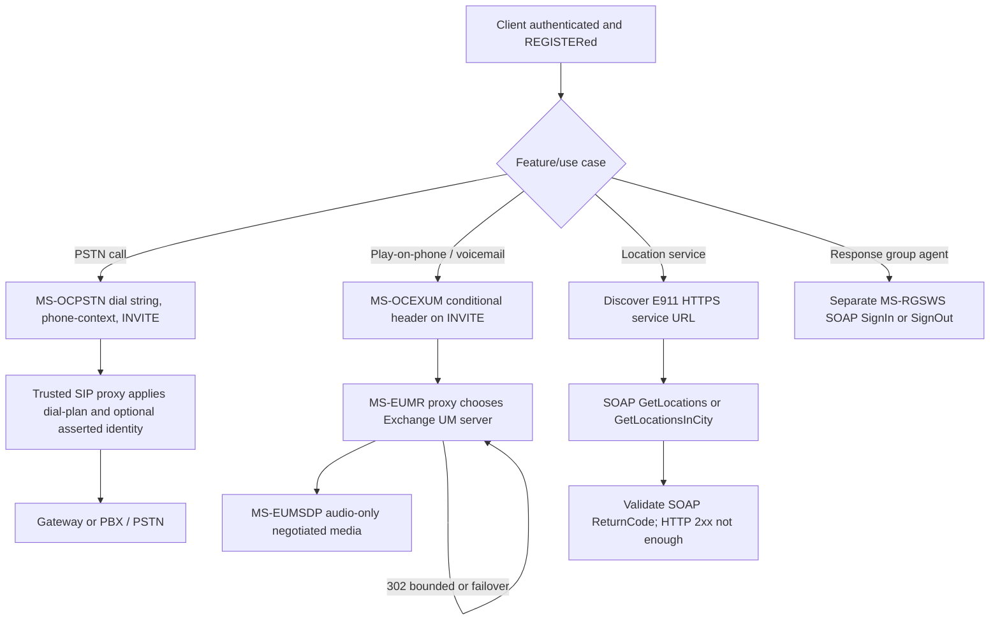

# PSTN, Unified Messaging, E911 and Response Group: role-qualified original-PDF cross-analysis

Date: 2026-10-22. **Directly inspected original Microsoft PDF text** from owner's `catalog.zip`; five published original documents **v20250520, release May 20, 2025**: MS-OCPSTN, MS-EUMR, MS-EUMSDP, MS-OCEXUM, MS-E911WS, plus MS-RGSWS. Normative references must be scoped to individual sections and historical product versions. Official architecture/source index: [MS-OCSPROT](https://learn.microsoft.com/en-us/openspecs/office_protocols/ms-ocsprot/), [Microsoft Office protocol documents](https://learn.microsoft.com/en-us/openspecs/office_protocols/). The documentation provides historical interoperability evidence, **not an endorsement of obsolete SSL or a current telephony deployment policy**.

## Precisely sourced requirements and role boundaries

| ID | Source and clause | Original requirement / technical data | Protocol role |
|---|---|---|---|
| PSTN-01 | MS-OCPSTN §2.2.1 | `isGateway` is a valueless SIP Contact **header parameter**; e.g. `Contact: <sip:...>;isGateway`. Do not confuse with Contact URI parameter. | Gateway/server context |
| PSTN-02 | §2.2.2; RFC3966 §5.1.5 | `phone-context` extends RFC3966 semantics; may encode provisioned location profile, special `dialstring` if no profile, or `enterprise` for private non-E.164 transformed number. | Caller/location-policy profile |
| PSTN-03 | §3.2, UAC behavior | If outgoing dial-string cannot resolve to remote E.164 URI under local provisioning, UAC **MUST** encode phone number and phone-context in Request-URI; non-E.164 with missing location profile **MUST** use `dialstring`. | **Client** outbound call |
| PSTN-04 | §3.2, callback and sender behavior | When initiating callback and feature implemented, UA **SHOULD** use incoming P-Asserted-Identity values to populate Request-URI and To; From SIP URI **SHOULD** be valid, and phone-originating SIP number **SHOULD** be E.164 or private + location profile. | Client, feature-conditional; distinguish trusted asserted identity |
| PSTN-05 | §3.2, proxy behavior | Proxy with Request-URI phone-context **MUST** match a provisioned dial plan and convert URI using matched rules; absent match **SHOULD** fall back to other routing logic. | **Server/proxy**, not a client-side mandatory dial-plan cache |
| PSTN-06 | §2.2.3–2.2.4, §2.2.6 | `Ms-Call-Source: ms-rtc|non-ms-rtc` labels source network; option tags `ms-early-media`, `ms-bypass` are advertised in Supported under the relevant extension conditions. | Gateway and media/profile negotiation; not evidence that all clients support bypass |
| PSTN-07 | §2.2.7–2.2.9 | `ms-accepted-content-id` identifies chosen SDP offer Content-ID; `ms-trunking-peer` carries gateway/trunk; `ms-mediation-generated: yes` signals mediation generation. | Conditional gateway/multipart MIME signaling |
| UM-01 | MS-EUMR §3.1.2 | Proxy UM-server wait timer **MUST** be **less than 180 seconds**; recommendation **5 seconds**. | **Proxy**, not RFC4028 session timer or client reconnect delay |
| UM-02 | §3.1.5.3 | Selected UM server's `302` Redirect followed by **proxy** only if from selected server, **exactly one** Contact, next UM server belongs to caller's dial plan and at most **four previous 302** for this route. Otherwise select next UM server via §3.1.5.7, **without returning 302 to caller**. | **Proxy** redirect and loop controls |
| UM-03 | §3.1.5.4–5 | On routing INVITE to another UM server, proxy **SHOULD** send `101 Progress` to caller; multipart INVITE receiving UM `415` causes server ordering list reset and MS-SIPRE §3.9.5.5 processing. | **Proxy**, not generic SIP UAC retry rule |
| UM-04 | §3.1.5.7 | Failure or UM wait-timer expiry → next UM server, following version/order policy; exhaustion **SHOULD** return **480** and restart timer for newly selected UM server. | **Proxy** server failover; avoid fabricated user-side retry count |
| UMSDP-01 | MS-EUMSDP §3.1.5 vs MS-SDPEXT §§3.1.5.18–19 | UM-specific SDP accepts **only `m=audio`**. Other media types, e.g. `m=video`, `m=applicationsharing`, are rejected. SDP `o=` session-version MUST be numeric; receive-side SHOULD ignore it; server SHOULD increment in subsequent offers. | UM server's specialized **audio-only** profile |
| UMSDP-02 | §3.1.5 vs MS-SDPEXT §3.1.5.12.3 | Answer in provisional 18x is authoritative within same fork: any differences from later final SDP answer are ignored. | Specific to UM server profile; don't generalize to full client |
| UMSDP-03 | §3.1.5 vs MS-SDPEXT §§3.1.5.25,30–33 | `a=x-bypassid`, `a=x-bypass`, `a=x-mediasettings`, `a=rtcp-rsize`, `a=rtcp-fb`, `a=x-ssrc-range`, `a=x-source-streamid` and `a=x-source` are ignored in this profile. | UM server SDP, **not all SIP A/V media** |
| OCEXUM-01 | MS-OCEXUM §2.2.1 | `Ms-Exchange-Command: skip-pin` may be attached to **INVITE originating from protocol client** only after **client authentication by SIP server**; skips UM PIN prompt. | Client-originated privileged mailbox command; cannot infer all users allowed |
| OCEXUM-02 | §2.2.2 | `Ms-Sensitivity: private-no-diversion` suppresses rerouting/forwarding to UM for a Play-On-Phone call not answered by user. | Call-control privacy policy; conditional client/server role |
| E911-01 | MS-E911WS §§3.1.3–3.1.4.1 | Server **MUST** listen at HTTPS URL; client **MUST** have URL (may learn via other channel e.g. SIP). For GetLocations, client creates TCP, negotiates historical spec's SSL, sends SOAP/HTTP `GetLocationsRequest` with SOAP body `GetLocationsRequest`. | Separate SOAP/HTTPS trust boundary, not SIP MESSAGE |
| E911-02 | §3.1.4.1 | Server matches network identifiers incl. WAPBSSID, ChassisID+PortID, ChassisID, SubnetID, MAC. Source says order is **implementation-specific** (illustrative priority, not guaranteed canonical). | **Server** matching policy; client must not assume deterministic universal priority |
| E911-03 | §§2.2.5.1, 3.1.4.1 | `ReturnCodeType` XML enumeration **200, 400, 404, 500**; errors can be encoded in GetLocationsResponse body **inside HTTP 2xx**. Evaluate SOAP-level success separately from HTTP status. | Client response interpretation and location error states |
| E911-04 | §3.1.4.2 | `GetLocationsInCity` SOAP operation accepts geography-based lookup; response within HTTP 2xx may contain application error status. | Client optional UI/use-case scope requires product evidence |
| E911-05 | §3 (client overview) and §3.1.2 | Protocol client's service layer is pass-through with **no additional client protocol timers/state** and server has no per-request session timer; higher-layer location/call requirements still need independent analysis. | Distinguishes service contract from complete emergency-call UI |
| RGS-01 | MS-RGSWS §3.1.4–3.1.4.8 | SOAP/WSDL exposes `GetActiveResponseGroups`, `GetAgent`, `GetGroups`, `IsAgent`, `SignIn`, `SignInMultiple`, `SignOut`, `SignOutMultiple`. WSDL message pairs are operation-specific. | **Optional response-group agent** workflow, not ordinary SIP REGISTER |
| RGS-02 | §§3.1.4.5–3.1.4.8 | `SignInSoapIn/Out` and `SignOutSoapIn/Out` name distinct SOAP operations. Neither is the same as registering a SIP endpoint or deregistering its AoR. | Role/feature-specific service identity |

## Combined architecture: telephony trust boundaries

**Classification:** boxes are sourced protocol obligations; linking precondition to features is a **conditional synthesis**. The cycle denotes bounded server redirects/retries, **not** an unconstrained loop. This diagram is NOT an emergency-call routing transcript. MS-E911WS location query alone does not establish emergency INVITE selection or PSAP dispatch semantics.

## Cross-spec security and failure distinctions

| Trigger | Normative outcome | What is **not** established |
|---|---|---|
| E911 SOAP body ReturnCode 404 in HTTP 2xx | Application-level location failure | Not a SIP 404 and not guaranteed fallback location |
| UM 302 fails safety conditions | Proxy selects next server per EUMR §3.1.5.7 | Not a UAC generic browser redirect |
| UM INVITE timer expiry | Proxy chooses next UM server; exhaustion 480 SHOULD | Not authentication or transport keepalive failure |
| Outbound dial string cannot map E.164 | Client sets phone-context; proxy applies dial plan | Not universal ability to place all PSTN calls without provisioning |
| `skip-pin` to UM | Requires prior authentication | Not proof of authorization under arbitrary mailbox credentials |
| `Ms-Sensitivity: private-no-diversion` | Forbids a specific re-diversion behavior | Not a general confidentiality guarantee or end-to-end encryption |
| Historical text uses SSL | Conformance wording in original legacy document | No license to enable SSLv2/3 or TLS downgrade in a modern implementation |

## Open proof obligations

- TEL-G01: MS-OCSPROT full PSTN/emergency use cases and client UI conditions, exact E911 provisioned URLs, PIDF-LO or geolocation body, E911 location publication and fallback behavior.
- TEL-G02: MS-OCPSTN §§3.3–3.10 per-header UAC/UAS/proxy processing, proprietary `ms-bypass`/early-media/media bypass capability negotiation and source product notes.
- TEL-G03: MS-EUMR §3.1.5 complete UM server selection, SRTP/ICE/Edge/QoE conditions, rerouting order and privacy; current Exchange UM version support.
- TEL-G04: MS-EUMSDP codec constraints across MS-SDPEXT, MS-SRTP, MS-DTMF and historical ICE versions, separate from modern application sharing.
- TEL-G05: MS-E911WS complete XSD network identifier fields, `presenceList`, return semantics, certificate identity/revocation and local privacy restrictions.
- TEL-G06: MS-RGSWS full SOAP schemas, auth/authorization and agent membership changes; determine which Windows client versions and feature deployments actually expose this.
- TEL-G07: Current/historical RFC3966, RFC3325, RFC3261, RFC5234, SDP/RTP normative update chain; earlier manifest has availability, not full RFC version closure.
- TEL-G08: Cross-spec acceptance matrices for 1:1 IM, A/V conference, PSTN, voicemail, emergency, recovery and signout remain incomplete.

**Status: six original documents partially analyzed at these directly quoted sections. Not a claim of every clause or full Windows-client conformance. NO protocol implementation, live server tests, merge to main or release.**