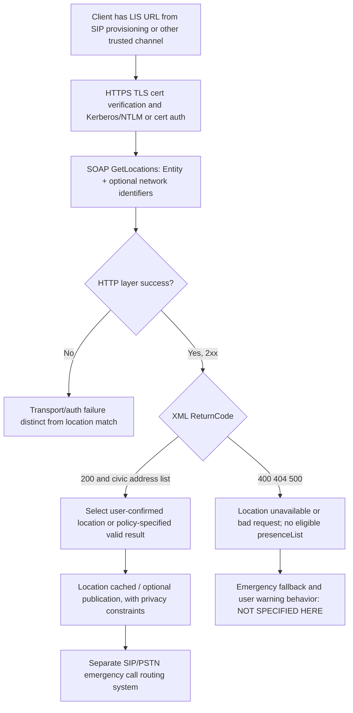

# Enterprise PSTN dial plans, SIP/PBX gateways, early media and E911 location: original-source boundary audit

**Date:** 2026-10-23. **Scope:** technical research only; neither the full Skype for Business Windows client nor safe real emergency calling is established. **Originals inspected** from owner-provided `catalog.zip` (matching PDF and full-text editions):
- **[MS-OCPSTN] rev11.0, v20250520, 2025-05-20**, original Microsoft PDF SHA-256 `c66e679e049fff858c4b2a988aa2d3c9f07fa9fa13622f630c138cd3f8d63f56`. Reviewed **§§1.3–1.7, 2.2.1–2.2.9, 3.1–3.9**, PDF pp10–23; original pp16/18 rendered.
- **[MS-E911WS] rev9.0, v20250520, 2025-05-20**, original Microsoft PDF SHA-256 `999ebc01f437d6bbe8b1141e479a94d1ecec30c61fa4491367e1c1d5f032920a`. Reviewed **§§1.3–1.7, 2.1–2.2.5, 3.1–3.1.5, 4, 5.1, 6**, original PDF pp9–25, pp12/17 rendered.
- **[MS-OCSPROT] rev9.0, v20250520 §§2.5.4–2.5.5**, owner PDF SHA256 `b0380ba5606072eb071bd67ffa7561e12cd7e55ec9dbd23a6553558438524ff2`.

Original IETF editions: [RFC3966](https://www.rfc-editor.org/rfc/rfc3966) §§3,5.1.5 (**tel URI/context**, December 2004); [RFC3261](https://www.rfc-editor.org/rfc/rfc3261) §§8,13,20; [RFC3262](https://www.rfc-editor.org/rfc/rfc3262) (June 2002 reliable provisional); [RFC3325](https://www.rfc-editor.org/rfc/rfc3325) (November 2002 trusted SIP asserted identity); [RFC3515](https://www.rfc-editor.org/rfc/rfc3515) REFER; [RFC3891](https://www.rfc-editor.org/rfc/rfc3891) Replaces; [RFC4119](https://www.rfc-editor.org/rfc/rfc4119) GEOPRIV PIDF; [RFC5139](https://www.rfc-editor.org/rfc/rfc5139) civic address; [RFC4559](https://www.rfc-editor.org/rfc/rfc4559) SPNEGO HTTP auth. Not every newer RFC describes actual classic client behavior.

**Evidentiary tags:** P = directly verified Microsoft source clause; R = primary RFC; S = cross-clause synthesis; U = unresolved service/product. Server/gateway obligations explicitly separated from client obligations.

## 1. PSTN routing and extension-token wire matrix

| ID | Original source and actor | Wire behavior and exact condition |
|---|---|---|
| PSTN-01 | MS-OCPSTN §2.2.2, §3.2, client UAC | When dial string cannot be resolved **locally** to remote SIP URI with E.164 user, UAC **MUST** set Request-URI to SIP user=phone plus `phone-context` of local user **location profile**. If profile is not provisioned and non-E.164, use `phone-context=dialstring`. Provisioning decides dial-plan context; this is **not** arbitrary locale inferred from client's IP. |
| PSTN-02 | MS-OCPSTN §2.2.2, §3.2; RFC3966 §5.1.5 | **Special values** `dialstring` and `enterprise`: `enterprise` marks result of enterprise dial plan when number remains non-E.164. SIP URI host part **not altered** by phone-context; neither `phone-context` nor its scope is universally the phone number's E.164 prefix. |
| PSTN-03 | §3.2, proxy | On Request-URI phone-context, **proxy MUST attempt** lookup of matching provisioned dial plan; if matched **MUST apply** its translation. If no match, **SHOULD** use other routing logic. This distinguishes **client local normalization** from **server rule-based routing**. |
| PSTN-04 | §3.2, callback UAC | If callback feature implemented, UAC **SHOULD copy** incoming non-E.164 P-Asserted-Identity including `phone-context=dialstring|enterprise` into callback INVITE Request-URI and To. **PAI is trusted-network information** under RFC3325; do not accept unverified arbitrary PAI as authenticated caller identity. |
| PSTN-05 | §2.2.1, §3.1, gateway vs ordinary UAC | Gateway **MUST** add Contact parameter `isGateway`; non-gateway **MUST NOT**. When received, gateway flag can inform presentation but is **not** proof the remote is a PSTN unless SIP authentication/routing policy confirms it. |
| PSTN-06 | §2.2.3, §3.3, gateway UAC | Gateway-originated SIP INVITE **MUST** add `Ms-Call-Source: ms-rtc` for target in protocol network, `non-ms-rtc` toward PSTN. Non-gateway UAC **MUST NOT add** this header. |
| PSTN-07 | §3.3, UAS/proxy | If receiving INVITE containing `Ms-Call-Source` while already alerting in another SIP dialog, UAS **MUST reply 605** to detect loop. Proxy receiving such 605 **MUST transform to 480** upstream. Proxy **MUST strip** source header on qualifying call forwards / destinations not provisioned to accept loop calls. Do not attribute 605 directly to ordinary desktop UAC outbound call. |
| PSTN-08 | §2.2.4, §3.4 | UAC supporting SDP answer in **unreliable SIP 183** **MUST advertise `Supported: ms-early-media`**. Gateway UAS receiving it **MUST return unreliable 183 with SDP answer**; non-gateway UAS **MAY**. Exact SDP and when media allowed deferred to [MS-SDPEXT] §3.1.5.12 and RFC3262 historic profile. |
| PSTN-09 | §2.2.5, §3.5 | PSTN anonymous `From: sip:anonymous@<domain-or-FQDN>;user=phone`; Microsoft protocol explicitly **MUST NOT** use `anonymous.invalid` host for this feature. Not generic permission to accept anonymity without server privacy policy. |
| PSTN-10 | §2.2.6, §3.6 | `Supported: ms-bypass` indicates capability where media may flow **directly to PSTN gateway**, bypassing intermediate mediation components. UA **SHOULD** advertise when supported, **not** proof successful ICE, SRTP, codec match, or media policy. |
| PSTN-11 | §2.2.7, §3.7 | When offering `application/SDP` or `application/gw-sdp` MIME parts, UAC **MUST include Content-ID**; UAS **MUST echo selected offer part's Content-ID** in `ms-accepted-content-id` on answer. This associates SDP answer with *selected offer part*, **not** the SIP Call-ID. |
| PSTN-12 | §§2.2.8–2.2.9,3.8–3.9, gateway role | Gateway can supply `ms-trunking-peer: host[;trunk=hostname][;User-Agent=quoted-string]` and `ms-mediation-generated: yes` on generated provisional response. **Do not require gateway-only headers from ordinary Windows UAC**. |
| PSTN-13 | §§1.4–1.7 | Additional dependencies MS-SIPAE auth, MS-SIPRE registrar routing, MS-SIPREGE registration, MS-SDPEXT media and RFC3261/3262/3264/3325/3515/3891/3892/3966. **MS-OCPSTN has no independent protocol version number negotiation** beyond SIP Supported option tags. |

### Cross-role conditional PSTN call trace (S, not all optional headers on every call)

```mermaid
sequenceDiagram
 participant C as Windows UAC
 participant P as SIP routing proxy
 participant G as PSTN Gateway / Mediation
 participant T as PSTN
 C->>C: Use local dial plan to resolve user dial string
 C->>P: INVITE Request-URI E164 or user=phone;phone-context=profile
 P->>P: Apply provisioned dial plan and trusted PAI policies
 P->>G: Routed SIP INVITE with applicable capabilities
 opt ms-early-media negotiated
  G-->>P: 183 (unreliable) with SDP answer
  P-->>C: 183 with SDP
 end
 G->>T: Gateway-to-PSTN call setup (outside this SIP wire spec)
 T-->>G: PSTN call progress (details outside MS-OCPSTN)
 G-->>C: SIP success/failure through proxy
 Note over C,G: RTP media negotiated separately, bypass optional
```

**Source-boundary note:** PSTN trunk side messages/timers and emergency PSAP route rules are **NOT specified by MS-OCPSTN**. `ms-bypass` is a capability, not guaranteed direct route. Ordinary SIP 200/ACK/487/CANCEL/BYE still require RFC3261 and MS-SIPRE. SIP transfer via REFER/Replaces is a separate protocol interaction requiring independent study.

## 2. E911 SOAP location discovery and data contract

| ID | Original Microsoft clause | Wire/data/security behavior |
|---|---|---|
| E911-01 | MS-E911WS §§1.3–1.6,2.1 | **Location Information Service (LIS)** provides civic location **via SOAP 1.1 over HTTPS**, not an audio SIP dialog. Client needs service FQDN/URL, obtainable from separate channel (e.g. SIP provisioning), and must negotiate TLS. Location can be cached and used for E911 or published presence, subject to location privacy requirements. |
| E911-02 | §3.1.1, server role | LIS is **stateless between requests** but has network identifier→location mappings for **wireless BSSID/RSSI, MAC, LLDP ChassisID+PortID, SubnetID and IP**. Does not imply client cannot cache response; server statelessness is separate. |
| E911-03 | §§3.1.4.1,3.1.4.1.2.1 | `GetLocationsRequest` SOAP body **MUST contain Entity** (user SIP URI, 1–64 chars) and MAY include `WAPBSSID`, `RSSI`, `MAC`, `ChassisID`, `PortID`, `SubnetID`, `IP`, in XSD-defined order/format. Network values are **personally/locationally sensitive**; not to arbitrary host. |
| E911-04 | §3.1.4.1, server | Matching order used by example implementation: WAPBSSID → Chassis+Port → Chassis → Subnet → MAC; **source expressly says the order is implementation-specific**. Do not require client to mimic this server algorithm or infer most-precise rank independent of result trust. |
| E911-05 | §§2.2.4.1,2.2.5.1 | Response contains mandatory `ReturnCode` in XML with **enumerated '200','400','404','500'** and optional `presenceList`; each `pidf:presence` contains GEOPRIV civic address per [RFC4119]/[RFC5139]. Client uses subset `country,A1,A3,PRD,RD,STS,POD,HNO,HNS,LOC,NAM,PC`; if address cannot be trusted to map to given network identifiers, `geopriv/method` **MUST equal 'Manual'**. |
| E911-06 | §§3.1.4.1,3.1.4.1.1.2 | **LIS sends an HTTP 2xx response even for an application-level error**, with XML `ReturnCode != 200` and **no presenceList**. Therefore HTTP 200 ≠ valid civic location. SSL/HTTP errors follow own layers. |
| E911-07 | §§3.1.4.2,3.1.4.2.2.1–2 | `GetLocationsInCityRequest` requires `Entity`, ISO country/region, two-character State and City length **1–64**, intended on **user request**. Response has mandatory ReturnCode and optional presenceList; a location list is not itself a user-confirmed chosen address. |
| E911-08 | §4, MS-OCSPROT §2.5.4 | On multiple returned civic addresses, **client user selects** an address (overview). Client caches chosen location and can use it for E911 dependent features. Example `ReturnCode 404` under HTTP 2xx shows no match is **not** an HTTP missing-path response. |
| E911-09 | MS-E911WS §5.1 | LIS permits HTTPS-only, authenticates users using Kerberos/NTLM or SPNEGO HTTP ([RFC4559]) and optionally certificate-based [MS-OCAUTHWS]. **These Web-service auth exchanges are not SIPAE REGISTER challenges** and do not prove a SIP emergency call is authorized. |
| E911-10 | §§1.7,3.1.2,3.1.5 | No independent E911WS version negotiation or protocol timers defined; timing of request just after login or when Wi-Fi changes is **implementation-specific** (§3.1.4.1.1.1). Source does not mandate continuously sending BSSID/persistent location surveillance. |
| E911-11 | MS-OCSPROT §2.5.4 | On network identifier change client can re-request location. This is **not** a substitute for emergency call location authorization / call routing. Client location cache validity/TTL, precise consent, transport loss, no-match display and manual override product policy require separate proof. |
| E911-12 | §§2.2.4.1,5.1 + RFC4119/5139 | **Privacy/trust boundary:** PIDF/GEOPRIV contains potentially room-level civic location; read location only from validated LIS HTTPS identity and authenticated account as applicable. Server's `method=Manual` denotes lower automatic certainty, not cryptographic signature or blanket permission to share outside authorized emergency context. |

### Location before emergency calling: two independent services (S)



**Important high-stakes guard:** This diagram does not claim that E911WS controls the emergency number, selects emergency gateway/PSAP or supplies on-wire PIDF-LO during an emergency SIP INVITE. Those critical rules need separate first-party SIP/PIDF Location Conveyance and product/server/gateway policy evidence. **Do not infer emergency calling correctness from successful GetLocations.**

## 3. Standards and error mismatch register

| ID | Normative sources | What remains unresolved |
|---|---|---|
| EMER-X01 | RFC3966 §5.1.5 vs MS-OCPSTN §3.2 | RFC global vs local telephone URIs use contexts; Microsoft `phone-context=enterprise|dialstring|locationProfile` within SIP URI depends on private dial-plan rules. Must not strip or coerce phone-context to country code before proxy translation. |
| EMER-X02 | RFC3325 §4 vs MS-OCPSTN §3.2 | `P-Asserted-Identity` is defined for trusted network domain; client callback copying PAI is not proof public untrusted caller can choose number identity. How SIPAE signature and gateway trust identify PAI remains partly open. |
| EMER-X03 | RFC3262 vs MS-OCPSTN §3.4 | Microsoft permits/mandates **unreliable 183 SDP** for supported gateway paths, while reliable provisional RFC3262 PRACK state differs. Exact early-media security and final SDP consistency requires MS-SDPEXT §3.1.5.12 plus MS-EUMSDP variant. |
| EMER-X04 | MS-E911WS §3.1.4.1 | HTTP 2xx with XML ReturnCode 400/404/500. Error code namespace **must not** be conflated with SIP 404/500, RFC3261 INVITE failure or media STUN/TURN error. |
| EMER-X05 | MS-E911WS §5.1 + MS-SIPAE §3.2 | Web LIS Kerberos/NTLM/cert auth ≠ SIP security association signing/authentication. Multiple independent credentials and lifetimes exist. |
| EMER-X06 | MS-OCPSTN §3.3 | Gateway-only `Ms-Call-Source` and 605→480 loop case are role-specific. Do not send header on desktop UAC or assume all SIP 480 are PSTN loop corrections. |
| EMER-X07 | MS-E911WS §2.2.4.1 | Room-level location and network IDs require privacy/retention/user-confirmation work and trust chain proof. Fallback to emergency services under absent/outdated location is **not specified by these two originals**. |
| EMER-X08 | MS-OCSPROT §2.5.4–5 | Overview location fetch can precede sign-in/use, but no fixed ordering among all bootstrap features; don't make E911WS HTTP success a universal precondition for non-emergency instant messaging. |

## 4. Required next original-source work (no implementation plan)

1. Fully inventory **emergency SIP INVITE conveyance/routing, PIDF-LO, privacy, gateway callback, user location confirmation, PSAP and regional deployment/fallback behavior**. MS-E911WS alone is insufficient, and real emergency numbers must never be used for assistant testing (all live tests remain owner-only).
2. Obtain and review actual client/server **Voice Policy, Dial Plan, PSTN usage/route** provisioning documents, including how phone-context location profile is obtained and normalized, and whether emergency short codes override user dial plan.
3. Audit original product notes §7 MS-OCPSTN, MS-E911WS and MS-OCSPROT product note <16>, plus RFC3262 early-media, RFC3966 local number and all relevant SDP MIC/media safeguards.
4. Full WSDL/XSD namespace and error XSD for `GetLocations`/`GetLocationsInCity` in MS-E911WS §6, exact security/TLS certificates, auth expiry, IPv6/MAC/LLDP parsing, return code 404/no location and stale cache warning.
5. Separate normal PSTN call INVITE, early SDP, provisional answer, gateway dialog and media bypass from all UMA/Exchange voicemail, conferencing and media ICE consent states.

**Research remains INCOMPLETE. Do not authorize protocol code, live-server contacts/tests, merge to main or release.**