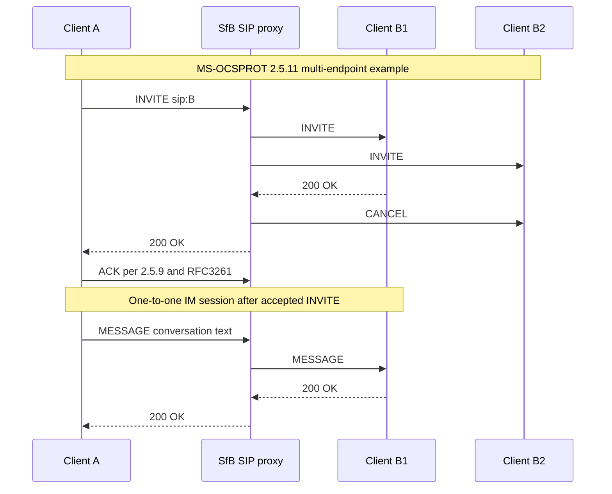

# Verified Windows client direct IM, contact add and multi-endpoint INVITE use cases

**2026-10-22 research, no implementation.** This audit was performed against the user's supplied full **MS-OCSPROT v20250520 / published 2025-05-20, revision 9.0**, extracted directly from `catalog/MS-OCSPROT.txt` inside `catalog.zip`; the PDF is `catalog/MS-OCSPROT.pdf`. Official original Microsoft source: https://learn.microsoft.com/en-us/openspecs/office_protocols/ms-ocsprot/90f4bc22-eae7-480e-a6f8-74d705ed2b2c . **Sections 2.5.9–2.5.11, printed PDF pp.36–38**, inspected in the original full document, not inferred from the conference IM profile. Additional normative reference: RFC 3261 §§12–13, 16 and RFC 3428 §§3–4. Publication/product specifics are subject to the documented edition.

## I. Direct two-party instant messaging: §2.5.9, Fig. 13, p36

Precondition: both protocol clients are signed in according to §2.5.5. Reference for routing: **MS-SIPRE**.

| Evidence ID | Step | Exact source-confirmed exchange | State boundary |
|---|---:|---|---|
| PIM-01 | 1 | Client A → server: `SIP INVITE` with destination address of Client B, routed with MS-SIPRE. | Invite requested, not yet dialog confirmed |
| PIM-02 | 2 | Server → Client B: forward INVITE using MS-SIPRE routing. | Server routing, not direct peer socket |
| PIM-03 | 3 | Client B → server: `SIP/2.0 200 OK` accepting invitation. | Remote accepted; still need ACK |
| PIM-04 | 4 | Server → Client A: forwarded 200; **Client A sends ACK** (the printed figure omits ACK for brevity). | Acknowledged SIP session |
| PIM-05 | 5 | Client A → server: `SIP MESSAGE` carrying conversation text and B's destination, via MS-SIPRE. | In established conversation |
| PIM-06 | 6 | Server → Client B: forward MESSAGE via MS-SIPRE. | Application receiver has not yet acknowledged |
| PIM-07 | 7 | Client B → server: `SIP/2.0 200 OK` for received message. | MESSAGE transaction succeeded at recipient |
| PIM-08 | 8 | Server → Client A: forward message 200. | Conversation remains in progress |

Source postcondition explicitly says IM conversation A–B **is in progress**. **No BYE, typing, edit/delete, receipt, retry, exact SDP body, SIP response to ACK, or peer-to-peer direct transport is defined by this high-level use case.** Those must not be invented.

**Key correction to earlier research:** Earlier `direct-and-conference-im-rfc3428-8591-profile-boundaries-2026-10-22.md` marked the Windows two-user wire profile entirely open. The **basic 8-step INVITE → 200 → ACK → MESSAGE → 200 sequence is now directly confirmed by MS-OCSPROT §2.5.9**. Detailed on-wire grammar, error handling, timing, endpoint forks and all variants remain open. RFC3428's 'MESSAGE does not initiate a SIP dialog' is compatible with an **independently established INVITE dialog**. Do not reuse MS-CONFIM MCU-specific `Message-Id`/IMDN for ordinary person-to-person IM without explicit evidence.

## II. Add contact: §2.5.10, Fig.14, p37

Precondition: protocol clients signed in per §2.5.5. Reference **MS-PRES**.

| ID | Step | Documented exchange |
|---|---:|---|
| CONT-01 | 1 | Client A sends SIP SERVICE to server to add Client B by SIP URI. |
| CONT-02 | 2 | Server updates contact list and responds SIP 200 OK. |
| CONT-03 | 3 | Server sends subscriber-list-change notification to Client B. |
| CONT-04 | 4 | Server sends Client B's presence information to A using NOTIFY/BENOTIFY. |

**Normative ordering caveat:** steps **3 and 4 MAY occur in either order**, explicitly stated by Microsoft. The postcondition is the contact being added; do not require B's notification before A's presence update as a validity condition. The concrete MS-PRES XML SERVICE payload, containers, privacy visibility and declined/blocked contact scenarios remain to be derived from MS-PRES revision 13.0.

## III. Multiple endpoints: §2.5.11, Fig.15, pp37–38

Preconditions: signed-in A; B registered concurrently through **B1** and **B2**. References **MS-PRES, MS-SIPRE**.

| ID | Step | Documented exchange |
|---|---:|---|
| MULTI-01 | 1 | A sends SIP INVITE to user B (AoR). |
| MULTI-02 | 2 | Server **forks INVITE** to B1 and B2 under MS-SIPRE. |
| MULTI-03 | 3 | B's endpoints choose suitable responder based on published capabilities using MS-PRES; in the example B1 sends 200 OK. |
| MULTI-04 | 4 | Server sends **CANCEL** to B2 branch. |
| MULTI-05 | 5 | Server forwards 200 OK to A, establishing chosen B1 conversation. |

This describes the **illustrated selection**, not a universal proof that exactly one 200 can ever race through a SIP proxy. RFC3261 proxy forking and race handling must be checked against Microsoft routing semantics and the chosen UI policy. The separate §2.5.9 ACK rule is still required for accepted INVITE responses; Figure 15's shortened steps do not negate that general SIP requirement.

## IV. Combined dependency state diagram, sourced overview

**The diagram splices §2.5.11's optional fork into §2.5.9's direct IM example as a cross-use-case inference.** The published Microsoft diagrams are independent examples; chronology of CANCEL/ACK in live forking races is NOT shown as a universal rule.

## V. Cross-document requirement and unresolved conflicts

| Issue | Grounding | What must be checked |
|---|---|---|
| PIM-A | MS-OCSPROT §2.5.9 vs RFC3428 §4 | MESSAGE itself doesn't create a dialog; INVITE does. Resolve exact in-dialog/Out-of-dialog Microsoft routing, headers and SDP. |
| PIM-B | §2.5.9 vs MS-CONFIM §3.3 | Conference 202/IMDN semantics **not proven** in direct IM. |
| CONT-A | §2.5.10 vs MS-PRES §3.2.5.3 | Contact-add notifications can reorder; preserve privacy-based container selection and BENOTIFY negotiation. |
| MULTI-A | §2.5.11 vs MS-SIPRE §§3.2.5,3.3 | Fork routing with epid/+sip.instance/capabilities; accepted branch and CANCEL races. |
| MULTI-B | §2.5.11 vs RFC3261 §13, §16 | ACK to 2xx, multiple branch final responses, CANCEL, transaction state and TO tags. |
| LIFE-A | §2.5.5, §2.5.9, §2.5.11 | Distinguish registered, authenticated, bootstrap-ready, conversation established, participant selected. |
| SECURITY-A | MS-SIPAE §3.2.4.1 and §3.2.5.2 | Secure per-message SIP auth for INVITE/MESSAGE/CANCEL, SA lifetime; don't assume encryption of IM body. |
| ERROR-A | MS-SIPRE §3 and RFC3261 | Timeouts/4xx/5xx/6xx, endpoint unreachable or stale presence, proxy fork races, session closure and recovery not yet fully verified. |

**Conclusion:** Basic 1:1 Windows IM setup and MESSAGE exchange, contact SERVICE add and multi-endpoint invitation example are directly covered by an authoritative 2025 umbrella document. This closes a significant *high-level sequence gap*, **not** the complete normative wire and state specification. Other source documents, exact SDP/headers, error recovery, protocol versions and all 112 supplied assessments still require systematic work. Overall research NOT COMPLETE. No code, live-server testing, main merge or release.
