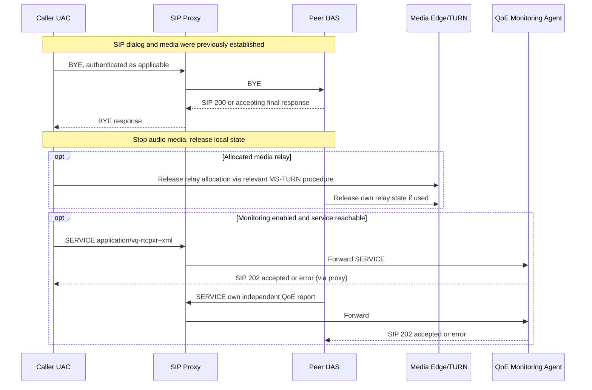

# Voice call termination and independent QoE report: original MS-OCSPROT 9.0 / MS-QoE 12.0 evidence

**Research tranche 2026-10-22; only selected original clauses, not entire QoE XSD or client traffic certification.** Primary originals from `catalog.zip`:
- **[MS-OCSPROT] 9.0, v20250520, May 20 2025**, §§2.5.15–2.5.16, **pp45–46**.
- **[MS-QoE] 12.0, v20250520, May 20 2025**, §§1.2.1,1.3–1.7,2.1–2.2.1.4,2.2.2–2.2.2.1,3.1–3.3,4.1 and product footnote <1>, original **pp10–20, 75–82**; the PDF **pp79–80 were rendered for visual verification**.
- **[MS-SIPRE] 13.0, v20250520**, routing/focus dialog extensions in relevant clauses; **[MS-TURN] 21.0** relay allocation/teardown referenced by media edge; base [RFC3261](https://www.rfc-editor.org/rfc/rfc3261) §§12,15 and [RFC4028](https://www.rfc-editor.org/rfc/rfc4028) §10.
- Official primary [MS-QoE publication and version page](https://learn.microsoft.com/en-us/openspecs/office_protocols/ms-qoe/c1050431-f4b2-44d4-a425-63d75e99f5df) confirms **12.0 released May 20, 2025 (Major)**; original source cites **`draft-deason-sip-soap-00` June 30 2000** (found at https://datatracker.ietf.org/doc/draft-deason-sip-soap/, expired, NOT current standard). Need separately compare Microsoft usage to exact draft §4.

## A. Two independent end-of-call protocol use cases

| ID | Original clause | Precisely evidenced role and transition |
|---|---|---|
| CALLEND-01 | MS-OCSPROT §2.5.15 | In established 1:1 voice call, Client A sends **SIP BYE** to server, server forwards to B, B sends accepting SIP response to server, server forwards to A. After acceptance, SIP session cleared and realtime voice/media packets terminate. **Overview illustration**, not every branch under network failure. |
| CALLEND-02 | §2.5.15 | If call used media Edge server, **clients deallocate its allocated ports after call terminated**. Specific TURN allocation protocol/transaction needs MS-AVEDGEA / MS-TURN and product modes; no inference of guaranteed response order. |
| CALLEND-03 | §2.5.16 | Once initiated and terminated a call, **each peer reports independently** to its provisioned server. Client A reporting success is not a prerequisite for Client B reporting. QoE report follows successful ordinary call as an **optional/configured usage**, not required for BYE semantic success. |
| CALLEND-04 | MS-QoE §§1.3–1.5 | SIP proxy forwards report to QoE Monitoring Agent, then Monitoring Server and/or registered third-party consumer; service and **QoE enabled** are prerequisites. QoE metrics can be objective and subjective; absent service cannot be treated as unconditional call setup failure. |
| CALLEND-05 | MS-QoE §1.3 | **SIP 202** from QoE Monitoring Agent means the agent **accepted**, but **not necessarily processed** the report (source explicitly says this). Do not use 202 as proof that metrics were stored or forwarded. This differs from MS-CONFBAS INFO processing, MS-CONFIM MESSAGE 202 and RFC6665 SUBSCRIBE 202. |
| CALLEND-06 | MS-QoE §§2.1–2.2 | Sends SIP **SERVICE** via SIP transport; message requires `Content-Type: application/vq-rtcpxr+xml` **or** `application/ms-cqf+xml` with XML payload and corresponding schema. Historical 2000 IETF draft cited for SERVICE syntax; it is not SOAP over HTTP. |
| CALLEND-07 | §2.2 | Allowed QoE destinations: QoE pool SIP GRUU, QoE Monitoring Agent's pool SIP URI, or Request-URI equal To header (routes to home pool). **Not arbitrary remote HTTP telemetry endpoint**. |
| CALLEND-08 | §§2.2.1.1–2.2.1.2 | Objective `VQReportEvent` envelope carries `VQSessionReport` per SIP dialog, optionally schema versions including ms-rtcp-metrics v2/v3/v4, with deeply nested endpoint/dialog/line metrics. In 2025 schema, `VQSessionIntervalReport` appears in XSD but is marked **Not Available** in the client element table; do not assume this is a supported client midcall format. |
| CALLEND-09 | §§2.2.1.4,2.2.2.1 | Dialog correlation details include SIP Call-ID and From/To tags, from/to/contact URIs and optional correlation ID. **QoE measurement identity is a dialog identity**, not user registrar EPID nor TURN relay session ID. |
| CALLEND-10 | §2.2.2.1 | Subjective `CallQualityFeedbackReport` XML has required `ReportingUserURI`, `Rating` (1–5) and required `CallId`, `FromTag`, `ToTag` attributes. Optional `Feedback`/Tokens and time fields exist. Treat this as user feedback, not proof every call automatically prompts rating. |
| CALLEND-11 | §2.2 | Strings Unicode, values SHOULD be invariant culture, overlong strings are typically truncated unless individual field says otherwise; XSD attr required means actually present. **Do not validate only the XML envelope type and ignore nested required bounds**. |
| CALLEND-12 | §3.1 | Client acts as SIP UAC; after error, **can retry** report. Source §§3.1.1–3.1.7 specify **no additional protocol state or timers**. Retry timing, maximum retries, durable offline queue and post-logout delivery **remain U**. |
| CALLEND-13 | §3.2 | QoE Monitoring Agent acts as SIP UAS; recognizes accepted report and returns final 202 or error. **606**: unsupported XML envelope (`VQReportEvent` or `CallQualityFeedbackReport` are supported in the revision). |
| CALLEND-14 | §3.2 | **400** if XSD validation or metric value fails; **401** if SIP From does not match body LocalPAI/FromURI or anonymous-focus mismatch; **415** if content type unsupported. These are UAS application-level validations of a SERVICE, not equivalent to ordinary SIP user SA challenge handling. |
| CALLEND-15 | §3.2 | **413** if report exceeds **300 kilobytes** size limit. No source mandate to split, compress or automatically retry a too-large payload; any such scheme remains unknown. |
| CALLEND-16 | §1.2.1 | Normative MS-QoE source includes **[IETFDRAFT-SIPSOAP-00] `draft-deason-sip-soap-00`**, plus [MS-RTP], [MS-SDPEXT], [MS-TURN], RFC3550/3551 and others. Historical draft **FOUND but expired**, exact normative behavior still requires full audit and current SIP method interoperability/profile check. |

## B. Call/metrics state diagram — conditional multi-actor synthesis, **not** a guaranteed complete packet order

**Synthesis caution:** QoE agent response travels via proxy; diagram omits explicit reverse hop for readability. Calls can instead end on session timer timeout, ICE consent loss or crash; in those branches, **delivery of BYE or QoE** is not established by the overview. QoE report should not depend on preserving active media or TURN allocation. A single peer's 202 acceptance **does not prove database persistence**.

## C. Distinct failure classes and trust/privacy

| Failure | Meaning | Correct attribution |
|---|---|---|
| SIP BYE transaction failure | Signaling dialog not confirmed cleared by remote | RFC3261 §15, MS-SIPRE dialogs and actual path loss |
| TURN deallocation fails | Relay allocation state may persist until service-defined expiration | MS-TURN §3; no ungrounded guarantee port freed |
| ICE consent expired | Media consent stale; media SHOULD terminate | MS-ICE2 §3.1.6.5; **not** SIP or QoE status |
| QoE 202 response | Agent accepted report, processing may be pending | MS-QoE §1.3; does not restore media or prove stored metrics |
| QoE 401 response | Body identity inconsistent with SIP From or anonymous focus conditions | MS-QoE §3.2; don't immediately repeat Kerberos login absent SIPAE rules |
| QoE 413 response | Report too large (>300KB) | MS-QoE §3.2; not SIP dialog failure |
| QoE 606 response | Unsupported report envelope | MS-QoE §3.2; client/report capability mismatch |

QoE report can contain SIP URIs, network addresses, caller IDs, device and quality metrics or subjective user feedback. **Security and privacy trust boundary:** signaling uses SIP transport; MS-SIPAE/TLS must protect auth and routing as applicable; existence of QoE Monitoring Agent is not consent to send reports to arbitrary hosts. Product-specific privacy, retention and user-consent controls are **not resolved** by a report XML schema.

## D. Open primary-source work

1. Exact MS-QoE 12 XSD **all 175 original pages** for RTP/RTCP XR metrics, units, codec, loss/jitter/MOS quality and call-type distinctions, product notes, optional fields, schema negotiation and example MIME boundaries.
2. **draft-deason-sip-soap-00 §4** first-party full text and any Microsoft deviations; no assumption generic SIP SERVICE supported outside Skype for Business.
3. Disconnect while media still flowing: can/cannot deliver BYE, TURN allocation expiry, ICE failover, QoE buffering/retry after new security association and before user logout.
4. C3P/conference QoE and MCU reporter distinction, each peer reports own session vs conference focus dialogs and media line correlation.
5. Reconcile possibly separate in-call QoE message flavors (e.g. actual deployment) with **2025 MS-QoE §2.2**; don't infer `application/vq2midcall-rtcp+xml` from informal captures as officially specified here without original source.
6. MS-QoE §6 product notes and version differences between 2014, 2015, 2025, especially 606 supported report types, 300KB limit, schema versions and SIP 202.

**Evidence status: substantive original sections P checked, combined lifecycle S, negative/race states U. Protocol corpus and Windows client reconstruction NOT COMPLETE; no implementation plan/code, live-server or interop tests, merge or release.**
