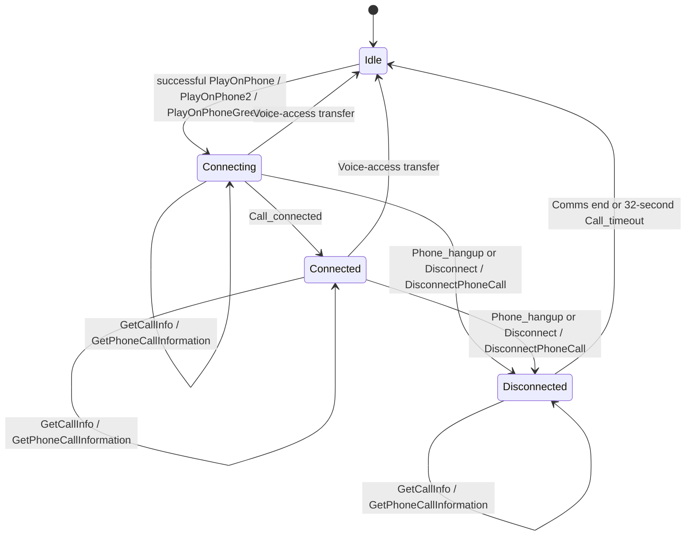
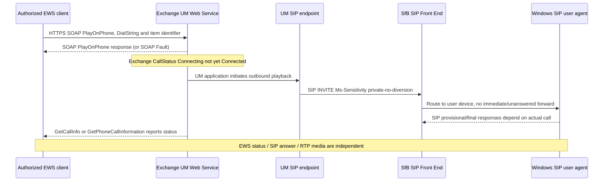

# MS-OXWUMS rev16 — EWS Play-On-Phone SOAP protocol, call-state transitions and Exchange authentication

**Important archival correction (2026-10-23): [MS-OXWUMS] is NOT absent from the 150-PDF archive.** It is missing from the **54-entry primary manifest**, but its PDF and extracted text **are present** in the broader `catalog.zip` and are recorded in the 150-source index as **secondary** (`manifest_primary=no`). Original PDF SHA256 independently verified against index: **f3262ac6d70faf794993a76a3671f1f09a4b339661a2ce7046dd4fdb8a1c5846**, **107 pages**, Microsoft revision **16.0** published **2025-05-20**, primary official [MS-OXWUMS Microsoft Learn document](https://learn.microsoft.com/en-us/openspecs/exchange_server_protocols/ms-oxwums/79ace092-b793-4fa5-82b0-dd30d12c14c2). Original **pp19–21,31,55–56** rendered; **p20** diagram visually reviewed. Audit original §§1.3–1.6, 2.1, 2.2.2.1, **3.1.1.1**, **3.1.2**, 3.1.4.1–3.1.4.14 (operation inventory and selected clauses), 3.2.1–3.2.6. **P** primary normative, **S** reasoned cross-source composition, **U** incomplete historical client applicability. **This is a subset of the 107-page WSDL/XSD; NOT full source closure.**

## Verified HTTP/SOAP data and failure semantics

| ID | Primary source | Source-constrained observation |
|---|---|---|
| WUM-01 | §2.1 | Protocol uses **SOAP 1.1**; **MUST use HTTPS**, and web server hosting application performs authentication. SIP `REGISTER` success/SSPI association is not sufficient for this separate HTTPS session. |
| WUM-02 | §§3.1.4.1–.14 | **14 operations:** Disconnect, DisconnectPhoneCall, GetCallInfo, GetPhoneCallInformation, GetUMProperties, IsUMEnabled, PlayOnPhone2, PlayOnPhone, PlayOnPhoneGreeting, ResetPIN, SetMissedCallNotificationEnabled, SetOofStatus, SetPlayOnPhoneDialString, SetTelephoneAccessFolderEmail. Not all are voice-playback or necessarily implemented by SfB native client. |
| WUM-03 | §3.1.1.1 | Source has **explicit server phone-call status state machine** (Figure 2), unlike OCEXUM extension's “no timers” placeholders. States **Start/Idle, Connecting, Connected, Disconnected, Stop/Idle**. Client cannot retrieve terminal Idle via call ID because **Idle has no associated phone-call identifier**. |
| WUM-04 | §3.1.1.1 | Successful PlayOnPhone, PlayOnPhone2 or PlayOnPhoneGreeting request enters **Connecting**, **not Connected**. Call_connected moves Connecting→Connected. Physical hangup or Disconnect/DisconnectPhoneCall moves to Disconnected. Connecting/Connected can transition to Stop on voice-access transfer; end from Disconnected occurs on server communication end or Call_timeout. |
| WUM-05 | §3.1.2 | **Call_timeout = 32 seconds**, **begins when call enters Disconnected**, then advances to Idle/terminal. This is **Exchange EWS call-state retention**, not MS-CONMGMT 32s unauthenticated first-hop SIP timer or MS-XCCOSIP 10/25s timers. |
| WUM-06 | §§3.1.4.3–.4 | GetCallInfo and GetPhoneCallInformation query call state with WSDL endpoints referenced via **[MS-OXDSCLI] §§2.2.4.1.1.2.6.47/.24**. Incorrect call identifier can produce **SOAP Fault InvalidCallIdException**; no data after Idle does **not prove client SIP REGISTER failed**. |
| WUM-07 | §2.2.2.1 | For **malformed XML**, SOAP fault required with **faultcode a:ErrorInvalidRequest** and detail **ResponseCode=ErrorInvalidRequest**. For **well-formed but schema-invalid XML**, detail code **ErrorSchemaValidation**. Distinct from transport HTTP status or SIP 400. |
| WUM-08 | §3.1.4.8 | **PlayOnPhone** starts outbound call to play voicemail/item. If invalid **entryId**, expected SOAP fault **InvalidObjectIdException** (SHOULD diagnostic); invalid **DialString** MUST produce SOAP fault, e.g. **DialingRulesException**. This is Exchange dial-policy enforcement, not SIP media error. |
| WUM-09 | §§3.1.4.7–.9 | PlayOnPhone2 also initiates outbound voice message playback, PlayOnPhoneGreeting plays/records greetings; newer method binding may have **Impersonation, MailboxCulture, RequestVersion, ServerVersion** SOAP headers. A voicemail-playing call and modifying greeting/mailbox preferences have separate server authorizations. |
| WUM-10 | §§3.1.4.1–2 | Disconnect and DisconnectPhoneCall SOAP operations change the EWS call state; an invalid call identifier in Disconnect MUST SOAP fault. **EWS disconnect is not itself a raw SIP BYE emitted on the desktop socket**, even if UM server later terminates SIP leg. |
| WUM-11 | §3.1.4.13 | SetPlayOnPhoneDialString sets **default telephone number** for PlayOnPhone and PlayOnPhoneGreeting. It is a **mailbox/UM profile setting**, not MS-OCPSTN phone-context or MS-E911WS civic location. |
| WUM-12 | §3.1.4.2 | DisconnectPhoneCall request references ExchangeImpersonation, MailboxCulture, RequestServerVersion SOAP headers **[MS-OXWSCDATA]**. These need schema/authorization checks; do not reframe as SIP feature flag. |
| WUM-13 | [MS-OCEXUM] rev11 §3.2, this source §§3.1.4.7–.9 | **Cross-protocol S:** EWS PlayOnPhone request and server Connecting precede possible **UM-origin SIP INVITE with `Ms-Sensitivity: private-no-diversion`**. Source does not fix exactly when all lower-layer SIP/UM proxy messages are emitted relative to SOAP response; no invented timing guarantees. |
| WUM-14 | §3.1.1.1; [MS-EUMSDP] rev9 §3.1.5 | Exchange UM PlayOnPhone control state **Connected** is not proof target device ICE succeeded or RTP/SRTP keys/multimedia bidirectional capability; the UM audio SDP profile independently limits media to audio. |
| WUM-15 | [MS-OCEXUM], [MS-EUMR], [MS-OXWUMS] | **Three explicit trust boundaries:** HTTPS mailbox identity/settings authority, SIP UM proxy authenticated route and `skip-pin` trust, and media/transport state. They cannot be merged into a single user access token. |

## Original Figure 2 reconstructed, distinguishing EWS and SIP (P + S annotations)

This diagram is a **faithful functional restatement** of [MS-OXWUMS] §3.1.1.1 Figure 2 (not guaranteed API request sequencing). It models Exchange-side phone status only. A caller obtaining **PlayOnPhone SOAP success** cannot infer call answered until status reaches **Connected**. A later Idle cannot be queried using same CallId after timeout.

### SOAP + SIP cross-service composition (S, conditional)

**The E→U bridge is a logical service trigger, not a normative on-wire Exchange interface**; full transaction edges require dated [MS-OXDSCLI], [MS-EUMR], [MS-SIPRE] and target Exchange client/UM server editions.

## Gaps remaining before full-client conformance

- **WUM-U1:** Need full schema/behavior audit of 107 original pages (SOAP header cardinalities, response types, UM mail settings, reset PIN, OOF, call faults and version notes); section 6 WSDL/XSD, [MS-OXDSCLI]/[MS-OXWSCDATA] normative closure remains open.
- **WUM-U2:** HTTP request can be accepted and call in Connecting while SIP call fails; exact status/error propagation in UM SOAP needs complete dependency reconciliation. 32s timeout applies **after Disconnected only**; no claim call attempts time out in 32s.
- **WUM-U3:** Source is Exchange EWS family; no proof classic Skype for Business Windows Full Client directly uses PlayOnPhone SOAP, even if Outlook/other Exchange app does. Must distinguish client product role/build.
- **WUM-U4:** Exact edition 16.0 2025 vs historical 2015 deployed Windows and Exchange on-prem product differences need version table. Presence/Appear Offline special-case comes from OCEXUM, not Exchange SOAP spec alone.
- **WUM-U5:** Original is present **secondary** in 150-physical-original archive but absent *54-entry primary manifest*; must add a proper row in master source inventory, not call it absent.

**Global documentation INCOMPLETE; implementation planning blocked. No code, real server traffic, interoperability tests, merge or release.**
