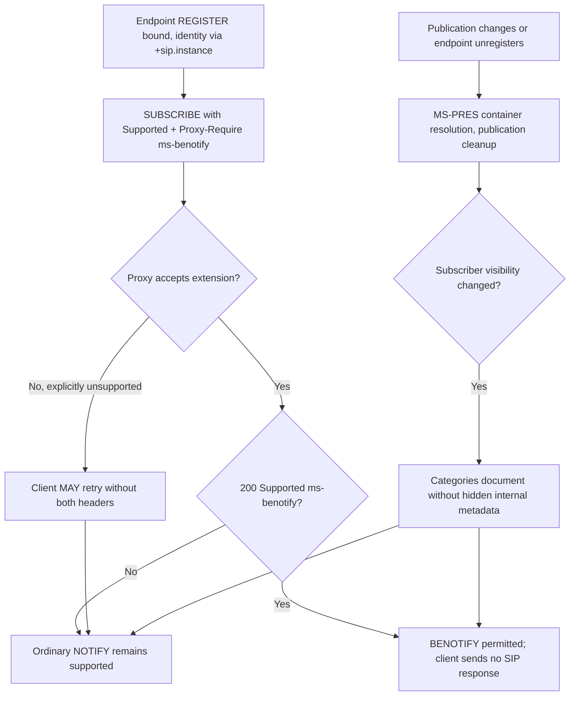

# Presence publication privacy, deregistration and BENOTIFY interoperability — original-PDF cross-analysis

Research tranche: **2026-10-22**. **Research-only, no implementation/test.** Examined owner-supplied original extracted PDF text for **MS-PRES v20250520 (257 pp.) §§3.2.5.3–3.2.5.5.1** and **MS-SIP v20170601 (93 pp.) §§3.5.1.1, 3.5.5.1–3.5.5.3, 3.6**. First-party specifications: [MS-PRES](https://learn.microsoft.com/en-us/openspecs/office_protocols/ms-pres/) and [MS-SIP](https://learn.microsoft.com/en-us/openspecs/office_protocols/ms-sip/). Note: **MS-SIP in supplied corpus is v20170601**, not an assumed 2025 revision. Published cross-edition compatibility and product notes still need reconciliation.

## 1. Server presence container resolution — §3.2.5.3 (verified)

When a publication changes, affected CategorySubscriptionDialogEntry entries must be reevaluated. For each publisher/subscriber/category, consider only containers that actually contain that category, then select the **highest numbered matching container within the first eligible match class**:

1. Explicit user URI membership;
2. Matching domain membership;
3. `sameEnterprise` (only same-enterprise subscribers);
4. `federated` (only federated subscribers);
5. `publicCloud` (only public-cloud subscribers);
6. Default container, if any.

If no eligible container exists, the subscriber resolves to a **null ContainerCategoryEntry**. This precedence is **not** a simple global greatest-container-number comparison: membership specificity takes priority. A subscription may be resolved to another container following a publication update even if the subscriber's URI is unchanged.

**Mandatory notification logic:** if resolved container changes or published instances within it change, notify the subscriber with the **complete** resulting set. For null container, send a category instance with empty data. Update resolved container as required.

**Mandatory outbound content:** `Content-Type: application/msrtc-event-categories+xml`; a categories XML document carrying category name, instance number, last publish time and published XML body. **MUST NOT expose** instance container ID, version, expiry type, endpoint ID or expiry time in this subscriber-facing category element. These are a protocol-level privacy boundary, not UI hiding.

### Provenance

**MS-PRES, revision v20250520, §3.2.5.3, PDF pp.91–92;** nested normative server-side MUSTs. Do not turn these into client publication-selection algorithms. The client receives appropriately scoped category results; privacy disclosure decisions belong to the documented server state.

## 2. Publication rejection and atomic version conflict — §3.2.5.4 (verified)

| Condition | Required server outcome |
|---|---|
| Missing body or malformed rich-presence XML | 400 Bad Request |
| From URI differs from To URI | 403 Forbidden |
| To URI differs from URI in publications element | 400 |
| Time-bounded publication without expiry time | 400 |
| Publishing read-only category to container | 403 |
| Unregistered category name | 403 |
| Any version validation failure in a multi-publication request | **409 Conflict; server MUST fail ALL publications**, including those whose own versions matched |
| Duplicate category instance within a container in one request | 400 |
| Publication too large or category quota exceeded | 413 SHOULD |
| `expireType=endpoint` publication from unregistered endpoint | **488 MUST**, cross-ref MS-SIPREGE §3.1.2.5.1 |

**Security/recovery consequence (inference):** an optimistic local presence state must not mark any item from a batch accepted after 409. The right recovery sequence and retry algorithm are not fully established by this server-side error table alone; determine exact MS-PRES client handling before planning code.

## 3. Deregistration is at least two distinct cleanup events — §§3.2.5.5 and 3.2.5.5.1

| Trigger | Deletion | Subscriber notification |
|---|---|---|
| **Any endpoint deregisters / registration expires** (§3.2.5.5, pp.92–93) | All **endpoint**-bounded instances published by that **same endpoint ID** | Server MUST notify **self subscribers** whose URI is the publisher's URI and **affected category subscribers**, via NOTIFY or BENOTIFY |
| **Last endpoint of user deregisters** (§3.2.5.5.1, pp.93–94) | Remaining **user**-bounded instances and endpoint-bounded instances for that expired endpoint | Server MUST inform affected category subscribers via NOTIFY/BENOTIFY |

Endpoint identity derives from `+sip.instance` Contact UUID per **MS-SIPRE §2.2.5**. The old research report covered only last-endpoint cleanup; this verifies the **separate earlier any-endpoint path** and distinguishes additional notification recipients.

**Uncertainty:** the two clauses can apply to one last-endpoint transition; their exact ordering, coalescing of notifications, and whether one notification suffices are not specified by the reviewed text. Do not invent a fixed packet count or force two notifications.

## 4. BENOTIFY capability negotiation and failure fallback — MS-SIP §§3.5.1.1, 3.5.5.1–3

**Original PDF edition v20170601**, pp.37–39.

- Client requests extension using BOTH `Supported: ms-benotify` AND `Proxy-Require: ms-benotify` on initial SUBSCRIBE. Proxy-Require intentionally permits legacy proxies to reject unsupported mechanism.
- If a proxy rejects SUBSCRIBE due to unsupported BENOTIFY, client **MAY** disable extension and resend SUBSCRIBE **without both headers**. This is a negotiated fallback, not a blanket requirement to repeat on every error.
- A successful SUBSCRIBE 200 with `Supported: ms-benotify` lets client **MAY** set its BENOTIFYEnabled flag. Server may withhold support based on unreliable connectivity. Client SHOULD continue to handle ordinary NOTIFY.
- On receiving a BENOTIFY request client **MUST NOT send a SIP response**; server MUST ignore any responses it receives. The client SHOULD process BENOTIFY content the same way as ordinary NOTIFY.
- For BENOTIFY extension alone, §3.5.2 introduces no new timers beyond RFC 3261 and RFC 3265. Separately §3.6 defines OPTIONAL auto-extension subscriptions, where NOTIFY may implicitly refresh subscription timer. Do **not** assume auto-extension or BENOTIFY is available just because SUBSCRIBE succeeded.
- §3.5.3 client SHOULD have registered before sending a SUBSCRIBE that advertises BENOTIFY.

### Conditional inter-protocol diagram

**Diagram warning:** depicts *conditional interdependencies* rather than guaranteed traffic sequencing; subscription existence and server configuration govern the transport to actual subscribers. For unregister, the source separately mandates notifications to appropriate subscriber classes.

## 5. Cross-reference ledger and research gates

| ID | Relation | Still unverified |
|---|---|---|
| PRES-BEN-01 | MS-PRES §3.2.5.3 subscriber notifications → MS-SIP §3.5.1.1 negotiation | Compatibility of **2025** MS-PRES with the supplied **2017** MS-SIP edition; product applicability |
| PRES-REG-02 | MS-SIPREGE registration → MS-PRES §§3.2.5.5–5.1 deletion | Race between registration expiration, publisher cleanup, recovery and notification |
| PRES-ID-03 | MS-SIPRE `+sip.instance` → MS-PRES `endpointId` | Full exact URI parameter syntax and multi-endpoint identity |
| PRES-PRIV-04 | MS-PRES container member class → permitted categories | End-to-end multi-container privacy, delegated users, federation, policy mutation |
| PRES-ERR-05 | MS-PRES §3.2.5.4 atomic 409 → client retry policy | Client normative recovery & expected conflict XML |
| SIP-EVT-06 | MS-SIP §3.5 uses RFC 3265; RFC 6665 later obsoletes | Appropriate old-client RFC event interpretation, and extension-specific behavior |

**Status:** substantive original-PDF server/client sections verified; neither entire MS-PRES nor the whole Windows Full Client has been analyzed. This document doesn't authorize code changes; no real-server tests, merges or releases.
