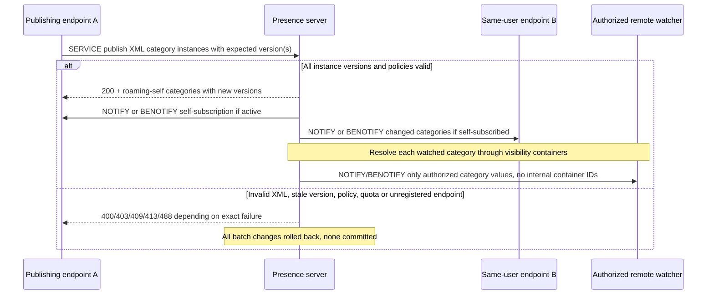

# Enhanced presence publication: versioned atomic XML batches, visibility and multi-device callbacks

**2026-10-23 primary-only research. Overall client analysis incomplete.** [MS-PRES] Presence Protocol **rev13.0 v20250520, 20 May 2025**, original PDF SHA-256 `f1e0ce966ab242cf09b57e4403f9cfa7aec9c5aa883325f1e4ac91ad1ff5fa79`, sections **§§2.2.2.2.1–.3, 2.2.2.3.1–.3, 2.2.2.4.1–.3, 3.2.1–3.2.5.5, 3.5.5.1–3.5.5.5**, PDF pp88–106; original PDF p90–93 and p106 visually sampled. Connect prior [MS-SIP8 and PRES13 roster/UCS](ms-sip8-pres13-roaming-contacts-acl-ucs-migration-version-security-2026-10-23.md), [MS-SIPREGE 17.1 registration loss](ms-siprege17-pres13-conmgmt10-registration-loss-survivable-cleanup-2026-10-22.md), [MS-PRES13 category subscription](ms-pres13-dlx13-batch-presence-directory-contacts-2026-10-22.md). RFCs [RFC3261](https://www.rfc-editor.org/rfc/rfc3261) §§8,10, [RFC3265](https://www.rfc-editor.org/rfc/rfc3265) §§3, [RFC6665](https://www.rfc-editor.org/rfc/rfc6665) successor, [RFC1034](https://www.rfc-editor.org/rfc/rfc1034) DNS. **P** = Microsoft primary role/edition; **S** = synthesis; **U** = unresolved.

## A. Publication batch verification and response

| ID | Original clause | Source-qualified requirement |
|---|---|---|
| PUB-01 | §3.2.5.1.1 | Endpoint supporting enhanced presence **MUST include `Supported: msrtc-event-categories` in REGISTER**. This is a *client capability tag*, not a blanket right to publish to every container. |
| PUB-02 | §§2.2.2.2.1, 3.2.5.1.2 | Publish is SIP **SERVICE `Content-Type: application/msrtc-category-publish+xml`**, with XML `publish/publications/publication`. **Server MUST verify From URI = To URI = publications URI**. Publication of other users' categories by just changing XML URI is not supported. |
| PUB-03 | §3.2.1 | Publication instance key includes **publisher URI, category name, container ID, instance number**; each has **version**, `publishTime` and expiry type `static|endpoint|user|time`, optional endpoint ID/expiry. These are distinct from MS-SIP `deltaNum` contact-version and MS-SIPAE message cnum. |
| PUB-04 | §3.2.5.1.2 | Server checks XML category schema/attributes. `expireType=time` **MUST include expiry time**. Endpoint-bounded publication requires **registered publishing endpoint** first (MS-SIPREGE); read-only containers and unregistered categories restricted. |
| PUB-05 | §3.2.5.1.2 | **Optimistic concurrency**: supplied `version` **MUST equal current instance version**; absent instance **MUST have version=0**; success **MUST increment** version. Server sets `publishTime` to UTC. Version is server sequence, not provided client time. |
| PUB-06 | §3.2.5.1.2 | `expires=0` deletes specified existing instance; nonzero updates/adds. **Do not interpret zero as all user categories or global user signout**; affected instance identified by complete key. |
| PUB-07 | §3.2.5.1.2 | Batch can add/update/delete *many categories in multiple containers*, and **server MUST NOT commit changes until all publication elements processed**; if any error, **cancel all pending changes**. This is an atomic batch, not independent best-effort per category. |
| PUB-08 | §§2.2.2.2.2,3.2.5.1.2 | Successful SIP **200 `Content-Type: application/vnd-microsoft-roaming-self+xml`** **MUST embed** categories, updated version and publishTime and complete affected ContainerCategoryEntry instances. **200 alone without parsing categories cannot prove local version state**. |
| PUB-09 | §3.2.5.2 | After successful batch server **MUST send NOTIFY or BENOTIFY to each applicable self subscription including same endpoint** (scope `categories`). It contains changed whole affected category instances in `application/vnd-microsoft-roaming-self+xml`, versions and values. This is distinct from the SERVICE response and supports multi-device consistency. |
| PUB-10 | §3.2.5.3 | Server **MUST re-resolve every relevant category subscriber's visible container** after publish. If selected container changed or category instances changed, notify subscriber with complete selected visible instances (or empty category when no resolution). A successful own publish does **not mean** all subscribers see it. |
| PUB-11 | §3.2.5.3 | Visibility choice order: category-bearing containers with specific **user**, then **domain**, then sameEnterprise, federated, publicCloud, lastly default. At first matching class choose **highest-numbered** container. User's contact-group ID is unrelated to visibility container number. |
| PUB-12 | §3.2.5.3 | Category-subscriber NOTIFY/BENOTIFY MIME `application/msrtc-event-categories+xml` **MUST omit** internal container ID, version, expiry type, endpoint ID and expiry time (while self-subscription can include them). Server must not leak private metadata through public notification. |
| PUB-13 | §3.2.5.4 | Server status **400** missing/bad XML, publications-URI mismatch, time expiry omitted, duplicate instance; **403** From≠To, read-only container or disallowed category name; **409** version conflict, **entire batch fails**; **413** request/category quota (SHOULD); **488** endpoint publication without valid registration. |
| PUB-14 | §§3.2.5.5–3.2.5.5.1 | Deregister or registration expiry removes **endpoint-bounded** publications for **only that endpoint**; if last endpoint for user, also deletes **user-bound** instances. Independent time-bound expiration cleanup §3.2.6.1 and static categories persist by their own rules. |
| PUB-15 | §3.5.5.2 | `setContainerMember` is separate SIP SERVICE with `application/msrtc-setcontainermembers+xml`: **no edits container zero**, member values are `user|domain|sameEnterprise|federated|publicCloud|everyone`; version must match, version increases after success; batch **all-or-nothing** and category subscribers can be re-notified even with unchanged category XML. |
| PUB-16 | §3.5.5.5 | Container edits reject with **400** malformed/missing XML or duplicate same container, **403 SHOULD** From/To mismatch, **409 MUST** stale version, **413 MUST** excess container membership quota. This is **not** the roster `deltaNum` error namespace. |

## B. Cross-device state and transport model (S)

For **BENOTIFY** the client **MUST NOT send SIP transaction response** per MS-SIP §3.5.5.3, whereas a normal NOTIFY follows the relevant RFC event transaction rules. Source role guard: the server **MUST** prevent privacy container metadata disclosure; the client cannot establish viewing permissions by manipulating claimed header strings.

## C. Open priority conflicts / invariants before any implementation plan

- **PRES-G01:** Fully parse §2.2.2.2.3 **409 XML version-conflict response**, including per-category updated data, and reconcile self-subscription races; do **not** blindly retry with old version or assume partial success.
- **PRES-G02:** Notification ordering can race with SERVICE 200 across multiple endpoints; server version and complete instance key govern semantics, not arrival order.
- **PRES-G03:** All role cases for optional/unregistered category names, tenant/domain federation and publisher-subscriber visibility depend on admin policy outside spec; not proof user can force `everyone` membership.
- **PRES-G04:** Source says server keeps independent category and container membership version numbers; legacy roaming contact `deltaNum` and ACL version are separate; never collapse into one 'presence revision'.
- **PRES-G05:** Additional MS-PRES §§3.3,3.4,3.6–3.9 for self-subscription, categories, subscriber approvals and delegates remain only partially analyzed in earlier ledger; no claim of full content.
- **PRES-G06:** Federation, publicCloud and privacy priority are policy-controlled; need exact category schema and server status for denied target or null container. No fabricated categories or numerical availability default.
- **PRES-G07:** Historical event RFC3265 vs successor RFC6665/7621 source edition and BENOTIFY/piggyback profile require explicit mapping by Windows/client era.
- **PRES-G08:** More extensive XSD errors, product notes and category state aggregation (§3.8) remain unverified. A published userState is not necessarily the finally aggregated displayed status.

**Status: original selected clauses verified, global spec research incomplete; no protocol code, no user-owned live servers/tests, no main merge or release.**
