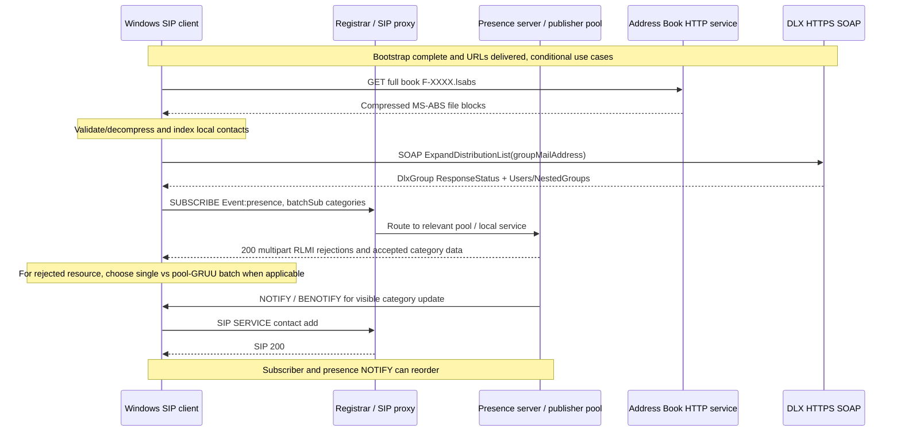

# Microsoft contact discovery and presence subscriptions: MS-PRES 13.0 + MS-DLX 13.0 original-source cross-analysis

**Research tranche 2026-10-22.** Directly inspected owner-supplied original PDF texts: **MS-PRES revision 13.0 v20250520, original PDF §§2.2.2.4.1–.3, 3.4.5.1.1–.1.3.1, 3.4.5.2 and 3.6.5.1** (notably pp40–45, 99–103, 108); **MS-DLX revision 13.0 v20250520, §§2.1, 2.2.5.1, 3.1.4.1.3.1–.3.5, 3.1.4.1.4.1** (pp13, 17–22); **MS-OCSPROT 9.0 v20250520 §§2.5.7,2.5.10**; **MS-SIP 8.0 v20170601 §3.5** previously checked for BENOTIFY. Official original URLs in `catalog/inventory.json`. This does **not** certify complete presence or SOAP normative conformance.

## 1. Three independent data planes

- **Offline address book:** MS-ABS HTTP GET binary full/delta files; AD objects and reverse lookup; not live presence or signed-in contact membership. [MS-ABS binary ledger](ms-abs10-original-binary-book-delta-compression-and-rnl-2026-10-22.md).
- **Distribution-list expansion:** MS-DLX HTTPS/TCP SOAP `ExpandDistributionList`; nested members and explicit authorization/resource quota response statuses.
- **Live publisher/contact subscriptions:** MS-PRES SIP `SERVICE`, `SUBSCRIBE`, `NOTIFY`/`BENOTIFY`; lists, visibility containers, category XML; may need routing to publisher's home server pool.

## 2. Verified MS-PRES wire and state requirements

| ID | Original section | Normative requirement / outcome | Role and condition |
|---|---|---|---|
| PRES-L01 | §2.2.2.4.1 | Category request **Event: presence**; batched form **Content-Type: application/msrtc-adrl-categorylist+xml** and XML `batchSub/action/adhocList/resource/categoryList/category`. Required Accept values: `application/msrtc-event-categories+xml, application/rlmi+xml, multipart/related`. | **UAC** request construction for enhanced presence batch |
| PRES-L02 | §2.2.2.4.1; §3.4.5.1.1 | Batch requires `Require: adhoclist, categoryList`, `Supported: eventlist`; subscribing AoR appears as **From** and **To**; valid dialog Contact URI. To and From equal in batch; single category subscribe may use differing URIs. | Batch UAC / server validates |
| PRES-L03 | §3.4.5.1.1 | **Single** category subscription has **exactly one resource**, potentially multiple categories; single cannot use `action name=unsubscribe`; batch recognized via both Require option tags. | Server processing/compatibility |
| PRES-L04 | §3.4.5.1.2 | **Polling** `SUBSCRIBE`: `Expires: 0` and To without tag; intended one-time snapshot and **SHOULD** for transient need. **Persistent** creates a dialog, ongoing NOTIFY/BENOTIFY and SHOULD for sustained contact-list monitoring. | UAC choice, server dialog lifetime |
| PRES-L05 | §3.4.5.1.2 | Server **MAY** reject both polling/persistent category subscribe with **403** when To user is outside local deployment. | Server; federation must not be presumed accepted |
| PRES-L06 | §3.4.5.1.3 | Server can cap batch resources/categories and context size; registered endpoint can be required and unregistered subscriber **SHOULD** receive **401** under that implementation. One batch dialog per endpoint/server may be enforced by ending older dialog with NOTIFY Expires=0. | Server resource-control/profile dependent |
| PRES-L07 | §3.4.5.1.3 | Server **MUST NOT** allow subscription to categories marked `private` and **MUST ignore** them in categoryList. | Server privacy guard; no client entitlement inference |
| PRES-L08 | §3.4.5.1.3 | `action=subscribe` adds publishers/categories to dialog state and selects visibility through MS-PRES §1.3.1 containers; `action=unsubscribe` removes specified entries, **200 OK even if entry not found**. A dialog refresh with unknown entry receives **481**. | Distinct server state transitions, idempotent unsubscribe |
| PRES-L09 | §3.4.5.1.3.1 | Batch resource may be rejected as `resubscribe` for remote deployment or other server pool. For same domain/different pool, **optional** `poolFqdn` gives server GRUU; client **SHOULD** create/reuse batch dialogue routed there. For different deployment, client **SHOULD** try single category subscribe with target in To. | Per-resource **partial rejection**; no global failure assumed |
| PRES-L10 | §3.4.5.1.3.1 | Subscription quota rejection can include RLMI instance `state=terminated reason=quotaExceeded statusCode=413 cid=<resource>`. Quotas/poolFqdn are server-implementation-specific. | Guarded by actual response, not always |
| PRES-L11 | §2.2.2.4.2 | Batch SUBSCRIBE success uses **multipart/related**, primary `application/rlmi+xml` part with version/fullState=false/rejected resources and separate **application/msrtc-event-categories+xml** per accepted publisher, binary transfer encoding. Each rejected `resource/instance` carries status info. | Client MIME boundary and XML parser; 200 may include rejected individual resources |
| PRES-L12 | §2.2.2.4.2 | RLMI `instance.state` is **active/pending/terminated/resubscribe**. `poolFqdn` present mandates **resubscribe**. `fullState` MUST be false for this batch response. `reason` on terminated instance is informational and client is **not expected** to automatically act based on arbitrary reason. | Do not translate any terminated into unconditional full resubscription |
| PRES-L13 | §2.2.2.4.3 | Category NOTIFY or BENOTIFY response to publication carries **Content-Type: application/msrtc-event-categories+xml**, category XML body; exact BENOTIFY availability per MS-SIP §3.5.1.1. | Server notifications; client **does not SIP respond** to BENOTIFY |
| PRES-L14 | §3.4.5.2 | Initial NOTIFY version **MUST=0**; subsequent versions may increment or stay equal. Server MAY route NOTIFY via **registration route-set** instead of subscription-dialog route-set when registration exists on same server. | Do not assume strictly increasing version or one fixed route |
| PRES-L15 | §3.6.5.1 | `SERVICE` Content-Type `application/msrtc-presence-setsubscriber+xml` **setSubscriber**: server **MUST verify To, From, SERVICE URI equal**; if referenced SubscriberEntry missing server returns **400**. | Subscriber list management, not the same as adding user's own roster contact |
| PRES-L16 | MS-OCSPROT §2.5.10 | User adding contact by SIP address: client `SERVICE` → server 200 → subscriber-list change to other endpoint and presence NOTIFY/BENOTIFY to local client; latter two notifications may reorder. | **Overview use-case**, exact roster SERVICE request body still needs proof |

## 3. Verified MS-DLX SOAP contract and authorization

| ID | Original section | Rule |
|---|---|---|
| DLX-L01 | §2.1 | Transport **HTTPS over TCP**, HTTP traffic encrypted according to historical document's SSL terminology. Service address may be learned through SIP. Certificate identity and current permitted TLS versions remain a separate security review. |
| DLX-L02 | §3.1.4.1.3.1 | `ExpandDistributionList` SOAP body has `groupMailAddress` (string), **MUST contain exactly one** per prose requirement **even though XSD declares minOccurs=0**. Treat conflict as **schema/prose tension** requiring errata/product-note check before interoperability expectations. |
| DLX-L03 | §§3.1.4.1.3.2–3 | `ExpandDistributionListResponse/ExpandDistributionListResult` encapsulates `DlxGroup`. One required `ResponseStatus` and optional `Users` and `NestedGroups`, each an array. NestedGroups represent group *objects*, not automatically recursively expanded all leaf users. |
| DLX-L04 | §3.1.4.1.3.5 | Each `ActiveDirectoryObjectInfo` may contain `displayName`, `mail`, `mailNickname`, `sipUri` (all optional strings); no guarantee that sipUri exists just because object appears in a distribution-list result. |
| DLX-L05 | §3.1.4.1.4.1 | `ResponseState`: `Invalid`, `Success`, `MemberCountLimitExceeded`, `NotAuthorized`, `NotFound`, `SimultaneousRequestLimitExceeded`. These are application-level **SOAP result states**, not SIP status codes. |
| DLX-L06 | §2.2.5.1 | **Different type** `SearchResponseState`: `Succeeded`, `NoEntryFound`, `InternalError`, `InvalidArgumentError`, `DatabaseError`, `CorruptionEntryError`. Never use `SearchResponseState` to decode `ExpandDistributionListResult.ResponseStatus`. |
| DLX-L07 | §3.1.4.1 (client/server) | Request is SOAP HTTP operation `ExpandDistributionListSoapIn`, response `ExpandDistributionListSoapOut`; server repository lookup SHOULD occur, response SOAP may convey logical failure with successful HTTP status. | 

## 4. Conditional sequence and state model (cross-spec synthesis)

**Warning:** This combines several **independent** reference use cases from MS-OCSPROT/MS-PRES/MS-ABS/MS-DLX. It is not an authoritative total order for a client bootstrap, requires suitable server deployment/services and does not assert that all remote roster subscriptions must pass through one proxy. BENOTIFY is conditional and must not be acknowledged by a SIP response, whereas ordinary NOTIFY follows RFC event processing.

## 5. Partial-state and failure matrix

| Wire or file event | State consequence | What is not justified |
|---|---|---|
| Batch 200 but individual RLMI `resubscribe` | Accepted resources keep data; rejected resource needs path-specific resubscribe | Do not treat entire SUBSCRIBE as failed |
| Batch resource `quotaExceeded` 413 | Report affected resource quota; other parts may succeed | No unbounded automatic retry |
| Persistent dialog refresh yields 481 | Subscription state missing; needs renewed dialog under applicable client rules | Do not treat as authentication 401 |
| MS-PRES `private` category requested | Server excludes; client should not claim exposure | A successful 200 doesn't grant rights |
| DLX `NotAuthorized` | Directory membership disclosure denied | Do not conflate with SIP 403 or request new SIP SA automatically |
| DLX result has only `NestedGroups` | Group memberships reported, not proven fully flattened | Do not invent leaf SIP endpoints |
| ABS compact delta omits contact attribute | Keep prior value | Do not replace with empty or delete |
| ABS file CRC mismatch | Corrupt file-data indication | No inferred server compromise or cryptographic authenticity proof |
| Presence category NOTIFY version repeats | May still be within documented sequence | Do not drop solely because version unchanged |

## 6. Open questions, edition conflicts and research gates

- **CONT-G01:** Exact source-defined SIP SERVICE content to *add contact*, manage contact group and subscriber privacy (MS-PRES §§2.2.2.5–6, §§3.3,3.6,3.10); overview §2.5.10 doesn't enumerate bytes.
- **CONT-G02:** Complete MS-PRES batch context element semantics, subscriber access containers, authorization/federation and quota error handling, all XML schema variations. `MS-PRES 2025` references `MS-SIP 2017` where versions differ.
- **CONT-G03:** RFC3265 original vs RFC6665 later event subscription requirements; Microsoft edition interoperability and unknown dialogs, stale routes and signed notification acceptance.
- **CONT-G04:** MS-DLX auth mechanism and certificate checks, full WSDL/SOAP serialization (including `SOAPAction`), nested-group recursion/limits, server rollout version, Privacy/NotAuthorized path.
- **CONT-G05:** MS-ABS full/delta identity, corruption recovery, GET transport authentication, HTTP cache/range, E164 normalization and product edition flags (see linked binary ledger).
- **CONT-G06:** Single external publisher SUBSCRIBE routing and pool GRUU privacy semantics, integrating MS-SIPRE EPID/GRUU, MS-SIPAE signed response and MS-SIP keepalive.
- **CONT-G07:** Direct **directory search** inside MS-PRES §§2.2.1,3.1, MS-ABS offline search and MS-DLX search WSDL operations need a disambiguating query/use-case matrix. MS-SEARCH is an independently named SharePoint Search protocol; a Microsoft direct metadata edge alone does not prove it is the core Skype for Business contact lookup engine.
- **CONT-G08:** Full-client UI semantics (personal contact groups, privacy relations, delegated contacts and roaming contact store) and all 112 assessment reports not independently closed.

**Status:** substantial original PDF presence/contacts/DLX sections checked; overall client state graph and complete normative corpus **NOT COMPLETE**. Strict research only; no protocol code, no genuine server interop tests, merge or release.
