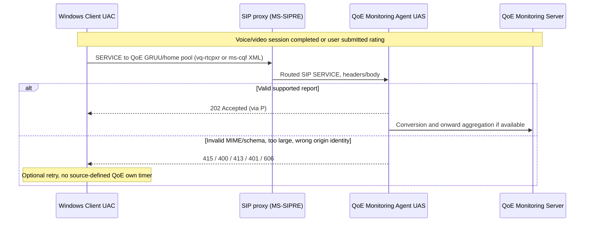

# MS-QoE 12.0: post-session SIP SERVICE XML reports, identity checks and monitoring acceptance

**Original source audit 2026-10-23. Not complete all 175 pages of metric schema; no implementation or testing.** [MS-QoE] *Quality of Experience Monitoring Server Protocol*, **revision 12.0 / `v20250520` / publication May 20 2025**, original PDF SHA-256 `4bfe62bbd9f2d7086833d59a55ab51b1950250a522ccdcf7aa29a0afe45430e2`, [Microsoft original](https://officeprotocoldocs-f5hpbjgea6b8gneq.b02.azurefd.net/files/MS-QoE/%5BMS-QoE%5D.pdf), official [revision history](https://learn.microsoft.com/en-us/openspecs/office_protocols/ms-qoe/c1050431-f4b2-44d4-a425-63d75e99f5df) confirms rev12 major. Direct original §§1.3–1.7,2.1–2.2.2.1.2,3.1–3.3, selected §4 examples; original PDF pp13 and 79 directly rendered and checked. IETF source [RFC3261](https://www.rfc-editor.org/rfc/rfc3261) for SIP transactions/routing. [IETFDRAFT-SIPSOAP-00] §4 referenced for SIP SERVICE syntax; **not a separate independent IETF standard RFC**. Microsoft [MS-SIPRE] rev13 for SIP routing, [MS-RTP] rev17 for live RTCP statistics, [MS-RTCPXR] (if available from original corpus) potential RTCP XR vocabulary, [MS-OCSPROT] rev9 overview. **Evidence:** P first-party clause; S cross-spec synthesis; U client/build dependent; R RFC primary.

## 1. A successful media session and accepted QoE report are distinct

| ID | Original clause | Client / proxy / monitoring agent scoped wire contract |
|---|---|---|
| QOE-01 | §1.3 | Client may publish media QoE metrics for **each SIP session**, one of **objective session metrics** and **subjective user feedback**. Publication typically occurs **after session ends**; this is post-session telemetry, NOT a mandatory precondition to rendering RTP or ending a SIP dialog. |
| QOE-02 | §§1.4–1.6 | **QoE Monitoring Server and enabled QoE feature** are prerequisites for aggregation. If the deployment lacks this, original does **not** establish an independent requirement that Windows Full Client upload diagnostics to arbitrary address. |
| QOE-03 | §2.1–2.2 | Client sends SIP **SERVICE** (Microsoft SIPSOAP draft) through SIP proxy to **QoE Monitoring Agent**. Permitted Request-URI: pool **QoE GRUU**, hosting pool URI, or Request-URI same as To (home pool handles it). These are structured routing policies, not a direct HTTPS metric upload. |
| QOE-04 | §2.2 | Only two supported request MIME types: **`application/vq-rtcpxr+xml`** or **`application/ms-cqf+xml`**. XML **MUST comply with specified schema**, required fields and value bounds; Unicode strings and invariant culture SHOULD be used, strings beyond declared character limits truncated unless otherwise stated. |
| QOE-05 | §§2.2.1,2.2.1.1 | Objective envelope **`VQReportEvent`** in namespaces **ms-rtcp-metrics / .v2 / .v3 / .v4**; child `VQSessionReport` (available); `VQSessionIntervalReport` appears in schema but marked **not available/not used** for this client profile. Do not fabricate interval reporting from mere XSD `maxOccurs`. |
| QOE-06 | §§2.2.1.2–2.2.1.2.1 | **`VQSessionReport`** describes a single SIP dialog and contains required `SessionId` attribute, `Endpoint`, `DialogInfo` and one or more `MediaLine`; `Pool` and `LocationProfile` exist in XSD but are explicitly marked *not used*. Schema allows optional opaque platform/conference data but not universally required. |
| QOE-07 | §§2.2.2,2.2.2.1 | Subjective envelope **`CallQualityFeedbackReport`** requires `ReportingUserURI`, integer **`Rating` 1–5**, required `CallId`, `FromTag`, `ToTag`; `Feedback` free text and `Tokens` predefined issue set are **optional**, as are start/end timestamps. This is **user-submitted feedback**, not automatic RTP packet loss report. |
| QOE-08 | §§2.2,3.2 | Monitoring Agent performs SIP UAS role; **202 Accepted means report accepted, NOT necessarily processed** into QoE Monitoring Server database or downstream third-party consumer. Do not mark telemetry fully stored/synchronized based on SIP 202. |
| QOE-09 | §3.2 | Agent **606** if XML report root not one of `VQReportEvent` or `CallQualityFeedbackReport`; **400** for schema invalid or invalid metric value; **415** for unsupported MIME; **413** for report payload larger than **300 kilobytes**. Not a generic SIP call setup error code or retransmission timer. |
| QOE-10 | §3.2 | Agent **401** when SIP **From** fails to match report body **LocalPAI**, or **FromURI** if LocalPAI absent. For anonymous contributor, agent can return 401 on mismatch between **focus-uri SIP header** and `ConfURI` in XML. This is **QoE report origin/body identity binding**, not necessarily SIPAE Kerberos/NTLM challenge. |
| QOE-11 | §§3.1,3.1.1–3.1.7 | QoE client UAC sends SERVICE to UAS; on error **can retry**. Critically the Microsoft original lists **None** for UAC abstract data, own timers, initialization, processing, timer events. **No QoE-specific fixed retry timer, maximum attempts, or queuing policy is specified here.** Default SIP semantics and product behavior outside this source may apply. |
| QOE-12 | §3.3 | SIP proxy **routes** report SERVICE via [MS-SIPRE] §3; it is not the same role as Monitoring Agent converting/aggregating reports and is not directly a media peer. |
| QOE-13 | §1.3 | Agent converts XML to internal representation and sends to **QoE Monitoring Server and/or registered third-party consumer**. **Privacy/trust inference (S):** reports can include endpoint/dialog/media network and device information, so authorization/retention and cross-server forwarding must be treated as a separate trust boundary from media transport; this source excerpt does not specify complete data minimization, storage encryption or consent UI. |
| QOE-14 | §2.2.1.1–2.2.1.2 | Not all schema fields are populated by clients even if in XSD; `Available: No` vs required XSD syntax is a distinct Microsoft compatibility dimension, likewise ms-rtcp-metrics v2/v3/v4 optional namespace elements. Current 12.0 revision does **not prove** all historical 2015 SfB Windows clients emit v4. |

## 2. Post-call path and failure disposition (S)

**This is a causal illustration**, not one mandatory packet trace for every Windows build. 202 success is not a database acknowledgement. QoE report 401 is separate from SIP initial 401/407 authentication establishment, and server's reporter identity verification belongs in the monitoring service trust boundary. Raw report containing sensitive endpoint/media addresses should not be assumed exportable to arbitrary third-party consumer without server policy.

## 3. RFC comparison and conflicts

1. **QOE-X01:** [RFC3261] defines SIP request/response transactions, but `SERVICE` and report XML are Microsoft extensions referring to historic **IETFDRAFT-SIPSOAP-00**. Generic SIP UAC 202 success does not define monitoring persistence.
2. **QOE-X02:** `VQSessionIntervalReport` is schema-valid but flagged *unavailable* by Microsoft §2.2.1.1.1; full client evidence should classify **available feature** separately from XML grammar.
3. **QOE-X03:** 300 kilobytes size ceiling is a **QoE Monitoring Agent** rejection bound, not an RTCP MTU, SRTP message length, TURN resource limit or Microsoft SIPCOMP decompression cap.
4. **QOE-X04:** `401` for mismatched XML LocalPAI/From or focus URI is **service payload authorization**, not necessarily an NTLM challenge. Distinguish SIP source, additional diagnostics and server auth context before retry.
5. **QOE-X05:** Objective RTP/RTCP quality sampling vs retrospective XML/report aggregation need call-end and service-unavailable race analysis, including client state after deregistration; MS-QoE §§3.1.1–3.1.7 provide **no own timers**, so do **not fabricate** a queue/retry cycle.
6. **QOE-X06:** Rated subjective feedback 1–5, free text, tokens and per-dialog identifiers are potentially personal data; retention/encryption/consent are deployment and application policy not inferred from RFC3550 media measurements.
7. **QOE-X07:** Full **175-page** report schema has many media metrics, endpoint identifiers, network candidates and versioned XML values; only selected schema sections were reviewed directly this tranche. Need schema-by-schema typed field/enum extraction for full RFC/media QoE closure and eventual normative tests *only by owner*.

**Research phase NOT COMPLETE, no code, no live-server connections or interoperability tests, no merge or release.**
