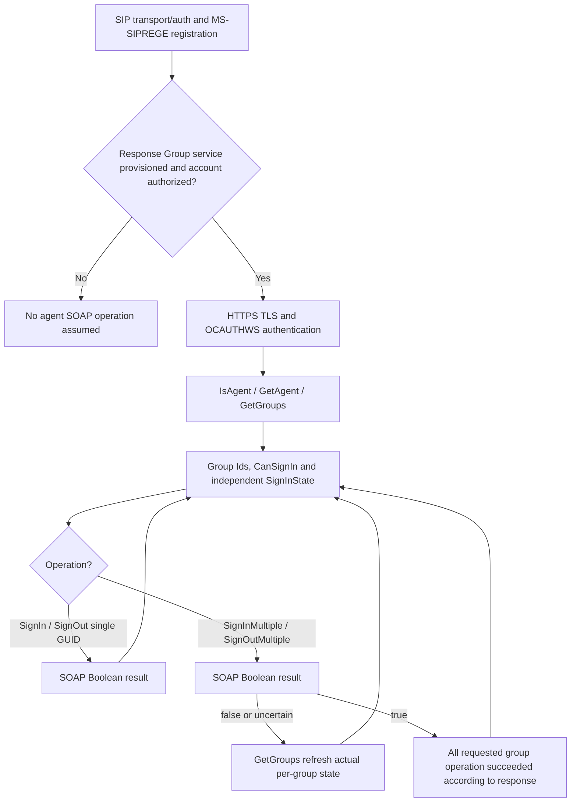

# MS-RGSWS 9.0 — Response Group agent SOAP, per-group login state and partial multi-group failures

**Research date 2026-10-23. First-party source selected-clause audit, NOT complete classic Windows Full Client feature proof.** Microsoft **[MS-RGSWS] Response Group Service Web Service Protocol**, **revision 9.0, release 2025-05-20 (v20250520)**; locally archived original PDF SHA256 **7f9e521f82b302d7ff98cc9af982de30847310baddf4e675cf56784903a55bdc**, confirmed against PDF bytes; original Microsoft URL `https://msopenspecs.microsoft.com/files/MS-RGSWS/%5BMS-RGSWS%5D.pdf` (document availability on this endpoint not independently established by tool; actual primary 46-page PDF present in archive). Checked **§§1.3–1.6, 2.1–2.2.4, 3.1–3.1.4.8, 4.1–4.3**, including rendered/original **pages 12,22,28**. Direct relevant dependencies **[MS-SIPREGE] §2.2.2.5.1** for provisioning service URL and **[MS-OCAUTHWS] §3** for authentication; historical **[RFC2818](https://www.rfc-editor.org/rfc/rfc2818)** HTTPS, **[RFC2119](https://www.rfc-editor.org/rfc/rfc2119)** normative language; [RFC2616](https://www.rfc-editor.org/rfc/rfc2616) HTTP status interpretation explicitly invoked by §3.1. **P** directly documented; **S** cross-protocol distinction; **U** unknown client/build/edition or normative dependency.

## A. Scope and source-specific requirements

| ID | Original source | Proven role and state requirement |
|---|---|---|
| RGS-01 | §2.1 | Protocol server **MUST support SOAP over HTTPS**; client obtains Response Group service address through SIP in-band provisioning **MS-SIPREGE §2.2.2.5.1**. SIP REGISTER 200 does not itself supply all RGS SOAP operation results. |
| RGS-02 | §3.1 | Service **is not required to retain per-protocol-client state** apart from authentication required by MS-OCAUTHWS §3; nevertheless it acts upon an authenticated user's **server-side Response Group membership and agent sign-in status**. “No client state” in abstract model must not be misconstrued as no sign-in state changes. |
| RGS-03 | §3.1 | HTTP status codes for HTTP/authorization faults are interpreted per RFC2616 unless explicitly specified; server may enforce implementation-specific **authorization checks**. A valid SOAP envelope without authorization is not a successful group operation. |
| RGS-04 | §§3.1.4,3.1.4.1–.8 | Exactly eight enumerated SOAP/WSDL operations: **GetActiveResponseGroups, GetAgent, GetGroups, IsAgent, SignIn, SignInMultiple, SignOut, SignOutMultiple**. This is an **agent-control API**, not a replacement for SIP SUBSCRIBE, REGISTER or media INVITE. |
| RGS-05 | §3.1.4.1.2–.3 | `GetActiveResponseGroups` request is empty element; response optional `GetActiveResponseGroupsResult` array of entries with optional **Uri, DisplayName** and required Booleans **IsAnonymized, IsOutboundAllowed**. If user not agent result SHOULD contain no complex entry type; empty != network error. |
| RGS-06 | §§2.2.4.1,3.1.4.2 | `GetAgent` request empty element, response optional `GetAgentResult:AcdAgent`; `AcdAgent.Id` required GUID, **UserSid, SipAddress, DisplayName** optional. Optional omission can mean server could not retrieve details; no invented empty SID identity. |
| RGS-07 | §3.1.4.3.2–3 | `GetGroups` request has no fields; response optional `GetGroupsResult:ArrayOfAcdGroup` may be empty for nonagent. Per-group required **Id, NumberOfAgents, CanSignIn, SignInState, NumberOfCallsWaiting, LongestWaitingTime**; `Name,AllAgents` optional. Wait time is **seconds**; unrelated to SIP transaction timer. |
| RGS-08 | §3.1.4.3.4.1 | `SignInState` **enum exactly SignedIn, SignedOut, Unknown**. It is per **Response Group agent membership**, not account SIP authentication or presence category. Treat `Unknown` as a source-defined third value, never silently `SignedOut`. |
| RGS-09 | §3.1.4.4 | `IsAgent` SOAP operation uses empty input element and **required IsAgentResult Boolean**; this service truth differs from “agent displayed in Contacts” or from address book membership. |
| RGS-10 | §3.1.4.5.2 | `SignIn` request requires **groupId GUID exactly once**; `SignInResponse.SignInResult` Boolean required. It updates **specific agent/group**, not account REGISTER binding. |
| RGS-11 | §3.1.4.7.2 | `SignOut` request likewise requires **groupId GUID exactly once**, returns required **SignOutResult Boolean**. Signing out of an agent group is **not SIP deregistration** and should not automatically dispose dialogs/media. |
| RGS-12 | §§3.1.4.6.2,3.1.4.8.2 | `SignInMultiple` and `SignOutMultiple` allow **optional groupIds:ArrayOfGuid** (minOccurs=0,maxOccurs=1); returning **Boolean false SHOULD occur even if only some operations failed**. Consequently **false does NOT prove zero groups changed**. |
| RGS-13 | §§3.1.4.6.2.2,3.1.4.8.2.2 | After multi-group operation with false/partial success, **GetGroups** can reveal actual per-group state. This is source-guided state reconciliation and forbids client optimistic all-or-none local assignments merely from a batch Boolean. |
| RGS-14 | §3.1.4.3.3.1 | `CanSignIn` indicates sign-in/out supported by that group; it is independent from `SignInState`. Per-agent UI entitlement not implied by a successful SIP registrar sign-in. |
| RGS-15 | §§3.1.1–3.1.3,3.1.5 | Protocol defines **no dedicated server abstract data-model timers**; network transport, authentication-token life and application retry policy reside in other protocols/deployment. This **does not** establish a fixed RGS retry interval or guaranteed atomicity. |

## B. Cross-protocol state model (S, conditional on agent role being provisioned)

**Two identities and three state layers:** SIP identity/registration; SOAP HTTPS authenticated RGS service identity; membership & sign-in for each agent group. User presence and SIP dialogs are a fourth/fifth independent layer. RGS's `SignOut` ≠ full Windows client's user sign-out. **This distinction is direct from separate protocol roles plus synthesized client architecture.**

## C. Conflicts and unproven Windows behaviors

- **RGS-U1:** `SignInMultipleResult=false` may denote partial success while only a single bool is returned. Per-group postcondition not recoverable from the response alone; authoritative `GetGroups` query necessary for reconciliation. Network loss can cause unknown partial completion, and original has **no idempotency tokens** or blanket retry rule.
- **RGS-U2:** Optional `groupIds` minOccurs=0: semantics of omitted/empty list are **not explicit** in the reviewed WSDL. Do not infer “all groups” or “none” merely from optionality.
- **RGS-U3:** Authentication via MS-OCAUTHWS delegated; HTTPS certificate and web-ticket/credential scheme must be independently source-verified; never reuse SIPAE MIC/SRTP key as web credential.
- **RGS-U4:** This 2025 server protocol says nothing universal about which **2015/2016 Windows Full Client UI** exposes agent sign-in or whether Response Group service is enabled. Product/edition applicability and exact provisioning address required.
- **RGS-U5:** Error code-specific response examples, server-side agent permission checks and full WSDL types need line-by-line input/schema and external MS-OCAUTHWS clause audit before declaring full RGS coverage.

**Research status partial. No protocol code, no live servers, no interoperability tests, no main merge or release.**
