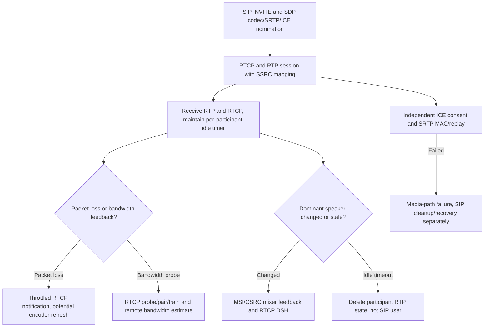

# RTP/RTCP runtime state, loss recovery, conference quality hints and redundant audio: MS-RTP 17 / MS-RTPRADEX 13

**Research-only original-source audit, 2026-10-23; NOT full-media conformance or implementation authorization.**

**Original first-party editions and provenance**: [MS-RTP] *Real-time Transport Protocol (RTP) Extensions*, **revision 17.0**, published **2025-05-20** (`v20250520`), original SHA256 `4ccc4bbcdec8076ec9dc7f7987c24cf300d1c3ab782bd026c43487ac9f28ed21`, official PDF https://officeprotocoldocs-f5hpbjgea6b8gneq.b02.azurefd.net/files/MS-RTP/%5BMS-RTP%5D.pdf ; reviewed §§1.3–1.7,2.2.1–2.2.12,3.1.1–3.1.7,3.2.1–3.2.7,4.1–4.15 (selected details). Original PDF pages **17,42,45** rendered. [MS-RTPRADEX] *RTP Payload for Redundant Audio Data Extensions*, **revision 13.0** v20250520, SHA256 `a29273cb09cbf156e4eb120acd726d63ef2f1c9a8fbb43becbfbda9490498086`, official PDF https://officeprotocoldocs-f5hpbjgea6b8gneq.b02.azurefd.net/files/MS-RTPRADEX/%5BMS-RTPRADEX%5D.pdf ; reviewed §§1.3–1.7,2.1–2.2.1,3.1–3.2, original PDF p9 rendered. IETF primary originals: [RFC3550](https://www.rfc-editor.org/rfc/rfc3550) (2003) §§5–6, [RFC3551](https://www.rfc-editor.org/rfc/rfc3551) (2003) profile, [RFC2198](https://www.rfc-editor.org/rfc/rfc2198) (1997) redundant audio payload §3, [RFC4585](https://www.rfc-editor.org/rfc/rfc4585) AVPF feedback (2006), [RFC5761](https://www.rfc-editor.org/rfc/rfc5761) RTCP mux (2010), [RFC4733](https://www.rfc-editor.org/rfc/rfc4733) telephone-events (2006). Referenced media complements: [MS-RTVPF] video, [MS-SDPEXT] SDP, [MS-RTASPF] RTP/RDP, [MS-DTMF] telephone-events, [MS-ICE2] consent. **P** original Microsoft actor/edition-specific; **R** RFC primary; **S** cross-source inference; **U** unresolved. A media stream timeout **does not equal a SIP dialog expiration**.

## A. Incoming RTP and RTCP wire profiles

| ID | Source | Primary requirement or constrained interpretation |
|---|---|---|
| RTP-01 | MS-RTP §2.2.2 | Receiver accepts **simple RTCP SDES, BYE, SR or RR packets**, as well as RFC3550 **compound packets**; **modifies RFC3550 Appendix A.2 validation**. Rejecting every non-compound RTCP packet by generic RFC3550 validation would discard legitimate Microsoft profile traffic. |
| RTP-02 | §2.2.10 | MS-RTP SDES text **null terminated** except **PRIV**, compared with RFC3550 base. In mixer scenario the **CSRC field in SDES chunk represents the MSI** rather than original participant SSRC. Do not equate source/mixer identifiers without conference mapping. |
| RTP-03 | §2.2.10.1 | **SDES PRIV `MS-EVT`** prefix is **not** NUL-terminated; data format `v=1 m=<8 lowercase hex digits> q=<8 lowercase hex digits>` with reserved mask bits ignored. This is per-source QoE-in-call hint, **not SIP SERVICE QoE report**. |
| RTP-04 | §2.2.11 | RTCP profile extensions follow SR/RR and begin **network-byte-order** `Type:16 | Length:16` including header. Unknown extension types **MUST be skipped/ignored by Length**; count per SR/RR **MUST be <=20**. Avoid interpreting variable extension bytes without bounds and parent SR/RR length validation. |
| RTP-05 | §§2.2.11.9,3.2.5 | RTCP **packet train** extension type `0x000B`, length **12**, with SSRC, last (L), Packet Idx, Packet Count, Packet Train Byte Count. Receiver validates sequential indexes/no gaps, expected count and prior probe/pair before using its **bandwidth estimate**; no automatic fixed target bitrate defined by the source. |
| RTP-06 | §§2.2.3–2.2.7 | **Probe packet** MUST be simple non-compound RTCP SR **with zero report blocks**. Packet pair and packet-train sequence measures bandwidth with separate RTCP extensions; packet-train example has two-packet pair plus **five train packets** and padding. This is not user payload, nor proof a TURN permission remains active. |
| RTP-07 | §3.1.5 | For RTP/RTCP multiplexing (example TCP), the protocol **MUST distinguish RTP vs RTCP using payload type**, bound to actual negotiated mode; do **not** enable arbitrary RTP/RTCP mux absent MS-SDPEXT/ICE mode negotiation. |
| RTP-08 | §§3.1.3,3.1.5 | SSRC / RTP sequence **change throttling** prevents forced expensive resync from malicious/unstable sources. In throttling mode repeated unexpected SSRC or sequence jumps **drop packets**. Initialization MUST mark previous candidates invalid, and the first legitimate packet SHOULD NOT trigger mode. |
| RTP-09 | §3.1.2 | **Throttling-mode timer** per RTP session **SHOULD 2 s; MUST <=2 s**. **Dominant speaker** validity timer SHOULD **3 s**, but MUST exceed maximum RTP ptime. **Participant idle timer** per participant SHOULD **50 s** or use RFC3550 §6.3.5 algorithm. |
| RTP-10 | §§3.1.5,3.2.5 | On valid incoming RTP packet and on RTCP packet, receiver **MUST reset the corresponding SSRC participant timer**. Hence RTP silence suppression need not immediately remove participant if RTCP still flowing; expired ICE consent is a different timer/state. |

## B. RTCP feedback, bandwidth, retries and cleanup

| ID | Source | Source-exact state and timer |
|---|---|---|
| RTCP-01 | MS-RTP §3.2 | RTCP packets **SHOULD** be sent per RTP session: remote may otherwise lose loss/jitter information or time out in silence suppression. With multiple streams in one RTP session, RTCP **MUST only use lowest SSRC**, SR/RR packet/octets counts SHOULD aggregate all streams. |
| RTCP-02 | §3.2.2 | Fast RTCP **packet-pair send interval SHOULD 250 ms**; fast packet-train interval **SHOULD 1 s**; normal intervals follow RFC3550 §6.2. RTCP probe/pair/train are explicitly media bandwidth-control, not SIP transaction F or ICE consent. |
| RTCP-03 | §3.2.6 | When operating fast packet pair, after **40 iterations** return to normal; fast train after **21**. Back-to-back packets in pair/train **MUST be adjacent**, and bandwidth profile extension SHOULD be attached to reports. These are separate **probe scheduling** states. |
| RTCP-04 | §3.2.2 | Packet loss feedback throttling timer **SHOULD 200 ms and MUST >=200 ms**, protects against unbounded loss-notification bursts. 200ms is a *minimum interval for an RTCP message type*, not a universal time to declare media lost. |
| RTCP-05 | §§3.2,3.2.5 | Video packet loss notification SHOULD trigger recovery hint to encoder (new I-frame/SP-frame possible), but receiver **MAY decide not to act** on a parsed notification. A video loss report is not proof encoder produced, sent or peer decoded a replacement frame. |
| RTCP-06 | §3.2.2 | **Fast feedback message timer SHOULD 190 ms**, resends message **4 times** per original text; for video source request, **slow timer SHOULD 3 s** after fast stops. Source's **§3.2.2 says slow fires 5 times**, while **§3.2.6 says after resending 4 times stops** — **editorial count inconsistency; keep as OPEN** rather than guessing 4 vs 5 sends. |
| RTCP-07 | §§3.2.5,3.2.6 | RTCP BYE starts **per-participant** timer SHOULD **20 s**; **on timer expiry delete participant SSRC information**. This is local RTP membership cleanup, **not SIP BYE** and not proof registered user signed out. |
| RTCP-08 | §3.2.5 | Receiver-side bandwidth limit requests **SHOULD be sent >=5 times** for same bound to reduce loss; recipient **MUST parse**, and on application-sharing profile host **SHOULD NOT send faster than bound**. This is feedback adaptation, not TURN allocation quota. |
| RTCP-09 | §§3.2,3.2.5 | RTCP **APP packet is ignored** by the Microsoft source processing rule; recognized **feedback source request**, dominant speaker history and congestion/bandwidth extensions have separate enumerated meanings. Don't treat every APP as custom control. |
| RTCP-10 | §§3.2.5,4.2/4.14 | Dominant speaker history feedback SHOULD track active speaker changes, **SOURCE_NONE=0xFFFFFFFF** for none; new mixer RTP session SHOULD get current dominant-speaker state. Not a conference Focus user-role or `Ms-Sender` identity change. |

## C. RFC2198 Redundant Audio / RFC4733 DTMF divergence

| ID | Source | Actor-qualified behavior |
|---|---|---|
| RADEX-01 | MS-RTPRADEX §§3.1,3.2 | Sender and receiver **MUST negotiate dynamic RTP payload type through SDP** for redundant audio; **send and receive payload type MUST match** (symmetrical), asymmetric mappings **MUST NOT** be used. |
| RADEX-02 | §§3.1.3,2.2.1 | Redundancy uses RFC2198 payload's **redundant block format**; receiving endpoint **MUST NOT expect redundancy data in RTP extended header**. |
| RADEX-03 | §3.2 | Redundant block's distance from original primary audio **MUST <=3 packets**, **only one redundant block allowed**; max two total blocks in one RTP payload (primary + redundancy), versus RFC2198 supporting more blocks. |
| RADEX-04 | §3.2 | Redundant audio **MUST use same codec/encoding as primary block**; RFC2198 general model can use different secondary codecs. This Microsoft narrow profile is **not** video NACK/retransmit or Microsoft DTMF event redundancy. |
| RADEX-05 | MS-DTMF rev15 §3.2–3.3 | Telephone-event sender/receiver **MUST NOT use MS-RTPRADEX redundant blocks** and **MUST NOT pack multiple DTMF events** in one packet. Audio redundancy and keypad events must be classified separately after SDP. |

## D. State separation across client/MCU/media

**Synthesis:** A SIP dialog can still exist when media participant timeout, ICE consent expiry or RTCP BYE has occurred. RTCP BYE is not a SIP BYE and a conference Focus membership is not an RTP SSRC. No full codec encoder/retransmission instructions are specified by MS-RTP; video feedback may be advisory. The text in MS-RTP §3.2.6 includes an inconsistent slow timer retry count requiring authoritative clarification.

## E. Gaps to close before any implementation plan

1. Fully map **all MS-RTP §2.2.11 RTCP extension types** and §2.2.12 feedback binary layouts, reserved flags, SSRC/CSRC identity and RTP timestamp handling; primary source contains ~68 pages but not all extensions byte-audited in this tranche.
2. Compare older RFC3550 Appendix A.2 compound packet validator to Microsoft simple-RR/SDES BYE allowances and target client protocol notes. RFC5506 reduced-size RTCP and RFC5761 mux must be classified as separate historical/current editions; modern RFC does not automatically implement Microsoft acceptance.
3. **20s RTCP BYE timer**, **50s RTP participant timer**, **ICE2 30s consent**, **RTCP 190ms/3s feedback** and **SIP 32s/180s conference timers** must remain separate. No global 'connected' Boolean.
4. Exact **slow video-source feedback count discrepancy** between §§3.2.2 and 3.2.6 must be resolved, not guessed.
5. RFC2198 dynamic payload mapping and FEC/source packet units need scenario-specific verification, including audio codec negotiation in MS-SDPEXT and MS-RTASPF sharing constraints.
6. **RTCP source quality** contains potentially identifiable SSRC device/audio metrics; forwarding to QoE telemetry and privacy boundaries need independent service requirements.
7. Future complete codec families including MS-RTVPF, audio healer, bandwidth policy, congestion, dominant speaker behavior §4 examples and retransmission conditions still OPEN. RTP flow is insecure unless SRTP/SSRTP integrity and authorization independently verified.

**Protocol analysis NOT COMPLETE. No implementation code, real Skype/server contacts, assistant interoperability tests, merge/release.**
