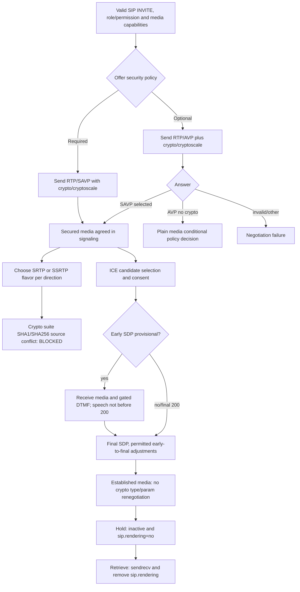

# SDP2 May 2025 media-lifecycle profile: optional SRTP/SSRTP, early SDP, hold and RTP/RTCP mux

**Original-spec research 2026-10-23; partial sections only, no client implementation authorization.** Source **[MS-SDPEXT] rev16.0, v20250520 (2025-05-20)**, Microsoft original SHA256 `83a151015e74ccadd7e14e856cd0967fcb64eb3c30c167f3638fa0d50edfcdb2`, official https://officeprotocoldocs-f5hpbjgea6b8gneq.b02.azurefd.net/files/MS-SDPEXT/%5BMS-SDPEXT%5D.pdf , direct §§3.1.5.1–3.1.5.2.2,3.1.5.8–3.1.5.14,3.1.5.15–18,3.1.5.23,3.1.5.38 and product notes §6; original PDF pp19–21,25–26 visually checked. [MS-SRTP] rev14 §§3.1.3,3.1.5 and [MS-SSRTP] rev11.1 §§3.1.3–3.1.5, [MS-SIPRE] rev13 early fork handling, [MS-EUMSDP] rev9 special UM SDP, [MS-CONFAS] rev12 media roles. IETF original **[RFC3264](https://www.rfc-editor.org/rfc/rfc3264)** (June 2002), **[RFC4568](https://www.rfc-editor.org/rfc/rfc4568)** (July 2006), **[RFC3262](https://www.rfc-editor.org/rfc/rfc3262)** (June 2002), **[RFC4145](https://www.rfc-editor.org/rfc/rfc4145)** (September 2005 TCP SDP), **[RFC5761](https://www.rfc-editor.org/rfc/rfc5761)** (April 2010 RTP/RTCP mux), **[RFC4574](https://www.rfc-editor.org/rfc/rfc4574)** (July 2006 media labels). Microsoft's `IETFDRAFT-ICENAT-19` is archived ICE draft19 not automatically RFC8445. Evidence P=direct Microsoft, R=RFC, S=conditional synthesis, U=unverified.

## A. Security profile selection and non-negotiation after setup

| ID | Primary source | Clause-scoped consequence |
|---|---|---|
| SDP-SEC01 | §3.1.5.1 | `a=crypto` only `AES_CM_128_HMAC_SHA1_80`, unique decimal tags across **crypto + cryptoscale**, one whitespace no horizontal tab, no session parameters, one inline key-params per line. These are mandatory syntax restrictions of the Microsoft profile, not generic extensible RFC4568 choices. |
| SDP-SEC02 | §3.1.5.1 | Inline base64 key/salt, lifetime **`2^31` MUST appear when sent** and incoming lifetime ignored in favor of `2^31`; MKI SHOULD be present, if present precisely **one byte**. This does not solve the MS-SRTP SHA1/SHA256 algorithm collision. |
| SDP-SEC03 | §3.1.5.2 | `a=cryptoscale` has `client|server` SSRTP flavor and **inherits crypto-suite constraints from §3.1.5.1**; distinct `a=crypto` tag value required. |
| SDP-SEC04 | §3.1.5.2.1 | Sender of SSRTP offer **MUST propose only client OR server flavor**, never both. Application supporting SSRTP SHOULD support normal SRTP as well; answer SHOULD select **one preferred encryption**. |
| SDP-SEC05 | §3.1.5.2.1 | Negotiation can yield directionally asymmetric SRTP and SSRTP. With client SSRTP offer answered server SSRTP, **offerer→answerer is SRTP**, **answerer→offerer SSRTP**. The reverse-flavor combination reverses directions; selection is not a single Boolean 'encrypted'. |
| SDP-SEC06 | §§3.1.5.2.2,3.1.5.14 | After session established, `re-INVITE` **MUST NOT renegotiate SRTP/SSRTP type or crypto-line parameters**. A legitimate new modality with its own m-line is distinct from changing already negotiated stream encryption. Key rollover and reconnect handling remain unproven by this clause. |
| SDP-SEC07 | §3.1.5.8 | For **optional** secure media, offer uses **RTP/AVP plus `a=crypto` or `a=cryptoscale`** (Microsoft deviation from RFC4568 transport expectations). Secure answer **RTP/SAVP** with selected crypto; nonsecure answer **RTP/AVP**, no crypto fields. **SAVP secure requirement cannot be silently downgraded** merely because optional mechanism exists. |
| SDP-SEC08 | §3.1.5.8 | Once secure answer is selected, **subsequent re-INVITEs MUST continue `RTP/SAVP`**. This is a media-level invariant, not independent proof of continuing ICE consent, certificate validity or packet MAC correctness. |
| SDP-SEC09 | [SRTP SHA source collision](ms-srtp14-sdpext16-ssrtp11-sha1-sha256-original-normative-conflict-2026-10-23.md) | RFC4568 named suite is HMAC-SHA1, while MS-SRTP rev14 mandates SHA256 and MS-SSRTP rev11.1 mandates SHA1. **BLOCKED**; this document records SDP semantics but does not select packet algorithm. |

## B. Early provisional SDP, forking and transition to final SDP

| ID | Primary section | Role- and edition-dependent rule |
|---|---|---|
| SDP-EM01 | §3.1.5.12.1 | Provisional-response SDP early media **requires ICE supported**, and **all provisional SDP answers MUST be same**. In forked MPOP, at most one branch SHOULD send an *unreliable* provisional SDP answer; reliable provisional answers have different RFC3262 context. |
| SDP-EM02 | §3.1.5.12.2 | Fork detection can use **`ms-forking` header** from SIP proxy per MS-SIPRE. Received stream SHOULD start after 18x answer; **sending early DTMF** should begin only after one or more media packets on corresponding receive stream. |
| SDP-EM03 | §3.1.5.12.2 | Early **forward speech SHOULD NOT start before INVITE 200** even when early media receive or DTMF send permitted. Distinguish incoming ringback/early announcement from speaking to pre-answer callee. |
| SDP-EM04 | §3.1.5.12.3 | Different forks may yield **different provisional and final SDP answers**. For same fork SHOULD repeat unchanged, but early-media-aware client SHOULD accept **direction changes**, **crypto/cryptoscale key-value changes** or formerly accepted **m-lines rejected** in final SDP, updating effective media state accordingly. |
| SDP-EM05 | §§3.1.5.12.3 vs 3.1.5.14 | **Provisional→final allowed key changes are not post-established rekey**: the former is *before final SIP 200* and scope-limited, latter forbids re-negotiation after session established. Do not mislabel as textual normative contradiction. |
| SDP-EM06 | §3.1.5.12.4 | With **non-forked INVITE**, ICE processing after provisional SDP SHOULD proceed as if final SDP already received. Forked-early candidates and nomination need MS-SIPRE and MS-ICE2 source-specific guards. |
| SDP-EM07 | §3.1.5.13 | Early RFC3262 support is Microsoft-constrained: SIP UAC **MUST NOT send SIP request with `Require:100rel`**, while a SIP UAS SHOULD include `Require:100rel` in **183 response**. Request vs response actors/roles distinct — not a contradiction. |
| SDP-EM08 | §3.1.5.13 | Reliable 183/SDP should support early media; **MUST NOT put an SDP offer or answer in PRACK or PRACK 200**; **MUST NOT complete multiple offer/answer rounds before answer**; forked early-dialog termination may process SIP **199** per historical IETF draft and MS-SIPRE. |
| SDP-EM09 | §6 notes <14>–<26> | OCS/Communicator 2007 editions lack various 18x early/fork behaviors; notes specifically allow provisional/final SDP differences for **OC2007R2, Lync2010 and Lync Client2013/SfB**. Therefore this is **feature- and client-era-conditional**, not all versions. |
| SDP-EM10 | MS-EUMSDP rev9 §3.1.5 | **UM** audio-only answer treats same-fork final SDP as identical to provisional and **ignores differences**, unlike general MS-SDPEXT §3.1.5.12.3. UM-specific override, not global rule for desktop peer media. |

## C. Hold, media identity and application-sharing exact ABNF

| ID | Clause | Source fact and compatibility guard |
|---|---|---|
| SDP-M01 | §3.1.5.23.1 | For audio/video hold, client SHOULD mark **all streams `inactive`** and include **`sip.rendering=no`** per MS-SIPRE. Hold is media direction change, not user REGISTER expiry or conference Focus leave. |
| SDP-M02 | §3.1.5.23.2 | On retrieve, client SHOULD set **all audio/video streams `sendrecv`** and SHOULD remove `sip.rendering`. Server-specific/peer permission may still reject offer; successful re-INVITE alone doesn't guarantee ICE consent. |
| SDP-M03 | §3.1.5.15 | Media labels identify **main-audio, main-video, panoramic-video, applicationsharing-video**; receiver ignores unrecognized labels. `m=applicationsharing` excluded from general `a=label` SHOULD. |
| SDP-M04 | §3.1.5.18.2 | Exact SDP ABNF for sharing role is **`a=x-applicationsharing-role:sharer|viewer`**. Answer requires reversed peer role; if multiple sharing m-lines, session-id and role pair SHOULD be unique. Settles earlier **MS-CONFAS** prose use of `sharing/viewing`: those are not ABNF wire values. |
| SDP-M05 | §3.1.5.18.5 | New original editorial mismatch: prose calls attribute `a=x-applicationsharing-contentflow`, but its ABNF uses **`a=x-application-contentflow:`** (without 'sharing'). **Neither can be silently chosen as mandatory transmitted spelling** pending full MS-CONFAS examples and official errata. |
| SDP-M06 | §§3.1.5.9–10.2 | TCP-based SDP `a=setup` only supports **active/passive**, not generic RFC4145 actpass/holdconn. An initial offer active can yield answer active but offerer still opens TCP; subsequent offer/answers use true active/passive. `a=connection:existing` SHOULD normally be used, `new` mainly for initial TCP-based sharing. |
| SDP-M07 | §3.1.5.38, §6 note <66> | RTP/RTCP multiplex using **`a=rtcp-mux`** SHOULD be supported only with ICE draft19; negotiated `a=remote-candidates` **MUST still contain both RTP and RTCP components**. Older OCS/Lync2010/Lync Server2013 explicitly lack this feature. Not generic 1-component ICE assumption. |

## D. Independent media state composition, NOT a normative packet trace

**Security caution:** This conceptual model is a *research graph*, not implementation pseudocode. The conflicting digest must not be automatically resolved by SDP string; *mandatory* encrypted media cannot be downgraded to plain transport for convenience. SDP inline keys are sensitive: confidentiality/integrity of SIP signaling, SIPAE message signatures, endpoint identity and authenticated conference role matter. A candidate ICE path with no consent or valid SRTP MAC must not be labeled successfully connected.

## E. Remaining original-source and version blockers

1. **SDP-ERR01** Full formal application-sharing `x-application-contentflow` vs `x-applicationsharing-contentflow` ABNF/prose mismatch and compatibility with MS-CONFAS §3.2 original examples, product behavior notes §6. No arbitrary wire token guessed.
2. **SDP-ERR02** MS-SRTP rev14 SHA256 against RFC4568 named SHA1 suite is *not* resolved; secure audio/video/RDP sharing remains flagged BLOCKED.
3. **SDP-ERR03** Early media ICE and SRTP key change races, multiple forked 18x/200 branch selection and PRACK/199 cleanup require exact RFC3262 + MS-SIPRE and product edition mapping.
4. **SDP-ERR04** User toggles Hold/Retrieve while media sends packet, re-INVITE rejected, provisional receive, SRTP crypto no-renegotiation, ICE no-restart and RDP sharer change — derive exact branch state, not generic `m=inactive` for every stream.
5. **SDP-ERR05** ICE2 draft19 + RTP/RTCP multiplex: candidate/RTCP component identity despite one selected UDP port; exact RFC5761 binding and MS-ICE2 mode must be checked with original format §2.
6. **SDP-ERR06** SIP signaling SDP crypto inline master keys require verified SIP/TLS trust boundary and proxy storage/logging security, not just an RTP AES cipher selected.
7. **SDP-ERR07** RFC4568 successor, SDES security policies, DTLS-SRTP/modern WebRTC mechanisms, new codecs, current TLS1.3 cannot be retroactively substituted into Microsoft 2025 classic source without explicit documented support.

**Research NOT COMPLETE; no implementation code, real-server/interoperability testing, merge or release.**
