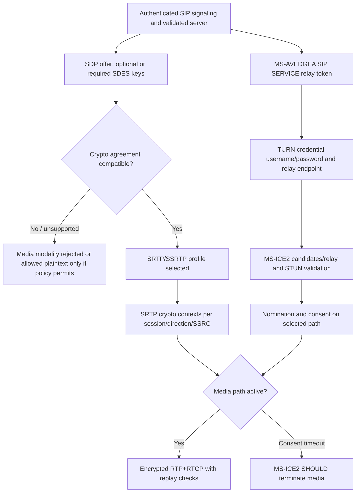

# SRTP–SDP cryptographic profile conflict and A/V Edge TURN trust path: original source audit

**Original-source research, 2026-10-22. Entire Windows Full Client protocol system remains INCOMPLETE.** Four locally archived original Microsoft specifications: **MS-SDPEXT rev16.0 v20250520** §§3.1.5.1–2.2, 3.1.5.8–9, 3.1.5.12.1–4, 5.1 (pp19–29 and p74); **MS-SRTP rev14.0 v20250520** §§1.3–1.6,3.1.1–3.1.5.2.2 (pp7–13); **MS-AVEDGEA rev12.0 v20250520** §§2.2.2–2.2.4, 3.1.4–3.1.5.7 (pp12–24); cross-reference **MS-SSRTP rev11.1 v20250916** (present in primary manifest, review outstanding). First-party RFC Editor: [RFC3264](https://www.rfc-editor.org/rfc/rfc3264) §§5–8, [RFC4568](https://www.rfc-editor.org/rfc/rfc4568) §§5–7, [RFC3711](https://www.rfc-editor.org/rfc/rfc3711) §§3–4. Source URLs, hashes and exact dates recorded in `catalog/inventory.json`.

## 1. SDPEXT 16.0 media security negotiation (verified)

| ID | Original clause | Precise normative reading |
|---|---|---|
| SDPSEC-01 | §3.1.5.1 | SDP `a=crypto` profile is constrained to crypto-suite **`AES_CM_128_HMAC_SHA1_80`**; **only inline key method** permitted. Tag must be unique across `a=crypto` and `a=cryptoscale`. Only *one space* as field separator; horizontal tab prohibited. |
| SDPSEC-02 | §3.1.5.1 | Maximum one key-params per a=crypto line; MKI **SHOULD** be used and if used **MUST be 1 byte**. SDP lifetime sent **MUST** be `2^31`; receiving peer **MUST ignore** externally supplied lifetime and use `2^31`. `session-param` **MUST NOT** be used. |
| SDPSEC-03 | §3.1.5.2 | Microsoft `a=cryptoscale` has flavor `client|server`. A peer **MUST NOT** present both SSRTP flavors simultaneously; complementary client/server roles needed. The SSRTP direction asymmetric: SSRTP server->client uses **SSRTP**, reverse client->server uses **SRTP**. Role independent of SDP offerer identity. |
| SDPSEC-04 | §3.1.5.2.1 | Offer may propose `a=crypto` and one SSRTP flavor; answer **SHOULD** choose one offered preferred encryption. If no common encryption, media may be unencrypted *only when neither peer requires encryption*; otherwise negotiation fails or modality is not established. |
| SDPSEC-05 | §3.1.5.2.2 | **MUST NOT** use SIP re-INVITE to renegotiate **SRTP versus SSRTP encryption type or any parameter** in `a=crypto`/`a=cryptoscale`. This sharply constrains what route-repair re-INVITE can alter. |
| SDPSEC-06 | §3.1.5.8 | Microsoft option for *nonmandatory* encryption: **offer `RTP/AVP` plus `a=crypto`/`a=cryptoscale`**, instead of usual RFC4568 SAVP in offer; supported secure answer **MUST** use `RTP/SAVP` plus crypto; unsupported encryption answer **MUST** use `RTP/AVP` without crypto. Once SAVP agreed, subsequent re-INVITEs **MUST remain SAVP**. |
| SDPSEC-07 | §3.1.5.9 | For initial *audio/video* SDP, connection-oriented/TCP active address in first offer/answer **MUST NOT** be used, even if ICE supports TCP; application-sharing **SHOULD** use MS-ICE2 over TCP. Later re-INVITE may use TCP when ICE so determines. Client application profile matters. |
| SDPSEC-08 | §§3.1.5.12.1–2 | Provisional 18x SDP early media requires ICE support, and provisional answers for same fork must be equal; in forked case received media can start while outgoing DTMF waits for incoming RTP. **Speech forward direction SHOULD NOT start before INVITE 200**. |
| SDPSEC-09 | §§3.1.5.12.3–4 | SDP in final INVITE 200 can differ from earlier provisional 18x when from **another fork**. For same fork unchanged is SHOULD; permitted media-direction change, changed `a=crypto` key, or rejected previously accepted media are explicitly allowed adjustments. Do not treat provisional-media crypto state as always final. |
| SDPSEC-10 | §§3.1.5.2, 5.1 | Inline SRTP keys are **plaintext SDP fields**, with *transport confidentiality* reliant on SIP TLS. Source explicitly states `a=crypto`/`a=cryptoscale` not encrypted in themselves; SIPAE authenticated context is not proof of end-to-end SDES secrecy through every intermediary. |

## 2. MS-SRTP 14.0 transport cryptographic and replay context (verified)

| ID | Original clause | Key requirement |
|---|---|---|
| RTPSEC-01 | §§1.5–1.6 | Requires negotiated and correctly configured master keys/security algorithms through MS-SDPEXT; actual SRTP protects RTP/RTCP packets **after** RTP processing, not SIP dialog, discovery, SDP signaling or E911 SOAP. |
| RTPSEC-02 | §3.1.3.1 | **Exactly two direction-specific cryptographic contexts per SRTP session**, one shared by all outgoing SSRC streams and one shared by incoming; each SSRC retains independent rollover counter, highest received RTP sequence and replay checklist. |
| RTPSEC-03 | §3.1.3.2 | **MUST** AES counter-mode with encryption on, **MUST** HMAC-SHA-256 auth (as literal primary text), 64-entry replay list, MKI used at 1-byte length, key derivation rate 0, master key 128 bits, master salt 112 bits, encryption key 128 bits, auth key 160 bits. RTP packet lifetime **2^48−1**, RTCP **2^31−1**. |
| RTPSEC-04 | §3.1.3.3.1–2 | **MUST** AES-CM with 128-bit block/key and 112-bit salt. f8 or NULL cipher **MUST NOT** be used. Auth tag **MUST** 80 bits. Primary explicitly calls hash **HMAC-SHA-256** while citing RFC3711 §4.2 and RFC2104. |
| RTPSEC-05 | §§3.1.5.1.1–2 | RTP packets **MUST** be encrypted+authenticated; receiving replay check window exactly 64; count failure totals rather than individually log replay/auth failures. |
| RTPSEC-06 | §§3.1.5.2.1–2 | RTCP **MUST** be encrypted+authenticated. SRTCP index **shared among streams per direction**. Receiver **does not honor E-bit**: incoming RTCP **MUST** be encrypted regardless. 64-entry replay list. |
| RTPSEC-07 | §§3.1.2,3.1.6 | No protocol-specific timers. SRTP replay/failure is separate from ICE consent timers, SIP SAE expiry and RFC4028 refresh. |

## 3. Blocking cross-spec conflict: SDP advertised suite versus Microsoft packet auth

**CONFLICT-CRYPTO-01 — UNRESOLVED.** Original MS-SDPEXT rev16.0 §3.1.5.1 explicitly **MUST offer `AES_CM_128_HMAC_SHA1_80`**, a suite name defined in RFC4568 using SHA-1 HMAC. Original MS-SRTP rev14.0 §3.1.3.3.2 explicitly says **HMAC-SHA-256** for SRTP authentication with n_a=160 bits and tag=80 bits. Even though both docs release May 20, 2025, the names **do not identify the same hash construction**. Do not silently implement SHA-1 because SDP suite says so, nor SHA-256 because MS-SRTP section says so. At minimum inspect **MS-SRTP version history/errata, MS-SDPEXT version history/errata, MS-SSRTP, MS-RTP and product notes**, and verify official clarification/version selection. The literal pairing and extant uncertainty must stay recorded until verified; no inference that this is an interoperable combination or that it is an editorial mistake.

**CONFLICT-CRYPTO-02 — lifetime:** SDP key-info uses `2^31` (MS-SDPEXT), and SRTP cryptographic packet lifetime speaks separately of `2^48−1` RTP and `2^31−1` RTCP (MS-SRTP). These are *different constraints/units and layers*, not proof all keys expire after same packet count; need normative reconciliation per media stream and direction.

**CONFLICT-CRYPTO-03 — re-INVITE:** SDP final-answer crypto key changes allowed in §3.1.5.12.3 for a provisional→final 18x/200 transition, while §3.1.5.2.2 **forbids** renegotiation via SIP *re-INVITE*. No contradiction if different transaction/lifecycle, but exact early security state update must be modeled.

## 4. MS-AVEDGEA 12.0 separate relay token and identity boundary

| ID | Clause | Role-qualified rule |
|---|---|---|
| EDGE-01 | §2.2.2, §3.1.4 | Client requests A/V relay credentials using **SIP SERVICE** carrying `application/msrtc-media-relay-auth+xml`, not the actual TURN allocation or SIP REGISTER security association. Client supplies requestID/version, from/to and one or more credential requests. |
| EDGE-02 | §§2.2.2.2,2.2.3 | Each credentialsRequest carries `identity`, optional `location` and `duration` in **minutes**, default 480; request token group uses `credentialsRequestID`. Successful response includes username/password base64 and `mediaRelayList` with internet/intranet endpoint information. |
| EDGE-03 | §3.1.5.4,§3.1.5.7 | **Server** caps requested token duration at configured maximum, and generates username/password using shared server–TURN secrets and the requested identity+token lifetime. A Base64 value is **encoding, not encryption**; relay credentials are confidential. |
| EDGE-04 | §§3.1.5.2–3 | XML version supported/proposed typically **1.0, 2.0, 3.0**; failure `Version Mismatch` yields SIP **501** and a highest compatible version candidate if available. `requestID` mirrors in response, for concurrent response correlation. |
| EDGE-05 | §3.1.5.1–6 | Invalid method = **501** without XML body, wrong Content-Type = **415** without XML body and Accept header; malformed XML = **400**, forbidden **403**, request too large **413**, generic server error **500** (with structured reasonPhrase under defined cases). Do not treat all 2xx or 5xx as relay allocation completed. |
| EDGE-06 | §§3.1.5.4–5 | Per-entry success returns `credentialsResponse` and original credentialsRequestID, **omits** entries that failed; a parent XML response can thus be **partially populated**. With location filter, only that location's relay info; route=directip returns IP, route absent/loadbalanced returns hostname. |

### Cross-layer trust-state synthesis (S; not single mandatory packet trace)

Important: there is no normative claim that every media session uses TURN relay or that token request must occur *after* sending the offer. Signaling keys, TURN token secrets and SRTP session keys remain different trust items. SRTP auth failures do not automatically invalidate SIP user login. E911 SOAP and user-contact roster should not be attached to media relay identity.

## 5. Required future proof steps

1. **URGENT** Obtain first-party errata/versions addressing `AES_CM_128_HMAC_SHA1_80` vs `HMAC-SHA-256` literal mismatch; audit RFC4568 and RFC3711 exact n_a, n_tag and key derivation, and MS-SSRTP 11.1. Do not select one algorithm until settled.
2. Fully extract MS-AVEDGEA §2.2.2–4 XML namespace/XSD, relay username encoding and version fallback; how SIPAE MIC and TLS protect credentials at each hop; service authorization claims.
3. MS-TURN 21.0 and RFC5766→RFC8656 original states for allocation, permissions, ChannelBind, auth challenges, refresh, expiration, bad allocation and TURN-over-TCP. Cross-check MS-ICE2 legacy draft.
4. Audit MS-SDPEXT remaining §§3.1.5.13–33 offer/answer, video stream attributes, application-sharing and QoE; MS-CONFAV/CONFAS media-role-specific error states; historical client/server product variants.
5. Distinguish SDP 18x early forks + provisional crypto from RFC3261/6026 2xx ACK per dialog, and ICE fork candidate/pair state from SRTP per-SSRC replay. Preserve security and authorization per fork.
6. Validate current product policy for allowing RTP/AVP unencrypted media; historic optional-encryption mechanism is **not** a modern security recommendation.

**Original editions and specific clauses checked, not complete. No protocol code, real-server/interop tests, merge or release.**
