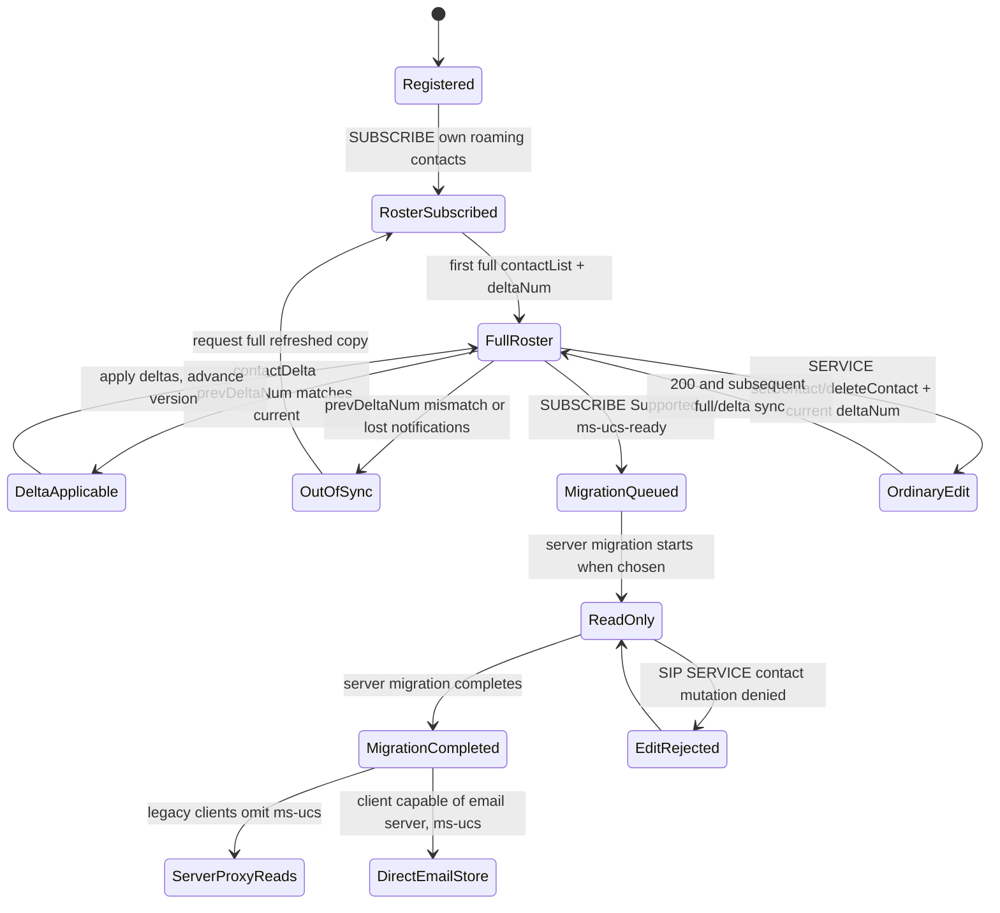

# Contact/group store edition and migration: MS-SIP 8.0 legacy roaming and MS-PRES 13.0 Unified Contact Store

**Research continuation 2026-10-23, version-guarded; NOT full Windows-client implementation evidence.** Microsoft original **[MS-SIP] Session Initiation Protocol Extensions, rev8.0 v20170601, 2017-06-01**, PDF SHA-256 `6ee1c16c922b7c154373572d5a3341139aaf6d91922a35468581a209f68e9e52`, original MS-SIP **§§2.2.3–2.2.4.2, 3.3–3.7.5.3 and Appendix D §9** (full schema not yet individually validated); original PDF pp18–19, 42–45 visually rendered. Microsoft original **[MS-PRES] Presence Protocol rev13.0 v20250520 (2025-05-20)**, SHA-256 `f1e0ce966ab242cf09b57e4403f9cfa7aec9c5aa883325f1e4ac91ad1ff5fa79`, **§§3.2.1–3.2.5,3.5.5,3.10.1–3.10.5**, original PDF p134 rendered directly. Original [RFC3261](https://www.rfc-editor.org/rfc/rfc3261) SIP, historical [RFC3265](https://www.rfc-editor.org/rfc/rfc3265) events, successor [RFC6665](https://www.rfc-editor.org/rfc/rfc6665) (July 2012), and [RFC2046](https://www.rfc-editor.org/rfc/rfc2046) MIME. Previous [directory/roster audit](ms-pres13-dlx13-batch-presence-directory-contacts-2026-10-22.md) and [binary offline address book](ms-abs10-original-binary-book-delta-compression-and-rnl-2026-10-22.md) are separate source sets.

**Evidence:** P original normative Microsoft actor/edition; R primary RFC; S conceptual inter-document synthesis; U unresolved source/product behavior. This research explicitly guards **2017 legacy MS-SIP** vs **2025 enhanced MS-PRES**, which are **not** a statement that every Windows client always invokes every legacy operation.

## 1. Roaming contacts and groups: actual XML and SIP message order

| ID | Original edition/clause | Verifiable semantics |
|---|---|---|
| ROST-01 | MS-SIP §2.2.4.1 | `application/vnd-microsoft-roaming-contacts+xml` `contactList` contains group elements `id/name/externalURI` and contact elements `uri/name/groups/subscribed/externalURI` plus optional `contactExtension` custom XML. **Contacts can be offline only (`subscribed=false`)** even if saved in roster. |
| ROST-02 | MS-SIP §2.2.4.1 | `contactDelta` has 6 operation types: added/modified/deleted Group and Contact; `deltaNum` and `prevDeltaNum` required. Group/contact additions and removals must not be treated as a full snapshot. |
| ROST-03 | MS-SIP §3.7 intro, §3.7.1 | Server keeps **one version counter for contact/group list per user**, incremented for mutations; version copies on multiple client devices help resync. **ACL has independent version counter**. Neither is MS-PRES *category instance* version nor SIP registration CSeq. |
| ROST-04 | MS-SIP §§3.7.4.1,3.7.5.2 | Client requests roster with SIP `SUBSCRIBE`, `Event: vnd-microsoft-roaming-contacts`, `Accept: application/vnd-microsoft-roaming-contacts+xml`; Request-URI/To/From are own user SIP URI, **not a searched contact**. Initial notification **full**, subsequent **delta**, potentially piggybacked in SUBSCRIBE **200**, or `NOTIFY/BENOTIFY`. |
| ROST-05 | MS-SIP §§3.7.4.1,3.5.1.1–3.5.5.3 | `BENOTIFY` is **optional negotiation** via `Supported: ms-benotify` and `Proxy-Require: ms-benotify`. On 200 indicating support enabled; server may decline for unreliable connectivity. If proxy rejects optional extension, client **MAY retry SUBSCRIBE without both tags**. Client **MUST NOT respond to BENOTIFY**; normal NOTIFY still supported. |
| ROST-06 | MS-SIP §§2.2.4.2,3.7.4.3–4 | `setContact/deleteContact/addGroup/modifyGroup/deleteGroup` are XML **SOAP messages in SIP SERVICE**, not HTTP REST or LDAP edits. For contact edit To/From/Request-URI remain **own user AoR**, contact URI belongs in XML. A **200** indicates service operation success, not presence authorization for all views. |
| ROST-07 | MS-SIP §2.2.4.2 | Each contact/group mutating primitive **includes current `deltaNum`** (optimistic version request). Delta response `prevDeltaNum` denotes prior state. A client that has missed intermediate updates cannot infer a correct local roster simply from the newest delta; should retrieve full/updated state per source §3.7. |
| ROST-08 | MS-SIP §§3.7.4.4,3.7 intro | Legacy group IDs **1–63**, group **1 default** and **MUST NOT be created/deleted by user**; every contact is in at least one group. **Group IDs not durable across full-list transfers**; no stable cross-snapshot identity solely by numeric group ID. |
| ROST-09 | MS-SIP §3.7.4.4 | Before deleting group, source says clients must remove its contacts using `DeleteContact` operations. Source is a legacy behavior, not an authorization to delete entire contact identity during modern contact-store migration; group deletion/loss prevention across versions still requires client-specific investigation. |
| ROST-10 | MS-SIP §§2.2.3,3.7.4.2,3.7.5.3 | Server-stored presence **ACL** retrieved by separate `Event: vnd-microsoft-roaming-ACL`, `Accept: application/vnd-microsoft-roaming-acls+xml`. Initial complete ACL then changes; each device SHOULD subscribe; **independent ACL deltaNum** from contacts. |
| ROST-11 | MS-SIP §3.7.5.1 | Legacy ACL entries (ACE) separate access rights: **server MUST enforce SUBSCRIBE/presence permission**, client **MUST enforce INVITE/session initiation permission**. Matching scope includes all, specific SIP URI, or SIP domain. **This is not identical to enhanced presence container membership resolution** in MS-PRES 13. |
| ROST-12 | MS-SIP §3.5 | Client **MUST NOT send a SIP response to BENOTIFY**. This applies equally when body contains contact delta, ACL or IMDN, but their respective event and MIME processing **are independent**. The SIP server ignores accidental BENOTIFY responses. |

## 2. Unified Contact Store (UCS) — Microsoft 2025 guards

| ID | Original section | Proven migration and compatibility contract |
|---|---|---|
| UCS-01 | MS-PRES §3.10 | Enhanced presence server may maintain contact/group structures inherited from **MS-SIP §3.7**. Existence of UCS metadata **does not imply** roster is stored exclusively at the SIP registrar or entirely in the email server. |
| UCS-02 | §3.10.4 | On SUBSCRIBE for `vnd-microsoft-roaming-contact` carrying `Supported: ms-ucs-ready`, server **queues** migration of user's contacts into **email-server store**. The **time when migration happens is implementation-specific**; header support is not an immediate 'migration complete' acknowledgment. |
| UCS-03 | §3.10.4 | **During migration**, contact/group list is **read-only**. All SIP SERVICE requests intended to modify contact list **are rejected**. The source gives **no universal rejection code here**; §3.10.4.1 defers to MS-SIP §3.7 and MS-OCER §7.3. Do not treat rejection as automatic lost auth or permission. |
| UCS-04 | §3.10.4 | **After migration**, clients that still fetch contacts from enhanced presence server **MUST NOT** send `ms-ucs` Supported in their SUBSCRIBE; server can proxy changes back to endpoint. Whether server emits delta vs full, proxies reads or writes to email store is **implementation-defined**. |
| UCS-05 | §3.10.4 | SIP endpoints **able to connect directly to the email server SHOULD include** `Supported: ms-ucs` on SUBSCRIBE to presence server. This is **client-capability-dependent**. `ms-ucs` vs `ms-ucs-ready` do **not** mean the same transition. |
| UCS-06 | §3.10.4.1 | Migration and Contact Store failures can also use error codes from **[MS-OCER] §7.3**. Exact WSDL/EWS migration, ErrorId mapping and server metadata are **OPEN**; a 403 or 409 alone cannot distinguish migration vs ACL/version failure. |
| UCS-07 | MS-PRES §4.15 examples (cross-check partial) | `ucsMode` on roaming contact-list examples is a server-provided state indicator. **Not yet a verified complete enumeration/transition table**; do not hardcode a guessed list of mode values based on a single example. |

## 3. Presence visibility is independently managed — contact membership ≠ entitlement

| ID | Original clause | Boundary |
|---|---|---|
| VIS-01 | MS-PRES §3.2.1 | Enhanced presence is keyed by **publisher URI, category name/instance, container ID, version**, and expiration type static/endpoint/user/time. The subscriber is resolved to a container by rights; contact list membership does not replace that lookup. |
| VIS-02 | MS-PRES §3.5.5.2 | `setContainerMember` SIP SERVICE `application/msrtc-setcontainermembers+xml` modifies container membership; **must reject container 0 edits**, version must match, actions atomic across request, unknown duplicate add/delete silently ignored, success increments container membership version. Not the `deltaNum` counter of MS-SIP roster. |
| VIS-03 | MS-PRES §§3.2.5.3,3.5.5.4 | Server re-resolves category subscriptions whenever publication or visibility membership changes. It can issue **NOTIFY/BENOTIFY to subscribers** even if published data did not change, because **resolved visibility container** changed. |
| VIS-04 | MS-PRES §§3.2.5.3 | Resolution chooses **user-specific**, then **domain**, then sameEnterprise, federated, publicCloud, then default; within first applicable type, highest-numbered container with that category. If nothing resolved, **null category**. This is a privacy priority rule, not sorting roster groups by numeric ID. |
| VIS-05 | MS-PRES §3.2.5.3 | Category-subscriber NOTIFY body `application/msrtc-event-categories+xml` **MUST NOT expose internal container ID, version, expiration type, endpoint ID or expiry time**, unlike self-subscription state `application/vnd-microsoft-roaming-self+xml`. Information boundary enforced by server independent of contact-list storage. |

## 4. Conditional state model (S, not canonical Windows client trace)

**S caveats:** The source does not mandate specific client **automatic retry** on migration rejection; it does not specify that every direct-mail-store client sends `ms-ucs-ready` or that migration start is synchronous. `OutOfSync` resync is a justified model from version semantics, but the exact server dialog/retry messages and failures need extraction. The diagram models sources, not code design or observed server transaction sequence.

## 5. Explicit cross-spec edition / open guards

1. **2017 versus 2025:** MS-SIP is rev8 dated 2017; MS-PRES 13 dated 2025 and references it for legacy contact list. Confirm actual full client build, UCS capability, deployed email server and roles. Don't force all older clients to support UCS.
2. **UCS mode enum and errors:** Extract complete MS-PRES §4 UCS examples, MS-OCER §7.3 and exact relevant Exchange/EWS specs. **Unverified**, do not synthesize a magic status code.
3. **Privacy layers:** Contact stored/offline, presence subscription active, ACL approved, enhanced presence container visibility, federation permission and session-initiation rights are **independent** dimensions.
4. **Concurrent endpoint races:** Multiple signed-in devices modifying contacts, stale `deltaNum`, lost BENOTIFY, server migrations and deleted group IDs require explicit per-edition normative reconciliation.
5. **History vs contact:** MS-ABS daily directory snapshots and MS-DLX group expansion do **not** provide the authoritative user's contact membership or current presence visibility.
6. **BENOTIFY event profile:** Source uses nonresponded BENOTIFY extension, not RFC3265 NOTIFY transaction; modern RFC6665 must not be blindly substituted into MS-SIP feature variant.
7. **Server READONLY during migration** is separate from capability to retrieve; unchanged `SUBSCRIBE` may produce full vs delta per implementation, not evidence of loss.
8. **Missing full XML parsing audit** of MS-SIP Appendix D, MS-PRES §§2.2.2.5, 3.10 service schemas, all errors and product notes. The present document is selected-clause P review, not a claim that all source documents were read exhaustively.

**Research phase NOT COMPLETE; no new protocol code, no real server tests, no merge to main or release.**
