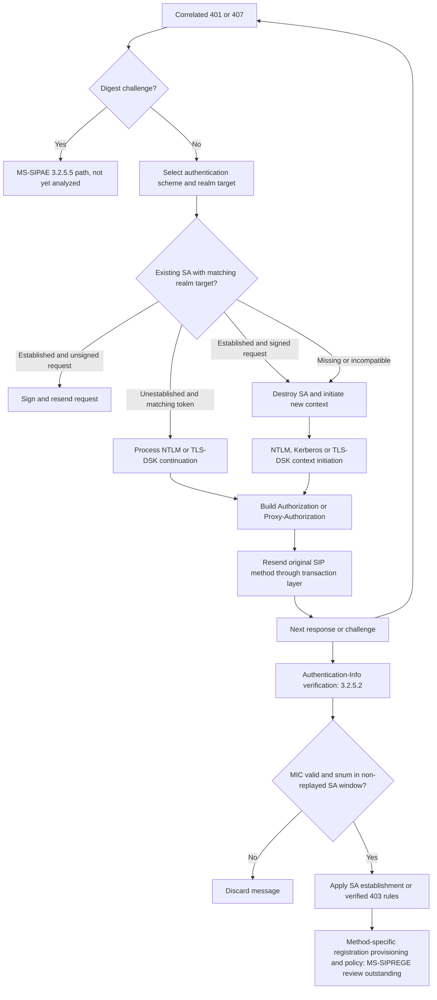

# MS-SIPAE §3.2.5.1: Challenge-handling reconstruction and cross-specification states

Research date: 2026-10-22. No source-code implementation and no server tests.

## Evidence
Official Microsoft original subsection: https://learn.microsoft.com/en-us/openspecs/office_protocols/ms-sipae/71b7e07d-505f-4ca6-9577-0a27bd12b0e9, **MS-SIPAE §3.2.5.1**, HTML last updated 2021-08-17. The latest published parent MS-SIPAE revision is 11.0 (2025-05-20); **do not assume the 2021 HTML text is verbatim equivalent to that newer PDF without comparison**. Related client verification: MS-SIPAE §3.2.5.2, https://learn.microsoft.com/en-us/openspecs/office_protocols/ms-sipae/26fd795e-5567-4d33-a09b-9c501f7ff01c . Standard SIP: RFC 3261 §§8.1.3.5, 10.2 and 17.1.2.

## Extracted normative client behavior (direct section review)

| ID | Condition / processing | Verifiable MS-SIPAE §3.2.5.1 rule | Cross-reference |
|---|---|---|---|
| AUTH-C01 | 401 or 407 after client's request | Inspect WWW-Authenticate / Proxy-Authenticate respectively. Digest is treated separately under §3.2.5.5; do not force it into the NTLM/Kerberos/TLS-DSK branch. | RFC 3261 §8.1.3.5 |
| AUTH-C02 | Challenge for non-Digest mechanism | Look for existing SA matching realm and authentication target. NTLM/TLS-DSK use unquoted targetname; Kerberos strips sip/ service descriptor from targetname for matching. | MS-SIPAE §3.2.5.2 also requires SA-based response MIC verification |
| AUTH-C03 | Server Date clock skew | Client checks skew; for Kerberos the referenced MS-KILE default allowance is 5 minutes. No analogous maximum is defined here for NTLM/TLS-DSK. | MS-KILE, Kerberos |
| AUTH-C04 | Matching *established* SA; original request unsigned | Retry request with signature, stop processing current challenge. | §3.2.4.1 signing |
| AUTH-C05 | Matching *established* SA; original request already signed | Destroy that SA and proceed to create fresh SA. | Security-context lifecycle |
| AUTH-C06 | Matching not-yet-established NTLM SA with gssapi-data | Base64-decode input; pass token and SA context into NTLM GSS_Init_sec_context to produce AUTHENTICATE_MESSAGE and subsequent authorization header. | RFC 3548 §3; MS-NLMP §3.1.4 |
| AUTH-C07 | Matching not-yet-established TLS-DSK SA with gssapi-data | Decode and process TLS handshake tokens **inside the SIP auth exchange**; validate server certificate, use/obtain client certificate, complete handshake and derive directional authentication keys. | TLS versions RFC 2246 / 4346 / 5246 as cited by MS-SIPAE |
| AUTH-C08 | TLS-DSK key derivation after final handshake | Derive 128 PRF output bytes from negotiated master secret, label 'client EAP encryption', client_hello.random || server_hello.random. Client authentication key comes from third 32-byte segment, server key from fourth; truncate to negotiated hash's required size. | MS-SIPAE §3.2.5.1 and RFC 2716 §3.5 analogy |
| AUTH-C09 | Kerberos or lack of gssapi-data in appropriate continuation | Destroy unfinished SA when instructed; create a new SA and initialize GSS security context with appropriate scheme and target. | RFC 2743; MS-KILE |
| AUTH-C10 | NTLM initial context | Request Datagram, Identify and Integrity parameters. Initial NEGOTIATE_MESSAGE is empty for datagram NTLM in described implementation; **empty generated token is still represented as gssapi-data=\"\"**. | MS-NLMP |
| AUTH-C11 | Kerberos initial context | Request ticket for service named by targetname; GSS_Init_sec_context with Integrity and Identify. | RFC 2743 and MS-KILE |
| AUTH-C12 | TLS-DSK initial context | Create TLS-DSK negotiation context and output client_hello token. | TLS standards cited above |
| AUTH-C13 | Construct next auth header | WWW challenge => Authorization; proxy challenge => Proxy-Authorization. Copy challenge realm/targetname/opaque when present, set qop=auth, encode token using Base64 (omit parameter if no token in stated TLS continuation, but retain empty string when NTLM produced an empty token). | MS-SIPAE §2.2.3 |
| AUTH-C14 | Negotiated version 3 or 4 | Version 3 included according to precise mutually applicable client/challenge conditions; for version 4, require challenge version >=4, set version=4 and include cnum, crand, response constructed according to §3.2.4.1 steps 1–3. | §3.2.4.1 |
| AUTH-C15 | Header formed | Resend challenged original SIP request with corresponding auth header; compare RFC 3261's retry transaction identity and CSeq processing. | RFC 3261 §8.1.3.5 |

These are **protocol requirements from the accessible subsection**, not assertions that their complete execution has already been implemented or verified.

## Security state graph — reconstruction from §§3.2.5.1 and 3.2.5.2

**Diagram limitations:** the exact 200 vs 403 and non-authenticated response branches are not fully modeled; not all auth schemes use equivalent continuation loops. The diagram is a conditional conceptual map, NOT an exact complete wire transcript. The challenge may be received multiple times, and a successful authentication step is not automatically successful registration or user sign-in.

## Security-specific synthesis and non-equivalences

1. TLS-DSK is **not merely the transport TLS session**. §3.2.5.1 processes TLS handshake tokens via SIP auth header gssapi-data and derives separate client/server per-message keys. Transport peer TLS validation must be audited independently under MS-CONMGMT and RFC 5922.
2. **Different signature keys per direction:** the specified TLS-DSK client key signs outbound SIP data, server key validates incoming MIC. Never assume same key.
3. **Existing SA signed-vs-unsigned challenge** is a state-dependent fork: resending with known SA signature differs from initiating a new credential negotiation.
4. **Context validity vs SIP transaction correlation**: each layer has distinct state and failure paths. Verified SIP response must be matched to current transaction and, if protected, to the correct realm/scheme/target-specific security context.
5. **Version 3 vs version 4 fields** change signature-protected content and header construction. Do not normalize away version negotiation.
6. **Digest is a separate branch** requiring §3.2.5.5; do not claim only three authentication branches exhaust all possible challenge types.

## Major unresolved details and extraction roadmap

- MS-SIPAE §3.2.4.1: exact outbound signature buffer, random numbers, sequence numbers and response field algorithms; required to interpret AUTH-C14.
- MS-SIPAE §3.2.5.5 Digest implementation and server applicability.
- MS-SIPAE §§2.2.3, 3.2.1 and security implications: on-wire grammar, SA init/expiration/retirement, accepted scheme selection.
- RFC 3261 authenticated retry CSeq/branch behavior; precise challenge-vs-REGISTER retry timeline.
- MS-SIPREGE published revision 17.1: registration-binding and in-band provisioning outcome, headers, contact UUID, errors and re-registration.
- MS-NLMP and MS-KILE: OS-level NTLM/GSS state, token boundaries, delegated credential policies, cryptographic details.
- Version comparison: 2021 HTML vs published MS-SIPAE 11.0, TLS version and algorithm legacy assumptions, applicability to the historical Windows Full Client.
- Independent authorized test evidence remains exclusively the project owner's responsibility.

Research status: this exact Microsoft challenge subsection **has been inspected and cross-linked**. Entire protocol corpus, client sequence, updated normative PDF revisions and feature-complete analysis remain **incomplete**. No implementation authorized until analysis gate completed.
