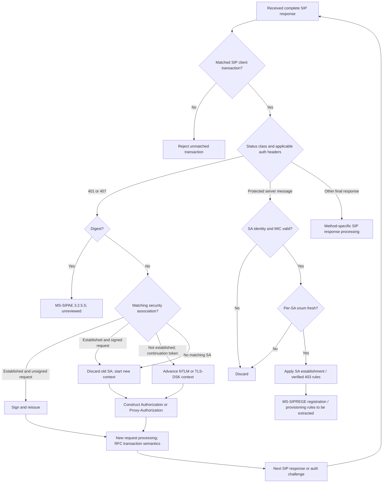

# Integrated SIP authentication analysis: client challenge and response trust gates

Research iteration 2026-10-22. **Normative scope:** MS-SIPAE §3.2.5.1 (public subsection last updated 2021-08-17) and §3.2.5.2 (public subsection last updated 2021-11-16), combined with RFC 3261 §§8.1.3.5, 10.2, 17.1.2 and 17.1.3. The current MS-SIPAE published revision 11.0 (2025-05-20) remains to be compared with these earlier HTML subsections. This is documentation, not code nor owner-server verification.

Source links:
- https://learn.microsoft.com/en-us/openspecs/office_protocols/ms-sipae/71b7e07d-505f-4ca6-9577-0a27bd12b0e9
- https://learn.microsoft.com/en-us/openspecs/office_protocols/ms-sipae/26fd795e-5567-4d33-a09b-9c501f7ff01c
- https://www.rfc-editor.org/rfc/rfc3261
- https://learn.microsoft.com/en-us/openspecs/office_protocols/ms-sipae/ba3e9821-fa85-4e0f-a80c-5a4c720a00bd

## Normative cross-section extraction

| ID | Origin | Preconditions / behavior | Boundary |
|---|---|---|---|
| XAUTH-01 | MS-SIPAE §3.2.5.1 | 401 and 407 require examining the corresponding challenge authentication header(s); Digest is a separate referenced §3.2.5.5 branch. | Method-specific RFC 3261 processing is a separate gate. |
| XAUTH-02 | §3.2.5.1 | Existing SA is selected by realm and scheme-dependent authentication target; Kerberos removes the `sip/` service descriptor for target matching. | Mere TLS connection reuse does not imply SA reuse. |
| XAUTH-03 | §3.2.5.1 step 2 | Established matching SA and unsigned challenged request: resend signed; established matching SA and already-signed request: destroy SA and establish new context. | Distinct next states even for identical 401/407 statuses. |
| XAUTH-04 | §3.2.5.1 steps 3–5 | Unestablished SA may continue NTLM or TLS-DSK via `gssapi-data`; Kerberos context initiation uses service ticket. | Handshake token continuity is cryptographic SA state, not ordinary SIP retransmission. |
| XAUTH-05 | §3.2.5.1 steps 6–9 | Challenge kind determines Authorization vs Proxy-Authorization. An empty generated NTLM token yields explicit empty `gssapi-data`; no token in stated TLS-DSK continuation omits parameter. Versions 3 and 4 have different fields. | Empty and absent are distinct on-wire states. |
| XAUTH-06 | §3.2.5.2 | Protected server message requires lookup using scheme, realm and target; build an ordered, conditional signed-value buffer, then verify scheme-specific MIC. | Do not mark context established from response code or transaction matching alone. |
| XAUTH-07 | §3.2.5.2 | Check `snum` anti-replay window **after** successful MIC; reject repeated or too-old sequence numbers. | Per-SA replay state, not a global counter. |
| XAUTH-08 | §3.2.5.2 | Valid MIC may advance unestablished SA to established except specially processed verified 403. | Do not translate cryptographic establishment directly into completed registration/provisioning. |
| XAUTH-09 | RFC 3261 §§8.1.3.5, 17.1.2/3 | SIP auth retries must be assessed against non-INVITE transaction semantics, timeout, branch and CSeq matching; sending a new challenge response is not simply receiving a retransmission. | Exact retry identity construction requires relevant RFC clause and MS-SIPREGE check. |

## Conditional multi-layer state machine

This is a **cross-spec decision model**, not a normative single complete wire trace: it omits intermediate TLS-DSK tokens, partial responses, unprotected status handling, all MS-SIPREGE branches and registration binding persistence. The protected-message path depends on actual response headers, not just a generic final class.

## Security/verification separation

1. A *valid parser result* proves only framed SIP bytes, not server identity.
2. An *RFC transaction match* proves local correlation, not possession of SA session keys.
3. *Scheme/realm/target SA lookup* chooses the applicable per-protocol security context.
4. A *valid cryptographic MIC* proves the received values satisfy the context's verification algorithm, not replay freshness.
5. A *fresh sequence number* completes the documented MS-SIPAE replay checks, not Microsoft registration or in-band provisioning.
6. *Registration/provisioning* requires separate MS-SIPREGE normative success and policy criteria.

The boundary chain is an inference from directly inspected source sections. It must remain independent of any existing project's synthetic tests.

## Missing research before calling this complete

- **Outbound signature rules**: obtain and inspect full MS-SIPAE §3.2.4.1 directly; determine exact v3/v4 client input buffer, nonce/counter behavior and signing algorithm. Do not invent a mirror of server MIC input.
- **Digest**: obtain §3.2.5.5 and its applicable RFC standards.
- **Full revision**: compare the subsection HTML with MS-SIPAE published 11.0 PDF, plus document errata and variant client-product years.
- **REGISTER/provisioning**: inspect MS-SIPREGE revision 17.1 full §2 and §3; derive exact request header payloads, state, refresh, privacy and recovery.
- **OS security**: map MS-NLMP, MS-KILE and RFC 2743 to token generation and verifiers.
- **Feature closure**: discovery, contacts, presence, messaging, conference, media and policy-denied states remain incomplete.

The signing-section web search in this research iteration located only the challenge section's cross-reference, **not a verifiably accessible §3.2.4.1 primary text**; no unsupported claims about its precise client signed-buffer encoding are made.

Status: partial, source-attributed synthesis. No implementation, no server access, no release.
