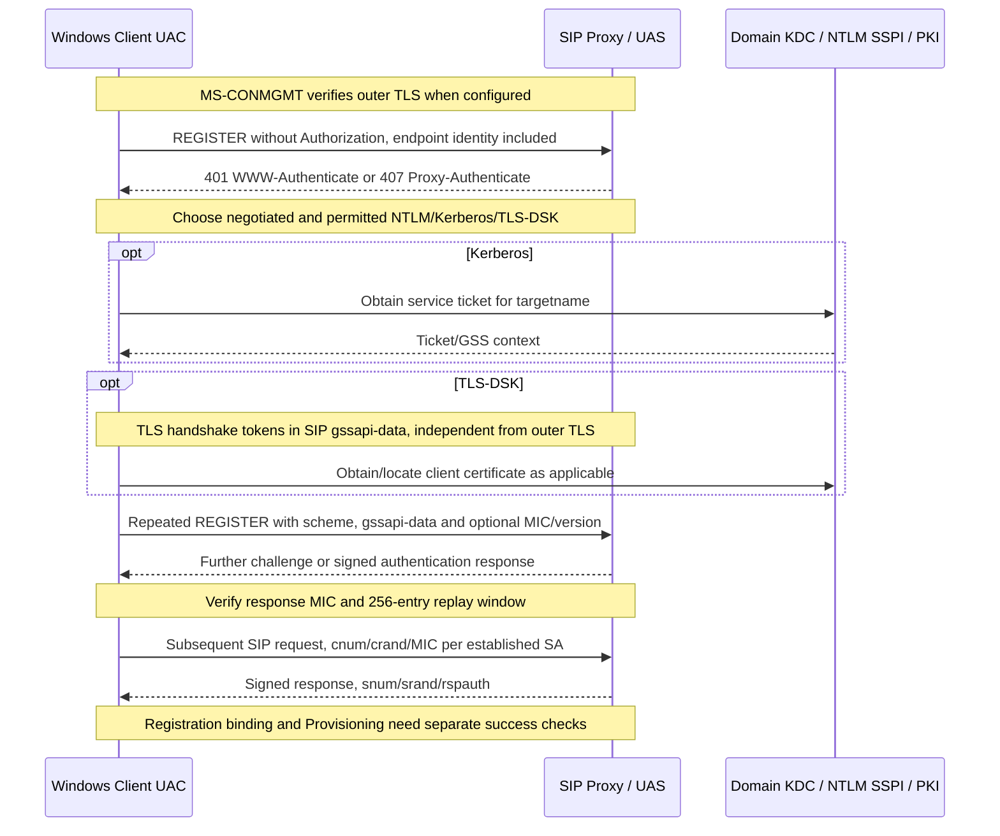

# SIP authentication security-association state machine: NTLM, Kerberos, TLS-DSK and signed messages

**Original-source audit 2026-10-23; incomplete scope, no implementation authorization.** Owner original **[MS-SIPAE] rev11.0, v20250520, released 2025-05-20**, PDF 59 pages, SHA256 `6f0337a593233162401f0265e5425ad38d839174d1f78b8031405c5c7de64836`; reviewed §§1.3–1.7, 2.2.1–2.2.3, 3.2.1–3.2.6, 3.3.1–3.3.5.3 and source examples §§4.1–4.5; several original PDF pages 20,21,23 were visually rendered. Cross-source **MS-CONMGMT rev10 §3.2** (outer TLS), **MS-SIPREGE rev17.1 §§3.1.1.4–3.1.1.6** (REGISTER), **MS-NLMP rev37.0 v20260330** (current NTLM primitive document), **MS-KILE rev49.0 v20260928** (current Kerberos primitive document), **MS-OCAUTHWS rev11.0 §§1.3.1–1.3.3,3.1.4.1** (Web Ticket and certificate provisioning). IETF original [RFC2743](https://www.rfc-editor.org/rfc/rfc2743) GSS, [RFC2104](https://www.rfc-editor.org/rfc/rfc2104) HMAC, [RFC5246](https://www.rfc-editor.org/rfc/rfc5246) TLS1.2, [RFC8446](https://www.rfc-editor.org/rfc/rfc8446) TLS1.3, and [RFC3261](https://www.rfc-editor.org/rfc/rfc3261) SIP. **Version warning:** MS-SIPAE 2025 explicitly cites possibly older security primitive versions; 2026 MS-NLMP/KILE contain updates and are not automatically evidence of older SfB client runtime.

**Codes:** P=direct 2025 Microsoft clause; R=RFC original; S=cross-spec reasoning; U=unresolved product profile; H=historical conditional. No normative statement in a server-focused clause is relabeled as a client obligation.

## 1. SIP security association identity, phases, lifetime and replay

| ID | Original section | Role-qualified normative evidence |
|---|---|---|
| SA-01 | MS-SIPAE §3.2.1 | **Client** maintains **distinct SAs by authentication server** `(realm, authentication target)`, authentication protocol and whether challenge came from proxy or UAS. Kerberos `sip/` service descriptor is stripped from targetname for matching, NTLM/TLS-DSK use targetname without quotes. |
| SA-02 | §3.2.1 | States: `establishing` (NTLM, Kerberos or TLS-DSK handshake), `established` (outgoing SIP signatures and incoming signature verification), `expired` (timer). SA stores version, opaque, link to proxy/server, outgoing sequence counter, highest verified inbound `snum`, 256-window received sequence numbers and mechanism-specific crypto context. |
| SA-03 | §§3.2.2–3 | For established **NTLM** SA client **MUST** plan expiration before 8 hours; for **Kerberos** before earlier of 8 hours or ticket expiry; **TLS-DSK** before earlier of 8 hours or local client cert expiry. Buffer SHOULD be at least **5 minutes** to complete new handshake. **Expiry is not SIP registration expiry or TLS transport closing time**. |
| SA-04 | §3.2.3 | When no SA is linked to server, client **SHOULD** start handshake with un-authenticated **REGISTER**, can use INVITE/SUBSCRIBE, **SHOULD NOT** use ACK/CANCEL which cannot be challenged; initial request **MUST include endpoint ID** `epid`, `+sip.instance` or GRUU per MS-SIPRE. |
| SA-05 | §2.2.1 | Challenge scheme is **NTLM, Kerberos, TLS-DSK** or RFC3261 `Digest` for special purposes. Microsoft parameters include `realm`, `targetname`, `opaque`, `gssapi-data`, `version` and for TLS-DSK optional `sts-uri`. One string `401 Unauthorized` is not proof all schemes are equivalent. |
| SA-06 | §3.3.5.1 | **Server** issues **401 + WWW-Authenticate** as UAS or **407 + Proxy-Authenticate** as proxy, includes valid **Date**, and SHOULD supply **`sts-uri`** to certificate provisioning when offering TLS-DSK. User identity and auth realm cannot be inferred from an arbitrary unverified `sts-uri`. |
| SA-07 | §3.2.5.1 | Client processes 401/407 by matching existing SA. If previously established SA did not sign challenged request, **resend signed**; if it *did* sign and is challenged, **destroy SA**, establish new context, do not blindly retry same signed token indefinitely. |
| SA-08 | §3.2.5.1 | **Clock skew**: compare challenge `Date`; Kerberos default acceptable **5 minutes** under MS-KILE, and client prompt for clock correction when excessive skew causes auth failure. Spec gives **no fixed max** for NTLM and TLS-DSK. |
| SA-09 | §3.2.5.1 | **NTLM** if challenge has `gssapi-data`, Base64-decode and pass to `GSS_Init_sec_context` with `targetname`, using *Datagram, Identify, Integrity* flags. NTLM initial datagram negotiation token **can be empty**, but parameter still present for that case. |
| SA-10 | §3.2.5.1 | **Kerberos** client obtains service ticket for challenge `targetname`, GSS context requests **Integrity** and **Identify**. Not the same credential transition as NTLM three-message negotiate/challenge/authenticate. |
| SA-11 | §3.2.5.1 | For **TLS-DSK** `gssapi-data` contains **TLS handshake messages embedded in SIP auth header**, Base64 decoded. Client validates server certificate, locates/obtains client certificate and constructs handshake response token (TLS certificate/client_key_exchange/certificate_verify/finished); this is **not outer TCP TLS record stream**. |
| SA-12 | §3.2.5.1 | After inner TLS-DSK handshake, derive 128-byte PRF output: `PRF(master_secret, "client EAP encryption", client_random||server_random)`; derive **client authentication key from third 32-byte block** and **server authentication key from fourth 32-byte block**, truncated to negotiated HMAC hash key size. **Legacy TLS-specific derivation**, not a generic TLS1.3 exported key. |
| SA-13 | §§3.2.5.1, 2.2.3 | Client re-sends challenged SIP request with **Authorization** for UAS or **Proxy-Authorization** for proxy, realm/targetname/opaque, `qop=auth`, `gssapi-data` when generated and version. For version 4 and server version >=4, includes `cnum`, `crand`, `response` signature as source specifies; version 3 and version 4 differ in timing of signatures. |
| SA-14 | §3.2.4.1 | For **each established linked SA**, outgoing SIP requests **MUST** be signed. Increment per-SA **`cnum`**, generate **32-bit `crand`** (8 hexadecimal chars), serialize conditional values as **UTF8 angle-bracketed fields in exact sequence with case preserved** (including Call-ID, CSeq, URI, tags, identity, Expires and response-code when applicable). |
| SA-15 | §3.2.4.1 | Generate MIC with **GSS_GetMIC** for NTLM/Kerberos; for **TLS-DSK** HMAC RFC2104 with **directional client auth key + handshake-negotiated hash**. Hex/Base16-encode token (lowercase letters SHOULD). **This MIC is not SRTP or STUN MESSAGE-INTEGRITY.** |
| SA-16 | §3.2.5.2 | On incoming `Authentication-Info`/`Proxy-Authentication-Info`, client **MUST locate matching established/establishing SA**. Missing SA: **discard** message. Match explicitly ties the server role, realm, protocol and auth target; no 'global auth yes' flag. |
| SA-17 | §3.2.5.2 | Client constructs response-verification buffer with **`srand`/`snum`**, exact SIP header order and version-dependent conditional P-Asserted-Identity fields; verifies with **GSS_VerifyMic** or directional **TLS-DSK HMAC server auth key**. Failed MIC: **discard, stop processing**. |
| SA-18 | §3.2.5.2 | Client inbound replay window: `snum` **older than `SnumHigh - 256`** or **reused within window** => discard. Only after valid signature *and* sequence does SA transition to established and other same-target SAs get destroyed. |
| SA-19 | §3.2.5.2 | When a server 403 response is verified while new SA is still establishing, client **destroys SA** and requests other credentials; do not turn this into a universal retry for policy 403 outside the establishment context. |
| SA-20 | §3.2.5.3 | Client authenticated AoR from **successfully verified signed server message**: for server auth-version >=3 and present `P-Asserted-Identity`, use its sip/tel URI; otherwise use From URI for request, To URI for response. Unverified `P-Asserted-Identity` must **not** be trusted just because it is present. |
| SA-21 | §3.2.6 | Expired SA **MUST** initiate new SA; preferred REGISTER **without Authorization**. If renewal unsuccessful, client **SHOULD retain old expired SA for transaction lifetime** (RFC3261 Timer B or F, default 32 seconds) before destruction. This is not unlimited continued use. |
| SA-22 | §§3.2.4.3,3.2.5.5 | **Anonymous Digest** is a separate conference-specific case for `<username>@anonymous.invalid` joining conference GRUU, with `MD5-sess` or `SHA256-sess` and conference key used as password (client **SHOULD**, product-note guarded); **not the normal full-client REGISTER auth method**. |
| SA-23 | §§3.2.4.5,3.2.5.4 | `p-session-on-behalf-of` is a role/delegation identity extension, not proof that arbitrary From identity controls a conference. Original MS-PRES and MS-CONFBAS delegate/admission authorization still required. |
| SA-24 | §§3.3.1,3.3.5.3 | **Server** SA is bound to authenticated SIP AoR and endpoint identifiers (EPID, instance, GRUU), receives signed messages, checks MIC and client replay window. Server per-SA message counters **not** the client's counters. |

## 2. Security boundaries and conditional end-to-end handshake

**Synthesis, not one universal wire trace:** NTLM may have additional challenges and empty initial token; Kerberos may use one or more GSS exchanges; TLS-DSK can span several SIP messages, and certificate service might be reachable separately. 401 vs 407 depends on server role. SIP registration 200/Presence-State added/fixed/refreshed logic is **MS-SIPREGE** and separate from SA validation.

## 3. Security model hazards and open version conflicts

1. **TLS transport ≠ TLS-DSK inner handshake:** MS-CONMGMT §3.2 transport server certificate validation and MS-SIPAE §3.2.5.1 embedded token TLS are distinct. Auth keys from latter must not be reused as SRTP SDES keys or web tickets.
2. **Legacy TLS-DSK hash/key schedule:** MS-SIPAE cites RFC2246/4346/5246 and PRF as above, while RFC8446 TLS1.3 obsolete RFC5246 and changes key schedule. **No evidence of inner TLS1.3 compatibility.** Do not impose TLS1.3 inside TLS-DSK absent first-party Microsoft extension support; also do not claim old algorithms should be accepted for new transport.
3. **Microsoft 2025 SA version 3/4:** Partial signing on first handshake differs; server waiting-for-signature flag and v4 500 rejection §3.3.4.1 need full client/server branch audit before exact packet byte tables.
4. **Exact `response` and `rspauth` signed text:** source §3.2.4.1 includes conditional fields and UTF8 with exact case. Do not canonicalize SIP tags or header values silently. Need full sequence and byte-level examples across all auth modes.
5. **Default Kerberos clock skew 5m** does not license arbitrary NTLM/TLS-DSK skew. Integrated Windows SSPI credentials / SPNs / domain trust/cross-realm scenarios depend on [MS-KILE] and [MS-NLMP] respective *version*, including whether legacy crypto suite allowed by server.
6. **SecurityAssociation expiration vs physical TLS channel vs REGISTER expiration** are separate clocks and failures; [MS-SIPREGE] §3.1.1.5.1 and §3.1.1.6 must be reconciled, including `added|fixed` on refresh and same TCP connection.
7. **Anonymous conference digest** uses MD5-sess or SHA256-sess under source; a historical specification naming MD5 does not prove modern security acceptability. User-prohibited real-server tests are not performed.
8. **Remote service `sts-uri`** is candidate provisioning URL returned in *authenticated? initially challenged* context. Avoid blindly trusting URL to send credentials or client certificate/private key before appropriate HTTPS identity and trust verification. A client certificate's PRIVATE key must remain local (not a mandatory upload).
9. **No full certificate provisioning flow** asserted solely by reading MS-SIPAE: MS-OCAUTHWS separately defines Web Ticket issue and certificate provisioning, SOAP/WS-Trust requirements, error reports and credential trust boundaries. Need direct Web Service original audit and runtime feature applicability.
10. **RFC5922/RFC9525 identity rules** and cert chain/EKU/revocation interaction with MS-CONMGMT §3.3 FQDN requires version-specific security proof (see discovery companion).

**Gate: normative and product-version analysis NOT COMPLETE; no protocol code, genuine server interop tests, merge or release.**
