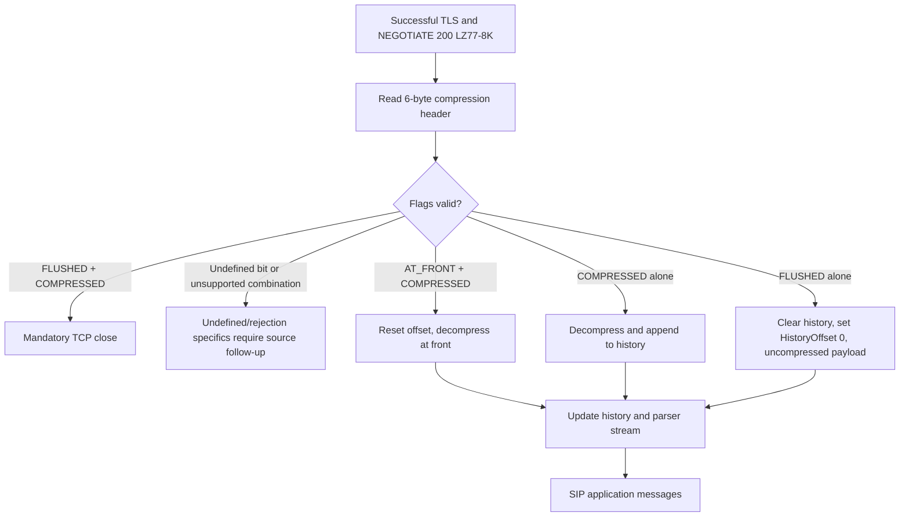

# MS-SIPCOMP rev10.0 original PDF: exact six-byte compression framing and receiver state

Research-only, 2026-10-22. Original owner-provided `catalog/MS-SIPCOMP.pdf` / `catalog/MS-SIPCOMP.txt`, revision 10.0, dated 2025-05-20, original PDF pp.9–10 and 15–17; directly inspected §§2.2.3–2.2.4 and 3.2.5.1.1–3.2.5.2 (plus §§3.1.2–3.1.5 and illustrative §4.1–4.2). RFC cross-reference: RFC2118 §3.1 Microsoft Point-to-Point Compression, RFC3261 §17.1.2.2; TLS basis MS-SIPCOMP references RFC4346 for TLS channel. This supplements `docs/ms-sipcomp10-conmgmt10-negotiation-inactivity-original-2026-10-22.md`. **No protocol implementation, traffic, real-server tests, merge or release.**

## Normative binary framing ledger (not inferred)

| ID | Primary clause | Exact on-wire constraint |
|---|---|---|
| CMPBIN-01 | §2.2.3 | `Compression: LZ77-8K` SIP header during NEGOTIATE; ABNF allows generic token syntactically but **currently only LZ77-8K supported**. Valid syntax ≠ negotiable algorithm. |
| CMPBIN-02 | §2.2.4 | After capability negotiated, **MUST** prefix data segment sent on compressed TLS channel with exactly **six-byte compression packet header**. |
| CMPBIN-03 | §2.2.4 | Header fields: **flags 4 bits**, **type 4 bits**, **reserved 3 bytes**, **Uncompressed size 2 bytes** (unsigned original length). Variable data is not part of six-byte header. This is header field *structure*, not a proven full TCP framing/length delimiter; avoid assuming a self-contained total compressed-frame size. |
| CMPBIN-04 | §2.2.4 | Flag bitmask **PACKET_FLUSHED 0x8**, **PACKET_AT_FRONT 0x4**, **PACKET_COMPRESSED 0x2**. Undefined 0x1 **MUST NOT** be set. |
| CMPBIN-05 | §2.2.4 | Type is four bits and **MUST be zero** for this protocol; receiver **SHOULD ignore** it. Reserved three bytes all **MUST be zero on send**, receiver **MUST ignore**. |
| CMPBIN-06 | §2.2.4 | 16-bit uncompressed length denotes original data length. Incorrect length **MAY** cause decompression failure. Need separate packet length framing and safe buffer bounds; no silent trust in uncompressed-size field. |
| CMPBIN-07 | §3.2.5.1.1 | FLUSHED **MUST** occur without any other flags. If compressor expands data rather than reducing it, send **uncompressed**, FLUSHED, resetting receiver's history buffer/HistoryOffset. |
| CMPBIN-08 | §3.2.5.1.1 | AT_FRONT **MUST** be combined with COMPRESSED; it occurs on first compressed packet or when data does not fit remaining history space. |
| CMPBIN-09 | §3.2.5.1.1 | COMPRESSED **MUST** be set on compressed data; MPPC related flags are RFC2118 bits A/B/C respectively, but do not equate them with all RFC2118 wire framing. |
| CMPBIN-10 | §3.2.5.2 | Receiver FLUSHED clears historical buffer and resets HistoryOffset=0; AT_FRONT resets HistoryOffset to start; COMPRESSED means decompression and updating history offset. |
| CMPBIN-11 | §3.2.5.2 | Contradictory FLUSHED+COMPRESSED → undefined state and receiving endpoint **MUST tear down TCP connection**. |
| CMPBIN-12 | §3.1.2 | NEGOTIATE Timer F recommendation **5 seconds** is negotiation-specific, not framing timeout or SIP REGISTER timeout. |
| CMPBIN-13 | §§4.1–4.2 | Example NEGOTIATE request targets first-hop SIP proxy; **Max-Forwards: 0**, **Compression: LZ77-8K**, Content-Length:0. Example success 200 echoes compression algorithm; examples are illustrative and do not override processing requirements. |

## Framing visual and failure classification

```
  0                  8                         32             48
  +--------+-----------------------------------+--------------+
  |flag|type|        reserved (24 bits)       | original size|
  |4b  | 4b |        3 bytes all zero          | 16 bits      |
  +--------+-----------------------------------+--------------+
  |                       DATA (variable)                     ...
```

**Caveat:** bit/byte packing and byte order for the 16-bit size must be checked in exact diagram/rendered PDF or other normative byte-order section before generated golden vectors. This representation summarizes specified field widths, not bytes individually.



**Inference explicitly separated:** the source excerpt provides a mandatory-close behavior for FLUSHED+COMPRESSED, but does **not** explicitly establish the precise TCP-close behavior for the undefined 0x1 bit or every malformed reserved field. Do not invent mandatory close for every invalid header. Also, no assumption that header alone delineates compressed data length within the TCP byte stream.

## Cross-layer impact and open proof obligations

- **Transport:** TLS channel then compression-negotiation then MPPC frame processing; SIP parser only sees decompressed SIP message bytes. A per-connection MPPC history is *transport compression state*, not SIP session/dialog/authentication state.
- **Security:** decompression errors must not be confused with MS-SIPAE MIC failure, RFC4028 timer expiry, or MS-SIPRE 430 recovery; actual reconnect/REGISTER/dialog recovery are separate cross-spec procedures, not automatically specified by MS-SIPCOMP §3.2.5.
- **Missing:** bit/byte endianness and TCP streaming delimiter interpretation; history buffer exact 8K mechanics from RFC2118; strict 16-bit bounds and compression-bomb safety; complete grammar §§2.2.1–2.2.2, and original figure-rendering verification.
- **Historic TLS:** source cites RFC4346 and uses 2025 release date; that does not validate TLS 1.1 security or assert support by every Windows Full Client version. Current security policy and Microsoft Product Behavior notes must be reconciled separately.
- **Coverage:** other 149 Microsoft PDF originals and all required normative RFC update chains not fully adjudicated; archive presence is not completion.

**Evidence gate remains OPEN, full analysis NOT COMPLETE.**
