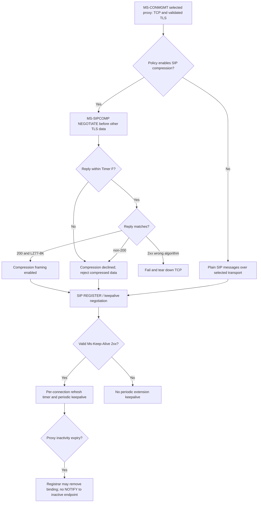

# MS-SIPCOMP 10.0 and MS-CONMGMT 10.0: transport negotiation, flags, timer, inactivity cleanup

**Research 2026-10-22.** Direct inspection of original extracted full PDF text supplied in `catalog.zip`, with pages and spec editions from PDF headers: **MS-SIPCOMP 10.0, v20250520**, PDF pp11–17, §§3.1.2–3.1.7, 3.2, 3.2.5.1.1–3.2.5.2; **MS-CONMGMT 10.0, v20250520**, pp18–19, §§3.4.5.3–3.4.6. Normative base references: RFC 3261 §17.1.2.2 (Timer F), RFC 2118 (MPPC); original Microsoft URLs are indexed in user-supplied `catalog/inventory.json`. This is a researched subset, not entire document certification.

## Verified client/server requirements

| ID | Clause | Normative consequence |
|---|---|---|
| COMP-01 | MS-SIPCOMP §3.1.2 | NEGOTIATE is a **non-INVITE transaction**, client **MUST** set timer F, **SHOULD** shorten to **5 seconds** rather than standard RFC3261 64*T1; **not** a blanket redefinition of Timer F for all SIP operations. |
| COMP-02 | §§3.1.3–3.1.4.1 | Client gets first-hop proxy IP and port from **established TCP + successful TLS negotiation**. To use compression, **MUST** initiate SIP NEGOTIATE after TLS and **before any other data on that TLS channel**. |
| COMP-03 | §3.1.5 | Client initiates; server **MUST NOT** initiate compression negotiation. The request communicates algorithm/capability. |
| COMP-04 | §3.1.5.2 | Server compares `Compression` header to `LZ77-8K`, rejects unmatched/unsupported/resource-exhaustion with SIP status >=400. Positive response **MUST** be constructed as 200 and **MUST** be sent within **5 seconds**; Max-Forwards > 0 triggers >=400 (product annotation <2> must be separately checked). |
| COMP-05 | §3.1.5.3 | On NEGOTIATE response cancel Timer F. For non-200 response, compression **declined**: neither endpoint may enter compression transport phase. 200 with wrong/missing compatible `Compression: LZ77-8K` → negotiation **fails and client MUST tear down TCP connection**. |
| COMP-06 | §3.1.6 | Timer F expires without reply: treat compression as declined, **MUST** reject server compressed bytes and **MUST NOT** start compressed transport. Do **not** incorrectly attribute compulsory TCP teardown to this specific timeout; source explicitly orders teardown for mismatched 200. |
| COMP-07 | §3.2 | Compression is modified MPPC under **RFC 2118** over TLS/TCP; ordered transport. Once negotiated every transported data packet **MUST** contain compression packet header §2.2.4. Ordinary SIP wire parser must not interpret framed compressed packet as plaintext SIP. |
| COMP-08 | §3.2.5.1.1 | Flags **PACKET_FLUSHED**, **PACKET_AT_FRONT**, **PACKET_COMPRESSED** must encode state: flushed alone, at-front with compressed, compressed when compressed; expansion → flushed + uncompressed payload and reset history. |
| COMP-09 | §3.2.5.2 | Receiver applies flag-dependent history buffer updates. Contradictory `PACKET_FLUSHED` with `PACKET_COMPRESSED` means undefined state and receiver **MUST tear down TCP connection**. |
| KEEP-01 | MS-CONMGMT §3.4.5.3 | Failed SIP response or missing/duplicate `Ms-Keep-Alive` in 2xx means keepalive not negotiated; no keepalive messages allowed. Non-overlapping supported capability sets also fail. On success client chooses shared mechanism and **MUST** load timeout unsigned integer and reset refresh timer. |
| KEEP-02 | §3.4.5.4 | On refresh timer expiry on enabled connection, client **MUST** send exact hop-by-hop keepalive from §2.2.2. |
| KEEP-03 | §3.4.6 | On proxy connection inactivity expiry, registrar proxy **SHOULD** remove client endpoint and associated registration binding, and **SHOULD** close inactive connection. **MUST NOT send NOTIFY to inactive endpoint** when removing registration (§MS-SIPREGE 3.2.2.4); non-registrar proxy has no required special action. |

## Cross-protocol transition graph

**Interpretation:** a declined compression negotiation does not license TLS downgrade; it only forbids entry to the compression transport mode. The flowgraph groups conditional branches, not a claim that every success path runs all of them, or that all negotiated keepalives must use REGISTER. Keepalive and registrar lifetime are independent from MS-SIPAE SA lifetime and RFC4028 session refresh.

## Conflict resolution / open primary-source requirements

1. **Clarify prior broad statement** in `ms-conmgmt10-ocsprot9-startup-discovery-tls-keepalive-2026-10-22.md`: MS-SIPCOMP §3.1.4.1 says NEGOTIATE must be **after TLS but before any other TLS data** for a client *participating in compression*. This stronger ordering constrains any simplified diagram where compression could follow an arbitrary SIP request. MS-CONMGMT's per-connection keepalive negotiation does not supersede it.
2. §3.1.5.2 product-note marker `<2>` for Max-Forwards > 0 needs explicit product applicability check. No unconditional assertion about every version.
3. Full packet grammar §§2.2.3–2.2.5 including Compression header, LZ77-8K packet format, endian, payload lengths, connection change, reset/partial reads, malicious decompression memory controls still need analysis.
4. RFC2118 and RFC3261 original normative updates not fully audited; confirm every conditional and the MS-SIPCOMP deviation.
5. MS-CONMGMT §3.4.6 prohibition of NOTIFY **to the inactive endpoint** is distinct from MS-PRES server notifications to other subscriptions when presence is removed. Their exact event ordering remains open.
6. Keepalive content §2.2.2 and registered/non-registrar proxy behavior §3.5 require exact byte-level/full event flow analysis; timeout refresh 2/3 rule documented earlier.
7. Compression is only on authenticated TLS channel in this cited profile. This should not be used to infer that every historically supported plaintext TCP connection negotiates MS-SIPCOMP.

**NOT COMPLETE. No new protocol code, no live server tests, no merge to main, no releases.**