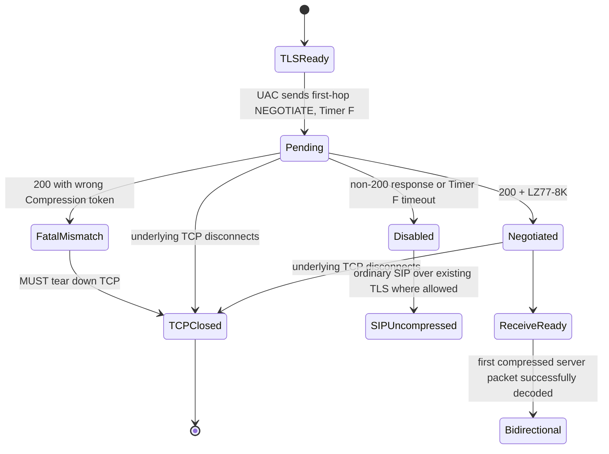
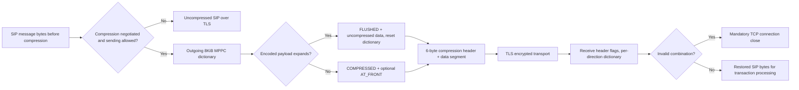

# MS-SIPCOMP 10.0: vollständige direkte Aushandlungs-, Framing- und Fehlerzustandsanalyse

**Research-only, 2026-10-23. Incomplete Windows Full Client coverage; implementation gate CLOSED.** Primary original Microsoft **[MS-SIPCOMP] Session Initiation Protocol (SIP) Compression Protocol**, **rev10.0**, **v20250520**, **published 2025-05-20** (PDF SHA-256 `66b70bc073b2cd3d060e0740f37d1e7112737de39bb865fc5d5a7799ee28a4ef`); directly examined **§§1.3–1.7, 2.1–2.2.4, 3.1.1–3.1.7, 3.2.1–3.2.7, 4.1–4.2, 6**. Original PDF p10 packet-bit-field rendered and visually verified. Primary RFC sources: [RFC3261 (June 2002)](https://www.rfc-editor.org/rfc/rfc3261) §§17.1.2 and 25.1, [RFC2118 (March 1997)](https://www.rfc-editor.org/rfc/rfc2118) §§3.1, 4.1–4.3 (**Informational** MPPC, not an Internet Standard), [RFC4346 (April 2006)](https://www.rfc-editor.org/rfc/rfc4346) TLS 1.1, and for **negative comparison only** [RFC3320 (January 2003)](https://www.rfc-editor.org/rfc/rfc3320) SigComp. [Microsoft MS-OCSPROT](https://learn.microsoft.com/en-us/openspecs/office_protocols/ms-ocsprot/bdcd1606-11c6-4457-a708-3d1c296259a0) overview explicitly separates compression negotiation and modified MPPC transport. **P** = direct Microsoft requirement, **R** = RFC, **S** = cross-spec inference, **U** = unverified runtime/product.

## 1. Exact registration-adjacent sequencing: TLS→NEGOTIATE→SIP

| ID | Source and scope | Original requirement / causal effect |
|---|---|---|
| COMP-01 | §§1.3–1.5, 2.1 | Client and first-hop proxy **must have established a TLS channel** and **must not have exchanged normal SIP traffic on that connection** before compression negotiation. Transport for negotiation and compressed payload **MUST be TLS**. Compression is **optional capability** and is not authentication. |
| COMP-02 | §2.2.1 | `NEGOTIATE` is a Microsoft **SIP extension method**, not SIP `OPTIONS` and not SigComp. Request **MUST include** RFC3261 CSeq, Via, Call-ID, From, To, and `Compression` header. `Max-Forwards: 0` **MUST** be set so request stops at first hop; no body and no Content-Type **SHOULD** be used. |
| COMP-03 | §§2.2.2–3 | Exact supported header `Compression: LZ77-8K`. Successful SIP **200 OK MUST include Compression**. Other token values allowed by grammar, but this profile currently only implements LZ77-8K. |
| COMP-04 | §§3.1.2, 3.1.4.1 | UAC **MUST send** NEGOTIATE **after TLS handshake and before normal SIP data** if it participates. Non-INVITE RFC3261 Timer F **MUST be set**, with **5 seconds SHOULD** in place of RFC3261 `64*T1` default **32 s** (T1 default 500 ms). No transmission of a REGISTER as a prerequisite for this specific negotiation. |
| COMP-05 | §3.1.3 | UAC constructs NEGOTIATE Request-URI from **actual first-hop proxy IP address and remote TCP port**, following successful TLS; not user AoR, not an arbitrary SIP conference URI. |
| COMP-06 | §3.1.5 | Only the **client initiates NEGOTIATE**; server **MUST NOT** initiate it. The server is the SIP UAS for this non-INVITE transaction, but later either peer may send compressed packets. |
| COMP-07 | §3.1.5.2 | Server with missing/mismatching LZ77-8K, unsupported resources or nonzero Max-Forwards **MUST respond with >=400** (see historical exception). Unexpected Content-Type/body **SHOULD be ignored** and do not themselves mandate rejection. Server **MUST send response within 5 seconds**. |
| COMP-08 | §§3.1.5.3, 3.1.6 | Client on any response except **200** treats compression as **declined**, and no compression transport starts. **200 with wrong Compression value is a protocol mismatch requiring TCP teardown**. On Timer F timeout, client treats as declined and **MUST reject later compressed data**; failure is not a reason to synthesize success. |
| COMP-09 | §3.1.7 | When underlying TCP closes during negotiation, negotiation aborts and transport follows MS-CONMGMT. Negotiated compression state is therefore **per-connection**; a reconnected channel cannot inherit history/negotiation without new evidence. |
| COMP-10 | §6 historical notes | OCS/Communicator **2007 R2** have exceptions: server can accept missing Max-Forwards and can ignore nonzero Max-Forwards. Edition-conditional **H**, not general relaxation for Skype for Business Windows Full Client. |

### Negotiation transitions

**S caution:** A non-200 response means compression declined, **not** intrinsically SIP registration rejected, since REGISTER is a separate transaction. `SIPUncompressed` represents ordinary SIP transport continuation when higher-level policy allows; the Microsoft spec's explicit transition is only that compression transport MUST NOT begin. Peer mismatched 200 is **not** the same as a non-200 decline.

## 2. Packet structure, bidirectional dictionary and exact desynchronization events

| ID | Source | Requirement |
|---|---|---|
| COMP-11 | §2.2.4 | After successful negotiation, each compressed-session transport data segment **MUST begin with exactly 6-byte header**: flags 4 bits + type 4 bits, reserved 3 bytes, uncompressed length **unsigned 16-bit**. Senders **MUST zero** type, reserved and unused flag; receiving endpoints **SHOULD ignore** type and **MUST ignore** reserved bytes. |
| COMP-12 | §2.2.4 | Flag names: `PACKET_FLUSHED=0x8`, `PACKET_AT_FRONT=0x4`, `PACKET_COMPRESSED=0x2`, `0x1` unused. `FLUSHED+COMPRESSED` **MUST NOT coexist**. Do not guess byte length of variable payload from uncompressed length. |
| COMP-13 | §§3.2.1,3.2.3 | Each endpoint maintains **two independent 8192-byte history buffers** with byte offset (one outgoing, one incoming). Both start **zero initialized**. Send/receive histories become identical on their respective direction after each valid packet. |
| COMP-14 | §3.2.1 | On insertion crossing end of history, history offset **MUST reset to zero**. Sender must flag receiver accordingly. History state is **per-direction and per-connection**, not a global SIP session and not per Call-ID. |
| COMP-15 | §3.2.5 | Server **MAY send compressed packets immediately** in transport phase, though **SHOULD defer until client identity validation** to reduce unauthenticated memory/CPU exposure. Client **MUST NOT send compressed data until it receives the first compressed data from server**; SHOULD start compression once it receives it. This asymmetry makes negotiated=TRUE different from clientCompressionSending=TRUE. |
| COMP-16 | §3.2.5.1 | Compressor encodes literals and `(copy-offset,length)` pairs using **RFC2118 §§4.1–4.2** MPPC bit codes. Copy offset max **8191** due 8 KiB history. This is **modified MPPC in SIP-over-TLS**, *not standard PPP/CCP framing*. |
| COMP-17 | §§3.2.5.1–3.2.5.1.1 | If compressed representation **would exceed original input**, sender **MUST flush dictionary** and send **uncompressed payload with FLUSHED only**. `FLUSHED` clears receiver history and resets offset; do not carry stale dictionary across flush. |
| COMP-18 | §3.2.5.1.1 | `AT_FRONT` means new decoded data begins at dictionary offset zero; requires `COMPRESSED` flag, used for first compressed packet and wrap. `COMPRESSED` identifies compressed bytes; combinations must follow source exact rules. |
| COMP-19 | §3.2.5.2 | Incoming `FLUSHED` clears local dictionary/offset; `AT_FRONT` resets offset before decompression; `COMPRESSED` invokes MPPC decode and history append. **Inconsistent flags => MUST tear down TCP connection** (example FLUSHED+COMPRESSED). |
| COMP-20 | §§3.2.2,3.2.6 | Transport phase defines **no special timers**, apart from negotiation Timer F. On new connection no negotiated dictionary can be safely reused; exact higher-layer failure recovery follows MS-CONMGMT/MS-SIPREGE. |
| COMP-21 | §§2.2.1,3.1.5.3,3.2.5.2 | **Failure taxonomy**: no support/non-200 -> decline; wrong algorithm on 200 -> TCP teardown; timeout -> decline/reject compressed; malformed flag state -> TCP teardown; TCP break -> abort/clean state. Not all yield the same SIP status or application-level fatal logout. |

### Observable compressed message boundary diagram (S)

**Critical layer separation:** The source §2.1 places **MS-SIPCOMP inside TLS**. Consequently the compression header is processed **after TLS decryption**, not as unprotected network framing. An ordinary SIP parser must not treat compressed bytes as standalone SIP start line until per-connection decode succeeded. A SIP SA MIC over a serialized SIP message is not proof that an untrusted compression history can ignore bounds, illegal matches or resource constraints.

## 3. Standards, history and security conflicts

- **CMP-RFC01:** [RFC2118](https://www.rfc-editor.org/rfc/rfc2118) March 1997 is an **Informational** specification for **PPP MPPC**, including historical licensing statements. MS-SIPCOMP reuses its **encoding algorithm**, not PPP wire envelope. Historical licensing text is not protocol behavior evidence and needs separate legal assessment if relevant.
- **CMP-RFC02:** [RFC3320](https://www.rfc-editor.org/rfc/rfc3320) January 2003 is **SigComp** for SIP signaling with a **UDVM and distinct wire format**. Microsoft `NEGOTIATE`/`LZ77-8K` does **not** imply SigComp support or interchangeability. The Microsoft 2025 document **does not cite RFC3320 as a prerequisite**; comparison is informative only.
- **CMP-RFC03:** RFC3261 §17.1.2.2 non-INVITE F default 64*T1, whereas MS-SIPCOMP §3.1.2 recommends **5 s**. This override applies **only to NEGOTIATE**. Do not silently shorten REGISTER, SUBSCRIBE, MESSAGE, C3P or QoE timers to 5 s.
- **CMP-TLS01:** MS-SIPCOMP 2025 §2.2.4 cites TLS **RFC4346 (TLS1.1)** for negotiated TLS framing; separate **MS-CONMGMT rev10 2025 §3.2 cites RFC5246 TLS1.2**. Modern [RFC8446](https://www.rfc-editor.org/rfc/rfc8446) TLS1.3 supersedes RFC5246. This is a **normative citation-version difference**, *not evidence* that the actual classic Windows client must negotiate insecure TLS1.1 or that compressing under TLS1.3 preserves old compression framing automatically.
- **CMP-SEC01:** Server SHOULD wait for authentication before sending compressed data (§3.2.5). A client being able to decode compressed server packets is **not evidence SIPAE SA or REGISTER succeeded**. Unauthenticated compression can impose memory/CPU cost; RFC3320 SigComp security considerations have distinct UDVM limits, not source rules for MS-SIPCOMP.
- **CMP-SEC02:** Uncompressed length u16 controls claimed original bytes but not variable compressed data length. Original §2.2.4 does not describe a complete network length envelope or a maximum decompression ratio; validate exact TLS framing, input boundaries, LZ77 malformed offset behavior and memory safety from original MS-SIPCOMP, RFC2118 and implementation-environment requirements **before any code planning**.
- **CMP-HIST01:** MS-SIPCOMP §6 lists Skype for Business 2016/2019/2021/LTSC2024 plus original older clients; this is a product behavior applicability list, **not proof each installation negotiates compression**; negotiated optional and server capabilities determine actual use.

## 4. Open gates (not protocol implementation tasks)

1. Exact bit-and-byte endian representation of the **six-byte** header and surrounding per-message TLS record/stream delimiters; inspect original PDF diagrams and wire examples, and external RFC4346 changes across TLS versions.
2. Full MPPC RFC2118 literal/copy-tuple encoding rules, dictionary flush and wrap cases; exact upper bound/error behavior for malformed offsets or truncated bitstream and TCP tear-down policy.
3. Response mismatch and Timer F recovery interaction with MS-SIPAE first unauthenticated REGISTER and its per-connection SA, including any client negotiated route changes.
4. Under product notes §6, confirm precise Full Client build and server editions that actually send compressed packets; distinguish compression support from SigComp capability.
5. Security: privacy and side-channel risk of compression of sensitive SIP fields within TLS, memory/CPU limits, and authenticated server identity check before compression.
6. Completion cross-reference with [MS-CONMGMT TLS/discovery research](ms-conmgmt10-discovery-proxy-tls-identity-rfc-profiles-2026-10-23.md), [MS-SIPAE SA research](ms-sipae11-ntlmk-tlsdsk-security-association-states-2026-10-23.md), [MS-SIPRE dialogue recovery](ms-sipre13-dialog-route-integrity-430-recovery-2026-10-23.md).

**Status: direct MS-SIPCOMP §2–3 analyzed substantially; no claim that all client protocols or RFC normative dependencies are complete. No code, live-server access/tests, merge or release.**
