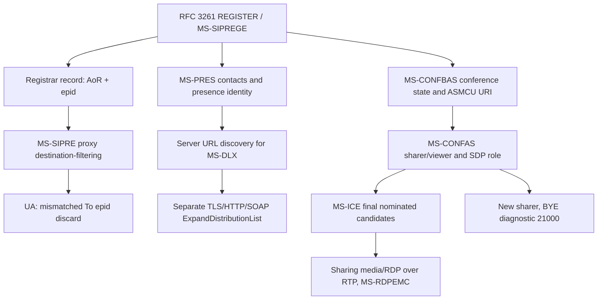

# Endpoint-targeted SIP, distribution-list expansion and application-sharing control

Research tranche 2026-10-22. Direct owner-provided original extracted Microsoft PDF checks: **MS-SIPRE v20250520** §§3.2.5.1–3.2.5.3 and 3.3 (PDF p.39–40); **MS-DLX v20250520** §3.1.4.1 (PDF p.17–18); **MS-CONFAS v20250520** §§3.2.5.1.1–3.2.5.1.6 (PDF p.15–16). All three are 2025-05-20 original published editions within the user's catalog.zip, not a blanket validation of every source. Microsoft official document directory: https://learn.microsoft.com/en-us/openspecs/office_protocols/ . Secondary assessments are hypothesis material; these clauses were read directly in the original extracted text.

## Source-verified requirement ledger

| ID | Original and clause | Direct normative content | Scope |
|---|---|---|---|
| ROUTE25-01 | MS-SIPRE §3.2.5.1 | UA **MUST discard without responding** to SIP request whose To epid is present and differs from its own epid (§3.2.3). | UA endpoint privacy/routing; not a generic malformed SIP parser failure. |
| ROUTE25-02 | MS-SIPRE §3.2.5.2 | Registrar **MUST** retain From epid in SIP location-service record when supplied in REGISTER, in addition to RFC 3261 §10 registration data. | Registrar, not automatically an originating UAC algorithm. |
| ROUTE25-03 | MS-SIPRE §3.2.5.3 | SIP proxy **MUST** filter out contact records whose epid mismatches an explicit To epid. When routing on a location record with epid and To lacks epid, proxy **MUST add** record epid to To; should use AoR+epid to index state. | Server routing; direct endpoint routing across multiple registrations. |
| ROUTE25-04 | MS-SIPRE §3.3 | `+sip.instance` MUST use a UUID URN per RFC 4122; the pair (AoR, instance) has long-lived/distinguishing semantics, but Contact doesn't by itself designate a destination route. | Distinguish EPID and +sip.instance rather than assuming literal equality. |
| DLX25-01 | MS-DLX §3.1.4.1 | On user-initiated distribution-list expansion, connect to service address obtained through another channel (e.g. SIP); **MUST establish TCP and negotiate SSL** before SOAP HTTP operation `ExpandDistributionList`. | Legacy normative wording 'SSL' does NOT authorize insecure obsolete SSL versions; actual TLS/certificate validation policy needs independent verification. |
| DLX25-02 | MS-DLX §3.1.4.1 | Client **MUST** construct `ExpandDistributionListSoapIn` with `ExpandDistributionList` SOAP body. Server **SHOULD** query distribution-list repository, and **MUST** return `ExpandDistributionListSoapOut` with `ExpandDistributionListResponse` within HTTP 2xx; failures include error type. | Separate SOAP/HTTP trust boundary from SIP registration or contacts. |
| SHARE25-01 | MS-CONFAS §3.2.5.1.1 | For app sharing via addUser dial-in, conference client needs ASMCU URI from `conf-uris` with purpose `applicationsharing`, from conference document per MS-CONFBAS §2.2.2.4. | C3P subscription state prerequisite, not generic RTP discovery. |
| SHARE25-02 | MS-CONFAS §3.2.5.1.2 | SDP offer identifies role with `x-applicationsharing-role`, `sharer` or `viewer`; MCU answer **MUST reverse** role. Offer with no `m=applicationsharing` or `m=video` is rejected **488**. Multiple sharer/viewer instances have MCU `port=0` rejection semantics (RFC 3264 §8.1). | SDP offer/answer validation; role-qualified client and MCU obligations. |
| SHARE25-03 | MS-CONFAS §3.2.5.1.2 | If app-sharing and video m-lines coexist, video sendonly/recvonly must be consistent with sharer/viewer role; mismatch rejects whole offer with 488. `x-applicationsharing-contentflow` constraints depend on role and whether active video exists. | Conditional multimedia negotiation, no blanket always-video assumption. |
| SHARE25-04 | MS-CONFAS §3.2.5.1.3–4 | Completion uses MS-ICE §3.1.4 and final offer/answer containing selected candidates; renegotiation **MUST** deactivate previous `m=applicationsharing` line (`port=0`) and introduce a new m-line. | Session/media-state lifecycle independent of SIP REGISTER. |
| SHARE25-05 | MS-CONFAS §3.2.5.1.5 | When new sharer replaces current sharer, existing sharer receives SIP BYE with `ms-diagnostics-public:21000`, reason `New sharer joined conference`. | Explicit sharing ownership transition vs generic BYE/connection loss. |
| SHARE25-06 | MS-CONFAS §3.2.5.1.6 | SDP `a=x-capabilities` name/value pairs (name charset lowercase a-z, '_' or '-', '=' separator, ';' separator recommended); malformed line → 488. After re-INVITE, C3P `media-capabilities` may notify; exact version/product-note handling still required. | SDP-to-conference-control synchronization. |

## Cross-protocol dependency graph (not guaranteed chronological packet trace)

**Evidence split:** routing, SOAP WSDL operation, sharing SDP and BYE are first-party clauses directly checked. The diagram's inter-subsystem edges (presence-to-DLX discovery, registration-to-conference readiness) are *architecture relationships* requiring exact server message sources and condition verification before converting to a guaranteed wire sequence. SOAP certificate validation and modern TLS suitability are not proven by the quoted legacy SSL requirement.

## Detailed fault and negative-state matrix

| Event | Documented outcome | Open client handling |
|---|---|---|
| To epid mismatches own identity | UA silently discards SIP request (MS-SIPRE) | Caller transaction timeout and fallback under RFC 3261 and endpoint routing, to review. |
| Distribution list expansion fails | SOAP response signals error type (MS-DLX) | Error schema/status, retry authentication and service URL provisioning, to review. |
| App-sharing offer lacks qualifying m-line | 488 (MS-CONFAS) | Distinguish application sharing unsupported from any SIP 488; exact feature negotiation needed. |
| Video and app-sharing direction conflict | Entire SDP rejected 488 (MS-CONFAS) | No partial success assumption. |
| ICE final candidate exchange incomplete | Completion governed by MS-ICE §3.1.4 | ICE1 vs ICE2 topology and timer distinctions, to review. |
| Existing sharer replaced | SIP BYE with diagnostics 21000 (MS-CONFAS) | Distinguish deliberate sharer handover from network loss, conference membership may persist. |

## Normative source gap register

- MS-SIPRE §3.2.3 exact epid generation and §3.3.3 SIP.INSTANCE regeneration, GRUU relation, multiple simultaneous clients.
- MS-DLX §§2.2–2.3 WSDL/XSD response faults, service endpoint discovery, web authentication and certificate name matching; PDF edition notes.
- MS-CONFAS §3.2.5.2 RDP messages, §3.2.5.3 data channel and §3.2.5.4 sharer control, entire MS-RDPEMC, MS-ICE and MS-CONFBAS C3P state; MSRP/PSOM interplay if applicable.
- Full direct point-to-point IM and message receipt processing under MS-SIPRE and MS-SIPAPP not assessed in this document.
- RFC 3264 exact offer/answer, RFC 4122 UUID and SIP routing RFC 3261 §16 update status; all historical-vs-current security applicability.
- Complete original-source/version and 112 assessment reconciliation not yet complete.

**Conclusion:** Directly verified sections expand the system from earlier auth/presence/media coverage into endpoint-specific routing, SOAP directory expansion and application-sharing lifecycle. Overall RFC/MS analysis **NOT COMPLETE**; no implementation planning permitted, no protocol code, real servers, merges or releases.
