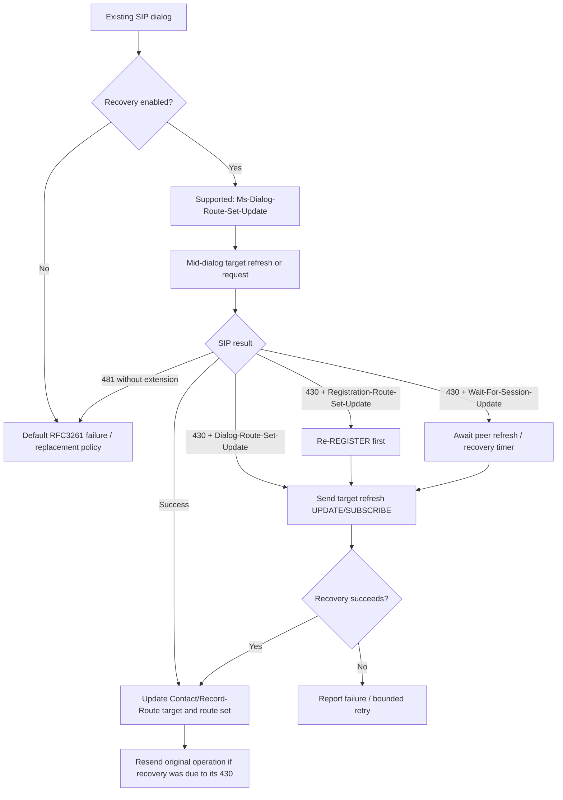

# MS-SIPRE 13.0 §3.7: original dialog-route recovery state machine

**Research date:** 2026-10-22. **Original:** owner-supplied `catalog/MS-SIPRE.pdf` / `MS-SIPRE.txt`, **MS-SIPRE version 13.0, v20250520**, pp51–55 (printed original PDF). Directly inspected **§§3.7.2–3.7.6**. Source: [official Microsoft MS-SIPRE](https://learn.microsoft.com/en-us/openspecs/office_protocols/ms-sipre/). Normative cross-references: [RFC3261](https://www.rfc-editor.org/rfc/rfc3261) §§6,10.2.4,12, [RFC4028](https://www.rfc-editor.org/rfc/rfc4028), and [RFC3265](https://www.rfc-editor.org/rfc/rfc3265). No protocol code or live testing.

## Original clause requirement ledger

| ID | Original clause and role | Directly evidenced processing |
|---|---|---|
| REC-01 | §3.7.2.1, UA | With dialog recovery enabled and RFC4028 session timer negotiated, UA **SHOULD** start recovery refresh timer when dialog created; interval **at least** negotiated session timer interval. |
| REC-02 | §3.7.3.1, UA | Recovery **SHOULD** be enabled where losing signaling path loses valuable content, e.g. audio call media state, but **SHOULD NOT** for replaceable presence SUBSCRIBE dialogs. |
| REC-03 | §3.7.4.1, UA | UA with recovery enabled **MUST** include `Ms-Dialog-Route-Set-Update` in Supported on all requests in dialog. UA **SHOULD** negotiate periodic refresh: RFC4028 INVITE sessions or RFC3265 SUBSCRIBE refresh. All recovery-dialog refreshes **MUST** be target refreshes under RFC3261 §6. |
| REC-04 | §3.7.5.1, proxy | On stale routing/session state and **without** `Ms-Dialog-Route-Set-Update`, proxy **SHOULD** reply **481** and stop. |
| REC-05 | §3.7.5.1, proxy | With extension negotiated, proxy **MUST** send **430 Flow Failed** with **P-Dialog-Recovery-Action** and appropriate recovery action. |
| REC-06 | §3.7.5.1, action | `Dialog-Route-Set-Update`: source endpoint can perform dialog recovery. `Registration-Route-Set-Update, Dialog-Route-Set-Update`: source must first refresh REGISTER, then dialog. `Wait-For-Session-Update`: recovery depends on target endpoint registration/target refresh. |
| REC-07 | §3.7.5.2, registrar | If new dialog-creating request Contact contains GRUU but corresponding binding missing or Routable FALSE, registrar **SHOULD** respond **430** and include registration-plus-dialog recovery action. Source cross-references MS-SIPREGE §3.1.2.1. |
| REC-08 | §3.7.5.3.1, UA | On 430 with recovery action, UA **MUST** inspect value, distinguishing in-dialog and dialog-creating requests. For registration-plus-dialog action: MUST report original failure upward, refresh registration and then restore eligible dialogs after success; **SHOULD** terminate/recreate nonrecoverable dialogs. |
| REC-09 | §3.7.5.3.1, UA | On a sole Dialog-Route-Set-Update, UA **MUST** initiate dialog target refresh; when successful **MUST** resend original failed request using updated route set/remote target; when unsuccessful **MUST** report original failure. |
| REC-10 | §3.7.5.3.1, UA | If recovery causes same request to be resent >=2 times and another 430 received, UA **SHOULD** stop further attempts and report to user. |
| REC-11 | §3.7.5.3.1, UA | For sole Wait-For-Session-Update and negotiated RFC4028 session timer, UA **SHOULD** start/reset recovery refresh timer to interval >= negotiated session interval. |
| REC-12 | §3.7.5.3.2, UA | Successful REGISTER refresh with `Presence-State` `register-action-value` `added` or `fixed` triggers **SHOULD** dialog recovery for enabled dialogs and terminate/recreate other dialogs. |
| REC-13 | §3.7.5.3.3, UA | On received RFC4028 session refresh UA **SHOULD** reset recovery timer; on mid-dialog target refresh UA **SHOULD** extract Contact and Record-Route, update route set and remote target. |
| REC-14 | §3.7.5.3.4, UA | To recover a dialog UA **MUST** send appropriate target refresh (e.g., UPDATE in INVITE dialog, SUBSCRIBE in SUBSCRIBE dialog) including required Contact/Record-Route values; wait for SIP transaction completion. If success **MUST** update dialog route set and remote target from response. |
| REC-15 | §3.7.5.3.4, UA | If recovery target refresh gets 430 with sole Wait-For-Session-Update, **SHOULD** start/reset recovery timer; after one dialog restored **SHOULD** restore logically related dialogs, e.g. conference components. |
| REC-16 | §3.7.6.1, UA | On recovery refresh timer expiry, UA **MUST** invoke §3.7.5.3.4 recovery procedure. |

### Combined protocol state diagram

**Diagram caveat:** only source-defined conditional branches. It does not specify all SIP retransmissions, concurrency of 430 and REGISTER, cryptographic reauthentication or UI behavior. Reissue semantics are explicit for sole Dialog-Route-Set-Update; other actions have separate preconditions.

## Cross-spec distinctions

- **Registration** (MS-SIPREGE/RFC3261 §10), **security association** (MS-SIPAE), **dialog route set** (MS-SIPRE §3.7), and **session media** (MS-ICE2/MS-RTP) are separate; 430 concerns routing recovery and cannot be equated with auth 401/407 or media ICE timeout.
- RFC4028 session timer sets a lower bound for recovery refresh timer where applicable; there is **no universal new 10-second or 32-second recovery timer** in this section.
- Conference dialogs may be logically linked; §3.7.5.3.4 recommends recovery of others after one restored. Presence subscriptions are specifically cited as cheaply replaceable, so recovery is discouraged.
- 2025 Microsoft spec uses RFC3265 event subscription references although RFC6665 supersedes it; historical applicability unresolved.

## Remaining open and trust boundaries

REC-GAP-01: §3.7.1.1 exact routing reference serialization and §2.2.2.2 Contact / Record-Route header grammar.
REC-GAP-02: Original MS-SIPREGE rev17.1 §3.1.2.1 Routable flag and `Presence-State` transition values.
REC-GAP-03: RFC4028 timer negotiation, 422 Min-SE, refresher role, expiry and security; RFC3261 UPDATE/target refresh method versions.
REC-GAP-04: RFC6026 vs RFC3261 forking 2xx interactions with stale route and session recovery.
REC-GAP-05: Re-authentication, TLS identity/reconnect and MS-SIPAE per-message MIC after registration route change.
REC-GAP-06: Cross-document full media, conference, contact, signout and profile audit, all secondary assessments independent validation.

**Status: section-level original PDF recovery mechanics verified; overall protocol corpus analysis NOT COMPLETE.** No implementation planning, code, real server tests, merge or release.
