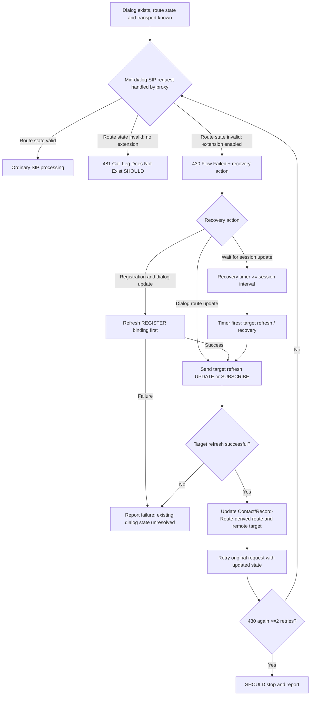

# MS-SIPRE 13.0 routing integrity and 430 dialog recovery across registrar, proxy and media

**Original research date 2026-10-23; NOT full client completeness.** Source Microsoft **[MS-SIPRE] Session Initiation Protocol Routing Extensions, rev13.0, v20250520**, original PDF SHA256 `9dc4121780f66dc958f5d9e906594cfbc8b5535410e5f18592a8331227e969ae`, direct chapters **§§2.2.2.2, 2.2.18, 3.6–3.7.7 and Appendix A product behavior <17>–<30>**, 116-page PDF. Related originals **[MS-SIPREGE] rev17.1 v20250819 §§3.1.1.5.1 and 3.1.2**, **[MS-CONFBAS] rev15.0**, **[MS-PRES] rev13.0**, **[MS-CONMGMT] rev10.0**, **[MS-SIPAE] rev11.0**. Compare [RFC3261](https://www.rfc-editor.org/rfc/rfc3261) §§12,16,17, [RFC4028](https://www.rfc-editor.org/rfc/rfc4028) §§7–10, [RFC3265](https://www.rfc-editor.org/rfc/rfc3265) §3 (historical SUBSCRIBE event), and [FIPS198a](https://csrc.nist.gov/pubs/fips/198-1/final) HMAC. Current RFC6665/7621 event edition is an **open profile difference**, not automatic replacement. Source [Microsoft §3.7.5.3.1](https://learn.microsoft.com/en-us/openspecs/office_protocols/ms-sipre/786aa8e2-ddcb-40a9-9fda-050f7f6c8c0a) and [§2.2.18 header grammar](https://learn.microsoft.com/en-us/openspecs/office_protocols/ms-sipre/0645c455-f44c-4663-8608-9d6a050f07cc) crosschecked.

Status codes: **P** primary Microsoft requirement; **R** original RFC; **S** cross-clause model; **U** unresolved version/runtime. All SIP proxy and registrar actions separated from client.

## 1. Why the Dialog Route Set carries protected routing context

| ID | Original source | Normative or descriptive primary behavior |
|---|---|---|
| ROUTE-01 | MS-SIPRE §3.6 | RFC3261 Via and Record-Route convey message/dialog paths; Microsoft adds **route state** for server farm members, endpoint indexes, NAT/firewall/security associations and service proxy traversal. Such a route URI may be meaningful only to one proxy family and connection. |
| ROUTE-02 | §3.6.3 | **Proxy** SHOULD maintain endpoint state tables and can embed indexes as `ms-opaque` (UAS identity) or `ms-identity` (UAC identity) in **Record-Route URI**. It can embed `ms-fe` (unique server FQDN inside farm), `ms-role-rs-to/from` (authorization server role), and `ms-ent-dest`; some are **product-conditional/older**. |
| ROUTE-03 | §3.6.3 | A proxy can instead encode data directly as a syntactically legal opaque URI parameter, which may be integrity-protected. **Opaque is not proof of confidentiality or authentication by itself**, and a client cannot assign semantics or rewrite it absent source permission. |
| ROUTE-04 | §3.6.2.1 | **Proxy**, if it rotates HMAC keys protecting Via/Record-Route/Contact, **MUST** retain old key during timer. Recommended minimum **1 h** for Via/Record-Route copied request→response, **8 h** for Contact/Record-Route copied into long-lived dialog route sets. These are **proxy key-retention windows, not UAC SIPAE SA expiry**. |
| ROUTE-05 | §§3.6.5.1–3.6.6 | **Proxy** with removed/expired route HMAC key SHOULD reject stale route with **481**; when recovery extension enabled it uses **§3.7 430/481 procedure**. Even with valid SIPAE UAC, proxy can no longer validate its old route token. |
| ROUTE-06 | §6 product notes <17>–<26> | Several routing parameters and choices have **Office Communications Server/Communicator 2007-only behavior exceptions**, and others 2007 clients lack. **Do not** project each old Record-Route proprietary parameter as a universal Windows 2015/2019 requirement. |

## 2. Recovery capability and exact network failure consequences

| ID | Original source | Verified actor-qualified rule |
|---|---|---|
| REC-01 | §3.7 intro | Proxy route references can become invalid after primary proxy/registrar restart or failed NAT/firewall path. This extension aims to repair **dialog route set** without tearing down underlying audio/video media *when possible*, distinct from a global user re-login. |
| REC-02 | §§3.7.2.1, 3.7.3.1 | **UAC** SHOULD enable dialog recovery for valuable INVITE/media contexts and SHOULD NOT for easily recreated presence SUBSCRIBE dialogs; when enabled and RFC4028 timer negotiated, set **recovery refresh timer** at least as long as session timer. |
| REC-03 | §3.7.4.1 | For recovery-enabled dialog, **UAC MUST include** `Supported: Ms-Dialog-Route-Set-Update` on **all requests in dialog** and SHOULD have refresh mechanism. Refresh MUST be **target refresh** per RFC3261 §6, typically UPDATE for INVITE dialog and SUBSCRIBE for SUBSCRIBE dialog. |
| REC-04 | §3.7.5.1 | **Proxy** detecting missing route state for mid-dialog request checks Supported option: if absent **SHOULD reject 481**; if present **MUST reject 430 Flow Failed** and send `P-Dialog-Recovery-Action`. **430 Flow Failed is SIP**, not ICE/STUN or TURN error 430. |
| REC-05 | §§2.2.18,3.7.5.1 | Microsoft header values: `Dialog-Route-Set-Update` = sender target refresh; **combined** `Registration-Route-Set-Update, Dialog-Route-Set-Update` = refresh registrar then dialog; `Wait-For-Session-Update` = sender waits for destination's target/session refresh. Header grammar also has extensible tokens, not just fixed enum. |
| REC-06 | §3.7.5.2 | **Registrar**, when dialog-creating request Contact contains a GRUU with missing binding or `Routable=FALSE`, **SHOULD send 430** and **MUST supply combined registration+dialog action** when sending it. This situation is not a benign DNS retry and not exactly RFC3261 generic 481. |
| REC-07 | §3.7.5.3.1 | UAC receiving 430 with relevant action **MUST inspect** response header; combined registration action causes notification to higher layer, registrar binding refresh, then dialog recovery on recovery-enabled dialogs if registration succeeded; unrecoverable dialogs SHOULD terminate/re-create. |
| REC-08 | §3.7.5.3.1 | Single `Dialog-Route-Set-Update`: UAC **MUST** target refresh the dialog; if successful **MUST resend original failed request with new route set and remote target**; if refresh fails **MUST report original request failure** to upper layer. |
| REC-09 | §3.7.5.3.1 | After **two or more attempted re-sends** of same original request that again produce 430, UAC **SHOULD stop retrying and inform user**; do not form an infinite 430 recovery loop. |
| REC-10 | §§3.7.5.3.1,3.7.5.3.4 | Single `Wait-For-Session-Update`: UAC SHOULD reset recovery refresh timer (where RFC4028 session timer was negotiated) to **at least** negotiated session timer. If a recovery target refresh itself receives that tag, same timer fallback. |
| REC-11 | §3.7.5.3.2 | **UAC**, after successful REGISTER refresh that returns `Presence-State register-action=added|fixed`, **SHOULD try recovery** on recovery-enabled dialogues, and **SHOULD terminate/recreate** others. **Cross-document tension** with MS-SIPREGE rev17.1 §3.1.1.5.1 calling the same type of 200 a *registration failure* and saying prior dialogs SHOULD be considered terminated; see blocker REC-X01 below. |
| REC-12 | §3.7.5.3.3 | When receiving a target refresh in a recovery-enabled dialog, UAC **SHOULD extract Contact and Record-Route URIs** and update route set/remote target. Otherwise future SIP requests may use stale route and get 430. |
| REC-13 | §3.7.5.3.4 | Successful target refresh response => UAC **MUST** extract Contact + Record-Route URI and update route set/remote target. Failed target refresh does **not** establish new route even if 430 response has useful text. |
| REC-14 | §3.7.5.3.4 | After recovering a dialogue, UAC **SHOULD** attempt recovery of other logically associated dialogs, e.g. **conference Focus/MCU dialogs** under MS-CONFBAS. One recovered dialog cannot mark all related dialogs healthy. |
| REC-15 | §3.7.6.1 | When UAC recovery refresh timer fires, it **MUST run** dialog recovery procedure §3.7.5.3.4. This timer is separate from REGISTER binding refresh, SIPAE SA validity, connection idle and ICE consent. |
| REC-16 | §6 product notes <27>–<30> | Some dialog recovery behavior unsupported by OCS/Communicator 2007 (and selected 2007 R2 scenarios). Full Windows client version and server farm must be established before requiring feature; no blanket compatibility assumption. |

## 3. Recovery decision and multi-subsystem state model (Synthesis, **NOT** a universal packet trace)

**Scope guard:** This procedure is not generic RFC3261 fork recovery, SIP transaction retry, or the same as ICE connectivity restart. Recovery can preserve established media **when possible**, but an ICE consent expiry or SRTP failure is an independent media problem. Successful REGISTER does not guarantee stale route tokens were repaired. An application can independently end BYE/Focus dialogs on unrecoverable paths.

## 4. Explicit client-wide normative conflicts and research gates

**REC-X01 — cross-edition 200-with-added/fixed ambiguity, BLOCKING.** The owner-original **MS-SIPREGE rev17.1 (2025-08-19) §3.1.1.5.1** says refresh `200 OK` with `register-action=added|fixed` **MUST be treated as registration failure**, existing dialogs **SHOULD be considered terminated**, and registration **SHOULD restart**. Original **MS-SIPRE rev13.0 (2025-05-20) §3.7.5.3.2** says on *successful* refresh 200 with same values, recovery-enabled dialogs **SHOULD be recovered**. These may be conditional behaviors of different versions/capabilities or a textual discrepancy, but **the source corpus does not justify flattening them to one flow**. The existence of an optional recovery-enabled dialog is not evidence the newer 2025 SIPREGE obligation is overridden; obtain official errata, version history and Windows-client product notes for each before implementing sign-in recovery logic.

**REC-X02 — route HMAC key versus SIPAE MIC:** MS-SIPRE §3.6 proxy-HMAC keys protect opaque routing parameters and are retained as recommended 1h/8h; MS-SIPAE §§3.2.4–3.2.6 SIP signer keys and 256-window replay are a different cryptographic domain. A valid SIP AE MIC doesn't make expired proxy-HMAC route valid. SIP 430 route issue is different from SIPAE 401/407 auth challenge.

**REC-X03 — condition mismatch in published §3.7.5.3.1:** the prose describes presence of a `P-Dialog-Recovery-Action tag` and elsewhere lists concrete `Registration-Route-Set-Update`/etc values. This appears terminologically loose, not a new literal token required on wire. **Follow formal §2.2.18 grammar and exact action list**, report unresolved semantics instead of inventing a fourth action.

**REC-X04 — RFC4028 timer effect:** Recovery refresh timer interval >= negotiated session timer, while session expiration itself might cause BYE at the RFC4028 deadline. The ordering and actual ability to preserve dialog under timer expiration depends on negotiated refresher and peer, not just client initiation; requires scenario-specific scheduling/race proof.

**REC-X05 — multiple endpoints:** Registrar GRUU `Routable=FALSE` is endpoint-specific. Do not interpret one 430 as requiring sign-out/clear-all devices. Link MS-SIPREGE §§3.1.2 and MS-PRES per-endpoint cleanup.

**REC-X06 — complete Record-Route preservation:** Need original §2.2.2.2 precise Contact/Record-Route param grammar, SIP RFC3261 loose vs strict routing, HMAC/URI escaping, protected flags and SIPAE canonicalization; any normalization can destroy proxy authorization. Additional tier/origin endpoint checks remain open.

**REC-X07 — conference graph:** Focus dialog, conference SUBSCRIBE dialog, MCU AV or IM dialogs have independent life cycles; recovering one may require multiple target refreshes under MS-CONFBAS §3.4 and MS-CONFIM/CONFAV. Source doesn't mandate a fixed serial order for all media and roster reacquisition.

**REC-X08 — actual product profile:** §§3.6/3.7 original product notes <17>–<30> are **not uniform**. Need target Skype for Business 2015 Windows build, servers and feature flags before declaring which Microsoft route token and recovery behavior applies.

**Research phase NOT COMPLETE, implementation plan remains forbidden; no code, live-server tests, main merge or release.**
