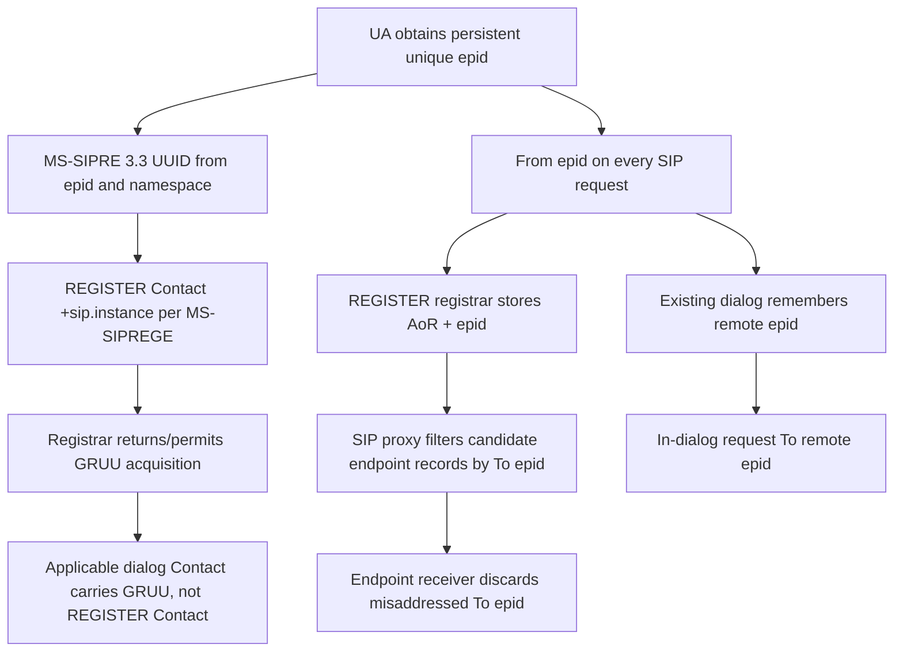

# Original MS-SIPRE v20250520: EPID → SIP.INSTANCE UUID → GRUU, identity and fork-safety

**Research, 2026-10-22.** Primary: user-provided `catalog/MS-SIPRE.pdf` and same-name extracted full original text, **MS-SIPRE 13.0, May 20 2025**, printed pp38–45, **§§3.2.3.1, 3.2.4.1, 3.2.5.1–3, 3.3.3.1, 3.4.3.1 and 3.4.4.1**. Official Microsoft specifications: https://learn.microsoft.com/en-us/openspecs/office_protocols/ms-sipre/ . Generic RFC: https://www.rfc-editor.org/rfc/rfc3261 (June 2002) §§9,12,13,16; RFC4122 UUID definitions. These are discrete primary clauses, not full Windows client verification.

## Verified role-based wire identity matrix

| ID | Role, condition | Exact primary rule and consequence |
|---|---|---|
| ID13-01 | UA initialization §3.2.3.1 | To employ EPID mechanism UA **MUST** have a syntactically valid EPID unique among UAs sharing one AoR and **SHOULD** persist it across endpoint power cycles. This is not merely a new random tag per SIP request. |
| ID13-02 | UA request construction §3.2.4.1 | UA **MUST** include its local epid in From on *every* request, including outside transactions. Dialog state **MUST** carry remote epid beyond RFC3261 dialog state; UAC initializes from To, UAS from From (or empty absent). |
| ID13-03 | UA targeted dialog §3.2.4.1 | When forming request in existing state with nonempty remote epid **MUST** include it in To; to call an endpoint specifically client **SHOULD** obtain AoR+epid from prior dialog or presence then use AoR in Request-URI/To and endpoint epid in To. |
| ID13-04 | UA receive §3.2.5.1 | A mismatched targeted To epid **MUST** cause silent discard (no response); not equivalent to SIP 404, 481 or 488. |
| ID13-05 | Registrar §3.2.5.2 | Registrar records From epid with RFC3261 registration location records; proxy routing selection can rely on (AoR, epid). |
| ID13-06 | SIP proxy §3.2.5.3 | For To containing epid, proxy **MUST** filter out location records with different epid. When using an epid-bearing record and request To lacks one, proxy **MUST** add record epid to To. Proxy **SHOULD** index originating and destination state by AoR+epid. |
| ID13-07 | UA SIP.INSTANCE init §3.3.3.1 | UA MUST obtain UUID per RFC4122; **if also using EPID** MUST derive EPID-name-based instance UUID as the thirteen-step derivation below. |
| ID13-08 | GRUU init §3.4.3.1 | UA MUST obtain GRUU through registrar MS-SIPREGE procedure (or admin means for server application/conferencing endpoints). This is endpoint routability, not merely username AoR. |
| ID13-09 | GRUU Contact §3.4.4.1 | UA **MUST** use obtained GRUU as Contact URI *where SIP requires Contact on applicable non-REGISTER requests*, but **MUST NOT** use GRUU to populate REGISTER Contact. Optional `grid` URI parameter differentiates the requested instance of GRUU. |
| ID13-10 | GRUU domain/EPID §3.4.4.1 | Requests carrying GRUU Contact **MUST** go to registrar/proxy in the GRUU-issuing domain; if EPID and registrar-obtained GRUU used together, From epid **MUST** match registration epid. |

## Exact EPID namespace UUID algorithm (MS-SIPRE §3.3.3.1)

This is original first-party source, not a generalized UUIDv5 SHA-1 assumption:

1. Namespace ID UUID is `fcacfb03-8a73-46ef-91b1-e5ebeeaba4fe`.
2. Use **SHA-256** per NIST FIPS 180-4.
3. Name input is **ASCII encoding of the epid parameter value as represented in SIP From/To**.
4. Hash namespace UUID bytes concatenated with these name bytes.
5. Populate `time_low` with digest bytes 0–3, `time_mid` with bytes 4–5, `time_hi_and_version` with bytes 6–7.
6. Force high four version bits in `time_hi_and_version` to `0101`.
7. Populate `clock_seq_hi_and_reserved` with digest byte 8; force high variant bits to `01`.
8. Populate `clock_seq_low` with byte 9 and six `node` bytes with digest bytes 10–15.
9. Convert resulting UUID to local byte order; it **SHOULD** persist across power cycles.

The section numbers its operation as 13 steps; the condensation above preserves all operative byte selections/bit transformations. **Exact byte-order semantics and normative RFC4122 interaction need independent verification** before any generated vector, especially because text says `local byte order`. Do not silently substitute a generic SHA-1 UUIDv5 helper or use the literal epid as +sip.instance.

## Lifecycle and SIP fork cross-analysis

**Graph classification:** original section rules are each directly verified. Edges between registration, GRUU derivation and SIP dialog processing are *cross-document dependencies*, not an exhaustive mandatory message transcript.

### Relation to MS-OCSPROT 9.0 §2.5.11, multi-endpoint invitation

The Microsoft overview shows INVITE to an AoR, proxy forking to B1/B2, accepted responder, CANCEL of other endpoint. **This is an illustrative specific path.** RFC3261 requires exact UAC handling of INVITE 2xx responses and ACK, and CANCEL cannot roll back an already accepted final INVITE. If multiple final 2xx emerge in a race, the generic SIP core may require multiple ACK/dialog-cleanup actions. **Do not implement a universal 'one 200 ⇒ other branch never can succeed' assumption.** Exact proxy forking and targeted EPID routing constraints must be reconciled against §§9,13,16 of RFC3261 and the Microsoft-specific endpoint state.

## Safety and uncertainty register

- Endpoint EPID and instance UUID are linked by derivation *only when both mechanisms are enabled*. They are not the same header parameter or interchangeably reusable wire value.
- A GRUU is a URI capable of targeting a user-agent instance; it is not a replacement for REGISTER Contact.
- Duplicate incoming dialogs and fork response races need precise tags, Call-ID, branch, CSeq and cancellation rules from RFC3261; plain MS-OCSPROT Fig.15 is not normative exhaustiveness.
- New SHA-256 UUID detail has direct source support; **no cryptographic or byte-vector test performed**, per owner's restrictions on implementation and testing. Research should check a normative example and emitted UUID byte order, without sending traffic.
- Full media/dialog and presence/contact routing profile still incomplete, including SIP entity statuses and GRUU certificate/transport identity.

**Research gate NOT COMPLETE.** No protocol code changes, server connections, interoperability tests, merges, releases or implementation plan.
