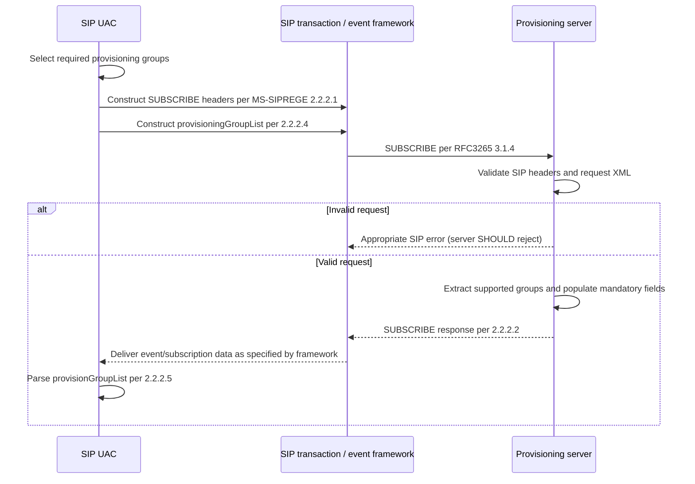

# MS-SIPREGE 17.1: confirmed in-band provisioning client and server state flow

Research date 2026-10-22. **Original full source:** user-provided `catalog/MS-SIPREGE.pdf` and matching extracted text, published v20250819 (134 pages); official https://learn.microsoft.com/en-us/openspecs/office_protocols/ms-siprege/21acf797-984c-48ce-97e3-c7df5c776b3d. Directly reviewed **§§3.3.1–3.3.2**, PDF pp.82–83, and **§3.4.1.5.1**, p.84, cross-referenced §§2.2.2.1–5. Full client and 151-document corpus analysis remains incomplete; no code or real-server tests.

## 1. Normative role-qualified requirement ledger

| ID | Normative location | Original processing rule, paraphrased | Confidence |
|---|---|---|---|
| PROV17-01 | §3.3.1 | User agent client sends a provisioning request enumerating requested configuration groups, awaits response and extracts group-specific parameters. | Direct original |
| PROV17-02 | §3.3.1.4 | Unless specified otherwise, processing follows **RFC 3265 §4.4.6**. Construct in-band provisioning request using SIP header syntax in **§2.2.2.1**, body in **§2.2.2.4**, then send SUBSCRIBE by **RFC 3265 §3.1.4**. | Direct original |
| PROV17-03 | §3.3.1.5 | Client processes groups from response according to **§2.2.2.5**. | Direct original |
| PROV17-04 | §§3.3.1.1–3, 3.3.1.6–7 | Client model, timer, initialization and local events sections explicitly state **None**. Do not invent provisioning-specific timers from this section; underlying RFC subscription behavior still needs analysis. | Direct original |
| PROV17-05 | §3.3.2.4.1 | Server validates incoming SUBSCRIBE headers against §2.2.2.1 and body against §2.2.2.4. Invalid input **SHOULD** result in appropriate SIP rejection, also invoking RFC 3265 §3.1.6.3 and RFC 3261 §8.2.6. | Direct original |
| PROV17-06 | §3.3.2.4.1 | Server **SHOULD** extract requested groups and construct output XML per §2.2.2.5 listing supported groups; **all mandatory parameters MUST be populated**. | Direct original |
| PROV17-07 | §3.3.2.4.1 | Server **SHOULD** form SUBSCRIBE response per §2.2.2.2. | Direct original |
| PROV17-08 | §3.4.1.5.1 | UAC includes a `User-Agent` in REGISTER following RFC 3261 §20.41, §24.1 and RFC 5234 ABNF. Product version shape: major.minor.build.qfe, build segment exactly four decimal digits. The old example is **not evidence** of the targeted client version. | Direct original |
| PROV17-09 | §§2.2.2.4–5 | Requested-group XML root is `provisioningGroupList` whereas returned-group XML root is `provisionGroupList`. Different structures and schema roles; cannot silently use one parser type. | Previously direct-checked original; cross-checked section reference |

## 2. Normative reference compatibility issue

**Important:** MS-SIPREGE revision 17.1 still directly cites **RFC 3265** for its provisioning SUBSCRIBE procedures. RFC 3265 has been superseded by **RFC 6665**, which changes SIP event-framework behaviors. One cannot replace every normative RFC 3265 reference with RFC 6665 without determining whether deployed Skype for Business clients/servers and the MS-SIPREGE edition follow older event semantics or negotiate updated behaviors. Record **both** published-spec profile and modern-updates profile, with explicit compatibility judgement and supporting clauses. See https://www.rfc-editor.org/rfc/rfc3265 and https://www.rfc-editor.org/rfc/rfc6665 .

## 3. Provisioning workflow reconstructed from directly cited clauses

**Scope of diagram:** the client construction, server validation and response-body processing edges follow §3.3; the exact placement of XML on SUBSCRIBE response vs NOTIFY/piggyback, acceptance of early NOTIFY, expiry and buffering rules require **independent review of §§2.2.2.1–3 and RFC 3265**, and must not be inferred from the simplified arrows. The RFC 3265 processing rule is normative to this published Microsoft edition despite RFC 6665's later obsolescence.

## 4. Combined registration/sign-in state boundaries (cross-spec inference)

The registration contact lease (RFC 3261 §10, MS-SIPREGE §3.1), provisioned groups (§3.3), negotiated SIP authentication association (MS-SIPAE §§3.2.4–3.2.5) and server/service availability are *separate* independent state dimensions. A positive REGISTER response alone does not assert that mandatory client provisioning groups are complete; an approved SUBSCRIBE transaction alone does not imply MIC verification or all provisioned policy values are semantically valid. Product version advertisement under §3.4 is another distinct compatibility dimension. These are architectural inferences requiring verification against original Windows Full Client behavior by the owner.

## 5. Remaining original source work

1. Extract full header grammar of §§2.2.2.1–2.2.2.3, XML/group schemas §§2.2.2.4–5, examples §4.2 with exact order, piggyback and NOTIFY behavior.
2. Resolve RFC 3265 vs RFC 6665 applicability for the client era and Microsoft extensions, including unexpected/early NOTIFY, Expires:0, subscription/dialog lifecycle and 4xx errors.
3. Read all MS-SIPREGE client/server registration state §§3.1–3.2, 3.4 version enforcement, refresh/unregister/deregistration NOTIFY, and survivable service branches.
4. Trace MS-SIPAE per-message authentication on provisioning SUBSCRIBE and protected server responses, especially replay and redirect/migration context.
5. Crosscheck Microsoft PDF product notes and other original protocols; complete target Windows client feature matrix.

**Status:** the client/server provisioning algorithm for §§3.3.1–3.3.2 is **now directly verified against the 2025 original**. Overall RFC/MS corpus and full client lifecycle **NOT COMPLETE**. No code, real-server tests, merge or release.
