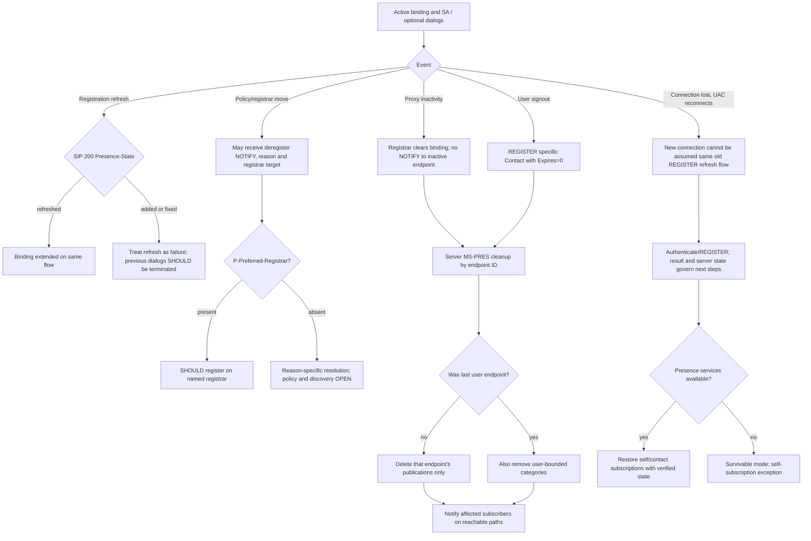

# Registration loss, survivable mode, multi-endpoint presence cleanup and SIP dialog-recovery boundary

**Source audit 2026-10-22 — research only, not client conformance certification.** Originals in owner's archive `catalog.zip`, visually inspected selected PDF pages:
- **[MS-SIPREGE] rev17.1, v20250819, 2025-08-19**, §§2.2.1.4,2.2.1.11–13,3.1.1–3.1.2.6,3.2–3.2.2.5,4.1.2–4.1.4; selected PDF **pp74–82 and pp95–96**.
- **[MS-PRES] rev13.0, v20250520, 2025-05-20**, §§3.2.5.5–5.1,3.2.6.1, **PDF pp93–94**.
- **[MS-CONMGMT] rev10.0, v20250520, 2025-05-20**, §§3.4.5–3.5.2, PDF pp17–20.
- **[MS-SIPAE] rev11.0, v20250520**, §3.2.6, and **[MS-SIPRE] rev13.0, v20250520**, §§3.7.2–3.7.6.
- IETF original **[RFC3261](https://www.rfc-editor.org/rfc/rfc3261)** (June 2002), §§10.2.2–10.2.4,10.3,12,15; **[RFC4028](https://www.rfc-editor.org/rfc/rfc4028)** (April 2005), §§7–10.

**Evidence classification:** P = original normative clause; R = original RFC; S = synthesis derived from several P/R; U = unverified client runtime/product behavior; H = guarded historical product note. All MUST/SHOULD obligations are scoped to original actor.

## A. Binding ownership, refresh and registrar state

| ID | Source | Exactly supported claim / transition |
|---|---|---|
| REGLOSS-01 | RFC3261 §10.2.2 | REGISTER with a specific Contact's `expires=0` removes **that binding**; `Contact: *` is permitted only with **`Expires: 0`** and removes *all* bindings of AoR. Multi-device full-client logout must not default to wildcard without explicitly intending to unregister other devices. |
| REGLOSS-02 | RFC3261 §§10.2.3–4 | REGISTER 2xx includes binding list; client updates **its own** binding expiry using Contact `expires` or Expires response, refreshes before timeout and SHOULD NOT refresh bindings established by other UAs. RFC recommends same Call-ID during boot cycle and same server address unless redirected. |
| REGLOSS-03 | MS-SIPREGE §3.1.1–3.1.1.3 | Microsoft profile wants EPID + SIP.INSTANCE determined before REGISTER and per-endpoint registration/security association with registrar. Source calls this **one active REGISTER dialog per selected EPID**, while generic RFC3261 registration is a **transaction/binding procedure, not an INVITE-style dialog**. This terminology difference must not be converted to RFC dialog rules without evidence. |
| REGLOSS-04 | MS-SIPREGE §3.1.1.5.1 | Client **MUST** obtain response expiry and set refresh timer **less than 200 OK duration**. Client **SHOULD** extract GRUU for later applicable dialogs and initialize a separately negotiated ms-keep-alive timer. |
| REGLOSS-05 | MS-SIPREGE §3.1.1.6 | During registration refresh Microsoft UAC **MUST use same TCP connection** used by its dialog-creating REGISTER. This differs from RFC3261's weaker same *server address* recommendation; a new TCP/TLS path after loss is therefore **not automatically a transparent refresh of original registered flow**. |
| REGLOSS-06 | MS-SIPREGE §3.1.2.5.1–6 | Registrar maps EPID and SIP.INSTANCE to endpoint, sets `Routable`, returns 200 with GRUU and optional Presence-State. On expiry registrar **MUST** remove binding and related binding state; SHOULD make endpoint non-routable. Keep-alive expiry SHOULD also remove binding. |
| REGLOSS-07 | MS-SIPREGE §3.1.2.5.1 | Registrar returning `Presence-State register-action=added` means new endpoint, `fixed` means reactivated stored endpoint/binding (Routable false→true), `refreshed` means existing binding refreshed. **Not all SIP 200 indicate preserving prior dialog state.** |
| REGLOSS-08 | MS-SIPREGE §3.1.1.5.1 | If registration **refresh** 200 includes `register-action=added` or `fixed`, UAC **MUST treat as registration failure**, existing dialogs **SHOULD be considered terminated**, and UAC **SHOULD restart registration**. `refreshed` is distinct. The text does **not** mandate identical treatment of normal *first* REGISTER `added`. |
| REGLOSS-09 | MS-SIPREGE §3.2.2.5 | On binding expiry, server has two permitted endpoint-ID retention models: keep identity `Routable=false` → later re-registration `fixed`, or remove identity → later `added`. Client MUST NOT assume previous GRUU/route is valid merely because user authenticated. |
| REGLOSS-10 | MS-SIPREGE §4.1.2 | Original wire example: authenticated REGISTER includes same explicit endpoint Contact, `+sip.instance`, `Event: registration` and `Expires: 0`; corresponding 200 confirms `Expires:0`. Example is **illustrative** and must not be mistaken for Contact:* mandatory syntax. |

## B. Server-initiated deregistration versus unreachable transport

| ID | Clause | Normative and profile meaning |
|---|---|---|
| REGLOSS-11 | MS-SIPREGE §§2.2.1.11.1–4 | Server **deregister NOTIFY** uses exactly one `Subscription-State: terminated;expires=0` and `Event: registration-notify`, plus `Content-Type: text/registration-event`; server SHOULD include one `ms-diagnostics-public`. **Not a newly defined RFC3265 event subscription package**, even though an Event header is present. |
| REGLOSS-12 | MS-SIPREGE §2.2.1.12 | **Survivable-mode NOTIFY** uses `Subscription-State: active;expires=<remaining registration lifetime>`, same registration-notify Event and `text/registration-event`. Different from terminated deregistration and from ordinary MS-PRES category subscription state. |
| REGLOSS-13 | MS-SIPREGE §2.2.1.13,§3.2 | Registration event body possibilities: `deregistered;event=unregistered` (endpoint quota, ErrorId 4140), `rejected` (disabled, 4141), `deactivated` (moving servers, 4142), `preferred-registrar-change` and `userservices-unavailable`; specific codes for latter in §2.2.1.13. Whitespace SHOULD be ignored by UAC. These distinctions affect retry versus policy failure. |
| REGLOSS-14 | MS-SIPREGE §§3.2.1.5,3.2.2.4–5 | On NOTIFY with `P-Preferred-Registrar`, UAC **SHOULD attempt registration to the named registrar**. Server, if sending deregister NOTIFY, **MUST send only to affected endpoint** and reuse tags plus last REGISTER Call-ID and local CSeq as source specifies. This is not a broadcast to all devices. |
| REGLOSS-15 | MS-SIPREGE §3.2 | Registrar **SHOULD** inform reachable UAC when premature binding removal is needed, **not MUST in every case**. Old **Communicator 2007/R2** behavior in §6 product notes <166>–<167> does **not** support some UAC deregistration processing; capability/edition conditional. |
| REGLOSS-16 | MS-CONMGMT §3.4.6 | If a proxy/registrar marks connection inactive via keepalive expiry, it SHOULD remove endpoint/binding and SHOULD close channel, but **MUST NOT send deregister NOTIFY to that inactive endpoint** (not expected to answer). Hence lack of NOTIFY is **not evidence of still-valid registration**. |
| REGLOSS-17 | MS-CONMGMT §§3.5.2–3.5.5 | Proxy has separate **connection timer** (default recommendation 32 sec until successful transaction) and **idle timer** (recommendation 15min32sec when no traffic). These timers are **proxy-side**, distinct from client REGISTER refresh, optional ms-keep-alive refresh and RFC4028 call expiration. |

## C. Presence and survivable-mode interplay

| ID | Exact primary | State boundary |
|---|---|---|
| REGLOSS-18 | MS-SIPREGE §3.1.1.5.1 | `Presence-State user-services-state=unavailable` → client SHOULD mark Presence-Service-Available=false. If absent → SHOULD set true. `primary-cluster-type` central/remote and `is-connected-to-primary` yes/no are **distinct** topology indicators, not a Boolean equivalent to registration success. |
| REGLOSS-19 | §3.1.1.5.1 | After first 200 UAC SHOULD establish contact/group subscription and self-subscription. With Presence-Service-Available=false, UAC SHOULD treat itself as **survivable mode** and **SHOULD NOT establish subscriptions except self-subscription**. Registration success ≠ full service availability. |
| REGLOSS-20 | §3.1.1.5.1 | If self-subscription cannot be established UAC SHOULD remove binding by REGISTER `Expires:0`; if non-survivable failure SHOULD retry self-subscription at randomized interval, but in survivable mode SHOULD defer retry until mode ends. These source recommendations need product-note precedence and higher-layer policy reconciliation; **do not claim a single unconditional retry path**. |
| REGLOSS-21 | MS-PRES §3.2.5.5 | Deregistration/expiry of **one endpoint** deletes only its `expireType=endpoint` category instances based on `+sip.instance` UUID, then server **MUST notify affected self and category subscribers** by ordinary NOTIFY or negotiated BENOTIFY. Does not erase publications of other endpoints. |
| REGLOSS-22 | MS-PRES §3.2.5.5.1 | Deregistration of **last endpoint for user** additionally deletes **user-bound** category instances and that endpoint's endpoint-bound instances and MUST notify affected category subscribers. `Last` condition must not be assumed when just one device disconnects. |
| REGLOSS-23 | MS-PRES §3.2.6.1 | Expiration of **time-bound** categories is a **separate publication cleanup timer**, deleting stale `expireType=time` categories and notifying affected subscribers, even with a live REGISTER binding. |
| REGLOSS-24 | MS-PRES §3.2.5.6 | Container **state/services** updates in containers 2 and 3 trigger aggregation (§3.8), e.g. device state removed. Published presence visible to subscriber may change after binding cleanup; not necessarily an unconditional offline value. |

### Cross-spec conditional state machine (S, **not** an official canonical trace)

**Explicit caveat:** separate independent server events may execute concurrently, including SIP 200 and notification delivery; steps are grouped by condition rather than asserting deterministic per-packet ordering. A silent transport break is **not** a clean REGISTER Expires=0. A server can drop unreachable registration without a NOTIFY; a different surviving device may still have active dialog and publisher state.

## D. Dialog recovery and session-timer junction: separate from registrar state

| ID | Source | Proven transition |
|---|---|---|
| REGLOSS-25 | MS-SIPRE §3.7.3–6 | Recovery-aware dialog requests advertise `Supported: Ms-Dialog-Route-Set-Update`. Valuable INVITE/media dialogs SHOULD use recovery; replaceable presence subscription dialogs SHOULD NOT. If proxy returns **SIP 430 Flow Failed** with `P-Dialog-Recovery-Action`, target refresh (`UPDATE` for INVITE, `SUBSCRIBE` for subscription) and route-set updates apply per source, sometimes requiring REGISTER first. |
| REGLOSS-26 | RFC4028 §10 | Only **2xx** to session refresh extends negotiated session expiration; timeout or **408/481** for refresh requires refresher UAC to send **BYE**. Other failures should follow response code semantics/retry if possible. This is not a rule that registration 401/423 or STUN/TURN 430 ends SIP dialog. |
| REGLOSS-27 | MS-SIPAE §3.2.6 | SA-expiration forces new SA negotiation (REGISTER without Authorization preferred); old expired SA can remain for default INVITE Timer B/non-INVITE Timer F transaction lifetime 32s if renegotiation fails. Do not infer fresh SA proves old route set usable. |
| REGLOSS-28 | MS-ICE2 §3.1.6.5 | Media consent expiry **SHOULD** terminate that media session and ignore late STUN responses; says **nothing** about automatically deregistering user or forcing a global logout. |
| REGLOSS-29 | MS-OCSPROT §2.5.15 | Normal active voice-call termination is SIP **BYE** routed via server, peer responds; thereafter media stopped and Edge media ports should be deallocated. This is **different** from a transport break that precludes delivery of BYE. |

## E. Blocking unresolved editions and conflicts

1. **Terminology:** MS-SIPREGE mentions "REGISTER dialog" while RFC3261 is REGISTER transaction/binding, and MS-SIPRE §3.7 operates on actual INVITE/SUBSCRIBE dialogs. Keep them distinct in any subsequent diagram.
2. **Same TCP connection rule:** exact safe recovery after physical TLS connection loss, changed cert/registrar, new EPID/GRUU, and transaction retry is **not fully specified** by these sections. Do not simply force 'refresh' after reconnect.
3. **User-services failed self-subscription:** the same §3.1.1.5.1 both recommends deregistration and prescribes randomized/deferred retries; need product notes/higher-layer priority to build a coherent branch.
4. **Registration-notify** syntax is a **Microsoft-specific non-event-package use** of RFC3265-style fields; **RFC6665/7621 modern interpretation** requires edition profile and should not be imposed automatically.
5. **Server role exception:** MS-CONMGMT's no-NOTIFY rule applies to the **inaccessible endpoint**, while MS-PRES notification about publication changes goes to **affected subscribers**, including another reachable endpoint. No contradiction.
6. **Prior Call-ID, tags, CSeq:** server-issued NOTIFY reuse must be checked with all router and SIPAE MIC verification rules before accepting an unsolicited registration-control notification.
7. **Multidevice signout:** no single original cited section mandates order of leaving all IM/call/conference dialogs, ending contact/presence subscriptions, freeing Edge TURN allocations and sending REGISTER Expires:0. **Research gap**, not a mandated packet sequence.
8. **QoE after call** is independent optional use case; see pending companion QoE original specification analysis for accepted/error status.

**Research NOT COMPLETE. No protocol implementation, live servers or owner interoperability testing, merge to main or release.**
