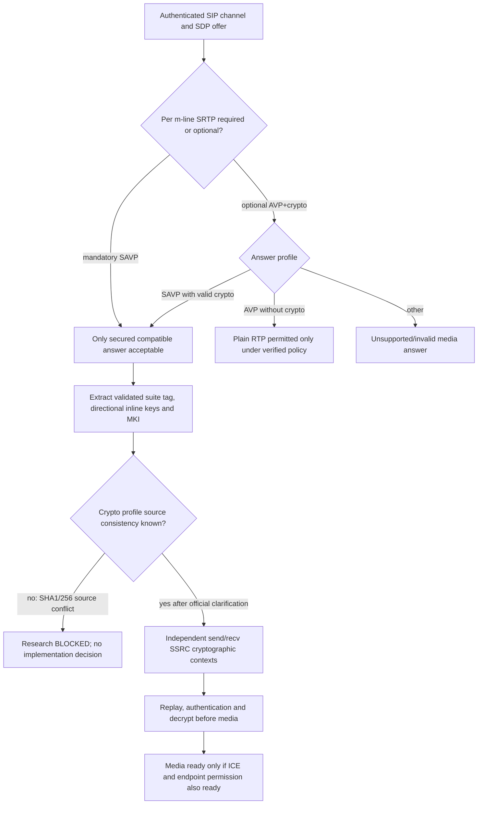

# SRTP SHA-1 / SHA-256 norm conflict: primary PDF, RFC and historical-edition audit

**Research date 2026-10-23. Status: BLOCKED. This is a source reconciliation, NOT a selected crypto design, implementation or interop test.**

## Original evidence and edition provenance

- **[MS-SDPEXT] rev 16.0, v20250520, Microsoft 2025-05-20**, official original https://officeprotocoldocs-f5hpbjgea6b8gneq.b02.azurefd.net/files/MS-SDPEXT/%5BMS-SDPEXT%5D.pdf ; SHA-256 `83a151015e74ccadd7e14e856cd0967fcb64eb3c30c167f3638fa0d50edfcdb2`. Direct §§1.3,3.1.5.1–3.1.5.2,3.1.5.8 and SDP examples. Original PDF pp19/20/21/25/26 rendered and checked.
- **[MS-SRTP] rev 14.0, v20250520, Microsoft 2025-05-20**, official original https://officeprotocoldocs-f5hpbjgea6b8gneq.b02.azurefd.net/files/MS-SRTP/%5BMS-SRTP%5D.pdf ; SHA-256 `1e6e706604da2f1925568c27fedfeca9d2283383685979e33d7116f994cb363d`. Direct §§1.3–1.7,3.1.1–3.1.6,5; PDF pp10–13 rendered, especially p12 where SHA-256 statement visibly confirmed.
- **[MS-SSRTP] rev 11.1, v20250916, Microsoft 2025-09-16 (Minor update after May major)**, official original https://officeprotocoldocs-f5hpbjgea6b8gneq.b02.azurefd.net/files/MS-SSRTP/%5BMS-SSRTP%5D.pdf ; SHA-256 `a9d20e69afe73ba3bb85ed4073ecb78c42b3eb0a5ddc16c1fc86ef37acb979a3`. Direct §§3.1.3.1–3.1.3.3.2,3.1.5.1.1–3.1.5.1.3.2,4.1; PDF pp14/15/16/18 rendered, p15 confirms SHA-1.
- **[RFC3711](https://www.rfc-editor.org/rfc/rfc3711)** March 2004 §§3.2,4.2,4.2.1,4.3,5.2,9.5; **[RFC4568](https://www.rfc-editor.org/rfc/rfc4568)** July 2006 §§4,5,6.1,6.2.1 and §7; **[RFC2104](https://www.rfc-editor.org/rfc/rfc2104)** HMAC (February 1997). Later RFC3711 updates RFC5506, RFC6904, RFC9335 are listed by RFC Editor but not evidence of historical SfB transform replacement. Optional RFC4568 plaintext protection is an explicit security caveat.

Evidence class **P** exact source edition/clause, **R** RFC original, **S** justified cross-document comparison, **U** unsolved. Client/media peer != ASMCU/media server; word MUST retained only for original actor.

## Clause-by-clause forensic discrepancy

| ID | Edition / section | Direct fact and consequence |
|---|---|---|
| SR-X01 | MS-SDPEXT rev16 §3.1.5.1 | Its only supported crypto-suite for `a=crypto` is **`AES_CM_128_HMAC_SHA1_80`** (MUST). This is a semantic wire algorithm identifier, not merely a user-facing cipher label. |
| SR-X02 | RFC4568 §§4.2,6.2.1 | That named suite **defines HMAC-SHA-1**, 160-bit SRTP authentication key and 80-bit tag. No RFC4568 definition permits silently substituting HMAC-SHA-256 under the same token. |
| SR-X03 | RFC3711 §§4.2.1,5.2 | Base SRTP default HMAC **SHA-1**; 160-bit key, 80-bit tag, AES-CM-128 default plus 112-bit salt. RFC3711's general transform framework permits extensions but requires a real mutually agreed transform/profile. |
| SR-X04 | MS-SRTP rev14 §§3.1.3.2,3.1.3.3.2 | This **2025 original** twice **MUST** describes authentication as **HMAC-SHA-256**, while retaining 160-bit authentication key and 80-bit tag. This is an explicit normative algorithm difference; key/tag lengths do not identify digest function. |
| SR-X05 | MS-SRTP rev14 §3.1.3.3.2 versus RFC3711 §4.2 | Its sentence calls HMAC-SHA-256 'the SRTP default' 'as specified in RFC3711 §4.2'; RFC3711 §4.2.1 specifies HMAC-SHA-1. Thus there is an **internal false attribution to an RFC**, besides the cross-Microsoft SDP conflict. |
| SR-X06 | MS-SSRTP rev11.1 §3.1.3.2 | Says packets inheriting MS-SRTP state **MUST have same settings**, but its own enumerated authentication algorithm is **HMAC-SHA-1**, while source MS-SRTP rev14 says SHA-256. Treat as **cross-spec inherited-setting contradiction unless an explicitly described override applies**. |
| SR-X07 | MS-SSRTP rev11.1 §3.1.3.3.2 | Again explicitly uses **HMAC-SHA-1** with 160-bit key, 80-bit tag, and a **different authenticated portion** for SSRTP; do not assume raw standard SRTP HMAC input or SRTP SHA-256. |
| SR-X08 | MS-SDPEXT rev16 §3.1.5.2 | `a=cryptoscale` extends `a=crypto` using `client|server` flavor, but **inherits same crypto-suite constraints**. The only described suite also says SHA1, agreeing with MS-SSRTP but not MS-SRTP. |
| SR-X09 | MS-SRTP rev14 §3.1.3.2 | Other common parameter settings: 64-entry replay, required MKI 1 byte, KDR zero, 128-bit master key, 112-bit salt, directional crypto contexts with SSRC-specific rollover/replay states. These common numeric settings **do not resolve the digest discrepancy**. |
| SR-X10 | MS-SRTP rev14 §§3.1.5.1–3.1.5.2 | Requires encrypted/authenticated RTP and RTCP, with **SRTCP receiving even when E-bit=0 requiring encrypted packet**, and shared SRTCP index among streams per direction. No 'fall back to no authentication' branch is evidenced. |
| SR-X11 | MS-SRTP rev14 §5.1 | Each send and receive direction uses **different master keys**. SDP carries master key; SIP/TLS path must protect it; a valid signaling exchange alone cannot prove secure media. Source explicitly warns replay failures do not necessarily terminate RTP, because duplicates can be expected for some media. |
| SR-X12 | MS-SSRTP rev11.1 §3.1.3.1 | Same directional/SSRC split; SSRTP adds ESN for media encryption, not a replacement for standard per-SSRC RTP packet index replay semantics. |
| SR-X13 | MS-CONFAV rev11 §4.2 example | Actual **Microsoft example SDP** offers `a=cryptoscale:1 client AES_CM_128_HMAC_SHA1_80` and `a=crypto:2 AES_CM_128_HMAC_SHA1_80` in same conference media INVITE; reinforces cross-spec SHA-1 suite selection. Example shows historical OC/2.0 user agent, hence **illustrative, not proof of current Windows runtime implementation**. |
| SR-X14 | [Archived MS-SRTP 2018 search result](https://msopenspecs.microsoft.com/files/MS-SRTP/%5BMS-SRTP%5D-180724.pdf) | Indexed excerpt shows SHA-1 in a 2018 original document, **but full historical PDF could not yet be fetched/screenshot-audited**. Mark **H/unverified archival clue**, not a verified 2018 edition diff or explanation for 2025 text. The rev14 change history labels 2025 update 'Major'; no source states which clause actually changed. |
| SR-X15 | MS-SDPEXT rev16 §3.1.5.1 | `a=crypto` ABNF requires single WSP, no HTAB; tag **unique across crypto and cryptoscale**, inline key method; **session-param forbidden**, one key-params allowed per attribute; SDP offered lifetime `2^31`, incoming value ignored in favor of `2^31`, MKI SHOULD included and if used exactly 1 byte. |
| SR-X16 | RFC4568 §6.2.1 | Base64 decoded key+salt for suite must contain **30 bytes** (16 key +14 salt). SDP MS-SDPEXT same key-field profile, but no proof of alternative SHA-256 suite declaration or wire negotiation. |
| SR-X17 | MS-SDPEXT rev16 §3.1.5.8 | For **optional** encryption, MS extension uses `RTP/AVP` with `a=crypto` or `a=cryptoscale`; accepted secured answer uses `RTP/SAVP`, declined secured answer uses `RTP/AVP` without crypto. This is an explicitly **permitted downgrade when media policy allows optional**; **not a reason to downgrade a mandatory secure-media offer**. |
| SR-X18 | MS-RTASPF rev10 §1.5–1.6 | For RTP-carried RDP sharing, **inner RDP encryption disabled** but **outer SRTP required**; the unresolved authentication transform has critical implications for screen-sharing confidentiality and integrity, not only voice. See independent original [RDP sharing source audit](ms-rtaspf10-rdpemc2024-sharing-payload-encomsp-control-security-2026-10-23.md). |

## Normative collision: exact table of sources

| Layer | Clause | Advertised/default digest | Strength of evidence |
|---|---|---|---|
| RTP/SAVP SDP suite semantics | RFC4568 §6.2.1 | HMAC-SHA-1 | RFC normative definition |
| Skype SDP extension `a=crypto` | MS-SDPEXT rev16 §3.1.5.1 | HMAC-SHA-1 suite token | Microsoft MUST |
| Skype SSRTP SDP `a=cryptoscale` | MS-SDPEXT rev16 §3.1.5.2 | Inherits HMAC-SHA-1 suite | Microsoft MUST |
| Skype SRTP profile | MS-SRTP rev14 §§3.1.3.2/.3.3.2 | **HMAC-SHA-256** | Microsoft MUST, contradictory |
| Skype SSRTP profile | MS-SSRTP rev11.1 §§3.1.3.2/.3.3.2 | HMAC-SHA-1 | Microsoft MUST, contrary to inherited 2025 SRTP setting |
| Conference AV SDP example | MS-CONFAV rev11 §4.2 | HMAC-SHA-1 suite | Illustrative, not normative deployment capability |
| Existing product runtime | Specific Windows build and server | **UNKNOWN** | No user-run interoperability evidence, no edition-specific precedence proof |

**Not a resolution:** (1) changing the meaning of the SHA1_80 token to SHA256; (2) trusting matching 160/80 bit lengths; (3) replacing SHA256 source line with assumed editorial typo; (4) silently selecting non-standard cipher or disabling SRTP to achieve compatibility. Nor does *generic* Microsoft security guidance recommending SHA2 override the specific Microsoft Open Specification.

## Cross-protocol media-authentication fault model (S, not packet recipe)

## Official clarification required to close this issue

1. Microsoft Open Specifications **official errata/support clarification** for MS-SRTP rev14 §§3.1.3.2 and 3.1.3.3.2 vs MS-SDPEXT rev16 §3.1.5.1 and MS-SSRTP rev11.1 §§3.1.3.2/3.1.3.3.2; ask whether SHA-256 text is intentional and if so **which authenticated suite identifier and key derivation/tag semantics** apply. Research-only; no external support request has been sent.
2. Retrieve and compare historical official MS-SRTP **rev13 v20240820** and rev14 v20250520 plus MS-SDPEXT rev15 vs rev16 and MS-SSRTP rev11.0 vs rev11.1 with **side-by-side source clauses**, not the unverified search excerpt.
3. Determine exact **Windows Full Client build** and deployed peer, MCU, Edge media versions, applicable product behavior notes and crypto allow-list (user-run testing only if user later chooses). No assistant wire captures/server access.
4. Confirm whether SRTP and SSRTP different hash transforms are explicitly negotiated separately by some **other** Microsoft source and whether that resolves inheritance claim, before any selection.
5. Complete secure RTP **replay/ROC/SSRC, RTCP SRTCP E-bit, MKI and lifetime** clauses and malformed SDP trust boundary, including conditional plaintext AVP use in trusted topology; no universal always-encrypted declaration where SDPEXT §3.1.5.8 allows optional negotiation.

**Research status: original normative contradiction VERIFIED; authoritative resolution NOT FOUND. Implementations, deployment, live-server tests, merge and release remain prohibited.**
