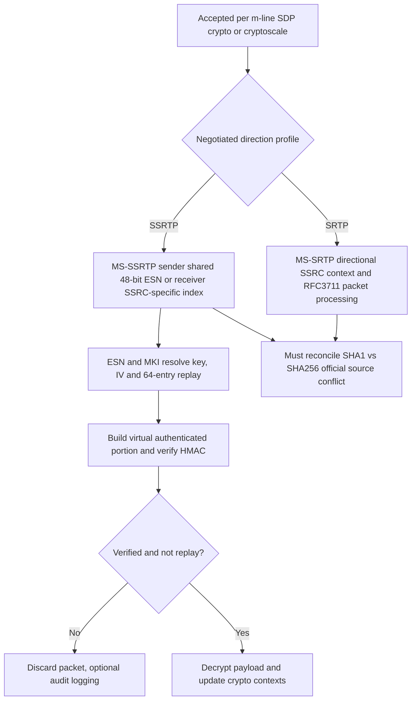

# MS-SSRTP 11.1 — 48-bit ESN, authenticated virtual packet, replay/SSRC and SDP directional flavors

**Original-source audit 2026-10-23; no implementation code or runtime test.** Microsoft **[MS-SSRTP] rev11.1 v20250916** released 2025-09-16, PDF SHA-256 `a9d20e69afe73ba3bb85ed4073ecb78c42b3eb0a5ddc16c1fc86ef37acb979a3`; official https://officeprotocoldocs-f5hpbjgea6b8gneq.b02.azurefd.net/files/MS-SSRTP/%5BMS-SSRTP%5D.pdf ; original §§1.3–1.7,2.2.1–2.2.2,3.1.1–3.1.7,4.1–4.2 visually crosschecked PDF pp11,14,15,16,18; rev11.1 September minor update supersedes May rev11.0. [MS-SDPEXT] rev16 §3.1.5.1–2.2, [MS-SRTP] rev14 §§3.1.3,3.1.5, [RFC3711](https://www.rfc-editor.org/rfc/rfc3711) §§3–5, [RFC3550](https://www.rfc-editor.org/rfc/rfc3550) §§5–6, [RFC4568](https://www.rfc-editor.org/rfc/rfc4568) §6.2.1. Evidence **P** = original direct clause; **R** original RFC; **S** cross-protocol reconciliation, **U** unproven client profile.

## A. Actual on-wire representation versus virtual authenticated data

| ID | Original section | Precisely documented field and processing rule |
|---|---|---|
| SCALE-01 | §§1.3,2.1–2.2.1 | SSRTP extends RTP/SRTP with **Encryption Sequence Number (ESN)** to allow encryption across media sources. It transforms RTP payload data only, whereas RTCP uses standard SRTCP layout. This is neither SIP CSeq nor ICE transaction ID. |
| SCALE-02 | §2.2.1 | On-wire order: ordinary RTP header/CSRC/extensions/encrypted payload + padding, **ESN field (6 octets)** + **MKI (1 octet)** + **authentication tag (10 octets)**. Standard RTP fields remain in normal RTP layout; the ESN, MKI and tag are protocol-specific trailer. |
| SCALE-03 | §2.2.1, PDF p11 | ESN is **48-bit unsigned network-byte-order** integer. No alignment padding required; initial ESN selected independently of RTP sequence number and need **not be contiguous** among different SSRTP streams. ESN is added only to RTP, not RTCP. |
| SCALE-04 | §2.2.1.1 | The **encrypted portion** includes RTP payload, RTP padding and RTP padding-count field, not RTP header/SSRC. The separate ESN field is part of SRTP-related trailer and also used in IV construction. |
| SCALE-05 | §2.2.1.2 | Authentication uses **reordered (virtual) packet** built from RTP fields in a special sequence and adds **rollover counter**. This authenticated-field rearrangement is **NOT on-wire field reordering**. A generic HMAC computed over raw RTP byte layout would not reproduce required SSRTP authentication even with same digest and keys. |
| SCALE-06 | §§3.1.1,3.1.3.1 | Two cryptographic contexts per SSRTP session (**send** and **receive**), SSRC-specific packet-index/ROC/replay state within direction. **ESN sender counter shared** across all media streams using one crypto context, but receiver also tracks most recently received ESN per SSRC to estimate packet index. |
| SCALE-07 | §3.1.3.2 | Initial ESN **MUST be random within 0..2^47−1**; highest bit **SHOULD** be zero to avoid early wrap. Distinct encrypted content protected by same master key **MUST NOT reuse ESN** (§3.1.5.1.2). Repetition can lead to AES counter-IV reuse. |
| SCALE-08 | §3.1.5.1.3.1 step 2 | Sender increments ESN; if its **low 8 bits become 0**, increment once more (skip values with trailing zero octet). Sequence increment is global **per sending cryptographic context**, not per SSRC. |
| SCALE-09 | §3.1.5.1.2 | SSRTP AES-CM IV: **`IV = (k_s * 2^16) XOR ((ESN >> 16) * 2^64) XOR (ESN * 2^16)`**. This substitutes ESN-based construction for ordinary RFC3711 packet-index IV rules; key+IV reuse under same master key is forbidden. |
| SCALE-10 | §3.1.3.2 | SSRTP retains **64-entry replay list**, mandatory one-byte MKI, zero key-derivation rate, 128-bit AES master key, 112-bit salt, 160-bit authentication key, 80-bit tag, per-SSRC ROC/sequence number. Same numeric settings do not imply same authenticated-data layout or digest as MS-SRTP 2025. |
| SCALE-11 | §§3.1.3.2,3.1.3.3.2 | Explicit **HMAC-SHA-1** authentication, despite statement that inherited MS-SRTP parameters **MUST be the same**; original MS-SRTP rev14 says **HMAC-SHA-256**. This is a normative cross-Microsoft collision, detailed in [forensic digest ledger](ms-srtp14-sdpext16-ssrtp11-sha1-sha256-original-normative-conflict-2026-10-23.md). |
| SCALE-12 | §3.1.5.1.3.1 | Sender resolves direction/SSRC context then MKI/master key; derives keys under RFC3711 §4.3; **encrypts payload**, appends **ESN**, **MKI**, and finally **10-byte auth tag** over virtual authenticated portion with ROC. No branch for null authentication/encryption defined. |
| SCALE-13 | §3.1.5.1.3.2 | Receiver extracts ESN, estimates packet index/ROC using per-SSRC state, chooses master key by **MKI**, checks replay, verifies HMAC, then decrypts. Failed replay/MIC => packet **MUST discard**; logging **SHOULD**. Only verified packets advance context state. |
| SCALE-14 | §3.1.5.2 | **SSRTCP** uses same processing as MS-SRTP ordinary SRTCP (§3.1.5.2), not the SSRTP 48-bit ESN trailer. MS-SRTP receive SRTCP **requires encryption regardless of E-bit**; verify relevant spec precedence for authentication hash. |
| SCALE-15 | §§3.1.2,3.1.6 | **No new SSRTP timers**. Do not collapse ICE 30s consent, RTCP sender reports, SIP session timer and crypto replay window into an artificial SSRTP expiration clock. |
| SCALE-16 | §§4.1–4.2 | Microsoft provides fixed **test vectors**: example 16-byte master key, 14-byte salt, 20-byte authentication key, ESN `5E1A32368001` and ROC `00000002` and encrypted 142-byte payload. These vectors are **source evidence**; no execution/tests were performed by assistant. The document omits RTCP example deliberately, referring to ordinary SRTCP. |

## B. One conference mode can negotiate directionally different transports

**MS-SDPEXT rev16 §3.1.5.2.1** has combinations:
- `a=crypto` offer and `a=crypto` answer: SRTP both directions.
- **Client** flavor SSRTP offer answered **Server** flavor: offerer→answerer **SRTP**, reverse **SSRTP**.
- **Server** flavor SSRTP offer answered **Client** flavor: offerer→answerer **SSRTP**, reverse **SRTP**.

These are source-level media direction *asymmetries* and distinct from client SIP UAC versus media MCU UAS role. **Only one flavor per offer** (MUST), client/server SSRTP variants cannot both appear in same SDP offer. A recipient decoding a packet must know its **negotiated per-direction mode**; it cannot decide simply from presence of an ESN-shaped ending without authentication.

**S graph:** crypto algorithm conflict is *not* a currently implemented branch; it is a source resolution blocker. The diagram does not claim automatic media fallback to unencrypted AVP or security recovery after packet loss.

## C. Source contradictions, protocol security and unresolved work

- **SCALE-G01:** Same master key across multiple SSRTP streams requires **globally unique ESN for differing content** or AES-CTR keystream reuse; per SSRC-only sequence increment is incompatible with the source.
- **SCALE-G02:** RFC3711 64-bit (ROC||16-bit seq) packet index for replay remains conceptually independent of SSRTP 48-bit ESN used for encryption IV. Need byte-accurate virtual authenticated layout (all header extensions, CSRC/padding) before crypto claim.
- **SCALE-G03:** MS-SRTP rev14 SHA256 / MS-SSRTP rev11.1 SHA1 inheritance problem unresolved; no source-supported negotiated SHA256 suite in SDPEXT rev16.
- **SCALE-G04:** RTCP encrypted regardless of E-bit in MS-SRTP; if authenticated hash must differ from SSRTP RTP HMAC it would create yet another unsignaled transform. Do not assume.
- **SCALE-G05:** Full SDP crypto key confidentiality, 1-byte MKI, invalid MKI, master-key lifetime, ESN wrap, ROC initial packet loss and replay state across ICE path changes still need exact RFC3711 + Microsoft product-era verification.
- **SCALE-G06:** Distinguish packet replay failures from network loss (no auto BYE) and ICE consent expiration (media session termination SHOULD per MS-ICE2). No unilateral SIP REGISTER signout.
- **SCALE-G07:** Test vectors not executed because no implementation or assistant interoperability/testing is authorized. The original expected 142-byte ciphertext/tag can be used **only in later owner-approved tests after the research and implementation gates are satisfied**.

**Research-only. Overall Windows Full Client normative reconstruction INCOMPLETE; no protocol code, actual server traffic, interop tests, merge or release.**
