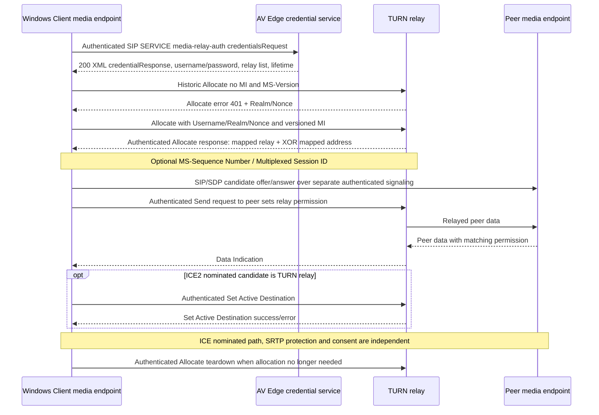

# Legacy Microsoft TURN 21.0 and A/V Edge credential issuance 12.0: exact framing, authenticated allocation and relay security

**Original-source audit: 2026-10-23; NOT an interoperability-tested or implementation-ready profile.** Owner-original **[MS-TURN] Traversal Using Relay NAT Extensions, rev21.0 v20250520**, SHA-256 `9548b9d59916b50569e685afd43e0f8e9ada9c965c7c06decd665411b795743e`, [Microsoft official PDF](https://officeprotocoldocs-f5hpbjgea6b8gneq.b02.azurefd.net/files/MS-TURN/%5BMS-TURN%5D.pdf) §§2.1–2.2.3,3.1.8–3.1.12,3.2.2–3.2.6. **[MS-AVEDGEA] Audio Video Edge Authentication, rev12.0 v20250520**, SHA-256 `baa3cddc1e1bfb4b0c2b0a998c71b802f80d4e5e6bb30adc0d8d42ebbbb0c8ff`, [Microsoft official PDF](https://officeprotocoldocs-f5hpbjgea6b8gneq.b02.azurefd.net/files/MS-AVEDGEA/%5BMS-AVEDGEA%5D.pdf) §§3.1.5.1–3.1.5.7. PDFs visually rendered MS-TURN pp41–42 and MS-AVEDGEA p22. Upstream [MS-ICE2] rev19 §§3.1.4.6–.7,3.1.4.8 and [MS-SIPAE] rev11 SIP signature auth context. IETF originals **[RFC3489](https://www.rfc-editor.org/rfc/rfc3489)** historical STUN (obsoleted by [RFC5389](https://www.rfc-editor.org/rfc/rfc5389), itself obsoleted by [RFC8489](https://www.rfc-editor.org/rfc/rfc8489)), **[RFC5766](https://www.rfc-editor.org/rfc/rfc5766)** TURN (obsoleted by **[RFC8656](https://www.rfc-editor.org/rfc/rfc8656)**). **Critical Microsoft reference:** `IETFDRAFT-TURN-08` = historical *draft-rosenberg-midcom-turn-08*, and `IETFDRAFT-STUN-02` — **not** RFC8656 wire syntax. First-party Microsoft [message header](https://learn.microsoft.com/en-us/openspecs/office_protocols/ms-turn/8177788b-1f38-47a5-8a6f-348e89717922), [Overview](https://learn.microsoft.com/en-us/openspecs/office_protocols/ms-turn/bf1e2a02-4f6e-4975-b83c-74018546b387). **P**=direct original protocol clause, **R**=RFC edition, **S**=cross-layer reasoned statement, **U**=unverified product topology/role. All MUST/MAY rules are source- and role-scoped.

## 1. Relay access credentials come from a separate trusted signaling service

| ID | Source | Verified actor and trust boundary |
|---|---|---|
| TURN-A01 | MS-AVEDGEA §3.1.5.1 | Credential service receives **authenticated SIP SERVICE**, **Content-Type `application/msrtc-media-relay-auth+xml`**. Non-SERVICE → **501 UnsupportedMessageType**; wrong MIME → **415 UnsupportedContentType** and `Accept` header. These errors omit XML body; later schema/policy errors include XML `reasonPhrase`. |
| TURN-A02 | §§3.1.5.3–3.1.5.4 | Server validates XML `from`, `to` as SIP URIs, correlates **requestID**; for each `credentialsRequest` creates `credentialResponse` echoing **credentialsRequestID**. This correlation is **not** SIP Call-ID, ICE ufrag or TURN Transaction ID. |
| TURN-A03 | §3.1.5.4 | Credential **lifetime = min(requested duration, server configured default)** when requested, otherwise server default. Username and password token values created from service identity/time and **Base64-encoded** into response XML; Base64 is **not encryption**. |
| TURN-A04 | §§3.1.5.4,3.1.5.7 | A/V Edge credential service and associated TURN server **share two secret keys** used to generate/verify client-issued username/password tokens. These are **not** client SIPAE signing keys, SDP SRTP master keys or historical TURN long-term public password. |
| TURN-A05 | §3.1.5.4 | Response `mediaRelayList` narrowed by requested `location` (intranet vs Internet), otherwise includes both. Route mode `directip` requires directIPAddress (v4/v6); `loadbalanced` or missing requires `hostName`. A relay address is a candidate transport, not authenticated evidence of ICE nomination or media consent. |
| TURN-A06 | §3.1.5.6 | Credential service statuses: **200 OK**, **400 Request Malformed**, **403 Forbidden**, **413 Request Too Large**, **500 Internal Server Error**, **501 Version Mismatch**; **415 wrong MIME** and **501 wrong method** without XML. Some listed 408/486/501 Not Supported variants explicitly marked **not in use**. |
| TURN-A07 | §3.1.5.7 | Token username construction incorporates lifetime and requested identity; exact user identity and expiry must match server validation. **Do not infer** that a client can choose arbitrary other user identity without auth policy; server policy/authorized issuance rules are separate from token shape. |

## 2. TURN framing/transport selection, not standard STUN 5389

| ID | Source | Verified requirement |
|---|---|---|
| TURN-W01 | MS-TURN §2.1 | UDP IPv4/v6 carries raw protocol datagram, **no TCP-style prefix**. TCP variant uses extra framing; deployed TURN can listen **TCP 443**, with optional **pseudo-TLS**, standard **TLS**, or **HTTPS encapsulation** as distinct modes. |
| TURN-W02 | §2.1.1 | **Pseudo-TLS** begins ClientHello-shaped bytes and gets ServerHello+ServerHelloDone-shaped bytes using RFC2246/TLS1.0 record-looking headers. This is explicitly called **pseudo-TLS**, not documented as a completed TLS certificate/key exchange; **MUST NOT infer authenticated encryption or server certificate identity from the camouflage alone**. Separate §2.1.2 supports actual TLS over TCP with cryptographic parameter negotiation. |
| TURN-W03 | §§2.1.2–2.1.4 | Actual **TLS over TCP** may use RFC2246/4346/5246; **HTTPS over TCP** is a distinct optional encapsulation. For ordinary TCP TURN messages/data there is a **4-byte framing header:** Type byte **0x02** TURN control, **0x03** raw data; Reserved **0**, Length 2 bytes excluding frame header. **Pseudo-TLS establishment records MUST NOT have this 4-byte TURN frame header.** |
| TURN-W04 | §2.2.1 | Microsoft TURN uses **20-byte TURN header** with 2-byte type, 2-byte length and **16-byte/128-bit transaction ID** (historic STUN format); **not** modern RFC5389 96-bit transaction ID and fixed header cookie. New transactions **MUST choose new ID**, retransmissions **MUST reuse same ID**. |
| TURN-W05 | §§2.2.1–2.2.2 | Supported historic messages: Allocate req/response/error **0x0003/0x0103/0x0113**, Send request **0x0004**, Data Indication **0x0115**, Set Active Destination **0x0006/0x0106/0x0116**. **Send response 0x0104 and Send error 0x0114 forbidden on server**. Legacy Shared Secret requests/responses **MUST NOT be used**. |
| TURN-W06 | §§2.2.2,3.1.8–3.1.10 | Every message's first TLV **MUST be Magic Cookie attribute 0x000F**, **not** the RFC5389 fixed header cookie. Missing framing/header/cookie → message **MUST ignore**, and on TCP connection **SHOULD disconnect**. Unknown mandatory TLV triggers Unknown Attribute error, unknown optional SHOULD ignore. |
| TURN-W07 | §§2.2.2.17,3.2.4.1,3.2.5.1 | **MS-Version** negotiates extension capabilities: v1 legacy MS-ICE; v2 ICE2; **v3 SHA256**; **v4 IPv6**; **v5 multiplexed TURN over UDP**; **v6 multiplexed UDP+TCP**. Version in Allocate request **SHOULD** be included, server response SHOULD; must keep capability checks rather than assume current MS-TURN rev21 means MS-Version6 always on wire. |
| TURN-W08 | §2.2.2.24, §3.2.5.1 | When v>=5 and UDP transport, or v>=6 and TCP, relay allocation response MUST supply **8-byte Multiplexed TURN Session ID**. Client **MUST reuse that ID** in multiplexed frames, not SIP session ID or ICE ufrag. |
| TURN-W09 | §2.2.2.21 | Replay-mitigating **MS-Sequence Number** carries **20-byte random server-issued Connection ID** and **32-bit monotonically increasing client sequence number**; if authenticated Allocate response supplies it, client **MUST include** it in later authenticated requests, echo the Connection ID and increment per request. Server SHOULD tolerate lost/out-of-order packets; this is not SIPAE cnum/MIC. |

## 3. Digest authentication, relay allocation and peer permissions

| ID | Original clause | Bounded behavior |
|---|---|---|
| TURN-C01 | MS-TURN §§3.1.12,3.2.4.1 | Client initial **Allocate MUST NOT contain MESSAGE-INTEGRITY**. Server may issue digest challenge; retried request includes **Username, Realm, Nonce** and verified MI. Shared Secret short-term auth defined in older IETF draft **not used**. |
| TURN-C02 | §§2.2.2.3,2.2.2.17 | **HMAC digest selected by both MS-Version values**: if both advertise **>=3**, **SHA-256 MUST** be used; if either <3 or missing, **SHA-1 MUST** be used. MI **MUST be final attribute**. This is **TURN control-plane** message security, totally separate from the unresolved SRTP media-plane SHA256/SHA1 conflict. |
| TURN-C03 | §2.2.2.3 | SHA1 key: **MD5(Username:Realm:password)** then HMAC-SHA1 over TURN message through attribute before MI and zero-padding to 64-byte block; SHA256: **K=HMAC-SHA256(Nonce,password)**, **Key=HMAC-SHA256(K,0x01||"TURN"||0x00||Username||Realm||0x00000100:32)** and HMAC-SHA256 message. Final digest TLV contains **20 bytes SHA1 or 32 bytes SHA256**. These are *source historical algorithms*, not recommendations for new services. |
| TURN-C04 | §§3.2.2,3.2.6 | For **Allocate and Set Active Destination** client SHOULD retransmit at fixed **650ms**, **maximum nine retransmissions**, and after no response SHOULD consider transaction failed. Retrying a transaction retains its transaction ID, distinct from a **fresh** request. |
| TURN-C05 | §3.2.5.2 | Error **401,431,432,434,435,438** ⇒ **SHOULD retry** Allocate with Username/Realm/Nonce and MI; nonce equal latest specified 401 challenge value. Invalid/other error follows historic IETFDRAFT-TURN-08 §8.4. SIP 401 and ICE STUN 431 share digits but *not context/key*. |
| TURN-C06 | §3.2.5.1 | Successful Allocate response **MUST verify transport/framing and MI**, and have XOR-Mapped Address. Its **Mapped Address** or **MS-Alternate Mapped Address** are relay addresses to advertise, while XOR Mapped Address reports client's reflexive address as TURN server sees it. Distinct 2-address roles. |
| TURN-C07 | §3.2.5.1 | Version>=4 and Requested Address Family **0x01** ⇒ IPv4 Mapped Address; **0x02** ⇒ IPv6 Mapped Address; no Family ⇒ IPv4 Mapped Address if supported and IPv6 **MS-Alternate Mapped Address** if supported. Multiple families conditional on server configuration, not a guarantee every v4+ request receives IPv6. |
| TURN-C08 | §3.2.4.2 | TURN **Send request**, when peer data sent, both **relays data** to that peer and **creates/refreshes peer permission** for return Data Indication. Client **MUST include MS-Sequence Number** and authenticated MI. A successfully allocated relay **cannot receive arbitrary peers' data without permission**. |
| TURN-C09 | §§3.2.4.3,3.2.5.3–.4 | **Set Active Destination** chooses peer for non-TURN-encapsulated traffic, includes MI and MS-Sequence Number. Client receiving authenticated successful Set Active Destination response **SHOULD assume new active destination**; receiving error **SHOULD assume not set**. Source explicitly **SHOULD NOT** implement older TURN-08 active-peer transition state machine. |
| TURN-C10 | §§3.2.4.4,3.2.4.5 | Teardown uses **Allocate request** for release per historic draft with authenticated MI + sequence and optional MS-ServiceQuality; once peer configured active, raw outgoing data uses §3.1.9 TCP header as applicable. No evidence that deleting SIP dialog automatically deletes every TURN allocation at exactly same instant. |
| TURN-C11 | §§3.2.5.5,3.2.4.6 | Client handles **Data Indication** after header validation; when using multiplexed TURN, raw data MUST be wrapped in multiplexed §2.2.3 frame. Unsupported/unknown legacy message types cannot silently be processed as modern TURN channel-data. |

## 4. Cross-protocol causal state (S, not one all-edition packet trace)

**Important:** Credential service and TURN message flow are separate protocols; no wire ordering guarantee forces first SDP offer to occur after every relay allocation in every topology. Client must know actual relay creds/permissions to use relayed candidate. An authenticated TURN allocation **does not grant permission to call a peer nor establish ICE nomination**. `Pseudo-TLS` handshake traffic is not proof of TLS confidentiality or identity and should never be silently treated as equivalent to a validated full TLS channel.

## 5. Explicit version/conflict/security blockers

- **TURN-X01:** Microsoft TURN's 16-byte Transaction ID / attribute magic cookie and legacy Send/Set Active Destination messages are incompatible with assuming RFC5389/5766/8656 packet types. A generic TURN implementation may parse the wrong header; exact SDP capability and peer versions required.
- **TURN-X02:** Microsoft **pseudo-TLS** resembles TLS1.0 ClientHello/ServerHelloDone solely by source wire form; original does not establish real cryptographic handshake, certificate validation or encrypted transport. Need target Windows client/deployment policy before documenting which mode is actually used and whether it has independent secure outer encapsulation. This is a **security-critical transport boundary**.
- **TURN-X03:** TURN-specific SHA256-v3 negotiation and nonce-derived key **cannot fix** the unresolved [MS-SRTP rev14 SHA1/SHA256 contradiction](ms-srtp14-sdpext16-ssrtp11-sha1-sha256-original-normative-conflict-2026-10-23.md) because keys, messages, algorithms and identities are different.
- **TURN-X04:** Relay username/password comes from A/V Edge SIP SERVICE, lifetime limited by server; no proof keys survive client logout or are valid on an unrelated TURN realm. Need service XML permissions, signature verification and requestID/credentialID handling before any design decisions.
- **TURN-X05:** Pseudo-TLS, full TLS, HTTPS encapsulation, raw UDP and ordinary TCP framing have **different first packets**. Need original §2.1.1–4 byte diagrams and actual product notes before exact transport transition; avoid speculative auto fallback from verified TLS identity failure to pseudo-TLS.
- **TURN-X06:** Allocate digest 401 and STUN/ICE 401/431, SIP auth 401/407 and SIP flow-failed 430 are four **distinct trust/error domains**. No global numeric-status handler valid.
- **TURN-X07:** Version flags, address family (dual IPv4/IPv6), 8-byte multiplexed session ID, 20-byte Connection ID and monotonic request seq are conditional, must be bounded to MS-ICE2 vs MS-ICE and actual client build/Edge server version.
- **TURN-X08:** Need full allocator timers/lifetime refresh, allocation quotas and expiry/release on crash, relay permission lifetimes, multiplexed frame §2.2.3, TURN-over-HTTP authenticating proxy, RTP/SRTP media integrity, and ICE2 nominated-path state including keepalive/consent before declaring all error cases covered.
- **TURN-X09:** Historical 2005 TURN draft, RFC5766 and RFC8656 must be classified by original source edition and deployment capability; later RFC normative improvement does NOT prove a 2025-described legacy wire format was updated.
- **TURN-X10:** Server's proxy challenge and source XML credential policy might vary on external/internal Edge deployments. No live server contacted and no assumption every Windows Full Client necessarily uses one of the three TCP/UDP access paths.

**Status: selected direct source clauses audited, full Windows Full Client implementation gate CLOSED. No code, real-server tests, merge to main or release.**
