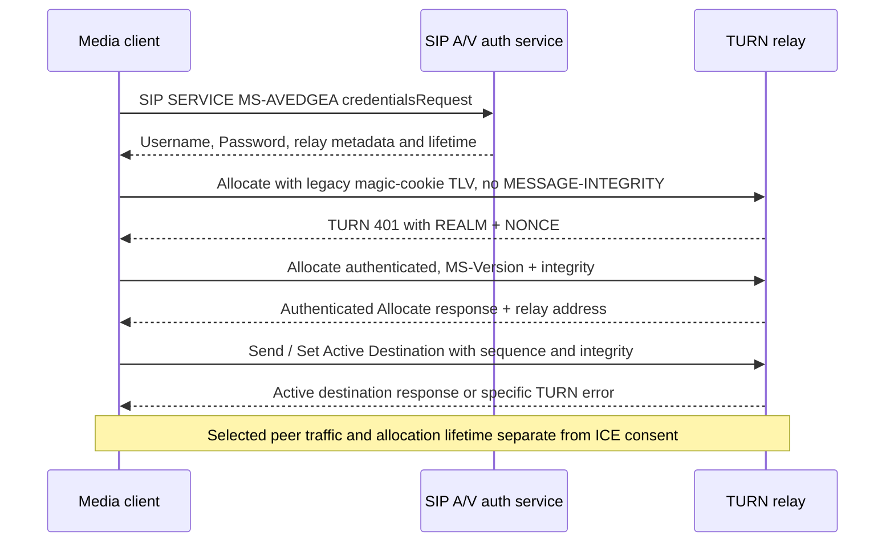

# Primary draft closure: legacy STUN and TURN references used by MS-TURN 21.0

**2026-10-22 — verified document discovery and selected normative cross-analysis, not complete RFC closure.** Microsoft owner's original `catalog/MS-TURN.pdf` **rev21.0, v20250520**, direct PDF text §§1.2,2.2.1–2.2.2.17,3.1.8–3.1.12,3.2.4.1–3.2.5.4. First-party IETF Datatracker original archived drafts and sections were checked. This file corrects an important ambiguity in the earlier research file [MS-TURN original analysis](ms-turn21-legacy-framing-hmac-allocation-rfc8656-2026-10-22.md). **An Internet-Draft being accessible does not make it a current standard.**

## I. Correct provenance: similarly named TURN-08s are not interchangeable

| Microsoft symbol | **Exact primary ID specified by MS-TURN §1.2** | Original first-party URL and date | Status |
|---|---|---|---|
| `IETFDRAFT-TURN-08` | **`draft-rosenberg-midcom-turn-08`** | https://datatracker.ietf.org/doc/html/draft-rosenberg-midcom-turn-08, **September 9, 2005** | FOUND; expired, replaced by separate `draft-ietf-behave-turn`. Normative clauses still require full analysis. |
| `IETFDRAFT-STUN-02` | **`draft-ietf-behave-rfc3489bis-02`** | https://datatracker.ietf.org/doc/html/draft-ietf-behave-rfc3489bis-02, **July 17, 2005** | FOUND; historical draft ultimately leading to RFC5389, not literally RFC5389 wire. |
| Historical *different* `-08` | `draft-ietf-behave-turn-08` | https://datatracker.ietf.org/doc/html/draft-ietf-behave-turn-08, **June 24, 2008** | FOUND but **NOT** the document that MS-TURN 21.0 references as IETFDRAFT-TURN-08. |
| Later IETF series | RFC5766 (2010) → RFC8656 (2020); STUN RFC5389 (2008) → RFC8489 (2020) | https://www.rfc-editor.org/rfc/rfc8656 ; https://www.rfc-editor.org/rfc/rfc8489 | Successor specifications. **Do not substitute their byte format, auth or lifetime rules for 2005 draft clauses without explicit negotiated support.** |

**Primary-level correction (research integrity):** prior documentation characterized the draft as 'TURN-08' without disambiguating publication family. A search engine can return the 2008 *BEHAVE* draft even when Microsoft explicitly requires the 2005 *MIDCOM* draft. The exact owner original MS-TURN §1.2 now resolves it; the source is accessible and shall no longer appear in any missing/unavailable list. **Research status changes to 'located / selected sections analyzed / remaining sections open'.**

## II. Original TURN 2005 draft clauses against Microsoft exceptions

| ID | Primary source and section | Normative source wording and scoped cross-effect |
|---|---|---|
| HIST-T01 | draft-rosenberg-midcom-turn-08 §9.1; MS-TURN §2.2.1 | Older draft defines Allocate Request 0x0003/response 0x0103/error 0x0113, Send Request 0x0004, Data Indication 0x0115, Set Active Destination Request 0x0006/response 0x0106/error 0x0116. This **predates modern TURN ChannelBind/ChannelData design** and must not be treated as current RFC8656 signaling. |
| HIST-T02 | Draft §9.2.3; MS-TURN §2.2.2.8 | TURN messages use **MAGIC-COOKIE TLV 0x000f** with value **0x72c64bc6** as first attribute. Contrast the modern STUN header fixed-cookie `0x2112A442`; they are not alternate encodings of the same field. |
| HIST-T03 | Draft §8.3; MS-TURN §§3.2.4.1,3.2.5.2 | Draft Allocate expects **previously obtained one-time credentials** and sends a signed Allocate; **Microsoft modifies** this to send initial Allocate **without MESSAGE-INTEGRITY**, receive 401+REALM+NONCE and then retry authenticated using long-term credentials provisioned via **MS-AVEDGEA**. **Client MUST NOT assume draft's Shared Secret Request handshake is Microsoft profile.** |
| HIST-T04 | Draft §8.4 | Error handling differs by reason: 420 remove unknown required attrs and retry; 430 reacquire credentials; 431 integrity failure alerts/retry with new creds optional; 300 use ALTERNATE-SERVER; 500 may back off then retry; 600 **MUST NOT retry**. The Microsoft exceptions in MS-TURN §§3.2.5.2,3.3.5 override applicable behaviors; **do not transfer complete draft table unchanged**. |
| HIST-T05 | Draft §7.7 | Server checks binding activity at expiration: if activity since timer epoch, reset by returned LIFETIME M; if no activity **MUST destroy** binding/one-time password, and close TCP associated connections. MS-TURN §3.3.2–3 mandates this timer by reference **with Microsoft overrides** (e.g. Microsoft long-term credential lifecycle differs). The old one-time-password deletion clause is not automatically server-MS-TURN requirement. |
| HIST-T06 | Draft §8.8 | Successful `Set Active Destination` enters **transitioning** state and arms **Ta=3 seconds**; 439 suggests a 2-second retry; 440 indicates unknown peer. **MS-TURN §§3.2.4.3, 3.2.5.3 explicitly SHOULD NOT implement this draft's transition-state computer** and after successful response **SHOULD assume** active peer is set. **Do not impose 3s Ta/2s transition retry as mandatory Windows client behavior.** |
| HIST-T07 | Draft §8.9 | UDP teardown sends authenticated Allocate refresh with **LIFETIME=0**, TCP teardown closes connection (draft behavior). MS-TURN §3.2.4.4 modifies teardown requests to include **MS-Sequence Number** and Microsoft integrity, so original draft-only packet is insufficient. |
| HIST-T08 | Draft §8.6–8.7 | `Send` and `Data Indication` carry framed data before a peer is active; `Data Indication` does not trigger reply. After successful Set Active Destination, certain data flows unencapsulated per transport conditions. Not a generic TURN permission/ChannelData rule in RFC8656. |
| HIST-T09 | draft-ietf-behave-rfc3489bis-02 §10.2.8 | Old STUN MESSAGE-INTEGRITY covers HMAC-SHA1 of message up to preceding attribute, padded in draft-defined manner. **Microsoft MS-TURN §2.2.2.3 introduces version-gated HMAC-SHA256** and its own key derivation. Hash selection cannot use old draft alone. |
| HIST-T10 | MS-TURN §2.2.2.3 | If either `MS-Version<0x03` (or absent), use **HMAC-SHA1**; both `>=0x03` → **HMAC-SHA256**. For SHA256 mode the owner original gives `K=HMAC-SHA256(Nonce, password)` and `Key=HMAC-SHA256(K, 0x01 || "TURN" || 0x00 || Username || Realm || 0x00000100 [network order])`, `Hash=HMAC-SHA256(Key, Text)`. Endian/length/username byte encoding details require direct figure+full paragraph confirmation before canonical test vectors; **these are TURN integrity keys**, unrelated to SRTP `a=crypto`. |
| HIST-T11 | MS-TURN §§3.1.8,3.1.10 | Per-message first TLV Magic Cookie; invalid header/cookie ignored, TCP disconnect SHOULD. Authenticated response integrity MUST be independently verified before accepting Allocate response or active destination. |
| HIST-T12 | MS-TURN §§2.1–2.2.2.21,3.2.4,3.2.5 | TURN requires **transport-specific framing** then 20-byte legacy TURN header. Extra Microsoft **MS-Sequence Number** and MS-Version bytes mean neither unextended 2005 draft nor 2020 RFC alone describes all traffic. |

### Actual authentication path (Microsoft 2025; synthesized from directly checked sections)

This does **not** claim the first request always results in 401 under all server configurations, nor that media traffic can flow before ICE's own connectivity and consent checks. Requested-address-family and alternate-server branches omitted.

## III. Error and trust-namespace matrix

| Source code | Meaning in correct context | Must NOT be conflated with |
|---|---|---|
| TURN 401 | Relay Allocate authentication challenge under TURN draft/MS-TURN | SIP REGISTER 401/407 + SIPAE negotiation |
| TURN 430 | Draft allocation/username failure (§8.4), implementation-specific MS-TURN mapping | **SIP 430 Flow Failed** (MS-SIPRE dialog repair), **STUN ICE2 430** |
| TURN 431 | Integrity of relayed request failed (draft §8.4) | Invalid SIPAE MIC or SRTP tag |
| TURN 439/440 | 2005 draft transition/unknown-destination errors; Microsoft says omit transition state computer | Modern TURN ChannelBind errors |
| ICE2 30s consent | Nominated media path peer consent validity | TURN allocation LIFETIME and user SIP SA expiry |

## IV. Remaining tasks — no false closure

**Accessible, only partially analyzed:** `draft-rosenberg-midcom-turn-08`, `draft-ietf-behave-rfc3489bis-02`. Remaining sections of both require full clause-level extraction; product notes for MS-TURN 21.0 still need audit. Full MS-TURN message-integrity Text computation, TCP/UDP framing, MS-Version, body endianness, IPv6 handling, complete 300/401/430/431/432/434/435/438/server errors, max attempts and peer-destination policies remain open. Do not turn this into protocol implementation or tests.

**Other draft references:** `draft-ietf-mmusic-ice-06`, `draft-ietf-mmusic-ice-19`, and `draft-ietf-mmusic-ice-tcp-07` are separately inventoried in companion [ICE edition comparison](ms-ice11-vs-ice2-19-historic-drafts-client-state-matrix-2026-10-22.md).

**Status: SOURCE REFERENCE RESOLVED; NORMATIVE SYSTEM NOT COMPLETE. No protocol code, real server contacts, interop tests, merge or release.**