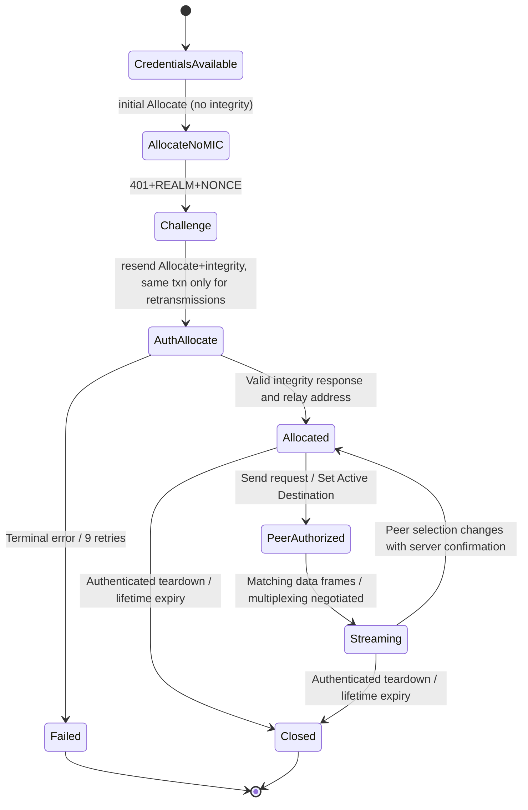

# MS-TURN 21.0: legacy allocation, challenge, framing, versioned HMAC and relay state

**Original-source tranche 2026-10-22. Research only.** First-party **[MS-TURN] v20250520, revision 21.0, 2025-05-20**, owner-supplied PDF and extracted text; directly inspected §§2.1–2.2.3, 3.1.8–3.1.12, 3.2.2–3.2.6, 3.3.2–3.3.5.1, original PDF pp21–44. Manifest official PDF URL [Microsoft original MS-TURN PDF](https://officeprotocoldocs-f5hpbjgea6b8gneq.b02.azurefd.net/files/MS-TURN/%5BMS-TURN%5D.pdf), SHA256 `9548b9d59916b50569e685afd43e0f8e9ada9c965c7c06decd665411b795743e`. [Microsoft Learn message-header clause](https://learn.microsoft.com/en-us/openspecs/office_protocols/ms-turn/8177788b-1f38-47a5-8a6f-348e89717922). Source explicitly delegates much state to **IETFDRAFT-TURN-08 and IETFDRAFT-STUN-02**, which remain an **unresolved archival prerequisite**. Official [RFC8656 (Feb 2020)](https://www.rfc-editor.org/rfc/rfc8656) **obsoletes RFC5766 and RFC6156**; it is *not automatically* wire-compatible with these historic Microsoft draft-defined extensions.

## 1. Exact client vs relay roles

| ID | Original clause | Verifiable requirement | Evidence limit |
|---|---|---|---|
| TURN-01 | §2.2.1 | Microsoft TURN header: **20 bytes**, 2-byte message type, 2-byte length, **16-byte (128-bit) Transaction ID**; excludes any transport-specific framing. Client **MUST** create new random Transaction ID for new transaction and **MUST reuse same ID for retransmissions**. | This is the *legacy MS-TURN* header, not RFC8489 STUN cookie-in-header 12-byte-ID. |
| TURN-02 | §§2.2.1–2.2.2.8,3.1.8,3.1.10 | **Magic Cookie is a first TLV attribute**: type `0x000F`, length 4, value `0x72c64bc6`, **MUST be first after header**. Missing/malformed framing or cookie → **ignore message**; if TCP, **SHOULD disconnect**. | Not the modern STUN fixed 0x2112A442 header cookie. |
| TURN-03 | §2.2.1 | Supported types `0x0003 Allocate`, `0x0103 Allocate response`, `0x0113 Allocate error`, `0x0004 Send request`, `0x0115 Data Indication`, `0x0006 Set Active Destination`, `0x0106 response`, `0x0116 error`. Unsupported legacy Shared Secret messages `0x0002/0x0102/0x0112` **MUST NOT be used**. | Parsing requires type allowlist. |
| TURN-04 | §§3.1.11–3.1.12,3.2.4.1 | Initial Allocate request **MUST omit Message Integrity**. Server issues 401 digest challenge with `REALM`, `NONCE` (and optional Alternate Server and MS-Version), **MUST NOT include Message Integrity**; subsequent retry includes Username, Realm, echoed server nonce, and authenticated integrity. | **TURN 401**, not SIP REGISTER 401 or SIPAE SA challenge. |
| TURN-05 | §2.2.2.3 | Authenticated TURN requests/responses **MUST** use Message Integrity as **last attribute**. If both sides advertise `MS-Version >=0x03` use **HMAC-SHA-256**; if either advertises <0x03 or is absent, use **HMAC-SHA-1**. | TURN HMAC is **relay authentication**, independent of SRTP packet transform/SDP suite conflict. |
| TURN-06 | §2.2.2.3 | Legacy HMAC-SHA1 integrity key derived from `MD5(username:realm:password)`; SHA256 mode uses separate two-stage nonce/password-driven HMAC key derivation. Original byte-level SHA256 key derivation syntax spans PDF pp23–25; **not fully transcribed** here and must be audited before treating wire digests as specified. | Cryptographic trust boundary; do not improvise key bytes. |
| TURN-07 | §3.2.2,3.2.6 | Client Allocate and Set Active Destination retransmission timer **SHOULD** be a fixed **650 ms** and stop after at most **9 retransmissions**. This is unrelated to MS-ICE2 consent 5 s/30 s, SIPCOMP Timer F 5s or RFC4028 session interval. | Note: specific actions only; other TURN requests depend on legacy draft. |
| TURN-08 | §3.2.4.1, §2.2.2.17 | `MS-Version` in Allocate **SHOULD** be included. For multiplexed TURN **UDP** require value **>=0x0005**; multiplexing **both UDP and TCP** requires **>=0x0006**. Version 4 enables requested-address-family behavior, version3 controls HMAC mode. | Independent capability gates, not one `turnSupported` flag. |
| TURN-09 | §§3.2.5.1–2, 2.2.2.15–17 | Success `Allocate` MUST be validated/authenticated, contain XOR-Mapped-Address; returned `Mapped Address` IPv4 or IPv6 and `MS-Alternate Mapped Address` for dual-stack depend on MS-Version and Requested Address Family. | XOR mapped identifies observed public client address, Mapped Address = allocated server relay address; **different purposes**. |
| TURN-10 | §3.2.5.2 | Allocate error codes **401, 431, 432, 434, 435, 438** → client **SHOULD retry** with proper identity/realm/nonce/integrity and version/address-family rules. **Other errors** follow draft TURN-08 §8.4, not an invented universal retry. | Need full per-code error meanings from §§2.2.2.12,3.3.5.1 and draft. |
| TURN-11 | §§3.2.4.2–3,3.2.5.3–4 | Peer permissions/data: `Send` and `Set Active Destination` must carry MS-Sequence Number and authenticated integrity. Set Active Destination response means assuming peer set, error means not; Microsoft says **SHOULD NOT** implement old draft's state computer for peer transition. | A peer selection transition does **not** implicitly consent to its SRTP crypto or media ICE. |
| TURN-12 | §§3.2.4.4–6 | Teardown uses `Allocate` with authenticated MS-Sequence Number; after Set Active Destination, direct non-TURN encapsulated data is framed according §3.1.9. Multiplexed TURN wraps each payload in specific wrapper. | Requires target TURN-08 teardown lifetime semantics; not identical to SIP BYE. |
| TURN-13 | §2.2.3 | Multiplexed TURN **Channel_ID 0xFF10**, 2-byte frame length, 8-byte MTURN_Session_ID, then variable payload. | Frame length counts bytes **after Length field**; this is a distinct data framing layer. |
| TURN-14 | §3.3.2–3 | Server MUST implement allocation lifetime timer per draft §7.7, MUST support UDP 3478 and SHOULD listen TCP 443. | Server requirements; do not assign server port obligation to Windows UAC. |
| TURN-15 | §§3.1.8–10 | All TURN messages require transport-specific header then TURN header then first Magic Cookie TLV; raw non-TURN data also requires transport-specific framing; framing verification failure means **ignore** (and TCP should disconnect). | Distinct from SIP/TLS compression frame and any TURN ChannelData implementation in RFC8656. |

### Allocation / permission / deallocation state model (conditional synthesis)

**Proof scope and diagram caveats:** Source requires client retry following server's 401, but a *new authenticated challenge response* is a new logical request/transaction and is **not** the same as retransmitting an identical previously sent request. Diagram omits Alternate Server, packet loss, permission expiry, all server-side auth failure branches and lease refresh details inherited from TURN-08. The state model is a **cross-clause synthesis**, not prescribed internal implementation state variables.

## 2. Critical three-way hash / credential separation

| Security system | Credential lifetime | Hash / integrity |
|---|---|---|
| MS-SIPAE REGISTER user SA | SIP/NTLM/Kerberos/TLS-DSK challenge state | SIP message integrity MIC/cnum, separate from relay |
| MS-AVEDGEA relay credential service | SIP SERVICE `application/msrtc-media-relay-auth+xml`, issued username/password/duration | Credentials subsequently used as TURN long-term user + password |
| MS-TURN relay authentication | TURN Allocate REALM/NONCE/MS-Version session | HMAC-SHA1 or HMAC-SHA256 based on **both** version values |
| MS-ICE2 peer checks/consent | ICE short-term `ice-ufrag`/`ice-pwd`, STUN transaction and consent deadline | STUN MESSAGE-INTEGRITY, fingerprint and consent checks |
| MS-SRTP/SSRTP media integrity | SDP-negotiated per-direction master key/SSRC | **Different unresolved** MS-SRTP 2025 hash vs RFC4568 advertised SHA1 crypto suite |

There are **multiple places mentioning HMAC-SHA256**; correctness requires binding each to the proper protocol. MS-TURN's explicit version negotiation **does not resolve** the MS-SRTP-14 vs SDPEXT-16 conflict.

## 3. RFC update/obsolescence conflicts

1. [RFC5766 (Apr 2010)](https://www.rfc-editor.org/rfc/rfc5766) standard TURN; [RFC8656 (Feb 2020)](https://www.rfc-editor.org/rfc/rfc8656) **obsoletes 5766 and RFC6156**. Microsoft MS-TURN 21.0 still explicitly normatively references **IETFDRAFT-TURN-08** (and IETFDRAFT-STUN-02). **Do not** map its 128-bit Transaction ID/magic-cookie attribute directly onto current RFC8489 STUN fixed header (12-byte ID).
2. Legacy allocated address vs modern TURN relayed transport address/permission/ChannelData requires an exact compatibility matrix: separate **TURN error 401/438** from **SIPAE 401/407** and **STUN check 430** and **SIP 430 Flow Failed**.
3. MS-TURN 21 has **product behavior note guards** for MS-Version, multiplexing, server-side alternate address and peer permissions; their applicability to the target **classic SfB Windows Full Client** is not fully verified.

## 4. Remaining evidence gates

- **TURN-G01:** Retrieve full [IETFDRAFT-TURN-08] and [IETFDRAFT-STUN-02] original versions, or mark unavailable; close delegated timing, auth, allocations and peer permissions.
- **TURN-G02:** Extract MS-TURN §2.2.2.3 complete SHA256 HMAC derivation, message padding, HMAC truncation, endianness, and alternate-server authentication guards, plus server validation errors §§3.3.5.1–3.3.5.6.
- **TURN-G03:** Entire §2.1 TCP/UDP/TLS/HTTP envelope and multiplexed packets with framing/MTURN Session ID and error rejection; cross-check RFC4571.
- **TURN-G04:** Confirm actual Windows-client versions, MS-AVEDGEA token issuance and relay list selection, MS-ICE2 relayed candidates and end-of-call teardown, token expiration/renewal.
- **TURN-G05:** Compare RFC8656/8489 with legacy draft-defined form at each relevant section, no automatic 'current supersedes old in Skype' assumption.
- **TURN-G06:** Clarify security of relay credentials and whether Microsoft media TURN traverses TLS under each deployment and version; old §3 server 3478/TCP443 is **not** evidence all links are encrypted.
- **TURN-G07:** Partial audio/video media failure/reconnect and media consent expiry vs relay allocation loss and SIP focus membership, including respective timers and trust boundaries.

**Normative status: selected original clauses verified, remainder still OPEN. NO protocol code, live server tests, merges or releases.**
