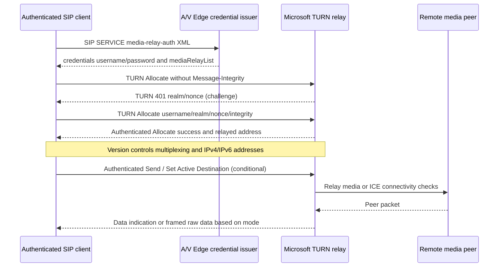

# Legacy Microsoft TURN 21.0: relay allocation, long-term challenge and media-route failure

**Date 2026-10-22, research only.** Owner-supplied original **MS-TURN rev21.0 v20250520**, `catalog/MS-TURN.pdf` and `.txt`, original pp38–47, sections **3.1.8–3.1.12, 3.2.2–3.2.6, 3.3.3, 3.3.5.1** (plus §2.2.2 attribute references). Earlier [MS-AVEDGEA 12.0](ms-sdpext16-srtp14-avedgea12-security-negotiation-conflict-2026-10-22.md) issues access credentials via SIP SERVICE. Microsoft primary catalog ID MS-TURN is rev21.0 (2025-05-20). Official RFC [RFC8656](https://www.rfc-editor.org/rfc/rfc8656), February 2020, **obsoletes RFC5766 and RFC6156**. Historical MS-TURN **instead extends `IETFDRAFT-TURN-08`** and references `TURN-05`. It is not safe to swap in RFC8656 semantics for the Microsoft-specific wire format.

## Specific client and server source requirements

| ID | Original source | Requirement and scope |
|---|---|---|
| TURN-L01 | MS-TURN §3.1.8–10 | TURN message must begin with transport-specific header, then TURN header, then **Magic Cookie as first TURN attribute**. Malformed inbound frame **MUST be ignored** and TCP SHOULD be disconnected. Authenticate using Message-Integrity as **last attribute** on authenticated messages. |
| TURN-L02 | §3.1.12 | Microsoft implements **long-term credential challenge** in place of draft shared-secret mechanism. Client sends unauthenticated initial Allocate; server returns error with Realm and Nonce, then client sends authenticated Allocate. |
| TURN-L03 | §§3.2.2,3.2.6 | Client retransmission for Allocate / Set Active Destination SHOULD use **fixed 650 milliseconds**, **at most nine attempts**. Exhaustion SHOULD mark TURN transaction failed, not force SIP registration failure. |
| TURN-L04 | §3.2.3 | Before allocation client MUST know TURN address, peer address and long-term credentials. Credential token acquired through MS-AVEDGEA is a separate step; avoid equating its SIP response 200 with successful TURN Allocate. |
| TURN-L05 | §3.2.4.1 | First Allocate **MUST NOT** have Message-Integrity and **SHOULD** carry MS-Version. MS-Version >=5 for multiplexed UDP; >=6 for multiplexed TCP. Include optional MS-Service Quality where supported. |
| TURN-L06 | §§3.2.4.2–4 | Send and Set Active Destination require MS-Sequence Number and Message-Integrity. Explicit allocation teardown also sends authenticated Allocate under older draft mechanism, not necessarily modern TURN Refresh. |
| TURN-L07 | §3.2.5.1 | Successful Allocate response **MUST** validate transport framing **and** authentication, and include XOR Mapped Address. Optional mapped and alternate mapped address distinguish IPv4/IPv6 allocated public addresses, separate from reflexive external client address. |
| TURN-L08 | §3.2.5.2 | On TURN Allocate error **401,431,432,434,435,438**, client **SHOULD retry** with **Username, Realm, Nonce** from prior 401 challenge and authenticate the request. These are **TURN errors, not SIP registration 401/407**. |
| TURN-L09 | §3.3.5.1 | Server missing MIC → **TURN 401** with Realm/Nonce and no MIC. Missing/unknown username → **432/436**; missing realm → **434**, missing nonce → **435**, stale nonce → **438**, authentication integrity failure → **431**. Never misapply HTTP or SIP meanings. |
| TURN-L10 | §3.3.5.1 | Server allocation version controls IP families: MS-Version absent/<=3 gives IPv4; >=4 can negotiate IPv4, IPv6 or both according to Requested Address Family. For version >=5 UDP or >=6 TCP, response **MUST** include multiplexed session ID if relevant. |
| TURN-L11 | §3.3.5.1 | Server listen default UDP **3478**, TCP **443** SHOULD. If allocation fails, server sends **300 Try Alternate** (when alternate known) or **500 Server Error**. Server chooses among implementation-specific relay addresses, not the client by guess. |
| TURN-L12 | §§3.2.5.3–6 | Set Active Destination successful response should establish relay active peer; response framing+auth both required. Raw packets from active peer require dedicated frame, distinct from TURN Data Indication. |
| TURN-L13 | §§3.3.2,3.2.4.4 | Server allocation lifetime timer is defined by historical TURN draft; client teardown only ends that allocation, **does not imply SIP dialog BYE**, crypto-key expiration or conference focus signout. |

## Two independent challenges (demonstrative source synthesis, not guaranteed universal packet order)

**Synthesis limits:** Every media session need not use TURN; the server-side connection may be UDP/TCP per topology, and exact allocation/connectivity ordering relative to SIP offer is not established by this diagram. The 401 here is a **TURN** error and must not start NTLM/Kerberos SIP REGISTER authentication. An A/V Edge credential token (username/password) is sensitive despite being Base64 encoded.

## Conditional state/failure classification

- `TURN frame incorrect` → discard and TCP disconnect SHOULD; **not** application SIP 400.
- `Allocate unauthenticated` → expected TURN 401 challenge; not a signal an ongoing SIP registration is invalid.
- `Allocate successful with verified XOR-MAPPED-ADDRESS` → relay candidate available; not proof ICE nomination or consent.
- `TURN 438 stale nonce` → retry under §3.2.5.2; not identical to SIP 430 dialog recovery.
- `TURN 300` → alternate relay policy; security and trust for alternate server MUST be checked in original complete draft and product notes before defining a concrete follow route.
- `No response after nine recommended attempts` → failed relay transaction; media may have other candidates, so do not automatically terminate entire SIP dialog without ICE/offer-answer context.
- `TURN allocation torn down` → relay permission removed, but SRTP and SIP lifecycle must be handled separately.

## RFC updates and blockers

- RFC8656 obsoletes RFC5766 and RFC6156 but Microsoft 2025 doc still mandates draft-specific Magic Cookie placement, MS-Version, MS-Sequence Number, Set Active Destination and multiplexing. These are **not** interchangeable packets with RFC8656 ChannelBind/Refresh.
- Missing normative text `IETFDRAFT-TURN-08` & `TURN-05` must be located and authenticated/versioned or marked inaccessible; once obtained, follow all §3.2.4 / §3.3.5 cross-references and state machines.
- Need original MS-TURN §§2.1–2.2 binary attribute field encodings, MIC canonicalization, transports framing, consent/TURN TCP, permission expiration, nonce policy and reallocation after network moves.
- Need review MS-TURN §7 product notes <25>–<40> for legacy client behavior, including multiplexed TCP and IPv6.
- Need verify MS-ICE2 §3.1.5.1 supported use of RFC5766 alternative TURN vs proprietary MS-TURN, and version negotiation from provisioned A/V Edge response.

**Not a complete TURN/full-client analysis. No implementation code, live server checks, merges or releases.**
