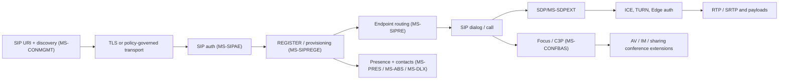

# Protocol dependency graph — provisional coverage v0.1

**Evidence boundary:** Rows are *topological links* identified in MS-OCSPROT overview §§2.2.2–2.2.3, MS-SIPREGE live §3.1.2.5.1 and §1.2.1, or architectural candidates. Legend: **O** = directly named by overview (published rev 9.0); **X** = explicit cross-reference in selected live subsection (its exact release revision still open); **I** = inference that requires closure / product relevance check. A graph edge is **not** a claim of normative conformance.

| Feature/source | Depends on | Edge | Evidence / status |
| --- | --- | --- | --- |
| Connection discovery MS-CONMGMT | DNS SRV, A, RFC 2782, DHCP RFC 2131/2132/3361 | X | [MS-CONMGMT §3.1.5](https://learn.microsoft.com/en-us/openspecs/office_protocols/ms-conmgmt/40d79c10-2275-4e52-bb4b-67c703d092c3); RFC 2782 algorithm not yet fully checked |
| Trusted SIP transport MS-CONMGMT | TLS/X.509 trust, long-lived reliable connection | O | [MS-OCSPROT §2.2.2.1](https://learn.microsoft.com/en-us/openspecs/office_protocols/ms-ocsprot/bdcd1606-11c6-4457-a708-3d1c296259a0), certificate clauses open |
| REGISTER MS-SIPREGE | RFC 3261, MS-SIPAE, MS-SIPRE, MS-PRES, MS-CONMGMT | X | [MS-SIPREGE §3.1.2.5.1](https://learn.microsoft.com/en-us/openspecs/office_protocols/ms-siprege/8b6cbbb4-b398-4b55-847d-950b9a8d3010), [MS-OCSPROT §2.5.2](https://learn.microsoft.com/en-us/openspecs/office_protocols/ms-ocsprot/45e475a0-b534-469a-892e-6bd6ae42fc6e) |
| SIP authentication MS-SIPAE | RFC 3261 authentication; NTLM, Kerberos, TLS-DSK; GSS/RFC 2743 and Windows MS-KILE/MS-NLMP to investigate | O/I | [MS-OCSPROT §2.2.2.1](https://learn.microsoft.com/en-us/openspecs/office_protocols/ms-ocsprot/bdcd1606-11c6-4457-a708-3d1c296259a0); detailed chain OPEN |
| SIP routing MS-SIPRE | RFC 3261; MS-SIPREGE's endpoint identity / GRUU | O/X | [MS-SIPREGE §3.1.2.5.1](https://learn.microsoft.com/en-us/openspecs/office_protocols/ms-siprege/8b6cbbb4-b398-4b55-847d-950b9a8d3010) |
| Presence / contacts MS-PRES | SIP subscription and notifications, registration, server authorization, MS-ABS, MS-DLX | O/I | MS-OCSPROT §§2.2.2.1, 2.5.2; contacts/permission schema details OPEN |
| IM MS-SIPAPP + SIP | SIP MESSAGE / INVITE, dialogs, conference focus as applicable | O/I | MS-OCSPROT §§2.2.2.1, 2.5 and 3; method-level authoritative mapping OPEN |
| Multi-party conference MS-CONFBAS | MS-CONFPRO, MS-CONFIM, MS-CONFAV, MS-CONFAS | O | [MS-OCSPROT §2.2.2.2](https://learn.microsoft.com/en-us/openspecs/office_protocols/ms-ocsprot/bf570f65-7429-4df3-8f81-751956ff314f) |
| Multiparty video controls MS-XMLMC | SIP INFO; conferencing state | O | Same overview §2.2.2.2; exact XML grammar OPEN |
| Media offer/answer MS-SDPEXT | SIP/SDP, RFC 3550/RFC 3551, codec/payload specs | O | [MS-OCSPROT §2.2.3.1](https://learn.microsoft.com/en-us/openspecs/office_protocols/ms-ocsprot/14c988fa-2da1-444f-84b9-1eab89c8264c); offer/answer revision and interoperability matrix OPEN |
| RTP media MS-RTP | RFC 3550, RFC 3551, MS-DTMF/H264PF/RTVPF/RTPRADEX | O | Same overview §2.2.3.1; exact payload/feedback OPEN |
| SRTP MS-SRTP / MS-SSRTP | RTP/RTCP, key derivation negotiated by SDP/other profile | O/I | Same overview §2.2.3.1; cryptographic algorithms/key management OPEN |
| Application sharing MS-RTASPF | MS-RTP and MS-RDPBCGR | O | Same overview §2.2.3.1; specific graphics streams OPEN |
| Network traversal MS-ICE/MS-ICE2 | MS-TURN; MS-AVEDGEA edge tokens; MS-ICE2BWM/MS-TURNBWM policies | O | [MS-OCSPROT §2.2.3.2](https://learn.microsoft.com/en-us/openspecs/office_protocols/ms-ocsprot/b3382ff5-585c-4cf4-ad1f-c962a49d6ad0); choose ICE generation by negotiated client/server capabilities |
| PSTN/enterprise voice | MS-OCPSTN, MS-EUMR, MS-OCEXUM, MS-EUMSDP, MS-E911WS, MS-DTMF | O | MS-OCSPROT §§2.2.2.1, 2.2.3.1; policy/routing/failover OPEN |
| Diagnostics and quality | MS-OCER, MS-QoE | O/X | MS-OCSPROT §2.2.2.1, MS-SIPREGE §3.1.2.5.1 |
| Web/auxiliary | MS-OCAUTHWS, MS-RGSWS, MS-PSOM | O | MS-OCSPROT §2.2.2.1; HTTP and SOAP envelopes/auth remain OPEN |

## Coarse graph (NOT a completed sequence)

## Normative reference crawler policy

For **every** MS document: read §1.2.1 normative and §1.2.2 informative lists and record edge `referrer+revision+section → target ID+explicit edition+usage+relevance+inspection status`; recurse until no **relevant** new nodes, do not blindly assume every infrastructure/server-only document is client mandatory. Record each exclusion with a reason. Then repeat for every applicable RFC's **Updates/Obsoletes** graph and incorporated references, plus Microsoft product behavior appendix. This traversal has **not** been completed.

## Known version / scoping traps

- RFC 3265 (cited in older Microsoft sections) and RFC 6665 represent distinct SIP event editions; do not replace without investigating Microsoft's exact reference and transaction differences.
- SDP RFC 4566 vs RFC 8866 and ICE RFC 5245 vs RFC 8445 require edition-conscious profiles.
- MS-SIPREGE explicitly references **draft-ietf-sip-gruu-10** in its normative refs and in registrar processing. Do not substitute RFC 5627 wire rules uncritically.
- In [MS-CONMGMT §3.1.5](https://learn.microsoft.com/en-us/openspecs/office_protocols/ms-conmgmt/40d79c10-2275-4e52-bb4b-67c703d092c3), TCP entries occur in discovery, but this does **not** authorize downgrading an already required trusted TLS session.
- MS-OCSPROT 2015 PDF revision 4.4 has a substantially older system inventory. Use historical diagrams only for change comparison, never as modern proof.

## MS-SIPAE deep-clause cross-reference additions (live §§3.2.5.1–3.2.5.2; published rev 11.0 edition matching OPEN)

| Origin | Explicit target | Dependency and status |
| --- | --- | --- |
| MS-SIPAE §3.2.5.1 | MS-KILE, MS-NLMP | Kerberos/NTLM GSS context, ticket, identity flags, default Kerberos clock skew; needs full Windows release review |
| MS-SIPAE §§3.2.5.1–3.2.5.2 | RFC 3548 §§3,6 | Base64 GSS tokens and base16 signature; historic reference vs newer RFC 4648 must be reconciled |
| MS-SIPAE §3.2.5.1 | RFC 2246, 4346, 5246; RFC 2716 §3.5 | Legacy TLS-DSK handshake/key schedule and PRF; modern TLS security compatibility unresolved |
| MS-SIPAE §3.2.5.2 | RFC 2743 §2.3.2, MS-NLMP §3.1.4 | GSS_VerifyMic path for Kerberos and NTLM, fixed NTLM SSPI sequence 100 in described clause |
| MS-SIPAE §3.2.5.2 | RFC 2104 | TLS-DSK HMAC server MIC verification and SA replay guard |
| MS-SIPAE §§3.2.5.1–3.2.5.2 | MS-SIPAE §§2.2.3, 3.2.4.1, 3.2.5.5 | Header grammar, outgoing canonicalization / cryptographic responses, Digest alternative: **still unreviewed** |

Source: [§3.2.5.1](https://learn.microsoft.com/en-us/openspecs/office_protocols/ms-sipae/71b7e07d-505f-4ca6-9577-0a27bd12b0e9) and [§3.2.5.2](https://learn.microsoft.com/en-us/openspecs/office_protocols/ms-sipae/26fd795e-5567-4d33-a09b-9c501f7ff01c). Refer to [authentication clause review](sipae-authentication-clause-review.md). These are **not full source closure**.
